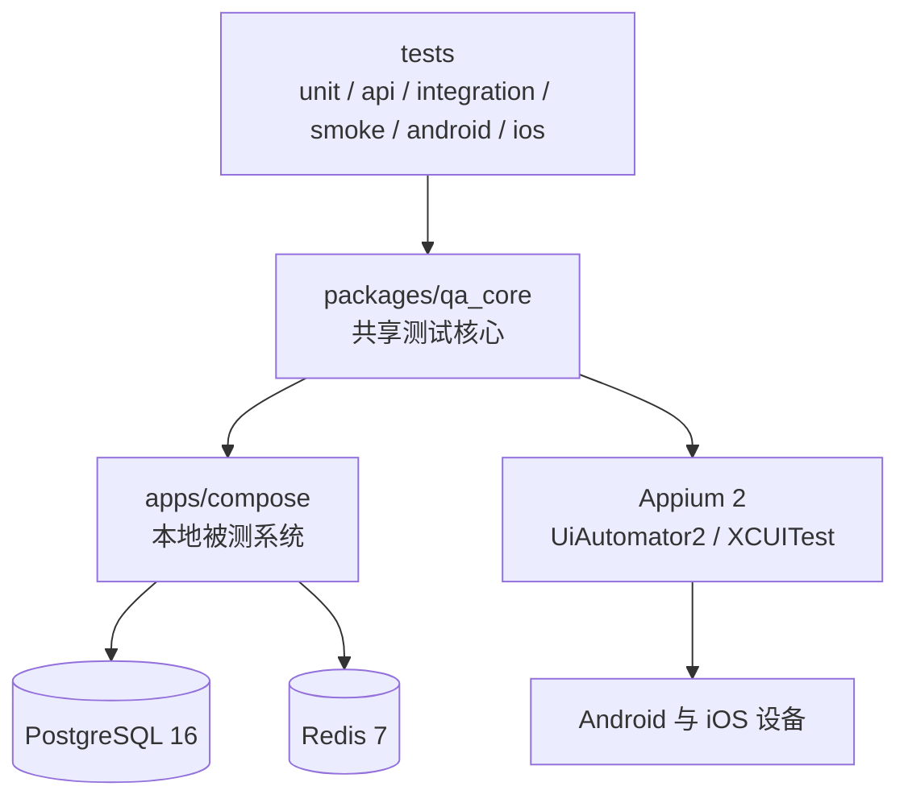

# Quality Engineering Lab

企业级质量工程平台：接口自动化、数据库与缓存测试、Android/iOS Appium 2、
性能工程、缺陷闭环，以及 AI/Agent 增强。

- 目标与验收标准：[docs/GOALS.md](docs/GOALS.md)
- 32 周执行计划：[docs/PLAN.md](docs/PLAN.md)
- 结构与技术栈总览：[docs/architecture/project-overview.md](docs/architecture/project-overview.md)
- 最新进度：[reports/README.md](reports/README.md)
- 全部设计文档：[docs/README.md](docs/README.md)

在手机上阅读时，上面两个索引页就是入口：GitHub App 与手机网页版都能直接渲染
Markdown 和下面的 Mermaid 结构图。

## 结构一览



更完整的结构图、技术栈表和端到端调用链见
[docs/architecture/project-overview.md](docs/architecture/project-overview.md)。

## 快速开始

```powershell
uv sync
.\scripts\start_sut.ps1
uv run python scripts/check_sut.py
uv run pytest tests/unit -q
```

环境准备、数据库与移动端步骤见 [docs/PLAN.md](docs/PLAN.md)；
出现失败时先查 [docs/runbooks/](docs/runbooks/)。

## 文档地图

| 目录 | 内容 |
| --- | --- |
| [docs/README.md](docs/README.md) | 全部设计文档索引，按主题分组 |
| [reports/README.md](reports/README.md) | 全部周报与日报，最新在最前 |
| [docs/adr/](docs/adr/) | 架构决策记录，记录问题、取舍和后果 |
| [docs/architecture/](docs/architecture/) | 仓库结构、技术栈与移动端调用链 |
| [docs/runbooks/](docs/runbooks/) | 失败排查手册 |
| [docs/test-strategy/](docs/test-strategy/) | 测试策略与缺陷生命周期 |
| [packages/qa_core/](packages/qa_core/) | 共享测试核心代码 |
| [apps/compose/](apps/compose/) | 本地被测系统与 Compose 编排 |
| [reports/](reports/) | 每日与每周进度报告 |

两个索引页由 `uv run python scripts/build_doc_index.py` 重新生成，写完新的
日报或周报后运行一次即可；加 `--check` 可以检查是否过期。

## CI

[.github/workflows/](.github/workflows/) 下有三条流水线：质量门、SUT 集成、
iOS 冒烟。
