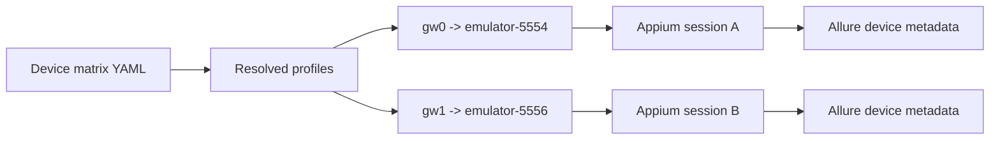

# Android Device Matrix and Parallel Evidence

Week 16 moves the Android suite from one fixed emulator to a configured device
matrix. The matrix is also the boundary that keeps parallel pytest workers
from sharing one Appium device.

## 1. Matrix Source

`configs/android-device-matrix.yaml` is the source of truth:

| Logical ID | Role | Default UDID | Platform version | Required |
| --- | --- | --- | --- | --- |
| `local-primary-avd` | primary regression | `emulator-5554` | 15 | yes |
| `local-parallel-avd` | parallel regression | `emulator-5556` | 15 | no |
| `physical-android` | physical-device compatibility | from environment | from environment | no |

Each entry has a `udid_env` override. The default local setup maps:

```text
QA_ANDROID_UDID_PRIMARY    -> local-primary-avd
QA_ANDROID_UDID_SECONDARY  -> local-parallel-avd
QA_ANDROID_UDID_PHYSICAL   -> physical-android
QA_ANDROID_PLATFORM_VERSION_PHYSICAL -> physical platform version
```

An optional device with no resolved UDID is omitted. A required device with no
UDID fails during fixture setup. Duplicate UDIDs are rejected because two
workers must never target the same device.

`QA_ANDROID_DEVICE_IDS` restricts the active profiles while preserving YAML
order. The runner uses it to select a physical-only or mixed AVD/device run:

```text
QA_ANDROID_DEVICE_IDS=physical-android
QA_ANDROID_DEVICE_IDS=local-primary-avd,physical-android
```

## 2. Worker Assignment

pytest-xdist sets `PYTEST_XDIST_WORKER` and
`PYTEST_XDIST_WORKER_COUNT`. The Android fixture maps that worker identity to
one matrix entry:

```text
gw0 + 2 workers -> profile[0]
gw1 + 2 workers -> profile[1]
```

If more workers are requested than active devices, setup fails with the worker
count and active-device count. It does not silently allow two sessions to
control one emulator.



## 3. Fixture and Test Layers

The dependency-free fixture app now exposes stable controls for:

- app, resume, and permission status;
- text input, submit, reset, and validation state;
- a counter and a native dialog;
- a debuggable WebView;
- a custom deep link;
- Camera permission requests.

The 60-test Android suite contains:

| Area | Tests |
| --- | --- |
| Device and app baseline | 12 |
| Form validation and input | 12 |
| Counter state | 4 |
| Dialog | 4 |
| Directional gestures | 4 |
| Permission state | 4 |
| Hybrid context | 4 |
| Files and clipboard | 4 |
| Deep link and foreground recovery | 6 |
| Existing Week 13-15 smoke tests | 6 |

The new matrix module keeps one Appium session per worker/device. Every test
restarts the fixture Activity with `stop=True`, which gives test-level app
state isolation without creating 54 new sessions.

## 4. Timeouts and Failure Boundaries

UiAutomator2 defaults `adbExecTimeout` to 20 seconds. Under two concurrent AVDs,
`adb shell dumpsys package ...` exceeded that default once. The project now
sets:

```text
QA_ANDROID_ADB_EXEC_TIMEOUT_MS=60000
```

This is a bounded device-command deadline, not a retry. Raising it makes the
real host delay observable while retaining a hard failure.

The fixture also distinguishes:

- missing ADB: explicit skip;
- offline device: explicit skip;
- unavailable Appium: explicit skip;
- missing fixture APK: explicit skip;
- command or assertion failure on a ready device: test failure.

## 5. Evidence

Every result records:

- logical device ID;
- role;
- UDID;
- platform version from the matrix.

On a failing test call, the hook attaches:

- screenshot;
- page source;
- up to 1000 recent logcat lines.

The runner writes raw Allure results and a pytest console log under:

```text
artifacts/android-matrix/<run-id>/
```

## 6. Execution

```powershell
.\scripts\run_android_matrix.ps1 `
  -PrimarySerial emulator-5554 `
  -SecondarySerial emulator-5556 `
  -Workers 2 `
  -AppiumPort 4723
```

Single-device debugging:

```powershell
.\scripts\run_android_matrix.ps1 -Workers 1 -SkipFixtureBuild
```

Mixed AVD and physical device:

```powershell
.\scripts\run_android_matrix.ps1 `
  -PrimarySerial emulator-5554 `
  -PhysicalSerial <physical-device-serial> `
  -Workers 2
```

Physical device only:

```powershell
.\scripts\run_android_matrix.ps1 `
  -PhysicalSerial <physical-device-serial> `
  -Workers 1
```

The runner reads the physical device's Android release during the run and
records the selected profile IDs in Allure.

## 7. Boundaries

- Both exercised AVDs use Android 15 AOSP ATD. This proves parallel isolation
  and scale on one API level.
- The mixed run was verified on one Redmi K50 running Android 14. This is one
  physical-device chain, not a comprehensive OEM or version matrix.
- The AOSP ATD image does not represent OEM permission dialogs, launcher
  policies, notifications, or vendor-specific background restrictions.
- Appium load, host CPU, memory, and emulator acceleration remain shared
  infrastructure. A device matrix isolates sessions, not host saturation.
