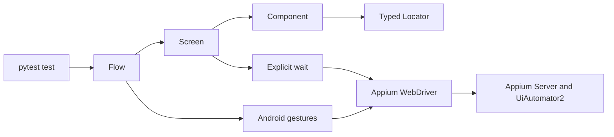
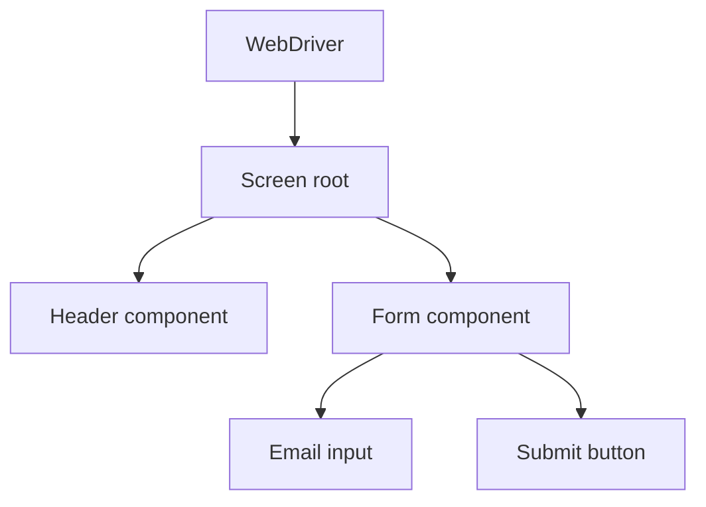

# Android Screen Framework

## Purpose

Week 14 adds the first reusable Android UI layer above the raw Appium session.
It keeps locator strategy, explicit waits, component boundaries, business-flow
ordering, and gestures separate so a failure points to one design boundary.



## Locator Strategy

`qa_core.mobile.locators.Locator` always carries a strategy, value, and optional
human-readable description. Screens and components never pass an untyped
`(by, value)` pair through business code.

Prefer locator strategies in this order:

| Priority | Strategy | Use when | Main risk |
| --- | --- | --- | --- |
| 1 | Accessibility ID | The target exposes a stable content description or label | Product copy or accessibility changes |
| 2 | Resource ID | The app owns a stable `package:id/name` identifier | Third-party or obfuscated IDs change |
| 3 | UiAutomator | A relationship, count, or visible text expression is required | String expressions are harder to review |
| 4 | XPath | No stable native strategy exists | Slow and tightly coupled to hierarchy |

Resource IDs from Android system packages are acceptable for infrastructure
smoke tests, but should not be treated as stable identifiers for a real product
screen.

## Explicit Waits

`MobileWait` wraps `WebDriverWait` with a bounded `WaitPolicy`:

```text
timeout_seconds
+ poll_interval_seconds
+ expected element state
+ locator identity
= one explicit wait with actionable timeout evidence
```

Supported states are `visible`, `present`, `clickable`, and `gone`. A timeout
raises `ElementWaitTimeout`, which names the locator and the state that was not
reached. Tests do not use fixed `sleep`.

The default values come from:

```text
QA_ANDROID_UI_WAIT_TIMEOUT_SECONDS=10
QA_ANDROID_UI_WAIT_POLL_SECONDS=0.25
```

The timeout is a deadline, not a guarantee that an element will appear. A
shorter timeout should fail with evidence rather than conceal a slow or broken
screen.

## Screen and Component Boundaries

`Component` owns one root locator and searches descendants inside that root.
`Screen` is a full page whose root must become visible before the screen is
considered ready.



This has two practical effects:

1. A duplicate label in another part of the screen does not match a component
   query.
2. A component can be composed into more than one screen without copying
   locators or actions.

Application-specific screens should declare locators as class attributes and
live close to the tests for that application. The generic mechanics stay in
`qa_core.mobile`.

## Business Flows

`Flow` executes named state transitions in order. It does not retry or reorder
steps. When a step raises, `FlowStepFailure` records:

- flow name;
- one-based step position in the message;
- zero-based step index for automation;
- step name;
- original exception as `__cause__`.

A flow therefore describes business order, while screens own UI interaction and
tests own assertions.

## Gestures

`qa_core.platforms.android.gestures.AndroidGestures` uses the UiAutomator2
`mobile: swipeGesture` command. The rectangle, direction, percent, and speed are
explicit arguments. Invalid percentages, speeds, or rectangles fail before a
device command is sent.

Use element-level `tap()` for normal controls. Use coordinate or swipe gestures
only when the interaction is inherently spatial, such as dismissing a sheet or
scrolling a surface without a stable child control.

## Current Evidence

The Android smoke suite creates a real Appium session, resolves
`android:id/content` through the typed screen root, performs one UiAutomator2
swipe, verifies the session still targets the configured package, and quits the
session.

```text
SMOKE-ANDROID-SESSION-001
SMOKE-ANDROID-SCREEN-001
```

## Boundaries

Week 14 supplies the framework skeleton. It does not yet supply:

- a real product screen with stable business locators;
- iOS gesture adaptation;
- device-specific gesture tuning;
- an image or OCR locator;
- automatic locator healing;
- implicit retries around business steps;
- the 60-test, dual-AVD, and real-device suite planned for Week 16.
