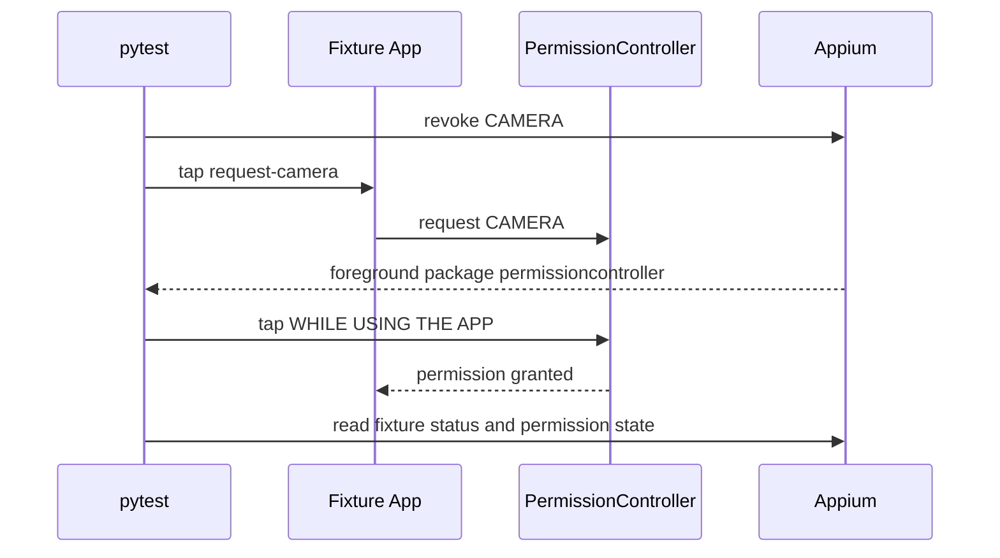

# Android System Interactions

## Purpose

Week 15 extends the screen framework into behavior that crosses the application
boundary: permission dialogs, WebView contexts, files, the clipboard, deep
links, and foreground recovery.

```mermaid
flowchart LR
    T[pytest] --> A[Android test session]
    A --> P[Permission dialog]
    A --> W[WebView context]
    A --> F[Device file and clipboard]
    A --> I[Intent and deep link]
    I --> R[Foreground recovery]
    P --> C[permissioncontroller]
    W --> CD[Chromedriver]
    F --> S[/sdcard]
```

## Test Fixture App

The AOSP Fake System App exposes no launcher Activity and cannot request a
runtime permission. Week 15 therefore adds a dependency-free Android fixture
under `apps/android-fixture/`.

The fixture provides:

| Capability | UI or contract |
| --- | --- |
| Camera permission | `request-camera` accessibility ID |
| Permission result | `fixture-status:camera-granted` or `fixture-status:camera-denied` |
| Hybrid WebView | `WEBVIEW_com.example.qaweek15` |
| Web content | `#fixture-hybrid` and `#fixture-web-button` |
| Deep link | `qaweek15://permission/...` |
| Resume evidence | `fixture-resume` accessibility ID |

`apps/android-fixture/build.ps1` compiles Java with the installed Android SDK,
creates `classes.dex` with `d8`, packages and signs the APK, then installs it
with ADB. Generated APKs and the debug keystore stay under
`artifacts/android-fixture/` and are not committed.

## Session Isolation

The first cross-App run exposed a real lifecycle boundary: creating a session
for a package without a launcher Activity does not guarantee that package is in
the foreground. The Android test fixtures therefore always launch an explicit
package/Activity component after session creation.

```text
create Appium session
-> start explicit component
-> wait for package + Activity
-> execute the test
-> quit session
```

This prevents a previous WebView or fixture app from leaking into the next test.

## Permission Flow

`AndroidPermissions` normalizes duplicate `mobile: getPermissions` output into
requested, granted, and denied sets. It accepts only full Android permission
names and verifies the resulting state after grant or revoke.

The real permission-dialog smoke follows this sequence:



Permission state assertions are deterministic. System-dialog assertions also
wait for the real `com.android.permissioncontroller` Activity; they do not use a
fixed sleep.

## Hybrid Context

`AndroidWebView` selects the exact `WEBVIEW_<package>` context and uses a
context manager to restore the previous context.

Switching into a WebView requires a compatible Chromedriver. Local Appium is
started with the `chromedriver_autodownload` feature by
`scripts/start_appium.ps1`. The current AVD uses Chrome/WebView 124 and
Chromedriver 124.0.6367.207.

A stale WebView from another running app can make Chromedriver fail before it
reaches the requested context. Tests should target the exact package context
and close unrelated WebView processes.

## Device Files and Clipboard

`AndroidFiles` encodes UTF-8 text as base64 for Appium push/pull operations and
uses `mobile: deleteFile` for cleanup. Paths must be absolute and cannot contain
`..`.

`AndroidClipboard` restores the previous clipboard text in a context manager.
Tests use unique file names and restore permissions, clipboard state, and
foreground state after the assertion.

## Intents and Recovery

`AndroidIntent` builds the payload for `mobile: startActivity`.
`AndroidActivities` can wait for a package or an exact package/Activity pair.
`AndroidActivityTimeout` reports both the expected and actual foreground target.

The recovery smoke starts the fixture through a custom deep link, sends HOME,
waits for the launcher package, launches the component again, and verifies that
the fixture is foreground with a new resume observation.

## Boundaries

- Week 15 runs on one Android 15 AOSP AVD.
- The fixture proves Appium behavior, not the final product's UI.
- A real product may use multiple permission groups, custom rationale screens,
  Chrome Custom Tabs, file providers, or app links that need separate tests.
- Notification shade and OEM permission UI are not asserted on the current
  AOSP ATD.
- Multi-device recovery and process-death injection belong to later Android and
  fault-recovery plans.
