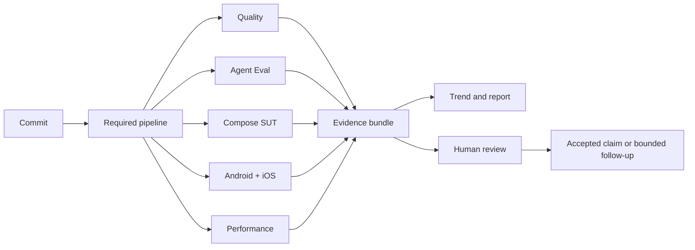

# Comprehensive Acceptance and Agent Evaluations

## 1. Acceptance Flow



Week 32 uses one commit to trigger the required execution paths. Each job
uploads machine-readable evidence to GitHub Actions. The trend job downloads
that evidence, synthesizes records for failed required jobs, and fails when the
accepted job set is incomplete.

## 2. Deliverable to Evidence Map

| Deliverable | Implemented evidence | Executed evidence |
| --- | --- | --- |
| One-commit quality pipeline | `.github/workflows/week31-quality-pipeline.yml` | GitHub Actions run |
| API defect repair | `apps/compose/api/app.py`, `tests/api/test_negative_inputs.py` | real Compose SUT and API test |
| Android path | emulator job and existing mobile suites | `week31-android` artifact |
| iOS required path | macOS Simulator job | `week31-ios-simulator` artifact |
| Optional cloud boundary | optional BrowserStack job | `PASS` or `BLOCKED` artifact |
| Performance path | isolated smoke job | `week31-performance` artifact |
| Agent Golden Tasks | `ai/golden_tasks/week32.jsonl`, eval runner | `week32-ai-eval` artifact |
| Agent permissions | `ai/agents/registry.yaml`, typed loader, unit tests | Quality job and local unit tests |
| Decision record | `docs/adr/0014-...md` | reviewable repository source |
| Interview package | `docs/interview/` | source links plus run/artifact index |

## 3. Agent Evaluation Contract

The implemented Agent is an evidence-triage baseline, not an LLM. It accepts
known signal states plus explicit evidence references. It returns one of:

- `PASS`: every signal is `PASS` and evidence is present.
- `FAILED`: at least one signal is `FAILED`.
- `BLOCKED`: no failure exists, but one signal is incomplete.
- `INSUFFICIENT_EVIDENCE`: evidence or a known signal state is missing.

Golden Tasks cover successful API/mobile/performance paths, failures, blocked
platforms, and missing-evidence cases. The regression record documents an
initial false pass when an empty artifact set was classified as successful.

## 4. Read-Only Monitoring Registry

The registry defines performance, flaky, CI, iOS environment, and weekly
maintenance monitors. All five require evidence and share these boundaries:

- read-only tools only;
- no Shell execution;
- no repository writes;
- no threshold changes;
- no defect creation or closure;
- no merge or release authority;
- structured proposed actions with human approval required.

The registry is declarative because no monitor needs autonomous execution to
produce a reviewable finding. Scheduling and event triggers remain in CI or a
manual runner.

The Week34 runtime bridge reads only collected machine-readable artifacts:

```text
quality/sut/api/android/ios JUnit
+ performance result.json
+ agent-eval.json
-> artifact monitor
-> ci-monitor + performance-monitor findings
-> agent-monitor.json
-> trend required-check validation
```

Only `ci-monitor` and `performance-monitor` are blocking runtime agents in this
step. The other three remain bounded follow-ups. Missing required artifacts are
represented as `NOT RUN` checks; a required job's green status alone is not
accepted as evidence.

## 5. Status Semantics

`PASS`, `FAILED`, `BLOCKED`, `NOT RUN`, `DEFERRED`, and
`INSUFFICIENT_EVIDENCE` are distinct states. A missing report is not converted
to success. The weekly report records the real environment for every result and
keeps inherited iOS or provider gaps open until new evidence closes them.

## 6. Human Boundaries

The pipeline can prove that code and tests ran. It cannot prove that a product
owner accepts an Agent suggestion or that a defect should be closed. Those
actions need human review of the evidence and remain separate metrics.
