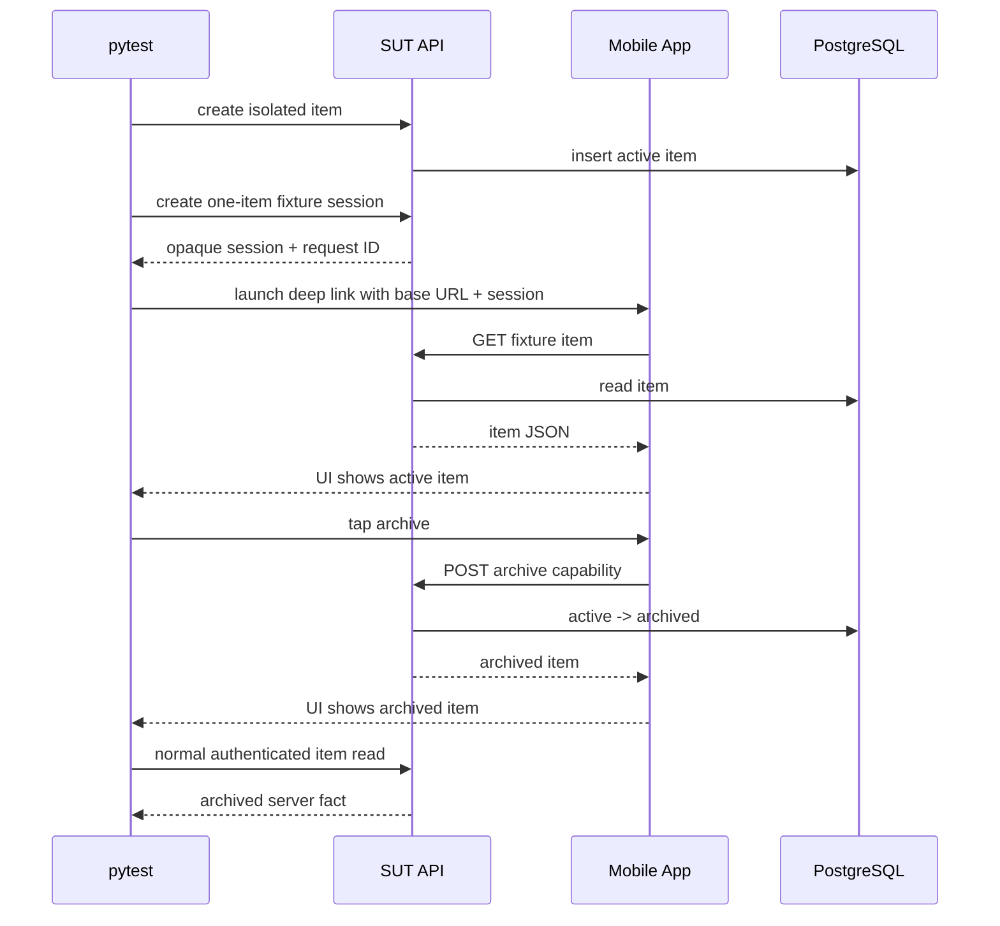

# Week 23 Cross-Layer E2E / 跨层 E2E

## Purpose / 目的

Week 23 proves one business object stays consistent across three layers:

```text
authenticated API setup
-> real Android or iOS UI action
-> authenticated API verification
```

The test does not treat a local control click as proof that the server changed.
The mobile fixture receives an opaque, short-lived capability for one catalog
item and uses the same local SUT API as the test.

## Components / 组件

| Component | Responsibility | Location |
| --- | --- | --- |
| `FixtureSessionApi` | Create the one-item capability and read/archive it | `packages/qa_core/e2e/fixture_api.py` |
| `E2eJourney` | Run setup, mobile action, verification, and cleanup | `packages/qa_core/e2e/journey.py` |
| `CatalogPort` | Hide Android/iOS API-backed UI details | `packages/qa_core/mobile/platforms.py` |
| Android fixture | Fetch and archive through `HttpURLConnection` | `apps/android-fixture/` |
| iOS fixture | Fetch and archive through `URLSession` | `apps/ios-fixture/` |
| E2E inventory | Keep 30 unique Test IDs and behavior dimensions | `configs/e2e-test-inventory.yaml` |

## Fixture Capability / Fixture 能力

The authenticated test creates a capability:

```text
POST /api/v1/e2e/sessions
{"item_id": 123}
```

The response contains:

```text
session_id
item
expires_in
can_archive
```

The capability:

- expires after `QA_E2E_SESSION_TTL_SECONDS`;
- is bound to exactly one workspace and item;
- is read-only when the authenticated role lacks `catalog:write`;
- is enabled locally by `QA_E2E_FIXTURE_ENABLED=1`;
- never exposes the original access token, password, or device UDID.

The mobile app launches with:

```text
qaweek15://e2e?e2eBaseUrl=...&sessionId=...   # Android
qaweek19://e2e?e2eBaseUrl=...&sessionId=...   # iOS
```

## Sequence / 主链路



## Evidence / 证据

Every case records:

- Test ID, scenario ID, platform, and run ID.
- Fixture session ID and API base URL.
- Item ID and expected business name.
- Request IDs from setup and verification.
- Normalized UI state.
- Normal API verification state.
- `artifacts/e2e/week23/<test-id>/<platform>/e2e-result.json`.
- Mobile screenshot, page source, and failure manifest when a UI step fails.

## Failure Boundaries / 失败边界

- Setup failure is reported as `api-setup`.
- UI failure is reported as `mobile-action`.
- Final server mismatch is reported as `api-verification`.
- A missing device or macOS environment remains `NOT RUN`, not `PASS`.
- A read-only role receiving `403` is an expected permission boundary.
- A deleted item or expired capability remains a fixture/API failure boundary.
