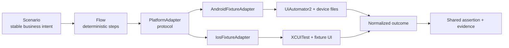

# Cross-Platform Mobile Framework v1 / 跨平台移动框架 v1

## Purpose / 目的

Week 22 introduces one business scenario layer shared by Android and iOS while
keeping platform-specific locators and system behavior inside adapters.

本周引入一个 Android/iOS 共用的业务 Scenario 层，平台定位器、文件和系统动作
仍留在各自 adapter 中。

## Shared Contracts / 共享契约

| Contract | Location | Responsibility |
| --- | --- | --- |
| `MobilePlatform` | `packages/qa_core/mobile/platforms.py` | 声明 `android` / `ios` |
| `LocatorSet` | `packages/qa_core/mobile/platforms.py` | 语义键到平台 locator 的映射 |
| `PlatformAdapter` | `packages/qa_core/mobile/platforms.py` | 业务层可用的平台能力 |
| `FilePort` | `packages/qa_core/mobile/platforms.py` | 写入、读取和清理文本 |
| `MobileScenario` | `packages/qa_core/mobile/scenarios.py` | 稳定 Scenario/Step 身份与执行 |
| Business scenarios | `packages/qa_core/mobile/fixture_scenarios.py` | 导航和文件往返的统一业务断言 |
| Diagnostics | `packages/qa_core/mobile/diagnostics.py` | 截图、page source 和脱敏 manifest |

## Platform Implementations / 平台实现

`AndroidFixtureAdapter` uses UiAutomator2 intents for navigation and the
existing `AndroidFiles` helper for temporary device files.

`IosFixtureAdapter` uses XCUITest accessibility identifiers and the fixture
write/read/delete controls. Both adapters expose the same capabilities to the
shared scenarios.

## Boundary Rules / 边界规则

- Business scenarios must not compare or branch on `adapter.platform`.
- Only adapter factories or test fixtures may select an Android/iOS adapter.
- Missing semantic locator keys fail with `MissingLocatorError`.
- Scenario failures retain `scenario_id`, `step_id`, step name, and cause.
- Platform-specific UI text may be normalized inside an adapter, but shared
  assertions cannot depend on one platform's exact language.
- `xfail`, `skipped`, and `unsupported` remain distinct from `passed`.

## Evidence / 证据

- Android real device: `artifacts/week22-android-junit.xml`
- Android Allure: `artifacts/allure-week22-android/`
- iOS Actions: `.github/workflows/week22-cross-platform.yml`
- Shared failure evidence: `artifacts/cross-platform/week22/<run-id>/`
