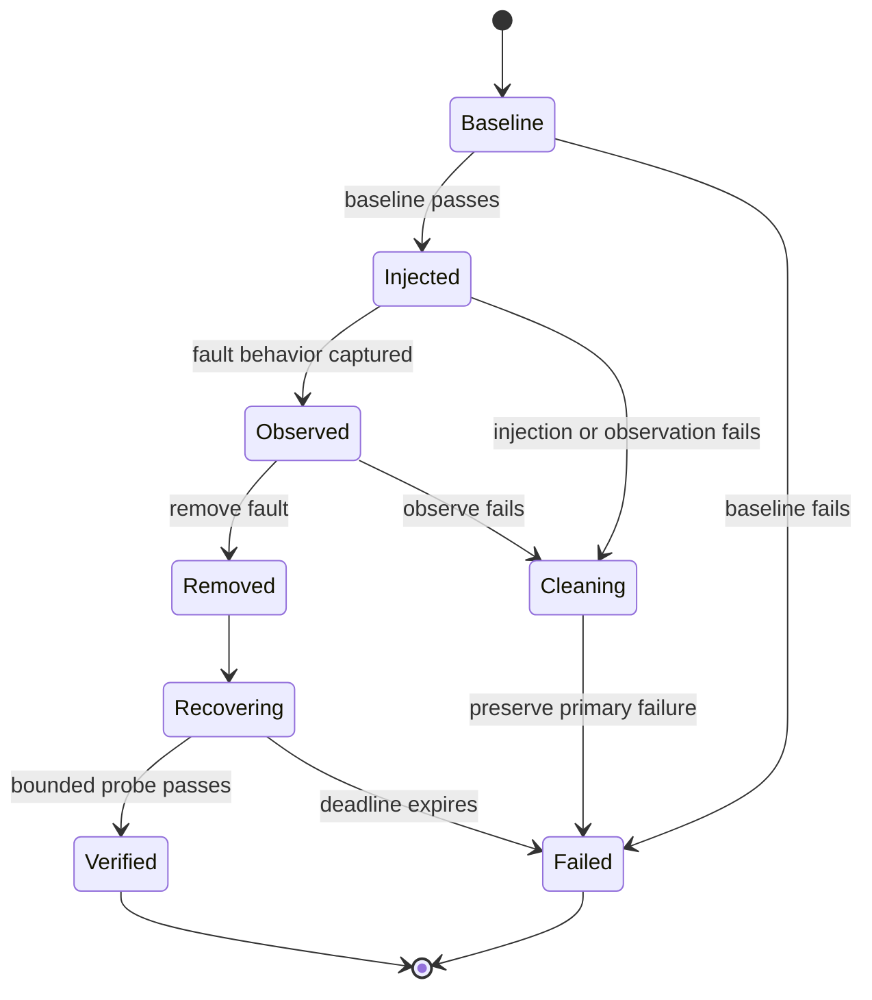

# Week 24 Fault Recovery / 故障注入与恢复

## Purpose / 目的

Week 24 proves that a previously healthy business path has a bounded failure
boundary, that the fault can be removed, and that the same business fact
recovers within a deadline. A successful fault injection alone is not recovery
evidence.

```text
verify baseline
-> inject one reversible fault
-> observe the expected boundary
-> remove the fault
-> poll until the business state recovers
-> verify the recovered state
-> write one correlated manifest
```

## Components / 组件

| Component | Responsibility | Location |
| --- | --- | --- |
| `FaultSpec` | Describe fault type, target, boundary, budget, cleanup, and parameters | `packages/qa_core/e2e/faults.py` |
| `RecoveryJourney` | Run baseline through recovery and preserve step identity | `packages/qa_core/e2e/recovery.py` |
| `RecoveryContext` | Correlate API, Android, or iOS evidence without mislabeling platforms | `packages/qa_core/e2e/recovery.py` |
| `RecoveryResult` | Return baseline, observed boundary, recovered state, attempts, and manifest | `packages/qa_core/e2e/recovery.py` |
| `ToxiproxyClient` | Create proxies and bounded network faults | `packages/qa_core/resilience/toxiproxy.py` |
| Week 23 `E2eJourney` | Provide the API + UI + API business baseline | `packages/qa_core/e2e/journey.py` |

## State Machine / 状态机



`RecoveryJourney` records stable step IDs:

```text
baseline
inject
observe
remove
recover
verify
cleanup
```

## Recovery Loop / 恢复循环

Recovery uses a monotonic deadline, not a fixed sleep:

```text
deadline = start + FaultSpec.timeout_seconds
repeat:
    probe business state
    if state satisfies predicate: return recovered state
    if deadline reached: preserve attempts and last error
    sleep for a small bounded poll interval
```

Reads may be retried while a dependency is reconnecting. Writes cannot be
blindly retried unless the operation has an idempotency contract. Recovery
always rechecks the business object; a healthy endpoint alone is insufficient.

## Evidence / 证据

Every run writes:

```text
artifacts/e2e/week24/<test-id>/<platform>/recovery-result.json
```

The manifest includes:

- run, worker, test, scenario, and platform identity;
- fault type, target, expected boundary, budget, cleanup action, and parameters;
- baseline, observed boundary, recovered state, and final probe observation;
- attempts, elapsed time, recovery time, and last probe error;
- cleanup status and original failure step;
- redaction for token, password, secret, API key, access key, and UDID fields.

## Real API Cases / 真实 API 用例

The first implemented set uses a real account, isolated namespace, catalog
item, authenticated read, and Toxiproxy:

| Test ID | Fault | Recovery proof |
| --- | --- | --- |
| `W24-API-NET-001` | 300 ms latency | item and name match the baseline after toxic removal |
| `W24-API-NET-002` | 250 ms timeout toxic | item read recovers after toxic removal |
| `W24-API-NET-003` | reset peer | a new connection reads the same item |
| `W24-API-NET-004` | disabled proxy | re-enabled proxy reads the same item |
| `W24-API-SVC-001` | unavailable upstream `api:8999` | proxy is restored to `api:8000` and reads the item |

These cases execute on Windows against the local Compose test environment. They
do not prove Android ADB, iOS WDA, or device-cloud recovery.

## Failure Boundaries / 失败边界

- Baseline failure means the test is invalid and must not inject.
- Observation success means the fault did not exercise the intended boundary.
- Recovery timeout preserves attempts and the last transport/business error.
- Cleanup failure cannot hide an earlier baseline, injection, observation, or
  verification failure.
- Android and iOS device absence remains `NOT RUN` or `BLOCKED`, not `PASS`.
- A formal issue is never created automatically; pytest may only save a
  human-review draft.

## Current Status / 当前状态

As of 2026-11-07:

- Gate G0: `PASS` on Android 15 Emulator with one API + UI + API case.
- API network/service recovery: `5 passed`.
- Recovery contract tests: `8 passed`.
- Android process/ADB/session recovery: `NOT RUN` in Week 24.
- iOS App/WDA/session recovery: `NOT RUN` on Windows.
- Week 24 completion: `IN PROGRESS`.
