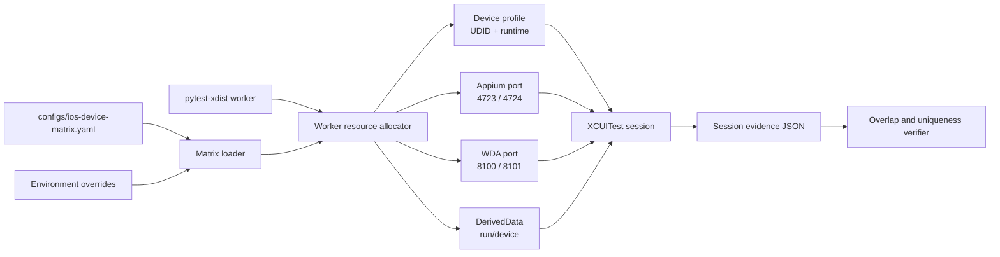

# iOS Device Matrix and Parallel Isolation

## Purpose

The iOS device matrix turns device selection, worker assignment, Appium ports,
WDA ports, and DerivedData directories into explicit, testable inputs. It keeps
parallel workers from silently sharing a Simulator or build cache.



## Matrix Source

`configs/ios-device-matrix.yaml` is the source of truth. It declares:

- current primary Simulator;
- current secondary Simulator for parallel execution;
- optional previous-major Simulator for compatibility;
- optional BrowserStack iPhone.

Each profile has a logical ID, role, provider, capability profile, device-name
environment variable, runtime environment variable, optional UDID environment
variable, and required flag.

`QA_IOS_DEVICE_IDS` selects logical profile IDs. A missing required profile
fails before a session is attempted. Missing optional profiles are omitted.

## Resource Allocation

For worker index `i`:

```text
Appium port = appium_port_base + i
WDA port    = wda_port_base + i
DerivedData = <project>/artifacts/ios-derived/<run-id>/<device-id>
```

The default bases are `4723` for Appium and `8100` for WDA. The allocator
rejects invalid worker IDs, more workers than active profiles, duplicate UDIDs,
unsafe run IDs, and paths escaping the project root.

The matrix loader and allocator live in
`packages/qa_core/platforms/ios/devices.py`. They do not create drivers and do
not read cloud secrets.

## Test Binding

`tests/ios/conftest.py` exposes:

- `ios_device_matrix`;
- `ios_worker_resources`;
- `ios_worker_profile`;
- `ios_worker_settings`.

The worker-specific `Settings` contain exactly one profile. Driver construction
then maps that profile to `appium:udid`, `appium:wdaLocalPort`, and
`appium:derivedDataPath`. The Appium endpoint is also worker-specific.

`pytest -n 2 --dist=each` is intentional: the same matrix test runs once on
each worker, guaranteeing that both profiles participate.

Before that parallel phase, `scripts/prewarm_ios_wda.py` creates one serial
session per worker. XCUITest Driver documents that first-time WDA compilation is
faster and safer when serial, while later sessions can reuse the per-profile
DerivedData cache in parallel. The prewarm also verifies that each Appium server
and Simulator can start independently before the overlap test.

## Runtime Evidence

Each worker writes:

```text
artifacts/ios-week20/<run-id>/<device-id>.json
```

The record contains UDID, Appium port, WDA port, DerivedData path, start/end
times, and completion state. `scripts/verify_ios_parallel_resources.py` rejects:

- missing or failed worker records;
- duplicate devices, UDIDs, Appium ports, WDA ports, or DerivedData paths;
- sessions that did not overlap in time.

## Provider Boundary

Cloud profiles use `ios_cloud_device_name` and
`ios_cloud_platform_version`. Local-only Appium/WDA ports and DerivedData are
not sent to cloud sessions.

The device matrix isolates processes and local resources. It does not isolate
host CPU, memory, network, or macOS Simulator runtime defects.
