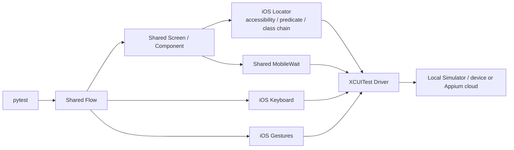

# iOS Screen Framework

## Purpose

Week 18 adds a reusable iOS UI layer above XCUITest while keeping locator and
interaction semantics separate from Android. Business composition can be
shared, but Android resource IDs, UiAutomator expressions, and pixel rectangles
must not leak into iOS pages.



## Capability Boundaries

The driver factory resolves three profiles:

| Profile | Selection | Required inputs | Signing behavior |
| --- | --- | --- | --- |
| Simulator | `local + simulator` | Device name, optional runtime/UDID | No Apple Team signing |
| Physical device | `local + device` | UDID and Apple Team ID | Signing and provisioning capabilities |
| Cloud device | non-local provider | Cloud credentials and App ID | Provider-managed device/signing path |

Missing local device UDID or Team ID fails before a session request. There is no
silent fallback from a physical device to a Simulator or a cloud provider.

## iOS Locator Strategy

`qa_core.platforms.ios.locators.IosLocator` supports:

| Priority | Strategy | Use when | Main risk |
| --- | --- | --- | --- |
| 1 | Accessibility ID | The app exposes a stable accessibility identifier or label | Localization and label changes |
| 2 | Predicate | Several element attributes must be combined | Expression review and hierarchy assumptions |
| 3 | Class chain | A bounded hierarchy path is genuinely required | Tight coupling to XCUITest element structure |

The constructor rejects obvious Android-only markers such as `android:id/`,
`-android uiautomator`, and `//android.`. This guards against copying an Android
page object into iOS code.

## Shared Screen and Wait

`LocatorLike` is the structural contract shared by Android `Locator` and iOS
`IosLocator`. `MobileWait`, `Component`, and `Screen` depend on this contract,
so both platforms reuse one explicit-wait implementation without sharing
platform locator enums.

A timeout keeps the locator label, strategy, value, expected state, and timeout
inside `ElementWaitTimeout`. Tests do not use fixed sleeps.

## Keyboard

`IosKeyboard` provides:

- optional clear followed by text input;
- Return submission through the element;
- keyboard dismissal through XCUITest `hide_keyboard`.

These primitives do not promise that an input exists or is focused. Screens
must use `MobileWait.clickable()` or another explicit state before invoking the
keyboard.

## Gestures

`IosGestures` uses semantic XCUITest mobile commands:

```text
mobile: swipe  -> direction + optional velocity
mobile: scroll -> direction
```

The abstraction intentionally avoids hardcoded screen coordinates. A valid
command does not prove that a business surface scrolled; product-level gesture
assertions belong to the screen that owns the content.

## Runtime Smoke

`tests/ios/test_screen_framework.py` creates a real session and uses:

```text
XCUIElementTypeWindow root
-> shared Screen and explicit wait
-> shared Flow
-> XCUITest swipe up
-> window size
-> screenshot attachment
```

The cloud sample run is evidence for framework wiring, not project App coverage.

## Week 18 Boundary

Week 18 does not cover permissions, notifications, deep links, files, WebView,
background recovery, multiple Simulator versions, or WDA parallel isolation.
Those belong to Week 19 to Week 21.
