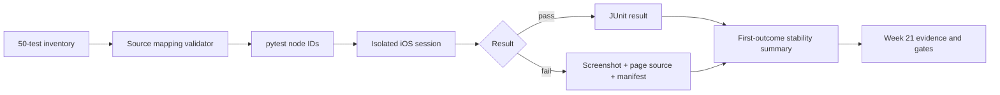

# iOS Stability, Inventory, and Failure Diagnostics

## Purpose

Week 21 turns the iOS suite into a traceable stage-acceptance system:

- `configs/ios-test-inventory.yaml` maps exactly 50 unique pytest functions to
  Test IDs and business intent;
- `tests/ios/conftest.py` creates one isolated session per Week 21 test;
- failed tests write screenshot, page source, and a sanitized JSON manifest;
- pytest JUnit files feed first-outcome stability statistics;
- the macOS workflow separates current-major, previous-major, and cloud evidence.



## Inventory Contract

The inventory loader in `packages/qa_core/platforms/ios/inventory.py` rejects:

- a count other than 50;
- duplicate Test IDs, node IDs, or business intents;
- unknown areas, priorities, device scopes, or automation states;
- node IDs that do not map to module-level pytest test functions;
- test functions that are missing from the inventory;
- a suite without any P0 tests.

Run:

```powershell
uv run python scripts/check_ios_test_inventory.py --json
uv run python -m pytest tests/ios --collect-only -q
```

Expected:

```text
actual_count: 50
50 tests collected
```

A parameterized execution does not become a second inventory item unless it has
its own source function and business assertion.

## Session and Failure Evidence

Week 21 tests use the `ios_runtime_driver` fixture. On Windows the fixture skips
before loading a required local device matrix. On macOS or a configured cloud
provider it creates one session and writes failure evidence under:

```text
artifacts/ios-week21/<run-id>/failures/<test-name>/
```

Each failure package contains:

```text
<test-name>-failure.png
<test-name>-failure.xml
<test-name>-failure.failure.json
```

The JSON manifest records test ID, failure class, exception type/message,
provider, device name, platform version, bundle ID, Appium endpoint, and run ID.
Access keys, tokens, secrets, passwords, and UDIDs are redacted.

Classification is a candidate, not a product verdict. Ambiguous errors remain
`UNKNOWN`.

## Stability Calculation

`scripts/run_ios_stability.py` executes pytest repeatedly and parses every
JUnit report. It does not pass pytest retry options.

```text
pass_rate = passed / (passed + failed)
flaky_candidate = test observed as both passed and failed
flaky_rate = flaky_candidates / tests with pass-or-fail observations
```

Skipped and xfailed results are counted and displayed, but never inflate the
pass numerator. The default gate requires:

```text
10 runs
pass_rate >= 98%
flaky_rate < 2%
```

The workflow runs a six-test P0 core subset ten times. Its output is
`artifacts/ios-week21/stability.json`.

## Version and Cloud Boundaries

The current-major Simulator job runs the 49 local tests. The cloud-session test
is executed separately because BrowserStack has different cost, credentials,
queueing, and device behavior.

The previous-major job uses only an already installed runtime selected from
`xcrun simctl list devices available -j`. If no previous-major runtime exists,
the workflow writes:

```json
{"status": "BLOCKED", "reason": "previous-major runtime unavailable"}
```

It must not download a large runtime implicitly or relabel two devices from the
same OS version as a version-matrix pass.

## Week 21 Gates

The workflow produces separate evidence for:

| Gate | Evidence |
| --- | --- |
| 50-test inventory | `check_ios_test_inventory.py --json` |
| Current-major suite | `week21-current-junit.xml` and Allure |
| Dual-Simulator isolation | `week21-parallel-junit.xml` and resource verifier |
| Ten-run stability | `artifacts/ios-week21/stability.json` |
| Previous-major compatibility | `previous-major.json` |
| Session cleanup | Appium `/sessions` check |
| Cloud real device | separate BrowserStack workflow |

No single gate substitutes for another. In particular, two current iOS 18.5
Simulators do not prove compatibility with iOS 17.
