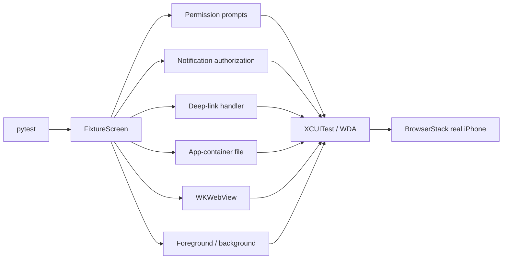

# iOS System Interactions

## Purpose

Week 19 moves from the generic iOS framework to a controlled fixture that can
trigger permissions, notifications, URL schemes, app-container files, local
WKWebView content, and background recovery on a real iOS device.



## Fixture Boundary

`apps/ios-fixture` is a test App, not a product App. It has stable
accessibility identifiers and no production credentials.

The GitHub macOS job:

```text
xcodebuild device build
-> package Payload/QaIosFixture.app
-> zip QaIosFixture.ipa
-> upload to BrowserStack
-> set QA_IOS_CLOUD_APP
-> run Week 19 pytest
```

The build is unsigned locally. BrowserStack accepts the upload and applies its
real-device installation/signing path.

Week 19 is split into 10 independently collected pytest cases. Each case creates
its own cloud session and writes a final screenshot/page source under
`artifacts/ios-diagnostics/<test-name>/`. The workflow uploads a small
`ios-week19-screenshots` artifact so UI evidence can be inspected without
downloading the full build bundle.

## Interaction Boundaries

| Capability | Fixture event | Test oracle |
| --- | --- | --- |
| Camera | `AVCaptureDevice.requestAccess(.video)` | status label becomes `camera: granted` |
| Microphone | `AVCaptureDevice.requestAccess(.audio)` | status label becomes `microphone: denied` |
| Notifications | `UNUserNotificationCenter.requestAuthorization` | `authorized`, then `scheduled` |
| Deep link | in-App button or external `mobile: deepLink` | status contains the opened URL |
| File | write/read inside Documents directory | `written`, then `read week19-file` |
| WebView | local HTML in WKWebView | strict context check; page source is supporting evidence |
| Recovery | background/foreground notifications | `background: resumed N` |

Permission prompts are handled by a bounded `IosSystemAlerts` wait. A missing
prompt fails with an explicit timeout instead of a fixed sleep.

## WebView Provider Boundary

The preferred path switches to an Appium `WEBVIEW_*` context and checks
`#web-status`.

If BrowserStack XCUITest does not expose a WebView context:

1. keep the session in `NATIVE_APP`;
2. attach `contexts` and the timeout to Allure;
3. mark the context case `xfail`, not `pass`;
4. read the XCUITest page source only as supporting content evidence.

This fallback proves rendered content is present, not that Web context switching
itself works. Run `41275681929` used Appium 2.19.0 on iPhone 15 / iOS 17 and
observed only `['NATIVE_APP']` after 70 seconds, even with
`WKWebView.isInspectable = true`.

The cloud fixture capabilities explicitly select BrowserStack Appium 2.19.0.
The provider's older default Appium version does not support
`mobile: deepLink`, which is required for the external cold-start case.

## Week 19 Boundary

Week 19 validates one cloud iPhone. It does not yet prove:

- two iOS Simulator versions;
- multiple real devices;
- parallel WDA ports or DerivedData isolation;
- long-term stability or 50 iOS tests.

Those belong to Week 20 and Week 21.
