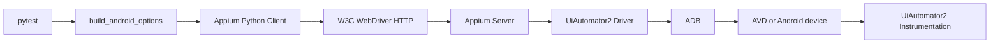
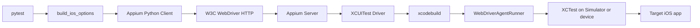
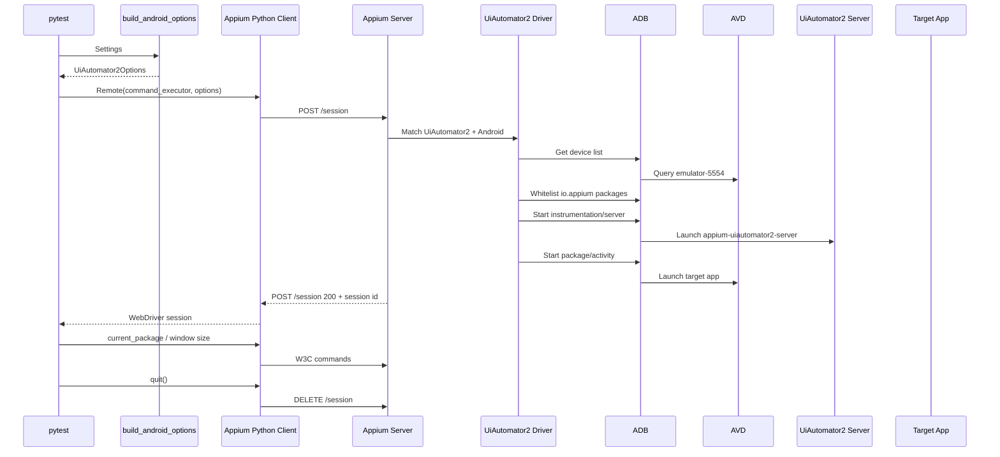

# Mobile Driver Call Chain

## Purpose

This document records the read-only Agent analysis performed for Day 4. It
compares Android and iOS from the pytest entry point through Appium to the
device-side automation runtime.

## Android Call Chain



Implementation evidence:

- `packages/qa_core/driver/android.py`
- `tests/android/test_session.py`
- Day 3 verified Appium 2.19.0 and UiAutomator2 Driver 4.2.9.

## iOS Call Chain



Implementation evidence:

- `packages/qa_core/driver/ios.py`
- `tests/ios/test_session.py`
- Appium 2.19.0 accepts XCUITest Driver 8.4.3.

The first session is slower than later sessions because Appium may build WDA,
install it, launch `WebDriverAgentRunner`, and wait for the Simulator or device
to become reachable.

## Boundary Comparison

| Boundary | Android | iOS |
| --- | --- | --- |
| Appium Driver | UiAutomator2 | XCUITest |
| Host bridge | ADB | Xcode and `xcodebuild` |
| Device runner | UiAutomator2 instrumentation | WebDriverAgentRunner under XCTest |
| Primary host dependency | Android SDK and ADB | macOS and Xcode |
| Common Windows failure | AVD not started or ADB disconnected | Cannot build WDA at all |
| Session setup artifact | UiAutomator2 server APKs | WDA application and XCTest runner |
| Common port | ADB transport | WDA local or remote port |

## Agent Review Findings

1. Both factories should keep the same public shape: typed settings in, WebDriver
   session out. This lets higher-level tests share lifecycle and diagnostics.
2. Android has a host prerequisite that can be repaired on Windows. iOS depends
   on macOS for WDA even when Appium and the client package are installed.
3. Platform-specific capabilities must stay inside the driver factories. A
   future `PlatformAdapter` should own lifecycle and diagnostics, not spread
   `if platform` checks through tests.
4. A successful Python import proves only that the client package is installed.
   It does not prove that the Driver, WDA build, Simulator, port, and target app
   can work together.
5. Session evidence must come from the real command result: Appium `POST
   /session`, WDA build output, Simulator state, and pytest. Static source
   inspection cannot replace a macOS execution result.

## Verification Boundary

On Windows, the project can verify typed iOS capabilities, package imports,
Appium Driver installation, and automatic test skip behavior.

The following remain macOS-only:

- Xcode command-line tools and an installed Simulator runtime
- WDA build and signing
- Simulator boot and UI access
- Real XCUITest session creation and teardown

## Week 13 Android Session Boot Sequence

Week 13 extends the basic Android arrow diagram into the observable startup
sequence. The host and device cross an explicit ADB boundary before the target
app receives any command.



The current local evidence shows:

```text
Appium 2.19.0
AndroidUiautomator2Driver 4.2.9
BaseDriver 9.18.0
UiAutomator2 server 7.7.1
emulator-5554 / Android 15 / x86_64
POST /session 200
```

## Capability Ownership

| Capability | Source | Owner | Boundary |
| --- | --- | --- | --- |
| `platformName=Android` | Driver Factory | Test core | Driver selection |
| `appium:automationName=UiAutomator2` | Driver Factory | Test core | Appium Driver selection |
| `appium:udid` | `QA_ANDROID_UDID` | Environment | Appium to ADB |
| `appium:deviceName` | `QA_ANDROID_DEVICE_NAME` | Environment | Diagnostic label |
| `appium:platformVersion` | `QA_ANDROID_PLATFORM_VERSION` | Environment | Expected Android version |
| `appium:appPackage` | `QA_ANDROID_APP_PACKAGE` | Target app | Activity launch |
| `appium:appActivity` | `QA_ANDROID_APP_ACTIVITY` | Target app | Activity launch |
| `appium:noReset=true` | Driver Factory | Test policy | App-state preservation |

Capabilities stay inside `qa_core.driver.android`. Business tests should not
repeat platform-specific dictionaries, and future Android flows should receive
a session rather than create one independently.

## Host and Device Evidence

Host-side evidence:

- `adb devices -l` proves the target transport and UDID.
- Appium `/status` proves the server is ready.
- `appium driver list --installed --json` proves the Driver package is present.
- Appium logs prove Driver matching, server startup, and `POST /session`.

Device-side evidence:

- `getprop sys.boot_completed=1` and `init.svc.bootanim=stopped` prove boot.
- `service check package/settings` proves required Android services exist.
- `pm list packages` proves `io.appium.settings` and UiAutomator2 server APKs
  are installed.
- `ps -A` proves the device-side server process can run.
- Target package/activity from `dumpsys package` proves the launch target.

Static source inspection cannot prove any device-side fact. The architecture
document therefore separates source ownership from runtime evidence.

## PyCharm Debug Path

The recommended Week 13 debug path is:

```text
Android Tests
-> tests/android/test_session.py
-> create_android_driver
-> build_android_options
-> Appium Python Client Remote
-> Appium Server log
-> ADB / UiAutomator2 server / target app
```

At `build_android_options`, inspect settings-to-capability mapping. At
`create_android_driver`, inspect the normalized Appium endpoint. After
`create_android_driver` returns, inspect `driver.session_id` and
`driver.current_package`. The exact breakpoint and ADB command sequence is in
`docs/runbooks/android-session-debugging.md`.

## Week 13 Boundary

This week establishes the architecture and diagnostic path. Locator strategy,
explicit waits, gestures, page objects, business flows, system dialogs, and
larger Android suites belong to Week 14 to Week 16.
