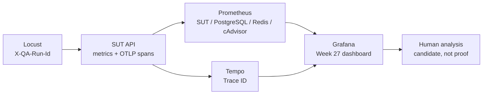

# 性能可观测性与 Trace 关联 / Performance Observability and Trace Correlation

- 用途：说明 Week 27 的指标、日志关联、Trace 和监控栈边界。
- 事实来源：`apps/compose/api/app.py`、`apps/compose/compose.yaml`、
  `infra/monitoring/`。
- 更新时机：指标名称、抓取目标、追踪协议或 Dashboard 结构变化时同步更新。

## 1. 目标

Week 26 已经能用 Docker CLI 在大约同一时间段采集 API、PostgreSQL 和 Redis 的
资源样本，但它不是时间序列系统。Week 27 要把四类事实放进同一条分析链：

```text
Locust run_id
-> SUT HTTP 请求指标
-> request_id / trace_id
-> Prometheus 时间序列
-> Tempo Trace
-> Grafana 同一时间窗口
```

这张图像医院里把挂号号、检验单号和检查结果放在同一个患者时间线上：
数字本身不会告诉你病因，但同一时间窗口内的请求、数据库、缓存和资源变化
可以排除错误假设。



## 2. SUT 请求指标

`GET /metrics` 使用 Prometheus text exposition format。动态路径必须先归一化，
否则每个 workspace、item 和 job 都会生成新的 label，形成高基数时间序列。

| 指标 / Metric | 类型 | Labels | 含义 |
| --- | --- | --- | --- |
| `qa_sut_http_requests_total` | Counter | `method`, `route`, `status` | 已完成请求数 |
| `qa_sut_http_request_duration_seconds` | Histogram | `method`, `route` | 请求耗时分布 |
| `qa_sut_http_requests_in_progress` | Gauge | 无 | 当前处理中的请求数 |
| `qa_sut_last_request_run_info` | Gauge | `run_id` | 最近一次关联的 Locust run |

动态路由统一映射为：

```text
/api/v1/workspaces/qa-perf-week27/catalog
-> /api/v1/workspaces/{slug}/catalog
```

`run_id` 不进入每个请求的 Counter label，只记录最近一次活动 run，避免高基数。

## 3. 请求与 Trace 关联

每个请求从以下顺序取得关联 ID：

1. 使用调用方提供的 `X-Request-Id`，前提是值符合受限字符集。
2. 没有合法值时生成 UUID hex。
3. 使用 W3C `traceparent` / `tracestate` 提取上游 Trace Context。
4. 响应返回 `X-Request-Id` 和 `X-Trace-Id`。

OTLP 只有在 `QA_OTEL_ENABLED=1` 时启用。Compose 的 `monitoring` profile 由
`start_sut.ps1 -Monitoring` 或 `start_performance_sut.ps1 -Monitoring` 激活，
默认运行不会连接不存在的 Tempo。

## 4. 数据源

| 数据源 / Source | 采集方式 | 主要指标 |
| --- | --- | --- |
| SUT API | `/metrics` | 请求数、p95/p99、5xx 比例 |
| PostgreSQL | `postgres-exporter` | 连接数、事务、锁和数据库状态 |
| Redis | `redis-exporter` | 客户端、内存和命令处理 |
| 容器 | `cAdvisor` | CPU、工作集内存和网络/块 IO |
| Trace | OTLP HTTP 到 Tempo | 请求级 span 和 Trace ID |
| 展示 | Grafana provisioning | 统一时间轴和 Dashboard |

## 5. 本地端口

| 组件 | 默认端口 | 地址 |
| --- | ---: | --- |
| Prometheus | 29090 | `http://127.0.0.1:29090` |
| Grafana | 23000 | `http://127.0.0.1:23000` |
| Tempo query UI | 23200 | `http://127.0.0.1:23200` |
| Tempo OTLP HTTP | 24318 | `http://127.0.0.1:24318` |
| PostgreSQL exporter | 29187 | `http://127.0.0.1:29187/metrics` |
| Redis exporter | 29121 | `http://127.0.0.1:29121/metrics` |
| cAdvisor | 28081 | `http://127.0.0.1:28081` |

这些地址只绑定本机测试环境，不是生产监控架构。

## 6. 结论边界

- Prometheus 指标只能说明某个时间窗口内发生了什么，不能单独证明因果。
- SQL 是数据库查询语言，PostgreSQL 是数据库系统；`pg_stat_*` 只是
  PostgreSQL 暴露的部分运行时事实。
- Trace 能显示调用耗时和上下文，但当前数据库与 Redis 客户端还没有自动
  Instrumentation，因此不能宣称已有完整跨组件 Trace。
- 没有 Grafana 真实启动和 Prometheus 成功抓取时，Dashboard workflow 状态
  必须是 `BLOCKED` 或 `NOT RUN`。
- Week 27 不执行 Stress、Spike、Soak，也不宣布容量上限。
