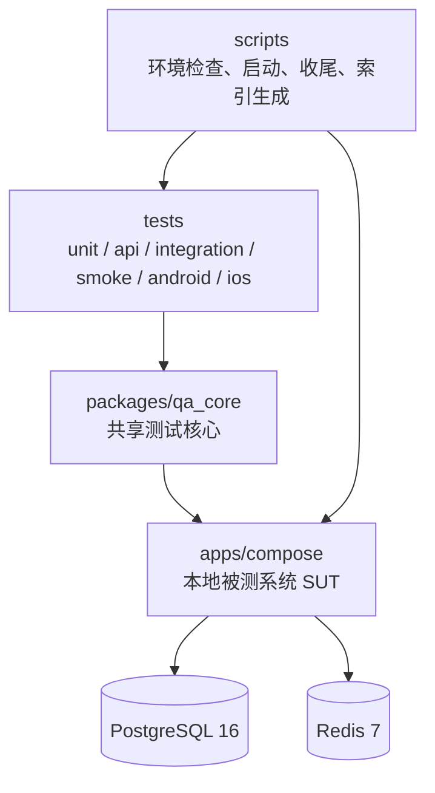
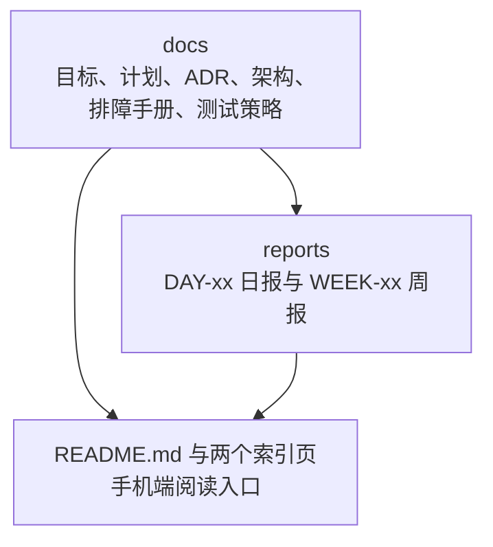

# 项目结构与技术栈总览

- 用途：一页看懂仓库结构、技术栈和测试执行链路，也是手机端阅读时的结构图来源。
- 事实来源：[项目目标文档](../GOALS.md)、[项目执行计划](../PLAN.md)。
- 更新时机：目录结构、技术栈或执行链路发生变化时同步更新本页。

## 1. 仓库结构

### 1.1 代码与运行

### 1.2 文档与证据

依赖方向只有一个：`tests` 使用 `packages/qa_core`，`qa_core` 通过 HTTP、SQL、
Redis 协议和 Appium 会话访问 `apps/compose` 提供的被测系统。`docs` 与 `reports`
是证据，`ai/` 存放提示词、策略与评测记录，`artifacts/` 是测试与 CI 产物，不入库。

## 2. 技术栈

| 层 | 当前实现 | 代码位置 |
| --- | --- | --- |
| 运行环境 | Python 3.12、uv、项目内 `.venv` 与 `.uv/cache` | `pyproject.toml`、`uv.toml` |
| 配置 | pydantic-settings，`QA_` 前缀，从 `.env` 读取 | `packages/qa_core/config/settings.py` |
| API 客户端 | httpx，含超时、重试、退避与抖动 | `packages/qa_core/http/client.py` |
| 认证 | 本地 OAuth2/OIDC、JWT、refresh 轮换 | `packages/qa_core/auth/` |
| 契约 | OpenAPI 与 JSON Schema 兼容性校验 | `packages/qa_core/contracts/` |
| 数据库 | PostgreSQL 16、psycopg 3、schema 只读契约、事务与锁 | `packages/qa_core/db/` |
| 缓存 | Redis 7、TTL 与幂等键 | `packages/qa_core/cache/` |
| 测试数据 | 数据工厂、测试命名空间隔离、资源池 | `packages/qa_core/data_factories/`、`resource_pools/` |
| 移动端 | Appium 2 Python Client、UiAutomator2、XCUITest + WDA | `packages/qa_core/driver/` |
| 报告 | Allure 结果、缺陷指纹、命名空间泄漏报告 | `packages/qa_core/reporting/`、`artifacts/` |
| 并发 | pytest-xdist（`pytest -n 4`） | `pyproject.toml` |
| 日志 | structlog | `packages/qa_core/http/client.py` |
| 本地环境 | Docker Compose：API + PostgreSQL 16 + Redis 7 | `apps/compose/compose.yaml` |
| CI | GitHub Actions：质量门、SUT 集成、iOS 冒烟 | `.github/workflows/` |
| 文档入口 | `build_doc_index.py` 生成 README 索引页，GitHub 渲染 Markdown 与 Mermaid | `docs/README.md`、`reports/README.md` |
| 语雀发布（可选，需付费会员） | 语雀开放 API v2 | `scripts/sync_yuque.py` |

## 3. 测试执行链路

| 测试层 | 入口模块 | 最终目标 |
| --- | --- | --- |
| 接口 | `qa_core.http`：httpx、超时、重试、退避 | 本地 SUT 的 HTTP 接口 |
| 数据库 | `qa_core.db`：psycopg 3 | PostgreSQL 16 |
| 缓存 | `qa_core.cache`：redis | Redis 7 |
| 移动端 | `qa_core.driver`：Appium Python Client | Appium Server 2 到 UiAutomator2 / XCUITest 到设备 |
| 全部 | `qa_core.config`：pydantic-settings | 从 `.env` 读取地址与开关 |

接口、数据库与缓存三类测试直接打到同一个被测系统，移动端测试再经过 Appium
服务转发到设备，因此同一份数据契约在四条链路上保持一致。

设备侧的逐步调用链（Android 与 iOS 分开）见
[Mobile Driver Call Chain](mobile-driver-call-chain.md)。

## 4. 建议阅读顺序

1. [项目目标文档](../GOALS.md)：先确认要做成什么。
2. [项目执行计划](../PLAN.md)：再看每周怎么推进。
3. 本页：建立结构与技术栈的整体印象。
4. `docs/adr/`：逐个决策的取舍理由。
5. `docs/runbooks/`：出现失败时按手册定位。
