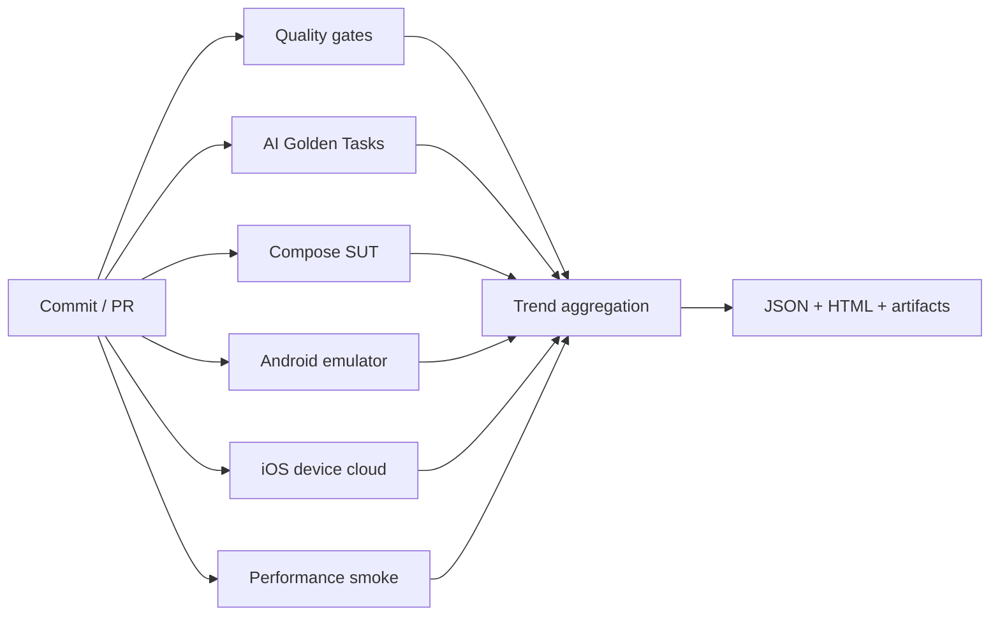

# Quality Pipeline And Trends

## 1. Pipeline Model

The platform jobs do not parse each other's console output. They exchange
machine-readable JUnit, Allure, JSON, CSV, and status files.

## 2. Evidence Contract

| Source | Machine-readable | Human-readable |
| --- | --- | --- |
| pytest | JUnit XML | Allure results |
| Android | JUnit + Appium log | Allure/screenshots |
| iOS cloud | JUnit + performance JSON | Allure/provider links |
| Performance | Locust CSV/HTML + `result.json` | trend summary |
| Defects | `defects.jsonl` draft | triage runbook |
| Governance | owner/quarantine YAML | pipeline summary |
| Agent Eval | `agent-eval.json` | accuracy/evidence/latency summary |

Logs, HTML, page source, and API responses remain untrusted input.

## 3. Owner And Quarantine

Owners are required for quality, API, Android, iOS, performance, and
infrastructure. Quarantine entries require:

- exact pytest node ID;
- named owner;
- reason;
- expiration date;
- evidence reference.

Expired entries fail CI. Quarantine suppresses no result automatically; it is a
reviewed scope change, not a retry.

## 4. Trend History

The trend record contains run ID, commit, timestamp, per-check outcome, JUnit
counts, and evidence path. GitHub Actions cache carries a bounded 100-point
history. The current run also uploads JSON and HTML artifacts.

If cache restoration fails, the current run still produces one valid point.
Missing history must be recorded as reduced trend depth, not as a product pass.

## 5. Boundaries

- GitHub cache is not a permanent analytics database.
- A skipped Android/iOS job is not a pass.
- Provider cancellation is not a test failure.
- Allure is not the defect state system.
- The defect-draft plugin never creates or closes a formal issue.
- Agent Eval proves a bounded Golden Task baseline, not general model quality.
- Agent findings do not change thresholds, create defects, merge, or release.
