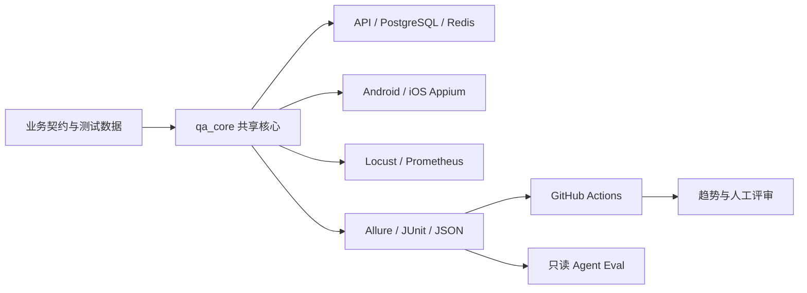

# 质量工程实验室面试证据包 / Interview Evidence Pack

这组材料用于 15 到 25 分钟的项目演示和追问。它不把“计划完成”写成“执行完成”，
也不把静态检查、Mock 或无证据的总结当作平台验收。

## 使用顺序

1. [架构总览](architecture-overview.md)：先解释系统边界和关键调用链。
2. [STAR 故事](star-stories.md)：按问题、约束、行动、结果回答追问。
3. [面试问题库](question-bank.md)：覆盖 API、数据库、移动端、性能、CI 和 Agent。
4. [演示与证据索引](demo-and-evidence.md)：15 分钟现场演示和可追溯链接。

## 一句话定位

这是一个共享测试核心加独立执行面的质量工程平台：API、数据库、缓存、Android、
iOS、性能和 Agent 使用同一套证据语义，但各平台保留自己的运行环境和失败诊断。

## 可诚实陈述的边界

- Android 已有 Linux API 35 emulator 实跑。
- iOS 必需路径是 macOS 15 + iOS Simulator 实跑；BrowserStack Free Trial 当前
  额度到期，保留为可选 `BLOCKED` 证据。
- iOS WebView context 只暴露 `NATIVE_APP`，仍是 strict `xfail`。
- 上一主版本 iOS runtime 兼容性仍为环境 `BLOCKED`。
- Notification Center 的系统 UI 交互仍为 `NOT RUN`。
- Week 21 没有重构前 duration 基线，因此不能声称 p95 有前后改进。
- 当前 Agent 是确定性只读分诊基线，不是 LLM。Token 和成本为 0 是实测属性，
  不能包装成“大模型 Agent 已上线”。

## 不能说过头的结论

不说“全平台设备矩阵通过”；实际是单一 Android AOSP ATD emulator、macOS
Simulator 和可选云端的组合覆盖。

不说“Agent 替代测试或缺陷闭环”；实际是 Agent 只分类证据，测试执行、门禁、
缺陷创建和关闭仍由确定性流程与人工决定。

不说“性能已经证明生产容量”；实际是隔离测试环境下的 smoke、load、stress、
soak 和容量证据，不是生产压测。
