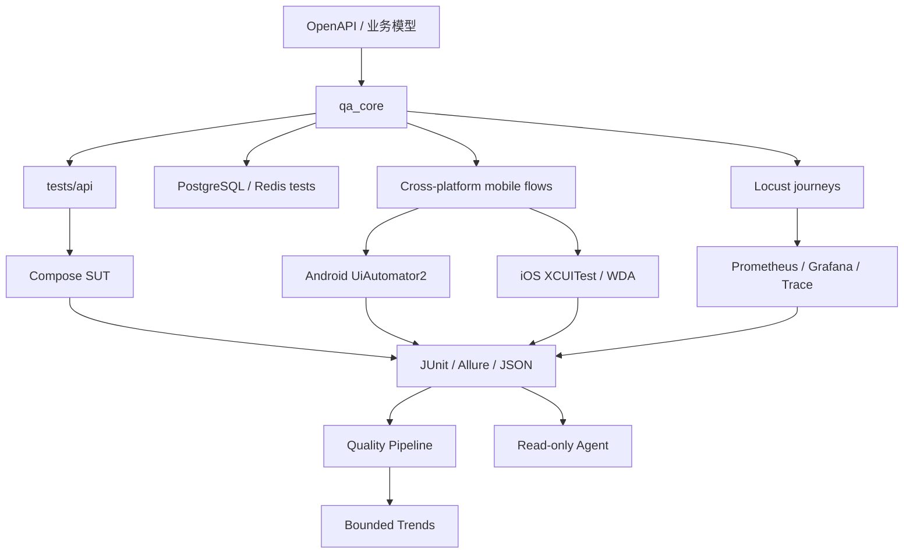

# 架构总览 / Architecture Overview

## 1. 设计目标

项目把测试资产分成两层：

- `qa_core`：认证、HTTP、契约、数据工厂、移动端抽象、报告和可观测性等共享能力。
- 执行面：API、PostgreSQL/Redis、Android、iOS、Locust、CI 各自在真实环境中运行。

共享核心解决重复代码和结果语义不一致；执行面隔离保证一个平台失败不会伪装成
另一个平台通过。



## 2. 一条 API 请求链路

1. Pydantic 模型和 OpenAPI 约束请求结构与兼容性。
2. 共享 HTTP Client 处理超时、重试、认证、错误分类、Trace 和 rate budget。
3. 测试通过资源池和唯一 namespace 创建隔离数据。
4. API 写入后查询 PostgreSQL 和 Redis，验证状态、TTL、幂等和最终一致性。
5. JUnit、Allure、Trace ID 和缺陷指纹形成可定位证据。

关键证据：

- `packages/qa_core/clients/`
- `packages/qa_core/contracts/`
- `tests/api/`
- `tests/integration/`
- `docs/adr/0002-http-client-timeout-and-retry.md`
- `docs/adr/0005-api-error-taxonomy-idempotency-and-state-machine.md`

## 3. 一条跨平台移动链路

```text
业务 Flow
-> PlatformAdapter
-> Screen / Locator Set
-> Android UiAutomator2 或 iOS XCUITest
-> Appium / ADB / WebDriverAgent
-> 设备或 Simulator
-> 截图、page source、日志、JUnit、Allure
```

业务测试只依赖 Flow 和元素语义；平台 adapter 决定定位器和系统交互。设备矩阵、
端口和 DerivedData 隔离用于并行执行。

- Android Runner：`tests/android/`、`configs/android-device-matrix.yaml`
- iOS Runner：`tests/ios/`、`configs/ios-device-matrix.yaml`
- 跨平台契约：`packages/qa_core/mobile/`
- 调用链文档：`docs/architecture/mobile-driver-call-chain.md`

## 4. 性能与可观测性

Locust 只负责生成负载；SLO 判定由独立结果模型完成。独立 Compose project、
独立数据池和固定资源降低压测污染。API latency、PostgreSQL、Redis、主机指标和
Trace 通过同一 run 时间线关联。

```text
Locust journey
-> API / PostgreSQL / Redis
-> Prometheus / OTLP
-> run result JSON / CSV / HTML
-> SLO + capacity + recovery conclusion
```

关键证据：

- `performance/`
- `configs/performance-*.yaml`
- `infra/observability/`
- `docs/architecture/performance-observability.md`
- `reports/weekly/WEEK-25.md` 到 `WEEK-29.md`

## 5. CI 与趋势

统一流水线包含 Quality、AI Golden Tasks、Compose SUT、Android、iOS
Simulator、可选设备云、性能和 Trend。每个 job 上传 JUnit、JSON、日志或 Allure。

必需 job 失败但未生成 JUnit 时，Trend job 会合成 `FAILED` 记录。Cloud quota
阻断记录为 `BLOCKED`，不替代必需的 Simulator 结果。

- Workflow：`.github/workflows/week31-quality-pipeline.yml`
- Trend 代码：`packages/qa_core/reporting/quality_trends.py`
- ADR：`docs/adr/0013-ci-pipeline-required-evidence-and-trends.md`

## 6. Agent 边界

Week 32 的 Agent 只做证据分诊：

```text
structured signals + evidence references
-> deterministic classification
-> finding with suspected layer, confidence and evidence paths
-> human review
```

没有证据时返回 `INSUFFICIENT_EVIDENCE`。首批 5 个监控 Agent 的注册表把工具
限制为只读，并禁止 Shell、写仓库、改阈值、建/关缺陷和发布。

- `ai/agents/evidence_triage.py`
- `ai/agents/registry.yaml`
- `ai/golden_tasks/week32.jsonl`
- `ai/evals/run_golden_tasks.py`
- `docs/adr/0014-comprehensive-acceptance-evidence-and-agent-guardrails.md`

## 7. 主要取舍

| 取舍 | 选择 | 原因 |
| --- | --- | --- |
| Monorepo | 单一仓库 | API、移动端、性能和 CI 共享契约与证据 |
| 确定性 Agent | 先做规则基线 | 可复现、零 Token，先验证失败语义再引入模型 |
| iOS | Simulator 必需，云可选 | Runner 可重复，外部额度不应掩盖必需覆盖 |
| 趋势存储 | 有界 Actions cache | 成本低且可审计，但不冒充永久数据库 |
| 缺陷系统 | Adapter 隔离 | Allure 保存证据，正式状态由 Issue 系统管理 |
| 权限 | 默认只读 | 日志和页面不可信，写操作必须审批 |
