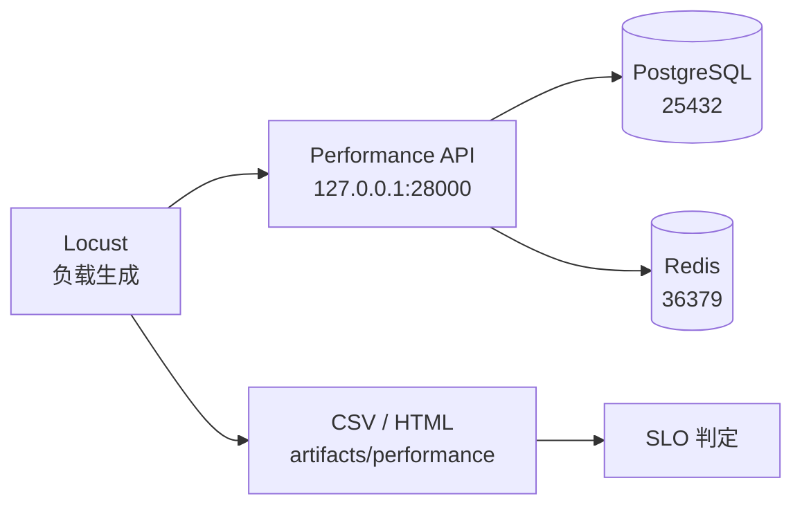

# 性能负载模型 / Performance Load Model

## 1. 目标

Week 25 先建立可重复的性能运行骨架，不追求一次压出系统上限。第一阶段要回答：

```text
服务能启动
-> Locust 能按固定形状发请求
-> 每次请求有名称和结果
-> p95、错误率和样本量可机器判定
-> 结果能保存并与后续 baseline 对比
```

## 2. 独立环境

性能环境像一间单独的实验厨房：菜谱相同，但食材库存、操作台和计时器不能与
日常功能测试共用。



对应实现：

| 组件 / Component | 本地实现 / Local Implementation | 作用 / Purpose |
| --- | --- | --- |
| Compose project | `quality-engineering-lab-performance` | 隔离容器、网络和卷 |
| API | `http://127.0.0.1:28000` | 独立被测入口 |
| PostgreSQL | `127.0.0.1:25432` | 独立测试数据库 |
| Redis | `127.0.0.1:36379` | 独立缓存与任务状态 |
| Profile | `configs/performance-smoke.yaml` | 固定负载形状和阈值 |
| Locust | `performance/locustfiles/api_journeys.py` | 生成负载并收集指标 |

## 3. 指标定义

| 名词 / Term | 简单解释 / Plain Meaning | 本项目位置 / Project Mapping |
| --- | --- | --- |
| SLI | 实际测量到的一个服务指标 | p95、错误率、请求数 |
| SLO | 给 SLI 约定的目标边界 | YAML `thresholds` |
| SLA | 对外承诺的服务等级 | 后续容量报告，不由 smoke 代替 |
| Baseline | 固定版本和环境下可重复的参考结果 | Week 26 baseline profile |
| Load | 按预期负载验证服务 | Week 26 |
| Stress | 逐步增加负载寻找拐点 | Week 28 |
| Spike | 短时突增负载 | Week 28 |
| Soak | 长时间运行观察泄漏和退化 | Week 29 |

`Little's Law` 的基本关系：

```text
并发请求数 = 到达率 × 平均停留时间
```

它描述稳定系统中的平均关系，不承诺 p95，也不能单独证明容量。

## 4. Week 25 Smoke Profile

当前 `week25-isolated-smoke` 运行 10 秒，4 个读用户，2 用户/秒启动速率：

| 旅程 / Journey | 权重 | 请求 |
| --- | --- | --- |
| catalog browse | 4 | `GET /api/v1/workspaces/atlas/catalog` |
| OpenAPI | 2 | `GET /openapi.json` |
| liveness | 1 | `GET /health/live` |

通过阈值：

- p95 不高于 1000 ms。
- 错误率不高于 1%。
- 至少产生 20 个请求，防止空跑被误判为通过。

这些阈值只用于证明 Week 25 基线链路成立，不是生产 SLO，也不是容量结论。

## 5. 后续 8 到 10 条用户旅程

Week 26 到 Week 29 再扩展并分级：

1. 工作区目录浏览。
2. 认证登录与 token 刷新。
3. 目录项创建与清理。
4. 目录状态更新与缓存失效。
5. 成员列表和权限读取。
6. 缓存刷新任务提交与轮询。
7. WebSocket 事件订阅与断开。
8. PostgreSQL 锁等待和连接池压力。
9. Redis 缓存命中、miss 和淘汰。
10. 故障恢复后的重新连接与一致性检查。

写旅程必须使用独立测试工作区、唯一数据键和幂等清理；不能直接压固定种子
数据并让测试间相互污染。

## 6. 运行规则

- 不在公共生产服务或其他人的环境上压测。
- 固定 API、数据库、缓存和 Locust 版本。
- 每次运行记录 commit、profile、开始时间、工作区、阈值和原始 CSV。
- 首次执行先做功能 readiness，再开始负载。
- 运行失败时先区分服务、网络、Locust、SUT 和环境问题。
- 单次通过不等于稳定；趋势需要多次同条件运行。
