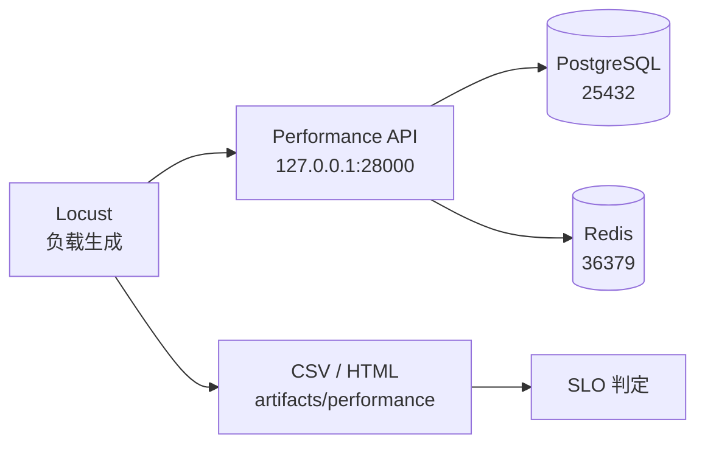

# 性能负载模型 / Performance Load Model

## 1. 目标

Week 25 先建立可重复的性能运行骨架，不追求一次压出系统上限。第一阶段要回答：

```text
服务能启动
-> Locust 能按固定形状发请求
-> 每次请求有名称和结果
-> p95、错误率和样本量可机器判定
-> 结果能保存并与后续 baseline 对比
```

## 2. 独立环境

性能环境像一间单独的实验厨房：菜谱相同，但食材库存、操作台和计时器不能与
日常功能测试共用。



对应实现：

| 组件 / Component | 本地实现 / Local Implementation | 作用 / Purpose |
| --- | --- | --- |
| Compose project | `quality-engineering-lab-performance` | 隔离容器、网络和卷 |
| API | `http://127.0.0.1:28000` | 独立被测入口 |
| PostgreSQL | `127.0.0.1:25432` | 独立测试数据库 |
| Redis | `127.0.0.1:36379` | 独立缓存与任务状态 |
| Profile | `configs/performance-smoke.yaml` | 固定负载形状和阈值 |
| Locust | `performance/locustfiles/api_journeys.py` | 生成负载并收集指标 |

## 3. 指标定义

| 名词 / Term | 简单解释 / Plain Meaning | 本项目位置 / Project Mapping |
| --- | --- | --- |
| SLI | 实际测量到的一个服务指标 | p95、错误率、请求数 |
| SLO | 给 SLI 约定的目标边界 | YAML `thresholds` |
| SLA | 对外承诺的服务等级 | 后续容量报告，不由 smoke 代替 |
| Baseline | 固定版本和环境下可重复的参考结果 | Week 26 baseline profile |
| Load | 按预期负载验证服务 | Week 26 |
| Stress | 逐步增加负载寻找拐点 | Week 28 |
| Spike | 短时突增负载 | Week 28 |
| Soak | 长时间运行观察泄漏和退化 | Week 29 |

`Little's Law` 的基本关系：

```text
并发请求数 = 到达率 × 平均停留时间
```

它描述稳定系统中的平均关系，不承诺 p95，也不能单独证明容量。

## 4. Week 25 Smoke Profile

当前 `week25-isolated-smoke` 运行 10 秒，4 个读用户，2 用户/秒启动速率：

| 旅程 / Journey | 权重 | 请求 |
| --- | --- | --- |
| catalog browse | 4 | `GET /api/v1/workspaces/atlas/catalog` |
| OpenAPI | 2 | `GET /openapi.json` |
| liveness | 1 | `GET /health/live` |

通过阈值：

- p95 不高于 1000 ms。
- 错误率不高于 1%。
- 至少产生 20 个请求，防止空跑被误判为通过。

这些阈值只用于证明 Week 25 基线链路成立，不是生产 SLO，也不是容量结论。

## 5. 后续 8 到 10 条用户旅程

Week 26 到 Week 29 再扩展并分级：

1. 工作区目录浏览。
2. 认证登录与 token 刷新。
3. 目录项创建与清理。
4. 目录状态更新与缓存失效。
5. 成员列表和权限读取。
6. 缓存刷新任务提交与轮询。
7. WebSocket 事件订阅与断开。
8. PostgreSQL 锁等待和连接池压力。
9. Redis 缓存命中、miss 和淘汰。
10. 故障恢复后的重新连接与一致性检查。

写旅程必须使用独立测试工作区、唯一数据键和幂等清理；不能直接压固定种子
数据并让测试间相互污染。

## 6. 运行规则

- 不在公共生产服务或其他人的环境上压测。
- 固定 API、数据库、缓存和 Locust 版本。
- 每次运行记录 commit、profile、开始时间、工作区、阈值和原始 CSV。
- 首次执行先做功能 readiness，再开始负载。
- 运行失败时先区分服务、网络、Locust、SUT 和环境问题。
- 单次通过不等于稳定；趋势需要多次同条件运行。

## 7. Week 26 Baseline 与 Load

Week 26 使用一个隔离实验 workspace，只改变虚拟用户数和启动速率：

| Profile | Users | Spawn rate | Duration | Warmup | Measured runs |
| --- | ---: | ---: | ---: | ---: | ---: |
| Baseline | 4 | 2/s | 60s | 15s | 3 |
| Load | 8 | 4/s | 60s | 15s | 3 |

两份 profile 使用相同认证方式、账号池、workspace、请求权重、think time 和
阈值文件。Baseline 与 Load 之间没有修改代码、业务数据或请求混合比例。

实际中位数：

| Metric | Baseline | Load | Change |
| --- | ---: | ---: | ---: |
| Total requests | 669 | 1340 | +100.3% |
| Throughput | 11.03 req/s | 22.11 req/s | +100.5% |
| p50 | 7 ms | 8 ms | +14.3% |
| p95 | 16 ms | 18 ms | +12.5% |
| p99 | 24 ms | 26 ms | +8.3% |
| Error rate | 0% | 0% | 0 |

三次运行分别产生以下资源中位数：

| Service | Baseline CPU | Load CPU | Baseline memory | Load memory |
| --- | ---: | ---: | ---: | ---: |
| API | 5.49% | 8.99% | 51.8 MB | 53.8 MB |
| PostgreSQL | 1.66% | 2.82% | 25.1 MB | 25.2 MB |
| Redis | 0.82% | 1.09% | 7.4 MB | 7.6 MB |

观察：

- 虚拟用户和吞吐量翻倍时，p95 只增加 2 ms，错误率保持 0。
- API CPU 随吞吐增长，但仍处于较低水平；PostgreSQL 和 Redis CPU 也有增长。
- 当前样本没有显示应用、数据库、Redis 或压测机已饱和。
- 这只能说明 8 用户、60 秒档位未观察到瓶颈，不能外推为容量上限。
- Docker `NetIO` 和 `BlockIO` 是接收/发送、读/写两组计数之和；需要分方向或多
  数据源时应在 Week 27 接入 Prometheus 和容器指标。

## 8. 性能数据池

Week 26 使用 `qa-perf-<run-id>` workspace，提供 16 个账号和 100 条 catalog
item。准备过程是幂等 upsert：

```text
provision
-> repeated provision keeps 1 workspace / 16 users / 100 items
-> authenticated journey reads own workspace
-> cleanup deletes PostgreSQL rows and Redis cache keys
-> runtime credential file is removed
```

密码、access token 和 refresh token 只写入 git-ignored `runtime.json`，不进入
profile、metadata、manifest、日志或周报。Week 26 实测清理结果为
`workspaces=0, users=0, items=0`，容器和运行时凭据文件均无残留。

双 run 验收使用两个独立 workspace：

| Run | Initial rows | Cleanup A 后 B | Final rows |
| --- | --- | --- | --- |
| `week26-isolation-a` | 1 workspace, 4 users, 20 items | 已删除 | 0 / 0 / 0 |
| `week26-isolation-b` | 1 workspace, 5 users, 30 items | 仍为 1 / 5 / 30 | 0 / 0 / 0 |

结果保存在 `artifacts/performance/week26/isolation-verification.json`。这证明
按精确 workspace slug 清理不会误删另一个 performance run。

## 9. 分布式 Locust 边界

单主机 `master + 1 worker` 已完成真实 Smoke：

- 56 requests，0 failures。
- p50 9 ms，p95 23 ms，p99 25 ms。
- master 完成聚合和最终 SLO gate。
- worker 不执行最终 SLO gate，避免空统计导致假失败。

单主机拓扑只证明控制和统计聚合正确，不证明独立压力机容量。Week 26 没有第二
台独立测试主机，因此跨主机 worker 验收保持 `DEFERRED`；这不是 `PASS`。

## 10. Week 27 指标与 Trace 对齐

Week 27 在同一时间轴上补充：

- SUT `/metrics` 的请求数、p95/p99、5xx 比例和进行中请求数。
- PostgreSQL exporter 的连接、事务和锁状态。
- Redis exporter 的客户端、内存和命令处理指标。
- cAdvisor 的容器 CPU 和内存时间序列。
- Tempo 中按 `X-Trace-Id` 查询的 SUT 请求 span。

Locust 发送 `X-QA-Run-Id`，SUT 将最近一次 run id 暴露为
`qa_sut_last_request_run_info`。run id 不进入每个请求的 label，避免高基数。

分析顺序：

```text
先确认 Prometheus target up
-> 再看 Locust 时间窗口内的 RPS、p95/p99 和错误率
-> 对齐 API/PostgreSQL/Redis 容器资源
-> 用 Trace ID 查看单次请求耗时
-> 只形成瓶颈候选和下一轮实验
```

监控栈没有真实启动、没有成功抓取或 Tempo 查询失败时，Week 27 必须保持
`BLOCKED`/`NOT RUN`，不能把配置文件存在写成验收通过。
