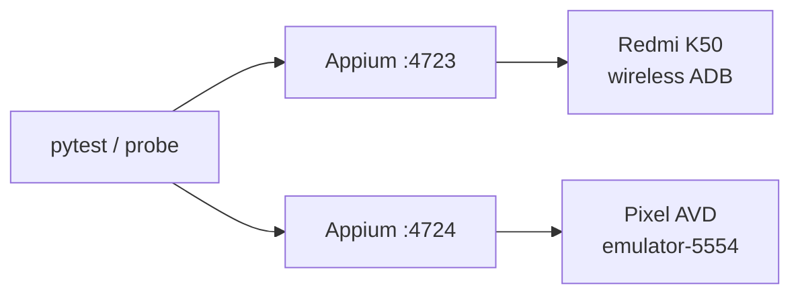

# Android Appium Multi-Instance and Port Isolation

## Purpose

Run two independent Appium servers against two distinct Android devices and
prove that:

- Appium HTTP ports do not conflict;
- each session binds the requested device;
- App fixtures and UI state do not leak across sessions;
- server logs remain separate.

## Topology



The two Appium servers share one ADB server on the Windows host. Device
identity, not just host port, must be part of the acceptance evidence.

## Start the AVD

```powershell
emulator -avd Pixel_API_35_AOSP_ATD `
  -no-snapshot-save `
  -no-boot-anim `
  -no-audio

.\scripts\wait_for_android_ready.ps1 `
  -Serial emulator-5554 `
  -TimeoutSeconds 300

.\apps\android-fixture\build.ps1 -Serial emulator-5554
```

## Start Two Appium Servers

```powershell
.\scripts\start_appium.ps1 -Port 4723 -WaitSeconds 60
.\scripts\start_appium.ps1 -Port 4724 -WaitSeconds 60
```

The default port keeps:

```text
artifacts/appium-server.out.log
artifacts/appium-server.err.log
```

Non-default ports use port-specific logs:

```text
artifacts/appium-server-4724.out.log
artifacts/appium-server-4724.err.log
```

Separate logs are part of port isolation. Two servers must not overwrite each
other's evidence.

## Run the Concurrent Probe

```powershell
.\.venv\Scripts\python.exe scripts\verify_android_multi_instance.py `
  --primary-url http://127.0.0.1:4723 `
  --primary-serial "<physical-serial>" `
  --secondary-url http://127.0.0.1:4724 `
  --secondary-serial emulator-5554 `
  --json-output artifacts\android-multi-instance\multi-instance.json
```

The probe creates both sessions concurrently and:

- resets the primary fixture and increments its counter once;
- resets the secondary fixture and increments its counter twice;
- verifies distinct session IDs;
- verifies each session's UDID;
- records package, Activity, and window size;
- records the final counter text.

## Week 16 Observation

```text
physical session: bcdbd4ce-...
physical server: 127.0.0.1:4723
physical UDID: 172.20.10.10:37699
physical window: 1440x3200
physical counter: 计数器：1

secondary session: f377ef76-...
secondary server: 127.0.0.1:4724
secondary UDID: emulator-5554
secondary window: 1080x2400
secondary counter: Counter: 2

both package: com.example.qaweek15
both Activity: .MainActivity
both session status: passed
both servers after cleanup: {"value":[]}
```

The different counter values prove the fixture state did not leak between
devices. The different UDIDs and window sizes prove the sessions were not
silently routed to the same device.

## Port Checklist

```powershell
Get-NetTCPConnection -State Listen -LocalPort 4723,4724 |
  Select-Object LocalAddress,LocalPort,OwningProcess
```

Expected:

```text
127.0.0.1:4723  <process A>
127.0.0.1:4724  <process B>
```

Do not confuse:

- Appium HTTP port with the Android device serial;
- UiAutomator2 system port with the Appium server port;
- host ADB server port `5037` with either Appium port;
- a window size difference with proof of device identity.

## Boundaries

This acceptance does not cover:

- two physical devices;
- Appium servers on different hosts;
- device-cloud endpoints;
- two Appium sessions on the same device with distinct system and MJPEG ports;
- CI-managed emulators.

Those remain separate Week 16 or later integration cases.

The same-device port case is covered separately by
`android-same-device-multi-session.md`.
