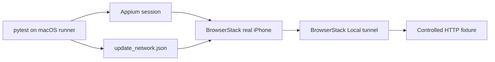

# iOS Cloud Performance And Weak Network

## 1. Purpose

Use a real iPhone in BrowserStack when no local macOS device is available.
Separate three different questions:

| Question | Measurement | Not equivalent to |
| --- | --- | --- |
| Can the app launch and reach a stable UI? | Appium command time to visible title | XCUITest first-frame time |
| Does weak network change app behavior? | Controlled HTTP status and end-to-end UI settle time | Device radio or SUT packet capture |
| Is native iOS performance healthy? | Instruments, `xctrace`, MetricKit | Appium command duration |

The Week 30 cloud workflow covers the first two. Native Instruments and
MetricKit remain a separate macOS capability.

## 2. Performance Workflow

Workflow:

```text
.github/workflows/ios-week30-mobile-performance.yml
```

The macOS runner:

1. Builds `QaIosFixture.ipa`.
2. Uploads it to BrowserStack.
3. Creates a real iPhone Appium session.
4. Runs five `terminateApp -> activateApp -> title visible` cycles.
5. Runs five `background_app(1) -> title visible` cycles.
6. Fetches a sanitized BrowserStack session record.
7. Uploads JSON, JUnit, and Allure evidence.

The timing includes Appium transport and UI polling:

```text
Runner
-> BrowserStack hub
-> real-device Appium server
-> XCUITest commands
-> app UI
-> response back to runner
```

Do not call that number native cold-start time. It measures the cloud control
path plus app readiness.

## 3. Weak-Network Architecture

Workflow:

```text
.github/workflows/ios-week30-weak-network.yml
```



The test uses the real iOS app catalog request:

```text
1. Normal network -> active
2. 3g-umts-lossy -> active and slower
3. no-network -> visible error
4. reset -> active again
```

The controlled server is
`scripts/run_mobile_network_fixture.py`. BrowserStack Local exposes the runner's
port `8765` to the device as `http://bs-local.com:8765`.

The provider capability is set under `bstack:options`:

```json
{
  "bstack:options": {
    "local": true,
    "localIdentifier": "<runner-generated-id>",
    "networkProfile": "3g-umts-lossy"
  }
}
```

Mid-session changes use:

```text
PUT /app-automate/sessions/{session_id}/update_network.json
{"networkProfile": "3g-umts-lossy" | "no-network" | "reset"}
```

`PASS` requires all of:

- baseline request is active;
- provider accepts all network updates;
- lossy request remains successful and is at least 5% slower;
- no-network produces an observable app error;
- reset returns the app to active.

If BrowserStack accepts a profile but BrowserStack Local traffic is not shaped,
the result is `PARTIAL`, not `PASS`.

## 4. Why Not Disable Wi-Fi

Disabling a device radio proves only that the connection was toggled. It does
not prove:

- which request the app made;
- whether the app surfaced an error;
- whether retry or cache behavior worked;
- whether recovery happened;
- whether the provider actually applied the requested profile.

The test must observe an app-level outcome.

## 5. Local Android Alternative

Android does not need device-cloud shaping for the controlled fixture path:

```text
controlled HTTP server on host:8765
-> Toxiproxy host/container proxy
-> adb reverse tcp:<proxy-port> tcp:<proxy-port>
-> Android fixture catalog request
```

Run the fixture server:

```powershell
.\.venv\Scripts\python.exe scripts\run_mobile_network_fixture.py --port 8765
```

Create a Toxiproxy proxy whose upstream reaches the host server, then expose the
proxy port with:

```powershell
adb -s <serial> reverse tcp:18100 tcp:18100
```

Point the fixture catalog URL to `http://127.0.0.1:18100` and add:

- latency toxic for slow response;
- bandwidth toxic for low throughput;
- timeout or closed proxy for outage;
- remove toxic for recovery.

This is packet-level and reversible for the app path, unlike changing the
device's global Wi-Fi setting.

## 6. Evidence Boundaries

- BrowserStack session status does not prove first-frame rendering.
- `networkProfile` applies to the provider session, not the project SUT's
  production network.
- The controlled HTTP fixture is not a production service.
- The cloud test uses one real iPhone and iOS version.
- WebView context remains a known strict `xfail` on BrowserStack.
