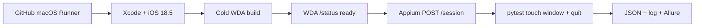
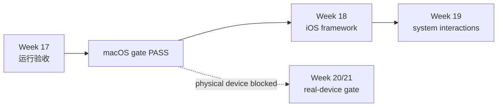

# DAY-08 - iOS 环境验收恢复与 macOS Simulator 通过 / iOS Environment Acceptance Restored

- 日期 / Date: 2026-10-31
- 范围 / Scope: Week 17 iOS 环境、WDA、Appium session 与真实 smoke
- 结果 / Result: **Simulator PASS；physical device DEFERRED**

## 完成范围 / Scope

- Windows 本机 Simulator 和设备 profile 预检均正确失败，原因是缺少 macOS/Xcode。
- 确认 GitHub 托管 macOS Runner 可用。
- 确认自托管 iOS Runner 数量为 0，物理设备门仍未放行。
- 首次 macOS 运行通过环境预检，但 WDA 冷启动超过 240 秒，smoke 超时。
- 调整 WDA 冷启动预算为 600 秒，开启 Xcode 日志，并提高 smoke 外层超时。
- 第二次 macOS 运行成功完成 WDA、XCUITest session、窗口读取和 session 退出。
- 下载并检查环境 JSON、Appium 日志和 Allure 结果。
- 增加设备云 provider adapter 和 cloud smoke workflow；当前缺少 Secret 与 App。
- 配置 BrowserStack Username/Access Key，并使用官方 sample App 完成真实设备 session。

## 术语解释 / Glossary

| 名词 / Term | 简单解释 / Plain Meaning | 本项目位置 / Project Mapping |
| --- | --- | --- |
| macOS Runner | 运行 Xcode 的 macOS 构建机 | GitHub `macos-15-arm64` |
| WDA | 把 XCTest 暴露为 WebDriver 接口的代理程序 | `WebDriverAgentRunner` |
| 冷启动 | Runner 上没有可复用的 WDA 构建缓存 | `useNewWDA=true` |
| Session | Appium 与 Simulator/WDA 之间的一次操作会话 | `POST /session` |
| Smoke | 最小但真实的端到端执行证据 | `tests/ios/test_session.py` |

## 通俗解读 / Plain-Language Guide

WDA 像 iOS 自动化的“遥控器服务”。macOS、Xcode 和 Simulator 是房间，
但遥控器服务没有启动时，Appium 只能一直敲门，无法真正操作 App。



第一次失败不是产品失败，而是等待预算不足：WDA 最终在 211.615 秒后 ready，
但旧配置的重试和 pytest 总超时没有给它完整机会。调整后，session 正常创建，
窗口尺寸为 `393 x 852`，退出返回 HTTP 200。

## 今日在整体路线中的位置 / Day Position



Week 17 环境门关闭后，下一步恢复 Week 18。物理设备门独立保留，不能把
Simulator 结果写成真机通过。

## 设备云路径 / Device Cloud Path

物理门选择设备云作为后续路线：

- 默认 BrowserStack，同时支持 Sauce Labs 和 LambdaTest capability。
- `qa_core.driver.ios` 按 provider 生成嵌套 vendor options。
- `.github/workflows/ios-cloud-smoke.yml` 验证凭据、连接真实云设备并运行 smoke。
- 所需 Secret：`IOS_CLOUD_USER`、`IOS_CLOUD_ACCESS_KEY`、`IOS_CLOUD_APP`。
- Username 和 Access Key 已配置；`bs://sample.app` 真实 session 已通过。
- `IOS_CLOUD_APP` 和项目自己的签名 App 仍未配置。

## 质量检查 / Quality Checks

| 检查 / Check | 结果 / Result | 环境 / Environment |
| --- | --- | --- |
| Targeted iOS unit tests | PASS，14 passed | Windows |
| Ruff | PASS | Windows |
| Mypy | PASS，148 files on acceptance branch | Windows |
| macOS environment preflight | PASS | macOS 15.8.2 arm64 |
| WDA build/start | PASS，211,615 ms | Xcode 16.4 |
| XCUITest session | PASS | iOS 18.5 Simulator |
| pytest iOS smoke | PASS，1 passed in 242.06s | macOS Runner |
| Physical device | DEFERRED | no self-hosted/cloud device |
| Cloud provider unit tests | PASS | provider capability mapping |
| Cloud real-device session | PASS | iPhone 14 / iOS 16，`1 passed in 18.52s` |
| Cloud project App session | NOT RUN | `IOS_CLOUD_APP` 尚未配置 |

## 验收方式 / Acceptance Method

运行：

```powershell
gh workflow run ios-smoke.yml --ref codex/ios-environment-acceptance-20261031
gh run watch 41167106841 --exit-status
gh run download 41167106841 --name ios-appium-diagnostics
```

通过证据：

- Run conclusion = `success`。
- `ios-environment.json` 中 `passed=true`。
- Appium 日志出现 `WebDriverAgent successfully started`。
- `POST /session` 成功，窗口尺寸大于 0。
- pytest 输出 `1 passed`。
- Allure result JSON 已上传。

## 变更文件 / Files Changed

- `.github/workflows/ios-smoke.yml`
- `tests/ios/test_session.py`
- `tests/ios/test_cloud_session.py`
- `tests/unit/test_ios_driver_options.py`
- `tests/unit/test_settings.py`
- `packages/qa_core/config/settings.py`
- `packages/qa_core/driver/ios.py`
- `.github/workflows/ios-cloud-smoke.yml`
- `.env.example`
- `docs/runbooks/ios-cloud-device-provider.md`
- `docs/runbooks/ios-xcuitest-simulator.md`
- `docs/GOALS.md`
- `docs/PLAN.md`
- `reports/weekly/WEEK-17.md`
- `reports/weekly/WEEK-18.md`
- `reports/weekly/WEEK-19.md`
- `reports/daily/DAY-08.md`

## 环境 / Environment

- GitHub-hosted macOS 15 arm64
- Xcode 16.4
- iPhone 16 Simulator，iOS 18.5
- Appium 2.19.0
- XCUITest Driver 8.4.3
- WDA 9.2.0

## 风险与限制 / Risks and Limitations

- WDA 冷启动接近 4 分钟，macOS Runner 容量会影响总体耗时。
- 当前只验证 Simulator；签名、Provisioning、设备信任和真机行为未验证。
- Week 18 的 capability、locator、keyboard、gesture 和 Screen/Flow 尚未实现。
- Week 20/21 的真机矩阵仍需要物理设备门先放行。

## 下一步 / Next Day

恢复 Week 18：

1. 建立 iOS capability profile。
2. 增加 iOS accessibility id、predicate 和 class chain locator。
3. 复用显式等待、键盘和基础手势。
4. 增加 iOS Screen/Flow smoke。
5. 在 macOS Runner 上记录真实页面操作和 Allure 证据。
