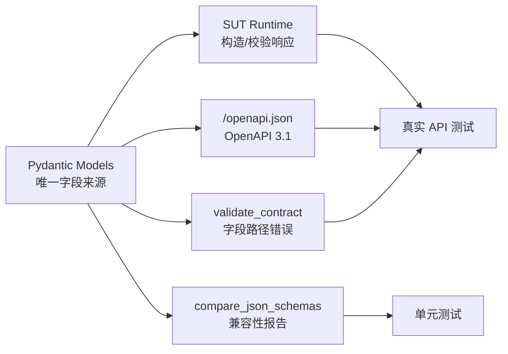
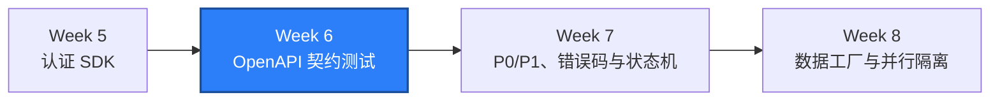

# WEEK-06 - OpenAPI、Pydantic 与兼容性契约 / OpenAPI, Pydantic, and Compatibility Contracts

- 计划 / Plan: Week 6，Pydantic、JSON Schema、OpenAPI 和兼容性
- 日期范围 / Date Range: 2026-10-12
- 分支 / Branch: study/week-06-contract-testing
- 基线提交 / Base Commit: a061e4b
- 计划提交 / Plan Commit: 3cb03ea
- Pull Request: https://github.com/htb123-maker/quality-engineering-lab/pull/1

## 计划目标 / Plan Goal

Week 6 的目标是让 API 响应从无类型字典升级为可执行契约。Pydantic 模型负责
运行时字段和类型校验，同一批模型生成 OpenAPI 3.1 JSON Schema；测试可以区分
兼容变化和破坏变化，并把错误定位到具体字段路径。

English summary: deliver one shared response contract source for runtime
validation, OpenAPI 3.1 documentation, field-path diagnostics, and deterministic
compatibility decisions.

## 完成状态 / Completion Status

通过 / PASS（Windows 本机 + Linux 容器）。

- Windows 本机：Ruff、Mypy、33 条单元测试和 9 条真实 API 测试通过。
- Linux 容器：4 条数据库/SUT 集成测试和 9 条 API 契约合计 `13 passed`。
- Compose SUT 已重建，API 容器 healthy。
- `/openapi.json` 与测试中生成的 OpenAPI 文档完全一致。

## 完成范围 / Scope

- 新增 `qa_core.contracts` 契约包。
- 用 Pydantic 定义 token、用户、OIDC、目录、审计、注销和错误响应。
- 所有关键 SUT 响应由共享模型构造或校验。
- 新增 `/openapi.json`，固定 OpenAPI `3.1.0`。
- 新增字段级 `ContractValidationError`，生成 `$.field` JSON 路径。
- 新增 JSON Schema 兼容性比较器和破坏性判定规则。
- 认证 SDK 的 token 响应复用 `TokenResponse`，不再单独解析字段。
- SUT 容器复制共享契约包，并安装锁定版本 Pydantic。
- `check_sut.py` 增加 OpenAPI 契约检查。
- 新增 ADR、runbook、单元测试、API 测试和周报。

不在本计划内：

- 负向、边界、错误码和状态机主测试集，属于 Week 7。
- 30 条以上完整契约测试规模，属于接口阶段逐步累积。
- Schemathesis 属性测试和外部 OpenAPI Diff 工具。
- 请求体 Pydantic 模型和 WebSocket/异步事件契约。

## 术语解释 / Glossary

| 名词 / Term | 简单解释 / Plain Meaning | 作用 / Purpose | 在本项目中的位置 / Position |
| --- | --- | --- | --- |
| Pydantic Model | 用 Python 类型描述运行时数据结构 | 解析、类型检查和 JSON Schema 生成 | `qa_core.contracts.api` |
| JSON Schema | 描述 JSON 字段、类型和约束的标准 | 判断结构是否合法和支持工具生态 | `/openapi.json` components |
| OpenAPI | 描述 API 路径、请求和响应的标准 | 给客户端、测试和文档统一契约 | `/openapi.json` |
| Runtime Validation | 对真实响应执行模型校验 | 防止实现与测试字段漂移 | `validate_contract()` |
| Compatibility | 新契约是否仍满足旧调用方 | 区分安全演进和破坏变化 | `compare_json_schemas()` |
| Breaking Change | 会让旧调用方失效的变化 | 触发版本和迁移决策 | 删除字段、改类型等 |
| Non-breaking Change | 旧调用方通常仍能工作的变化 | 允许演进但保留评审证据 | 新增可选字段 |
| `$ref` | OpenAPI/JSON Schema 的引用 | 复用 component，避免重复 Schema | `#/components/schemas/...` |
| Extra Forbidden | 出现未声明字段就失败 | 显式发现契约漂移 | `ContractModel` |

## 通俗解读 / Plain-Language Guide

把 API 契约想成餐厅菜单：Pydantic 模型是菜单的正式版本，OpenAPI 是给外部客人
看的菜单，测试则在每道菜上桌前核对盘子里是否真的只有菜单写明的项目。兼容性
比较器负责判断“加一道可选配菜”是否安全，以及“把主菜换成另一种食材”是否会
让老客人无法接受。



**一句话理解：** 本计划把“文档写一套、代码写一套、测试猜一套”改成“一套模型
同时负责响应、文档和兼容性判断”。

## 计划在整体路线中的位置 / Plan Position



Week 6 给后续业务测试提供稳定响应类型。Week 7 会在这层契约之上集中建设负向、
边界、错误码、幂等和状态转换测试。

## 质量检查 / Quality Checks

| 检查项 / Check | 结果 / Status | 执行环境 / Environment | 证据 / Evidence |
| --- | --- | --- | --- |
| Ruff | 通过 / PASS | Windows | `All checks passed!` |
| Mypy | 通过 / PASS | Windows | `Success: no issues found in 40 source files` |
| Unit tests | 通过 / PASS | Windows | `33 passed` |
| API auth + contract | 通过 / PASS | Windows + Compose SUT | `9 passed` |
| Linux integration + API | 通过 / PASS | Linux container | `13 passed` |
| SUT rebuild | 通过 / PASS | Docker Compose | API、PostgreSQL、Redis healthy |
| OpenAPI runtime equality | 通过 / PASS | Windows API test | `/openapi.json == openapi_document()` |
| Compatibility rules | 通过 / PASS | Unit tests | 兼容、必填、删字段、类型、枚举 |
| Allure | 通过 / PASS | Windows API tests | `artifacts/allure-report-week6/index.html` |

## 验收方式 / Acceptance Method

### 前置条件 / Preconditions

1. 使用项目 `.venv`，Python 3.12。
2. Docker Desktop Linux engine 正常运行。
3. Compose SUT 已重建并处于 healthy。
4. 本地 SUT 测试账号使用 `.env.example` 中的测试默认值。

### 静态与单元检查 / Static and Unit Checks

```powershell
.\.venv\Scripts\python.exe -m ruff check .
.\.venv\Scripts\python.exe -m mypy packages tests
.\.venv\Scripts\python.exe -m pytest tests\unit -q -p no:cacheprovider
```

实际结果 / Actual results:

```text
All checks passed!
Success: no issues found in 40 source files
33 passed in 0.30s
```

### 本地 API 契约验收 / Local API Contract Acceptance

```powershell
docker compose -f apps\compose\compose.yaml up `
  --detach --build --wait --wait-timeout 120
.\.venv\Scripts\python.exe -m pytest tests\api -q -p no:cacheprovider
```

实际结果 / Actual results:

```text
Container quality-engineering-lab-api-1 Healthy
9 passed in 1.14s
```

### Linux 容器验收 / Linux Container Acceptance

```powershell
.\scripts\run_integration_linux.ps1 -SkipSutStart
```

实际结果 / Actual results:

```text
.............                                                            [100%]
13 passed in 1.22s
```

### Allure 证据 / Allure Evidence

```powershell
.\.venv\Scripts\python.exe -m pytest tests\api -q -p no:cacheprovider `
  --alluredir=artifacts\allure-results-week6
npx --yes --package allure-commandline@2.34.1 `
  allure generate artifacts\allure-results-week6 `
  --clean -o artifacts\allure-report-week6
```

实际结果 / Actual results:

```text
9 passed in 1.18s
Report successfully generated to artifacts\allure-report-week6
```

### 证据路径 / Evidence

- 响应模型: `packages/qa_core/contracts/api.py`
- 字段路径校验: `packages/qa_core/contracts/validation.py`
- 兼容性比较: `packages/qa_core/contracts/compatibility.py`
- OpenAPI 生成: `packages/qa_core/contracts/openapi.py`
- SUT 契约路由: `apps/compose/api/app.py`
- 单元测试: `tests/unit/test_contracts.py`
- API 契约测试: `tests/api/test_contracts.py`
- ADR: `docs/adr/0004-openapi-contract-source-and-compatibility.md`
- Runbook: `docs/runbooks/contract-test-failures.md`
- Windows Allure: `artifacts/allure-report-week6/index.html`

### 未验证项 / Unverified Items

- 未接入 Schemathesis、OpenAPI Diff 或外部契约注册中心。
- 未为所有请求体建立 Pydantic Request Model。
- 未覆盖 WebSocket、异步事件、分页和复杂 `oneOf`/`discriminator`。
- 当前兼容性比较器不替代完整 OpenAPI 语义 Diff。
- Windows 本机仍受 Smart App Control 限制，PostgreSQL 集成依赖 Linux 容器。
- 已提交并推送（`3cb03ea`），Pull Request 已创建（#1）。

## 变更文件 / Files Changed

- `apps/compose/api/Dockerfile`
- `apps/compose/api/app.py`
- `apps/compose/api/requirements.txt`
- `docs/adr/0004-openapi-contract-source-and-compatibility.md`
- `docs/runbooks/contract-test-failures.md`
- `packages/qa_core/auth/client.py`
- `packages/qa_core/contracts/__init__.py`
- `packages/qa_core/contracts/api.py`
- `packages/qa_core/contracts/compatibility.py`
- `packages/qa_core/contracts/openapi.py`
- `packages/qa_core/contracts/validation.py`
- `reports/weekly/WEEK-05.md`
- `reports/weekly/WEEK-06.md`
- `scripts/check_sut.py`
- `tests/api/test_contracts.py`
- `tests/unit/test_contracts.py`

## 环境 / Environment

- Python: 3.12，项目 `.venv`
- Pydantic: 2.13.5
- Docker Desktop: Linux engine 29.8.1
- SUT API: `http://127.0.0.1:18000`
- PostgreSQL: `127.0.0.1:15432`
- Redis: `127.0.0.1:16379`
- OpenAPI: 3.1.0

## 风险与限制 / Risks and Limitations

- Pydantic Schema 是契约核心，破坏性评审和版本策略仍需要人工判断。
- `extra="forbid"` 会让任何未声明字段变化立即暴露，需要维护者同步更新契约。
- OpenAPI 请求体尚未完全模型化，当前重点是响应契约。
- 兼容性规则只覆盖本项目目前使用的 Schema 结构，不能替代通用 OpenAPI Diff。
- SUT 容器依赖 Pydantic；镜像需要重建后才能提供新版 OpenAPI。
- 本地 `check_sut.py` 仍可能被 Smart App Control 阻止 `psycopg` 导入，HTTP
  契约和 Linux 容器验收不受影响。

## 下一步 / Next Plan

进入 Week 7 API P0/P1 测试集：

1. 覆盖缺失、非法、边界和类型错误请求。
2. 统一 400、401、403、404、409、422、429 和 5xx 的错误语义。
3. 为关键写操作建立幂等键、重复提交和状态转换测试。
4. 覆盖 token 过期、权限不足、重复刷新和资源不存在。
5. 继续复用 `HttpClient`、`AuthClient` 和 `qa_core.contracts`。

Week 7 的验收标准是每条核心 API 至少有正向、负向和边界验证，错误码可以区分
产品、测试、认证、权限和环境问题。
