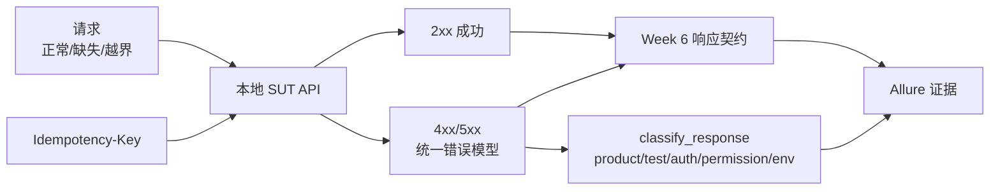
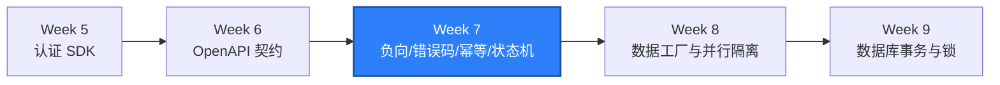

# WEEK-07 - 负向、边界、错误码、幂等与状态机 / Negative, Boundary, Error Codes, Idempotency, and State Machines

- 计划 / Plan: Week 7，负向、边界、错误码、幂等和状态机
- 日期范围 / Date Range: 2026-10-13
- 分支 / Branch: study/week-07-p0-p1-test-suite
- 基线提交 / Base Commit: 0151a1b（week-06 分支）
- 计划提交 / Plan Commit: pending
- Pull Request: pending

## 计划目标 / Plan Goal

Week 7 把 Week 6 的“响应契约”推进为“行为契约”：不只验证 200 时的字段形状，
还要验证请求缺失、类型错误、边界值、错误码、幂等重放和状态转换。交付一个可
独立执行的 API P0/P1 测试集，让每次失败都能落到明确来源：产品缺陷、测试缺陷、
认证问题、权限问题或环境问题。

English summary: turn the Week 6 typed response contract into a P0/P1 behavioral
suite that covers negative input, boundary values, error codes, idempotent
retries, and state transitions, and that classifies each failure as product,
test, auth, permission, or environment.

## 完成状态 / Completion Status

通过 / PASS（Windows 本机 + Linux 容器）。

- Windows 本机：Ruff、Mypy（49 个源文件）、63 条单元测试和 53 条 API 测试通过。
- 本机 SUT 就绪检查首次全项通过：`check_sut.py` 返回 `SUT ready: True`。
- Linux 容器：4 条数据库/SUT 集成测试和 53 条 API 测试合计 `57 passed`。
- 写接口测试结束后，种子行数仍为 `workspaces=2`、`users=3`、`items=4`。
- Allure 报告已生成，负向、幂等、状态机和限流证据可见。

## 完成范围 / Scope

为每个 P0/P1 接口补齐正向、负向和边界三类验证，并统一错误语义。

1. 负向与边界输入
   - token 端点：缺少或非法 `grant_type`、缺少 `username`/`refresh_token`、
     空密码、错误密码、损坏 JSON、非法 `Content-Type`。
   - 目录写接口：缺字段、类型错误、空名、超长值、非法 SKU 字符、未知字段。
   - 路径：未知 workspace（404）、大小写敏感 slug、未知路由（404）。
2. 统一错误语义
   - `400`：`invalid_request`、`unsupported_grant_type`、`invalid_grant`。
   - `401`：`authentication_required`、`invalid_token`。
   - `403`：`permission_denied`。
   - `404`：`not_found`、`workspace_not_found`、`item_not_found`。
   - `409`：`sku_conflict`、`idempotency_conflict`、
     `invalid_state_transition`。
   - `422`：`validation_failed`，带逐字段 `$.field` 路径。
   - `429`：`rate_limited`，带 `Retry-After`。
3. 幂等
   - 新增 `POST /api/v1/workspaces/{slug}/catalog/items`，支持
     `Idempotency-Key`。
   - 同键同 body 回放首次响应并返回 `Idempotent-Replay: true`。
   - 同键不同 body 返回 `409 idempotency_conflict`，不产生第二条记录。
   - 无键时重复请求由唯一约束拒绝，作为非幂等对照。
4. 状态机
   - `PATCH /api/v1/workspaces/{slug}/catalog/items/{item_id}` 只允许
     `active -> archived`。
   - 其余转换返回 `409 invalid_state_transition`；未知状态值返回 `422`。
5. 认证与权限边界
   - 用本地密钥构造过期、issuer 错误、签名伪造和缺少 `sub` 的 JWT，均返回
     `401 invalid_token`；再用一条正确构造的 JWT 作为阳性对照返回 200。
   - viewer 无法创建；owner 无法写入其他 workspace，均返回 403。
   - 限流按 `X-QA-Client-Id` 隔离，超过预算返回 429。
6. 失败分类
   - 新增 `qa_core.api_errors`：把“状态码 + 错误码”映射为
     product/test/auth/permission/environment，供 Allure 与失败分诊复用。

不在本计划内：

- 数据工厂、数据库种子、120 条 API 测试与并行隔离，属于 Week 8。
- 数据库事务、隔离级别、锁和死锁测试，属于 Week 9。
- Redis TTL、缓存失效与一致性，属于 Week 10。
- RBAC/BOLA/限流完整安全测试集，属于 Week 11。
- Schemathesis 属性测试与外部 OpenAPI Diff 工具。

## 术语解释 / Glossary

| 名词 / Term | 简单解释 / Plain Meaning | 作用 / Purpose | 在本项目中的位置 / Position |
| --- | --- | --- | --- |
| 负向测试 / Negative Test | 故意输入非法数据，验证系统正确拒绝 | 证明系统不会默默接受坏数据 | `tests/api/test_negative_inputs.py` |
| 边界值 / Boundary Value | 合法与非法交界处的最小/最大取值 | 最容易被离一错误击穿的取值 | `tests/api/test_boundary_inputs.py` |
| 错误码 / Error Code | 机器可读的失败标识，如 `invalid_grant` | 让程序化断言和分诊不靠猜文本 | 错误响应 `error` 字段 |
| 幂等 / Idempotency | 同一请求重复执行，结果与执行一次相同 | 让重试安全，不产生重复副作用 | `Idempotency-Key` + 目录写接口 |
| 状态机 / State Machine | 资源只能按规则在状态间转换 | 阻止非法状态跳转 | catalog item 的 `active`/`archived` |
| 409 Conflict | 请求与当前资源状态冲突 | 表达幂等冲突和非法状态转换 | `idempotency_conflict`、`invalid_state_transition` |
| 422 Unprocessable | 语法正确但字段校验不通过 | 区分“格式错”和“字段错” | `ValidationErrorResponse.fields` |
| 429 Too Many Requests | 触发限流 | 让调用方按 `Retry-After` 退避 | 写接口固定窗口限流 |
| P0/P1 | 优先级：P0 阻断核心、P1 重要 | 决定本计划先覆盖哪些接口 | 认证、目录、审计、写接口 |
| 失败分类 / Failure Classification | 把失败归到产品/测试/认证/权限/环境 | 决定谁来修、下一步查哪里 | `qa_core/api_errors.py` |

## 通俗解读 / Plain-Language Guide

Week 6 核对的是“盘子里有没有菜单写明的菜”。Week 7 检查的是“客人点错、点空、
重复点、点一个不存在的菜时，服务员有没有正确回应”。正向测试只证明点对了菜能
上菜；负向和边界测试要求点错菜时给出正确的拒绝理由，而不是端上来一盘错的。
幂等键像取号机：同一张号单再来一次，给的是同一份结果，而不是再做一份。



**一句话理解：** Week 7 给 API 装上一套“拒绝话术 + 防重复按钮 + 状态红绿灯”，
让坏输入和重复请求都得到明确、可分类的回应。

## 计划在整体路线中的位置 / Plan Position



Week 7 依赖 Week 5 的认证 SDK 和 Week 6 的响应契约；它产出的错误分类表、
幂等与状态机测试，是 Week 8 数据工厂、Week 11 安全测试和 Week 23 E2E 的公共
基础。数据准备、事务和缓存一致性仍留给后续周次。

## 质量检查 / Quality Checks

| 检查项 / Check | 结果 / Status | 执行环境 / Environment | 证据 / Evidence |
| --- | --- | --- | --- |
| Ruff | 通过 / PASS | Windows | `All checks passed!` |
| Mypy | 通过 / PASS | Windows | `Success: no issues found in 49 source files` |
| Unit tests | 通过 / PASS | Windows | `63 passed` |
| API P0/P1 | 通过 / PASS | Windows + Compose SUT | `53 passed` |
| Linux container | 通过 / PASS | Linux container | `57 passed` |
| SUT readiness | 通过 / PASS | Windows | `check_sut.py` → `SUT ready: True` |
| Seed integrity | 通过 / PASS | Windows + container | `verify_sut_database.ps1` → `PASS` |
| Allure | 通过 / PASS | Windows | `artifacts/allure-report-week7/index.html` |

## 验收方式 / Acceptance Method

### 前置条件 / Preconditions

1. 使用项目 `.venv`，Python 3.12。
2. Docker Desktop Linux engine 运行中，Compose SUT 已重建并 healthy。
3. 本地测试账号使用 `.env.example` 中的测试默认值。

### 静态与单元检查 / Static and Unit Checks

```powershell
.\.venv\Scripts\python.exe -m ruff check .
.\.venv\Scripts\python.exe -m mypy packages tests
.\.venv\Scripts\python.exe -m pytest tests\unit -q -p no:cacheprovider
```

实际结果 / Actual results:

```text
All checks passed!
Success: no issues found in 49 source files
63 passed in 0.29s
```

### 本机 API 与 SUT 就绪 / Local API and SUT Readiness

```powershell
docker compose -f apps\compose\compose.yaml up `
  --detach --build --wait --wait-timeout 180
.\.venv\Scripts\python.exe scripts\check_sut.py
.\.venv\Scripts\python.exe -m pytest tests\api -q -p no:cacheprovider
.\scripts\verify_sut_database.ps1
```

实际结果 / Actual results:

```text
PASS API live / API ready / OpenAPI contract / Seeded catalog
PASS PostgreSQL: counts={'workspaces': 2, 'users': 3, 'items': 4}
PASS Redis: ping=True
SUT ready: True
53 passed in 2.81s
Day 5 database verification: PASS
```

### Linux 容器验收 / Linux Container Acceptance

```powershell
.\scripts\run_integration_linux.ps1 -SkipSutStart
```

实际结果 / Actual results:

```text
.........................................................                [100%]
57 passed in 3.60s
```

### Allure 证据 / Allure Evidence

```powershell
.\.venv\Scripts\python.exe -m pytest tests\api -q -p no:cacheprovider `
  --alluredir=artifacts\allure-results-week7
npx --yes --package allure-commandline@2.34.1 `
  allure generate artifacts\allure-results-week7 `
  --clean -o artifacts\allure-report-week7
```

实际结果 / Actual results:

```text
53 passed in 4.00s
Report successfully generated to artifacts\allure-report-week7
```

### 证据路径 / Evidence Paths

- 契约模型：`packages/qa_core/contracts/api.py`
- 失败分类：`packages/qa_core/api_errors.py`
- JWT 构造助手：`packages/qa_core/auth/client.py`（`encode_hs256_jwt`）
- SUT 写接口：`apps/compose/api/app.py`
- 负向：`tests/api/test_negative_inputs.py`
- 边界：`tests/api/test_boundary_inputs.py`
- 幂等：`tests/api/test_idempotency.py`
- 状态机：`tests/api/test_state_machine.py`
- 限流：`tests/api/test_rate_limit.py`
- 认证边界：`tests/api/test_auth_boundaries.py`
- 单元：`tests/unit/test_error_taxonomy.py`、`tests/unit/test_contracts.py`
- ADR：`docs/adr/0005-api-error-taxonomy-idempotency-and-state-machine.md`
- Runbook：`docs/runbooks/api-negative-and-state-failures.md`
- Allure：`artifacts/allure-report-week7/index.html`

### 未验证项 / Unverified Items

- 幂等存储未验证并发同键竞态，属于后续并行与一致性专题。
- 限流是进程内固定窗口，未验证多实例或生产级精度。
- 5xx 只验证了错误模型与分类，未真实打断数据库或缓存来触发。
- 未接入 Schemathesis、OpenAPI Diff 或外部契约注册中心。
- 本次尚未提交、推送和创建 Pull Request。

## 变更文件 / Files Changed

- `.env.example`、`apps/compose/compose.yaml`
- `apps/compose/api/app.py`
- `packages/qa_core/api_errors.py`（新增）
- `packages/qa_core/auth/__init__.py`、`packages/qa_core/auth/client.py`
- `packages/qa_core/config/settings.py`
- `packages/qa_core/contracts/__init__.py`、`api.py`、`openapi.py`
- `scripts/check_sut.py`、`scripts/run_smoke_soak.py`
- `tests/api/conftest.py` 与 6 个 `tests/api/test_*.py`
- `tests/unit/test_contracts.py`、`tests/unit/test_error_taxonomy.py`（新增）
- `tests/unit/test_settings.py`
- `docs/adr/0001-...md`、`docs/adr/0005-...md`（新增）
- `docs/runbooks/local-sut-compose.md`、
  `docs/runbooks/api-negative-and-state-failures.md`（新增）
- `reports/weekly/WEEK-07.md`

## 环境 / Environment

- Python: 3.12，项目 `.venv`
- Pydantic: 2.13.5
- SUT API: `http://127.0.0.1:18000`
- PostgreSQL: `127.0.0.1:15432`
- Redis: `127.0.0.1:26379`（本机端口由 `16379` 调整，见下）
- Docker Desktop: Linux engine 29.8.1
- OpenAPI: 3.1.0

### 宿主机 Redis 端口调整 / Host Redis Port Change

本机 Windows 保留了 TCP 端口段 `16377-16476`，`16379` 无法绑定，导致
`check_sut.py` 的 Redis 检查长期失败。宿主机 Redis 端口改为 `26379`，容器内
仍为 `6379`。修改点：`apps/compose/compose.yaml`、`.env.example`、
`packages/qa_core/config/settings.py`、`scripts/check_sut.py`、
`scripts/run_smoke_soak.py`、`tests/unit/test_settings.py`、
`docs/runbooks/local-sut-compose.md`，并在 ADR-0001 加更新说明。

## 风险与限制 / Risks and Limitations

- 写接口会扩大 SUT 表面，必须保持“测试语义”，不能被误当作生产接口。
- 幂等指纹基于完整 body，字段语义变化时需同步评审指纹范围。
- 错误码集合一旦变化，`api_errors` 映射表与 runbook 必须同步更新。
- 状态机只有一条合法转换，是刻意选择的可判定性，不是真实业务建模。
- 删除接口只用于测试清理，需保证清理幂等，避免污染种子数据。
- 宿主机 Redis 端口依赖本机未被 Windows 保留；换机时需重新确认。

## 下一步 / Next Plan

进入 Week 8 数据工厂与并行隔离：

1. 建立数据工厂、数据库种子与幂等清理。
2. 引入资源池与 pytest-xdist 并行隔离（唯一命名空间）。
3. 把 API 测试规模扩展到 120 条，并保证多 worker 运行无数据污染。
4. 继续复用 `HttpClient`、`AuthClient`、`qa_core.contracts` 和
   `qa_core.api_errors`。

Week 8 的验收标准是多 worker 并行运行无数据污染，且清理可以重复执行而不报错。
