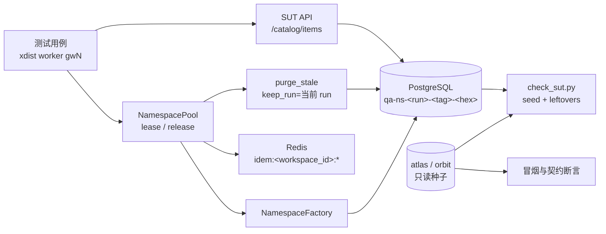
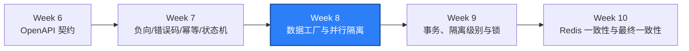

# WEEK-08 - 数据工厂、资源池与并行隔离 / Data Factories, Resource Pools, and Parallel Isolation

- 计划 / Plan: Week 8，数据工厂、数据库种子、清理、资源池、并行隔离
- 日期范围 / Date Range: 2026-10-14
- 分支 / Branch: study/week-08-data-factory-parallel-isolation
- 基线提交 / Base Commit: 1b82c10（week-07 分支）
- 计划提交 / Plan Commit: 待提交
- Pull Request: 基于 Week 7 分支的堆叠 PR（Week 7 为
  https://github.com/htb123-maker/quality-engineering-lab/pull/2）

## 计划目标 / Plan Goal

Week 7 把所有写入型 API 用例放在种子工作区 `atlas`，只能串行执行。Week 8 把这
些用例迁移到测试自有的命名空间，建立数据工厂、数据库种子与幂等清理，引入
资源池和 `pytest-xdist` 并行隔离，并把 API 测试规模扩展到 120 条以上。

English summary: move write tests into test-owned PostgreSQL namespaces, add a
data factory, record-style seeding, idempotent cleanup, and a per-worker
resource pool, then grow the API suite past 120 tests that pass in parallel
without polluting the seed data.

## 完成状态 / Completion Status

通过 / PASS（Windows 本机 + Linux 容器）。

- Windows 本机：Ruff、Mypy（65 个源文件）、86 条单元测试通过。
- Windows 本机 API：128 条用例，`127 passed, 1 xfailed`（串行 17.20s）。
- Windows 本机并行：`pytest -n 4` → `127 passed, 1 xfailed in 6.36s`。
- Linux 容器：`tests/integration` + `tests/api` 合计 `131 passed, 1 xfailed`。
- 运行后种子行仍为 `workspaces=2`、`users=3`、`items=4`，测试命名空间遗留数
  为 0。
- 失败验证已完成：人工插入一个 `qa-ns-*` 残留工作区后 `check_sut.py` 返回
  `SUT ready: False`（退出码 1）；下一次 API 会话开始时自动回收，检查恢复
  `PASS`。
- 唯一 xfail 是刻意保留的产品缺口：不支持的方法仍返回
  `BaseHTTPRequestHandler` 的 HTML 501 页面，而不是 JSON 错误契约。

## 完成范围 / Scope

1. 测试命名空间与数据工厂
   - `qa_core.db`：`DatabaseClient`（autocommit 连接、语句与查询助手、
     预留 `transaction()`）与 `WorkspaceRepository`（按自然键 upsert
     workspace、user、catalog item；按前缀删除/统计）。
   - `qa_core.data_factories`：`NamespaceFactory` 构造
     `qa-ns-<run>-<tag>-<hex>` 工作区、owner、viewer 与可选基线目录数据；
     `CatalogApiFactory` 通过 API 建删目录数据，供后续 Appium、Locust 复用。
   - 种子数据（`atlas`、`orbit` 及其用户和目录）保持只读。
2. 资源池与并行隔离
   - `qa_core.resource_pools.NamespacePool`：每个 worker 保留一个空闲命名
     空间，顺序复用；嵌套租约按需创建、释放即销毁。
   - 清理三级且幂等：`reset`（清目录 + 清幂等键）、`purge`（删工作区，
     级联删除依赖行）、`purge_stale(keep_run=...)`（回收历史运行）。
   - `qa_core.cache.purge_idempotency_keys()`：按工作区扫描并删除
     `idem:<workspace_id>:*`，使同一 `Idempotency-Key` 在第二轮运行不回放。
   - `tests/api/conftest.py` 改为 xdist 感知：`worker_id()`、`run_id()`、
     会话级 `namespace_pool`、函数级 `namespace`/`peer_namespace`/
     `owner_auth`/`viewer_auth`/`catalog_items`。
3. 测试规模与覆盖
   - API 测试从 53 条扩展到 128 条：新增数据工厂 13 条、命名空间隔离 10 条、
     并行隔离 8 条，并补齐边界、负向、幂等、状态机、限流、认证和契约用例。
   - 单元测试从 63 条扩展到 86 条：资源池租约语义、命名空间/slug/SKU 规则、
     Redis 幂等键清理。
4. 门禁与文档
   - `scripts/check_sut.py` 改为按身份校验种子，并新增
     `Namespace leftovers` 检查。
   - `scripts/run_api_parallel.ps1`：并行运行 API 套件并自动执行遗留检查。
   - `docs/adr/0006`、`docs/runbooks/parallel-data-isolation-failures.md`、
     `docs/runbooks/local-sut-compose.md` 更新。
   - `.github/workflows/sut-integration.yml` 改为 `-n 4` 运行完整 API 套件，
     并新增遗留命名空间门禁。

不在本计划内：

- 数据库事务、隔离级别、锁、死锁、索引和查询计划，属于 Week 9。
- Redis TTL、缓存失效与最终一致性，属于 Week 10。
- RBAC/BOLA/IDOR 与完整安全测试集，属于 Week 11。
- 缺陷系统集成与 Mock/Toxiproxy 故障注入，属于 Week 12 与 Week 24。

## 术语解释 / Glossary

| 名词 / Term | 简单解释 / Plain Meaning | 作用 / Purpose | 在本项目中的位置 / Position |
| --- | --- | --- | --- |
| 数据工厂 / Data Factory | 按规则批量构造测试数据的代码 | 让建数可复用、可读、可清理 | `packages/qa_core/data_factories/` |
| 数据库种子 / DB Seeding | 直接向测试库写入初始化数据 | 不依赖产品接口也能造出确定性前置数据 | `qa_core.db.WorkspaceRepository` |
| 命名空间 / Namespace | 每个测试独享的工作区 | 让数据互不可见，取代共享 `atlas` | slug `qa-ns-<run>-<tag>-<hex>` |
| 资源池 / Resource Pool | 预先维护可借还的资源集合 | 复用昂贵资源并保证归还时干净 | `qa_core.resource_pools.NamespacePool` |
| 租约 / Lease | 一段有开始和结束的独占使用权 | 保证释放时重置，避免状态外泄 | `pool.lease(...)` 上下文管理器 |
| 幂等清理 / Idempotent Cleanup | 清理重复执行也不报错、不漏数据 | 让中断后的重跑结果可预期 | `purge`、`purge_stale`、`reset` |
| 运行令牌 / Run Token | 一次测试运行的短标识 | 区分本轮与历史运行，避免误删同伴数据 | `PYTEST_XDIST_TESTRUNUID` |
| pytest-xdist | pytest 的多进程并行插件 | 缩短反馈时间并暴露共享状态 | `-n 4`、`worker_id()` |
| 遗留命名空间 / Leftover Namespace | 中断运行留下的 `qa-ns-*` 工作区 | 不清理会累积并掩盖真实数据问题 | `check_sut.py` 的 leftovers 检查 |
| 级联删除 / Cascade Delete | 删父行时自动删子行 | 让 `purge` 一次到位，无需手工顺序 | `ON DELETE CASCADE` |

## 通俗解读 / Plain Language Guide

Week 7 是“大家共用一张试验台，做完必须把器材摆回原位”。Week 8 改成“每位测试
工程师配一张自己的试验台”：台子上随便放什么都不会碰到别人的成果，离场时台子
自动清空，第二天再来还是干净的。资源池就像工具房的借还登记：一次只借一套，
还回去时先清点再放回架子。



**一句话理解：** Week 8 给每个并行 worker 发一张专属试验台，做完就擦干净，
并让“台面是否擦干净”成为一条会红的门禁。

## 计划在整体路线中的位置 / Plan Position



Week 8 依赖 Week 7 的写接口、幂等键和错误契约；它产出的数据工厂、资源池和并行
隔离是 Week 9 事务与锁实验、Week 10 缓存一致性、Week 12 并行与缺陷闭环、以及
后续 Appium/Locust 复用的公共基础。真实的数据库并发与锁行为仍留给 Week 9。

## 质量检查 / Quality Checks

| 检查项 / Check | 结果 / Status | 执行环境 / Environment | 证据 / Evidence |
| --- | --- | --- | --- |
| Ruff | 通过 / PASS | Windows | `All checks passed!` |
| Mypy | 通过 / PASS | Windows | `Success: no issues found in 65 source files` |
| Unit tests | 通过 / PASS | Windows | `86 passed` |
| API serial | 通过 / PASS | Windows + Compose SUT | `127 passed, 1 xfailed` |
| API parallel `-n 4` | 通过 / PASS | Windows + Compose SUT | `127 passed, 1 xfailed in 6.36s` |
| Linux container | 通过 / PASS | Linux container | `131 passed, 1 xfailed` |
| SUT readiness | 通过 / PASS | Windows | `SUT ready: True` |
| Seed integrity | 通过 / PASS | Windows + container | `verify_sut_database.ps1` → `PASS` |
| Leftover check | 通过 / PASS | Windows | `test_namespaces=0, prefix='qa-ns-'` |
| Cleanup failure path | 通过 / PASS | Windows | 注入 `qa-ns-*` → `SUT ready: False`（exit 1）→ 下一会话自动回收 |
| Allure | 通过 / PASS | Windows | `artifacts/allure-report-week8/index.html` |

`xfailed` 是刻意保留的产品缺口，不计为通过；详见“未验证项”。

## 验收方式 / Acceptance Method

### 前置条件 / Preconditions

1. 使用项目 `.venv`，Python 3.12。
2. Docker Desktop Linux engine 运行中，Compose SUT 已重建并 healthy。
3. 测试账号使用 `.env.example` 中的本地默认值；`QA_POSTGRES_DSN` 指向本地
   测试库，测试对其有写入权限。

### 静态与单元检查 / Static and Unit Checks

```powershell
.\.venv\Scripts\python.exe -m ruff check .
.\.venv\Scripts\python.exe -m mypy packages tests
.\.venv\Scripts\python.exe -m pytest tests\unit -q -p no:cacheprovider
```

实际结果 / Actual results:

```text
All checks passed!
Success: no issues found in 65 source files
86 passed in 0.42s
```

### 串行 API 与 SUT 就绪 / Serial API and SUT Readiness

```powershell
docker compose -f apps\compose\compose.yaml up `
  --detach --wait --wait-timeout 180
.\.venv\Scripts\python.exe -m pytest tests\api -q -p no:cacheprovider
.\.venv\Scripts\python.exe scripts\check_sut.py
.\scripts\verify_sut_database.ps1
```

实际结果 / Actual results:

```text
127 passed, 1 xfailed in 17.20s
PASS PostgreSQL seed: counts={'workspaces': 2, 'users': 3, 'items': 4}
PASS Namespace leftovers: test_namespaces=0, prefix='qa-ns-'
SUT ready: True
Day 5 database verification: PASS
```

### 并行隔离验收 / Parallel Isolation Acceptance

```powershell
.\scripts\run_api_parallel.ps1 -Workers 4
```

实际结果 / Actual results:

```text
127 passed, 1 xfailed in 6.36s
PASS Namespace leftovers: test_namespaces=0, prefix='qa-ns-'
SUT ready: True
```

### 清理失败验证 / Cleanup Failure Verification

```powershell
docker compose -f apps\compose\compose.yaml exec -T postgres `
  psql -U qa -d qa -c "INSERT INTO workspaces (slug, name) `
  VALUES ('qa-ns-leakcheck-0001', 'Leaked namespace');"
.\.venv\Scripts\python.exe scripts\check_sut.py
```

实际结果 / Actual results:

```text
FAIL Namespace leftovers: test_namespaces=1, prefix='qa-ns-'
SUT ready: False    (exit code 1)
```

随后运行 `run_api_parallel.ps1`，会话开始时的 `purge_stale()` 回收该残留，
`Namespace leftovers` 恢复 `PASS`。该工作区不会在下一步保留。

### Linux 容器验收 / Linux Container Acceptance

```powershell
.\scripts\run_integration_linux.ps1 -SkipSutStart
```

实际结果 / Actual results:

```text
131 passed, 1 xfailed in 12.18s
```

### Allure 证据 / Allure Evidence

```powershell
.\.venv\Scripts\python.exe -m pytest tests\api -q -p no:cacheprovider `
  --alluredir=artifacts\allure-results-week8
npx --yes --package allure-commandline@2.34.1 `
  allure generate artifacts\allure-results-week8 `
  --clean -o artifacts\allure-report-week8
```

实际结果 / Actual results:

```text
127 passed, 1 xfailed in 17.20s
Report successfully generated to artifacts\allure-report-week8
```

### 证据路径 / Evidence Paths

- 数据库客户端：`packages/qa_core/db/client.py`
- 数据仓库：`packages/qa_core/db/repositories.py`
- 数据工厂：`packages/qa_core/data_factories/namespaces.py`、`catalog.py`
- 资源池：`packages/qa_core/resource_pools/namespaces.py`
- 缓存清理：`packages/qa_core/cache/idempotency.py`
- 并行 fixtures：`tests/api/conftest.py`
- 数据工厂用例：`tests/api/test_data_factory.py`
- 命名空间隔离用例：`tests/api/test_namespace_isolation.py`
- 并行隔离用例：`tests/api/test_parallel_isolation.py`
- 单元用例：`tests/unit/test_namespace_pool.py`、
  `test_data_factories.py`、`test_cache_idempotency.py`
- 门禁与脚本：`scripts/check_sut.py`、`scripts/run_api_parallel.ps1`、
  `.github/workflows/sut-integration.yml`
- ADR：`docs/adr/0006-test-namespace-and-parallel-data-isolation.md`
- Runbook：`docs/runbooks/parallel-data-isolation-failures.md`、
  `docs/runbooks/local-sut-compose.md`
- Allure：`artifacts/allure-report-week8/index.html`

### 未验证项 / Unverified Items

- 同库并发跑两个不同 `run_token` 的测试会话时，会话开始的 `purge_stale()`
  会回收对方的活动命名空间。当前约定是“一个本地测试库同一时刻只跑一轮”。
- Redis 中登录产生的 `auth:refresh:*` 仍依赖 TTL，未做主动清理。
- 未在多台机器或分布式 runner 上验证资源池，只验证了本机 xdist。
- 数据库不可用、连接池耗尽等基础设施故障未做真实注入，属于 Week 9 与 Week 12。
- `test_unsupported_method_returns_the_json_error_contract` 为 `xfail(strict)`：
  不支持的方法返回 HTML 501，而不是 JSON 错误契约。是否登记为缺陷需人工批准。
- `.github/workflows/sut-integration.yml` 的改动只在本地等价命令上验证，未在
  GitHub Actions 上实际执行。

## 变更文件 / Files Changed

- `packages/qa_core/db/__init__.py`、`client.py`、`repositories.py`（新增）
- `packages/qa_core/data_factories/__init__.py`、`namespaces.py`、
  `catalog.py`（新增）
- `packages/qa_core/resource_pools/__init__.py`、`namespaces.py`（新增）
- `packages/qa_core/cache/__init__.py`、`idempotency.py`（新增）
- `tests/api/conftest.py`（重写为 xdist 感知的命名空间 fixtures）
- `tests/api/test_data_factory.py`、`test_namespace_isolation.py`、
  `test_parallel_isolation.py`（新增）
- `tests/api/test_auth.py`、`test_boundary_inputs.py`、`test_contracts.py`、
  `test_idempotency.py`、`test_negative_inputs.py`、`test_rate_limit.py`、
  `test_state_machine.py`（扩展与迁移到命名空间）
- `tests/unit/test_namespace_pool.py`、`test_data_factories.py`、
  `test_cache_idempotency.py`（新增）
- `scripts/check_sut.py`、`scripts/run_api_parallel.ps1`（新增）
- `.github/workflows/sut-integration.yml`
- `docs/adr/0006-test-namespace-and-parallel-data-isolation.md`（新增）
- `docs/runbooks/parallel-data-isolation-failures.md`（新增）、
  `docs/runbooks/local-sut-compose.md`
- `reports/weekly/WEEK-08.md`

## 环境 / Environment

- Python: 3.12，项目 `.venv`
- pytest: 8.x + `pytest-xdist`（`-n 4`）
- SUT API: `http://127.0.0.1:18000`
- PostgreSQL: `127.0.0.1:15432`
- Redis: `127.0.0.1:26379`
- Docker Desktop: Linux engine（Compose SUT 三容器 healthy）
- OpenAPI: 3.1.0，paths=12

## 风险与限制 / Risks and Limitations

- 测试直接写 PostgreSQL 是刻意取舍；若数据库权限收紧或改用共享环境，必须
  重新评审数据工厂的建数方式。
- 命名空间前缀 `qa-ns-` 是测试专用约定，清理逻辑依赖该前缀；人工调试数据不要
  使用该前缀。
- 资源池复用同一命名空间，任何遗漏的目录状态都会被下一次租约看到；因此
  teardown 不执行时可能产生串扰，runbook 给出了诊断顺序。
- 幂等键清理是按工作区扫描删除，工作区数量很大时需要关注扫描成本。
- `atlas`/`orbit` 现在完全只读，冒烟断言依赖种子不变；种子脚本变更时需同步
  `SEED_*` 常量（`packages/qa_core/db/repositories.py` 与
  `scripts/check_sut.py`）。
- 唯一 xfail 记录了产品缺口，修好后该用例会因 `strict=True` 变红，需要人工
  更新测试和报告。

## 下一步 / Next Plan

进入 Week 9 数据库 Schema、事务、隔离级别、锁与查询计划：

1. 建立 schema 迁移与查询计划的只读检查。
2. 覆盖提交/回滚、读已提交与可重复读的可见性差异。
3. 复现一个真实的锁等待与死锁案例，并留下等待图和日志证据。
4. 用 API 写入 + 数据库状态断言做联合验证，复用 Week 8 的命名空间与工厂。

Week 9 的验收标准是能定位并发事务的阻塞原因，并为每个结论提供 SQL 与日志证据。
