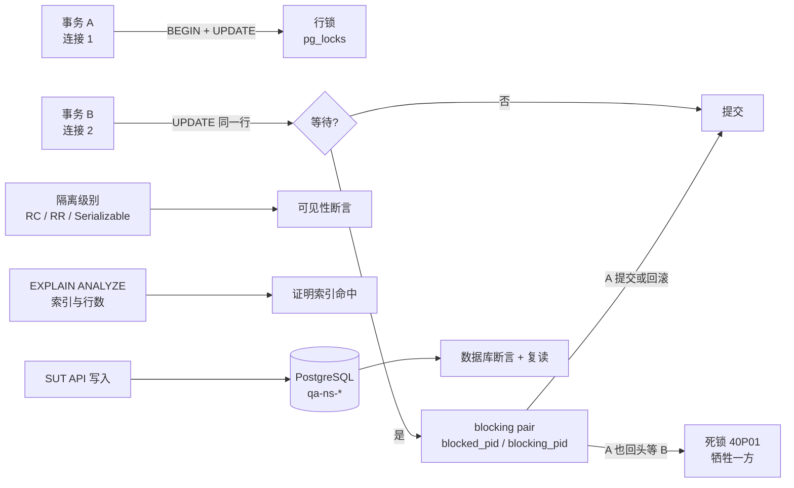
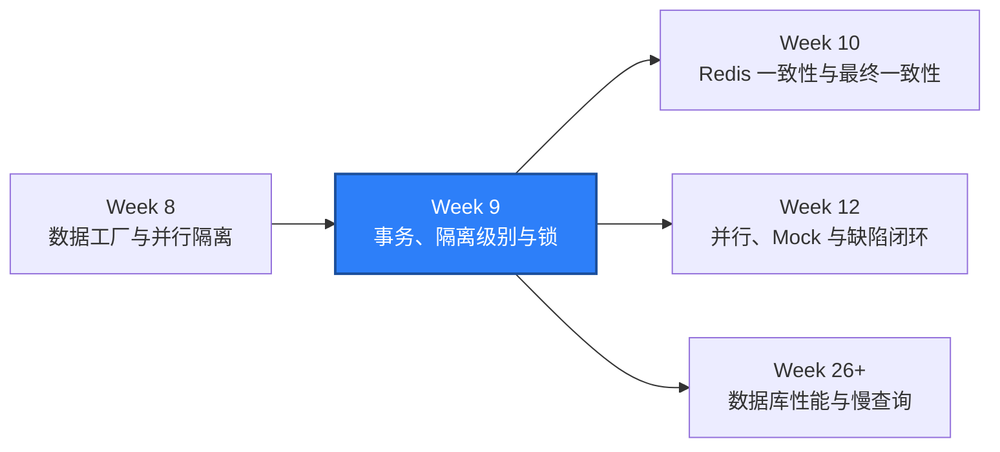

# WEEK-09 - 数据库 Schema、事务、隔离级别、锁与查询计划 / Database Schema, Transactions, Isolation Levels, Locks, and Query Plans

- 计划 / Plan: Week 9，Schema、事务、隔离级别、锁、死锁、索引和查询计划
- 日期范围 / Date Range: 2026-10-15
- 分支 / Branch: study/week-09-db-transactions-isolation-locks
- 基线提交 / Base Commit: b8b1712（week-08 分支）
- 计划提交 / Plan Commit: 待提交（本次工作提交）
- Pull Request: 待创建（等待人工确认后推送）

## 计划目标 / Plan Goal

Week 8 把写入型 API 用例搬进测试自有的命名空间，但只用到自动提交的单条语句：
种子、断言、清理。Week 9 进入数据库主线，把测试从“读最终状态”推进到“观察
并发过程中的中间状态”：用只读检查守住 Schema 契约，用两个以上连接复现提交、
回滚、保存点、隔离级别差异、行锁等待和真实死锁，并用 `EXPLAIN (ANALYZE,
BUFFERS)` 证明索引是否被使用，最后用 “API 写入 + 数据库断言” 把接口行为与
真实数据状态绑在一起。

English summary: extend the Week 8 namespace fixtures with multi-connection
database work: a read-only schema contract check, explicit transaction and
savepoint semantics, Read Committed vs Repeatable Read vs Serializable
visibility, a real row-lock wait with `pg_locks` evidence, a real deadlock with
SQLSTATE `40P01`, `EXPLAIN (ANALYZE, BUFFERS)` index evidence, and API + DB
joint state assertions.

## 完成状态 / Completion Status

通过 / PASS（Windows 本机 + Linux 容器）。

- Windows 本机：Ruff、Mypy（77 个源文件）、97 条单元测试通过。
- Windows 本机数据库集成：35 条用例通过（`tests/integration`，其中 31 条为
  Week 9 新增），包含真实行锁等待与真实死锁。
- Windows 本机 API：136 条用例，`135 passed, 1 xfailed`；`pytest -n 4` →
  `135 passed, 1 xfailed in 5.39s`，运行后遗留命名空间为 0。
- Linux 容器：`tests/integration` + `tests/api` 合计 `170 passed, 1 xfailed`。
- Schema 只读契约检查：`tables=3, views=1, violations=0`。
- 死锁证据：PostgreSQL 日志出现 `ERROR: deadlock detected`，
  `pg_stat_database.deadlocks` 在使用例前后 +1。
- 唯一 xfail 与 Week 8 相同（不支持的方法返回 HTML 501），不计为通过。

## 完成范围 / Scope

1. 只读 Schema 契约检查
   - `qa_core.db.schema`：用 `pg_catalog` 与 `information_schema` 读取表、列、
     主键、外键级联规则、唯一约束、CHECK 约束、索引和视图定义。
   - `scripts/check_schema.py`：把期望契约写成声明式规则，对本地 Compose
     PostgreSQL 做只读校验，输出可读行或 `--json`，schema 漂移时退出码为 1。
2. 事务语义
   - `qa_core.db.client.DatabaseClient` 支持显式关闭自动提交与设置隔离级别，
     并暴露后端 `pid`、事务状态和 `current_setting`。
   - 覆盖提交、回滚、保存点部分回滚、事务内唯一约束冲突、未提交数据对其他
     会话不可见（说明“测试事务回滚不能替代全部隔离方案”）。
3. 隔离级别
   - Read Committed：不可重复读与幻读可复现。
   - Repeatable Read：同一事务内重复读取结果稳定；并发更新同一行时
     返回 `40001 could not serialize access due to concurrent update`。
   - Serializable：两个事务并发更新同一行时，其中一个以 `40001` 失败。
   - 确认 PostgreSQL 不提供脏读（Read Uncommitted 等同 Read Committed）。
4. 锁、等待与死锁
   - `qa_core.db.locks`：`blocking_pairs` 读取 `pg_locks` + `pg_stat_activity`
     的阻塞对，`wait_for_blocking_pair` 轮询等待阻塞出现，`deadlock_count`
     读取 `pg_stat_database.deadlocks`。
   - 用例留下真实证据：阻塞方/被阻塞方 pid、`wait_event=Lock/transactionid`、
     锁模式 `ExclusiveLock` vs `ShareLock`、死锁 `40P01` 报错文本。
5. 索引与查询计划
   - `qa_core.db.plans`：`explain_json`、`plan_node_types`、`find_node`。
   - 用例证明复合索引 `idx_catalog_items_workspace_status` 在
     `(workspace_id, status)` 查询上被选择（Bitmap Index Scan），
     关闭 `enable_indexscan`/`enable_bitmapscan` 后退化为 Seq Scan，
     并记录 `Actual Rows`、`Shared Hit Blocks` 等真实执行数据。
6. API + DB 联合验证
   - API 创建/归档/删除后断言数据库真实行；数据库直接插入后通过 API 读取；
     重复 SKU 触发 `409 sku_conflict` 且数据库不产生第二行；并发写同一 SKU
     只有一个成功。
   - 归档后 `workspace_catalog_summary` 的 `item_count` 与
     `catalog_value_cents` 同步下降。

不在本计划内：

- Redis TTL、缓存失效、WebSocket 与最终一致性，属于 Week 10。
- RBAC/BOLA/IDOR、限流与输入安全，属于 Week 11。
- Mock、Toxiproxy 故障注入与缺陷系统闭环，属于 Week 12。
- 引入 Alembic/Flyway 之类迁移工具；本计划只做只读契约检查，原因见 ADR 0007。

## 术语解释 / Glossary

| 名词 / Term | 简单解释 / Plain Meaning | 作用 / Purpose | 在本项目中的位置 / Position |
| --- | --- | --- | --- |
| 事务 / Transaction | 一组要么全部生效要么全部撤销的语句 | 保证业务数据不半途而废 | `DatabaseClient.transaction()` |
| 自动提交 / Autocommit | 每条语句单独成为一个事务 | 让种子与清理简单直接 | 默认连接模式 |
| 提交 / Commit | 确认事务结果并让其他会话看见 | 区分“写过”和“生效” | `connection.commit()` |
| 回滚 / Rollback | 撤销事务内的全部修改 | 模拟业务失败与异常路径 | `connection.rollback()` |
| 保存点 / Savepoint | 事务内部的命名还原点 | 只撤销一部分而不放弃整个事务 | `SAVEPOINT` / `ROLLBACK TO` |
| 隔离级别 / Isolation Level | 并发事务之间能看见对方多少中间状态 | 用一致性换并发能力 | `SET TRANSACTION ISOLATION LEVEL` |
| 不可重复读 / Non-repeatable Read | 同一事务两次读同一行结果不同 | 说明 Read Committed 的边界 | `test_isolation_levels.py` |
| 序列化失败 / Serialization Failure | 数据库要求重试的并发冲突，SQLSTATE 40001 | Repeatable Read/Serializable 的代价 | `psycopg.errors.SerializationFailure` |
| 行锁 / Row Lock | 更新一行时对该行加的排他锁 | 让并发写互相等待而不是互相覆盖 | `pg_locks` |
| 阻塞对 / Blocking Pair | 谁在等谁的一对 pid | 定位锁等待的第一手证据 | `qa_core.db.locks.blocking_pairs` |
| 死锁 / Deadlock | 两方互相等待对方持有的锁 | 数据库必须在 1 秒后牺牲一方 | SQLSTATE `40P01` |
| 查询计划 / Query Plan | 数据库执行 SQL 的具体步骤 | 判断索引是否真的被用上 | `EXPLAIN (ANALYZE, BUFFERS, FORMAT JSON)` |
| 仅索引扫描 / Index-Only Scan | 只读索引就能回答查询 | 减少堆表访问和 IO | 覆盖索引专题 |

## 通俗解读 / Plain Language Guide

Week 8 解决的是“每人一张试验台”。Week 9 解决的是“当两个人同时伸手拿同一件
器材时会发生什么”：数据库用行锁让后来者排队，用死锁检测在互相僵持时牺牲
一方，用隔离级别决定排队的人能不能看见别人还没交卷的草稿，用查询计划解释
“为什么这条语句翻遍了整张表”。

**一句话理解：** Week 9 是把显微镜对准并发本身，不再只看最终数据，而是看锁
等待图、事务失败码和执行计划。



## 计划在整体路线中的位置 / Plan Position



Week 9 依赖 Week 8 的命名空间、数据工厂和 `qa-ns-` 清理约定；它产出的锁等待
证据、隔离级别结论和查询计划工具，是 Week 10 缓存一致性、Week 12 并行与缺陷
闭环、以及性能阶段慢查询分析的基础。

## 质量检查 / Quality Checks

| 检查项 / Check | 结果 / Status | 执行环境 / Environment | 证据 / Evidence |
| --- | --- | --- | --- |
| Ruff | 通过 / PASS | Windows | `All checks passed!` |
| Mypy | 通过 / PASS | Windows | `Success: no issues found in 77 source files` |
| Unit tests | 通过 / PASS | Windows | `97 passed` |
| Schema contract | 通过 / PASS | Windows + Compose SUT | `tables=3, views=1, violations=0` |
| Integration tests | 通过 / PASS | Windows + Compose SUT | `35 passed` |
| API serial | 通过 / PASS | Windows + Compose SUT | `135 passed, 1 xfailed` |
| API parallel `-n 4` | 通过 / PASS | Windows + Compose SUT | `135 passed, 1 xfailed in 5.39s` |
| Leftover check | 通过 / PASS | Windows | `test_namespaces=0, prefix='qa-ns-'` |
| Linux container | 通过 / PASS | Linux container | `170 passed, 1 xfailed` |
| Deadlock evidence | 通过 / PASS | Windows + Compose SUT | `ERROR: deadlock detected`，计数 +1 |
| Allure | 通过 / PASS | Windows | `artifacts/allure-report-week9/index.html` |

## 验收方式 / Acceptance Method

### 前置条件 / Preconditions

1. 使用项目 `.venv`，Python 3.12。
2. Docker Desktop Linux engine 运行中，Compose SUT 已 healthy。
3. `QA_POSTGRES_DSN` 指向本地测试库，测试账号对 `qa-ns-*` 命名空间有写权限。
4. 数据库连接数上限允许 4 个并发测试连接（Postgres 16 默认 100，足够）。

### 执行命令 / Commands

```powershell
.\.venv\Scripts\python.exe -m ruff check .
.\.venv\Scripts\python.exe -m mypy packages tests
.\.venv\Scripts\python.exe -m pytest tests\unit -q -p no:cacheprovider
.\.venv\Scripts\python.exe scripts\check_schema.py
.\.venv\Scripts\python.exe -m pytest tests\integration -q -p no:cacheprovider
.\.venv\Scripts\python.exe -m pytest tests\api -q -p no:cacheprovider
.\scripts\run_api_parallel.ps1 -Workers 4
.\scripts\run_integration_linux.ps1 -SkipSutStart
```

### 实际结果 / Actual Results

```text
All checks passed!
Success: no issues found in 77 source files
97 passed in 0.43s
PASS Schema contract: tables=3, views=1, violations=0
Schema check: PASS
35 passed in 4.12s
135 passed, 1 xfailed in 15.26s
135 passed, 1 xfailed in 5.39s
PASS Namespace leftovers: test_namespaces=0, prefix='qa-ns-'
SUT ready: True
170 passed, 1 xfailed in 16.46s
```

### 死锁证据 / Deadlock Evidence

```text
ERROR:  deadlock detected
DETAIL:  Process 3288 waits for ShareLock on transaction 4049; blocked by process 3287.
         Process 3287 waits for ShareLock on transaction 4048; blocked by process 3288.
```

用例断言：恰好一个事务以 `40P01` 回滚、另一个提交，
`pg_stat_database.deadlocks` 前后差值为 1，表内数据只保留幸存事务的两次写入。

### 证据路径 / Evidence

- 只读 Schema 契约：`packages/qa_core/db/schema.py`、`scripts/check_schema.py`
- 事务与隔离级别：`tests/integration/test_transactions.py`、`test_isolation_levels.py`
- 锁与死锁：`tests/integration/test_locks_and_deadlock.py`
- 查询计划：`packages/qa_core/db/plans.py`、`tests/integration/test_query_plans.py`
- API + DB 联合：`tests/api/test_api_db_state.py`
- ADR：`docs/adr/0007-transaction-isolation-and-lock-testing.md`
- Runbook：`docs/runbooks/database-lock-and-deadlock-triage.md`
- Allure：`artifacts/allure-report-week9/index.html`

### 未验证项 / Unverified Items

- 死锁牺牲者由 PostgreSQL 决定，用例只断言“恰好一方失败”，不指定是哪个事务。
- `pg_stat_database.deadlocks` 只累加；用例用差值断言，容器重建后计数归零。
- 只读契约检查只覆盖 `public` schema 的三张表与一个视图，不覆盖角色权限、
  时区、collation 等实例级设置。
- `READ UNCOMMITTED` 只验证行为（读不到未提交数据），不把它当作独立隔离级别。
- 并发用例只在本机与单容器验证，未在多机或分布式 runner 上执行。
- 真实业务并发缺陷（乐观锁、丢失更新）未验证：SUT 的 PATCH 有状态机保护，
  但表里没有版本号字段，需要产品侧改造，已列入 ADR 0007 的重新评估条件。
- 未引入 Alembic/Flyway 等迁移工具，Schema 漂移只报告不修复。
- `bulk_catalog` 夹具每次插入 20000 行，只在本地磁盘上验证过耗时，未在慢磁盘
  或小内存 runner 上验证。
- `.github/workflows/sut-integration.yml` 的 schema 检查步骤只在本机等价命令
  上验证，未在 GitHub Actions 上实际执行。
- 已提交到本地 `study/week-09-db-transactions-isolation-locks`，尚未推送远程，
  也尚未创建堆叠 Pull Request，等待人工确认后再执行。

## 变更文件 / Files Changed

- `packages/qa_core/db/client.py`（自动提交开关、隔离级别、pid、设置读取）
- `packages/qa_core/db/schema.py`、`plans.py`、`locks.py`（新增）
- `packages/qa_core/db/__init__.py`（导出新 API）
- `scripts/check_schema.py`（新增只读 Schema 门禁）
- `tests/integration/conftest.py`（新增连接工厂、命名空间与批量目录夹具）
- `tests/integration/test_schema_contract.py`、`test_transactions.py`、
  `test_isolation_levels.py`、`test_locks_and_deadlock.py`、
  `test_query_plans.py`（新增）
- `tests/api/test_api_db_state.py`（新增）
- `tests/unit/test_schema_contract_rules.py`、`test_plan_analysis.py`（新增）
- `docs/adr/0007-transaction-isolation-and-lock-testing.md`（新增）
- `docs/runbooks/database-lock-and-deadlock-triage.md`（新增）
- `docs/runbooks/local-sut-compose.md`（补充 Schema 检查与新用例范围）
- `.github/workflows/sut-integration.yml`（新增 schema 契约检查与触发路径）
- `reports/weekly/WEEK-09.md`

## 环境 / Environment

- Python: 3.12，项目 `.venv`
- pytest: 8.x + `pytest-xdist`
- SUT API: `http://127.0.0.1:18000`
- PostgreSQL: 16-alpine，`127.0.0.1:15432`（`deadlock_timeout` 默认 1s）
- Redis: 7-alpine，`127.0.0.1:26379`
- Docker Desktop: Linux engine 29.8.1；Linux 容器验收使用 `python:3.12-slim`
  一次性容器接入 `quality-engineering-lab_default` 网络

## 风险与限制 / Risks and Limitations

- 并发用例依赖真实调度：行锁等待与死锁用例使用有界轮询和超时，超时即判失败
  而不是跳过，避免“环境不配合”被误报成通过。
- 死锁由 PostgreSQL 在 `deadlock_timeout`（默认 1s）后检测，用例时间预算约
  数秒；本地与容器环境都在可接受范围内。
- 查询计划用例通过构造足量数据让规划器选择索引；在小数据集上强行断言索引
  容易变成假阴性，因此同时保留“关闭索引扫描后退化”的对照实验。
- 本计划不引入迁移工具，Schema 只做只读契约检查，真正的迁移版本管理留待
  生产化阶段，见 ADR 0007。
- 死锁用例会真实增加 `pg_stat_database.deadlocks` 计数，并让 `postgres`
  日志留下 `deadlock detected`；这是刻意保留的证据，不是环境噪声。
- `tests/integration` 目前串行执行；把并发用例放到 xdist 下需要额外的连接数
  预算与锁窗口评估，属于 Week 12 的并行专题。

## 下一步 / Next Plan

Week 10：Redis key、TTL、缓存失效、缓存穿透与数据库一致性；用 Week 9 的
数据库断言确认“缓存改了、库没改”和“库改了、缓存没改”两类不一致。
