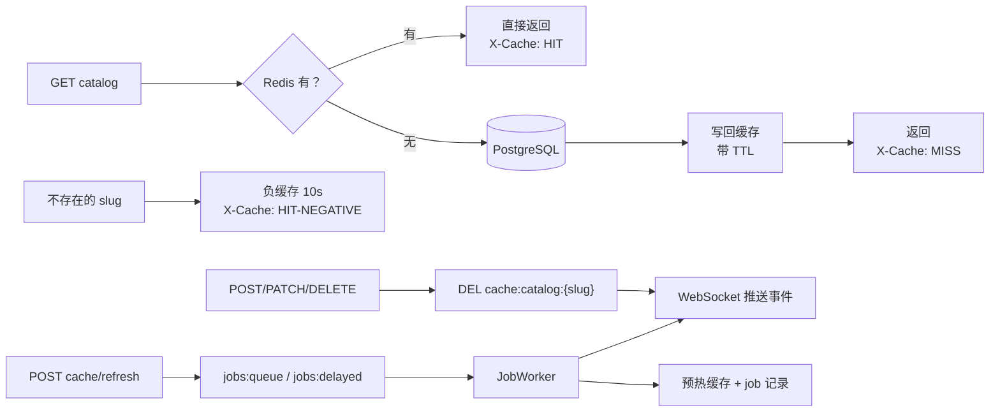
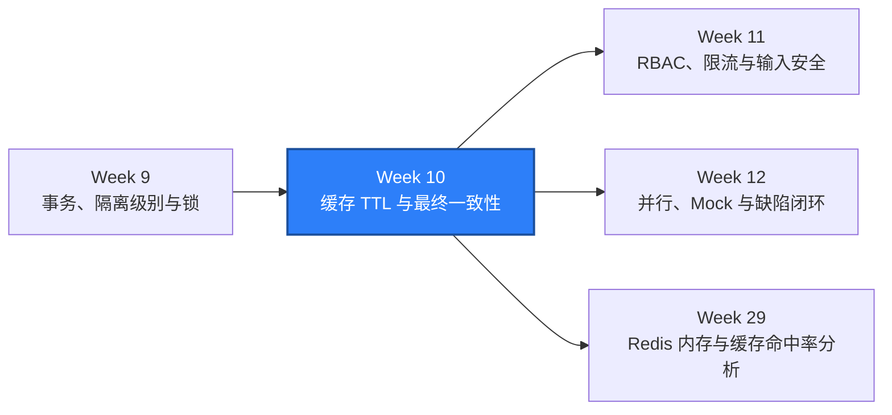

# WEEK-10 - Redis TTL、缓存失效与最终一致性 / Redis TTL, Cache Invalidation, and Eventual Consistency

- 计划 / Plan: Week 10，Redis key、TTL、缓存失效、缓存穿透、队列、WebSocket 和最终一致性
- 日期范围 / Date Range: 2026-10-15
- 分支 / Branch: study/week-10-redis-cache-and-consistency
- 基线提交 / Base Commit: 1c6afd2（week-09 分支）
- 计划提交 / Plan Commit: 待提交（本次工作提交）
- Pull Request: 待创建（等待人工确认后推送）

## 计划目标 / Plan Goal

Week 9 用只读契约、多连接事务、锁与查询计划证明了“数据库里真实发生了什么”。
Week 10 换到缓存层和异步层，验证**接口返回的答案可能既不是数据库的当前状态，
也不是最终答案**：目录读走缓存旁路（cache-aside），未命中才查库并写回；写操作
成功后主动失效缓存；不存在的 slug 用短 TTL 的负缓存挡住重复穿透；异步刷新用
Redis 队列加后台 Worker，`202 + job_id` 之后结果才真正产生；工作区事件通过
WebSocket 推送。一致性结论全部用 Redis 计数器、真实 key 的 TTL、任务状态机和
推送帧来证明，不用固定 `sleep` 等结果。

English summary: Week 10 adds a cache-aside read path with explicit TTL and
invalidation, short negative caching against penetration, a Redis-backed job
queue with an in-process worker, and an authenticated WebSocket event stream.
Tests read the real Redis keys and counters, wait with bounded polling, and
document both directions of inconsistency: "the database changed, the cache did
not" and "the cache holds a value the database no longer has".

## Week 9 状态复核 / Week 9 Status Review

本计划开始前先复核了 Week 9 的验收结论（Windows 本机 + Compose SUT 当时仍在运行）：

| Week 9 门禁 / Gate | 报告结论 / Reported | 本次复核 / Re-checked |
| --- | --- | --- |
| Ruff | `All checks passed!` | 复现 |
| Mypy | `77 source files` | 复现（当前工作区多出未提交的文档脚本，共 91 个文件） |
| Unit tests | `97 passed` | 复现（当前工作区含未提交的语雀同步用例，共 155 passed） |
| Schema contract | `tables=3, views=1, violations=0` | 复现 |
| Integration tests | `35 passed` | 复现 |
| API serial | `135 passed, 1 xfailed` | 复现 |
| API parallel `-n 4` | `135 passed, 1 xfailed`，遗留命名空间 0 | 复现 |
| Linux container | `170 passed, 1 xfailed` | 复现 |

复核中唯一一次红是环境残留，不是回归：第一次把 `tests/integration` 与
`tests/api` 并行执行时，`tests/integration/test_sut.py` 断言
`workspace_catalog_summary` 只包含 `atlas` 和 `orbit`，而数据库里还有一个上一次
中断运行留下的 `qa-ns-*` 工作区，于是失败；同一时刻并行运行的 API 套件在会话
开始时清理了陈旧命名空间，之后整套集成用例再次全绿（`35 passed`）。这一点已记入
下面的风险与限制。

## 完成状态 / Completion Status

通过 / PASS（Windows 本机 + Linux 容器）。

- Windows 本机：Ruff、Mypy（91 个源文件）、155 条单元测试通过。
- Windows 本机数据库与缓存集成：40 条用例通过（`tests/integration`，其中 5 条为
  Week 10 新增），包含缓存陈旧窗口、TTL 收敛、负缓存穿透保护和任务失败路径。
- Windows 本机 API：149 条用例，`148 passed, 1 xfailed`；`pytest -n 4` →
  `148 passed, 1 xfailed in 8.35s`，运行后遗留命名空间为 0。其中 13 条为 Week 10
  新增（缓存命中/失效/穿透/任务/事件流）。
- Linux 容器：`tests/integration` + `tests/api` 合计 `188 passed, 1 xfailed`。
- Schema 只读契约检查：`tables=3, views=1, violations=0`（本计划未改数据库 Schema）。
- 缓存证据：命中/未命中/负缓存/失效计数器、真实 key 的 TTL（`0 < TTL <= 60`）、
  `X-Cache: MISS → HIT → MISS`。
- 一致性证据：直接改库后读接口仍返回旧值（陈旧窗口），TTL 到期后读接口返回新值。
- 异步证据：`202 + job_id`、`jobs:delayed` 深度 1、`started_at`/`finished_at`、
  `jobs:stats:processed` 前后 +1、Worker 写入的缓存 key。
- 推送证据：`catalog.item.created` / `catalog.item.updated` 顺序递进、
  `job.succeeded` 携带任务结果、401/403/426 三条拒绝路径。
- 唯一 xfail 与 Week 9 相同（不支持的方法返回 HTML 501），不计为通过。

## 完成范围 / Scope

1. 缓存旁路读路径
   - `apps/compose/api/app.py`：`GET /api/v1/workspaces/{slug}/catalog` 先读
     Redis，未命中才查 PostgreSQL 并写回；响应带 `X-Cache`
     （`HIT` / `MISS` / `HIT-NEGATIVE` / `BYPASS`）与 `X-Cache-TTL`。
   - 正缓存 `cache:catalog:{slug}`（TTL `QA_CATALOG_CACHE_TTL_SECONDS`，默认 60 秒）。
2. 缓存穿透保护
   - 负缓存 `cache:catalog:{slug}:absent`（TTL
     `QA_CATALOG_CACHE_NEGATIVE_TTL_SECONDS`，默认 10 秒），同一个不存在的 slug
     连续读 3 次只产生 1 次 `db_reads`。
3. 失效策略
   - 创建、改状态、删除成功后先删除工作区缓存 key 再返回，保证“写响应到达即
     下一个读可见新值”；写路径不写穿缓存。
   - `cache:stats:{slug}:{hit,hit_negative,miss,db_reads,invalidations}` 计数器
     作为可断言证据，全部带 TTL。
4. 缓存降级
   - Redis 不可用时目录读回退 PostgreSQL 并标记 `BYPASS`，把缓存定位成加速器
     而不是单点依赖（单元测试用故障注入覆盖）。
5. 异步任务与最终一致性
   - `POST /api/v1/workspaces/{slug}/catalog/cache/refresh` 返回
     `202 Accepted` + `job_id` + `Location`；立即任务进 `jobs:queue`，
     `delay_seconds` 任务进 `jobs:delayed`，到期由 Worker 提升到队列。
   - 任务状态机 `queued -> running -> succeeded | failed`，记录存在 `job:{job_id}`
     并带 TTL；失败必须带可读错误（例如工作区在排队期间被删除 →
     `workspace_not_found`）。
   - `GET /api/v1/jobs` 返回队列深度与 `processed`/`failed` 计数器；
     `GET /api/v1/jobs/{job_id}` 只能由排队的工作区读取（跨工作区 403）。
6. WebSocket 事件推送
   - `GET /api/v1/workspaces/{slug}/events` 完成 RFC 6455 握手后推送 JSON 事件帧：
     `catalog.item.created`、`catalog.item.updated`、`catalog.item.deleted`、
     `job.succeeded`、`job.failed`，带工作区、递增 `sequence` 与时间戳。
   - 订阅者使用有界队列：客户端停止读取时丢弃事件并记日志，产生事件的请求线程
     不被阻塞。
   - 非升级请求返回 426，未认证 401，跨工作区 403。
7. 测试与工具
   - `packages/qa_core/cache/catalog.py`：缓存 key 契约、TTL 读取、计数器读取、
     清理、`CatalogCacheProbe`（压缩 TTL、按 deadline 轮询过期）。
   - `packages/qa_core/jobs.py`：`JobClient`（排队、轮询、等待、队列统计）、
     `wait_for_final_record`（白盒轮询任务记录）。
   - `packages/qa_core/events/websocket.py`：手写 RFC 6455 客户端（握手校验、
     掩码帧、ping/pong、close、带 deadline 的收帧）。
   - `NamespacePool` 释放租约时同时清理该工作区的缓存 key 与计数器。

不在本计划内：

- Webhook 出站投递（需要解决容器回调测试机的地址可达性），见 ADR 0008 的重新
  评估条件。
- RBAC/BOLA/IDOR 的系统性验证、限流与输入安全，属于 Week 11。
- 并行、Mock、Toxiproxy 故障注入与缺陷闭环，属于 Week 12。
- 用消息中间件替换进程内 Worker、队列持久化与重试策略，属于性能/生产化阶段。

## 术语解释 / Glossary

| 名词 / Term | 简单解释 / Plain Meaning | 作用 / Purpose | 在本项目中的位置 / Position |
| --- | --- | --- | --- |
| 缓存旁路 / Cache-Aside | 先问缓存，缓存没有才去查源数据并写回 | 让读多写少的接口少查库 | `_catalog_cache_aside` |
| 写穿 / Write-Through | 写库的同时写缓存 | 另一种一致性取舍，本项目未采用 | ADR 0008 备选方案 |
| TTL | 一个 key 的存活时间 | 让缓存不会永久陈旧 | `X-Cache-TTL`、`Redis TTL` |
| 缓存失效 / Invalidation | 写操作后主动删除缓存 key | 让“写完即可读”成立 | `_invalidate_catalog_cache` |
| 负缓存 / Negative Cache | 把“不存在”也缓存一小段时间 | 挡住对不存在 key 的重复穿透 | `cache:catalog:{slug}:absent` |
| 缓存穿透 / Cache Penetration | 查询一个数据库里也不存在的 key，绕过缓存反复打库 | 攻击或脏数据放大的典型风险 | 负缓存 + `db_reads` 计数器 |
| 陈旧窗口 / Stale Window | 从数据变更到缓存过期之间读到的旧值区间 | 说明缓存一致性是有代价的 | TTL 用例 |
| 最终一致性 / Eventual Consistency | 先返回受理，结果稍后达成并趋于一致 | 用受理状态换响应时间 | `202 + job_id` |
| 队列 / Queue | 待处理工作的排队区 | 把工作移出请求线程 | `jobs:queue`（List） |
| 延迟任务 / Delayed Job | 到某个时间点才可执行的任务 | 测试可稳定观察 `queued` 状态 | `jobs:delayed`（Sorted Set） |
| Worker | 真正执行排队工作的后台线程 | 让“请求返回 ≠ 工作完成”可测 | `JobWorker` |
| 幂等消费 / Idempotent Consumption | 重复处理同一任务也不会产生第二份副作用 | 重试与并发的基础 | 任务记录状态机 |
| WebSocket | 一次握手后双向长连接 | 把结果推给客户端而不是轮询 | `/api/v1/workspaces/{slug}/events` |
| 帧 / Frame | WebSocket 上的最小消息单位 | 区分文本、ping、close | `encode_ws_frame` / `read_ws_frame` |
| 背压 / Backpressure | 消费不过来时如何处理积压 | 决定丢弃还是阻塞生产者 | 有界订阅队列 |
| 有界轮询 / Bounded Polling | 以超时上限反复检查状态，而不是固定等待 | 把 flaky 等待换成可解释失败 | `JobClient.wait` |

## 通俗解读 / Plain Language Guide

Week 8 是“每个人一张试验台”，Week 9 是“两个人同时伸手拿同一件器材会发生什么”。
Week 10 是**值班室的白板**：白板上写着上次抄下来的器材清单，抄完可能已经过期；
有人借走器材要记得擦掉白板；有人故意报一个不存在的编号，值班员不该每次都跑去
仓库翻一遍；“我先把申请单收了，稍后处理完通知你”就意味着申请单收了不等于事办完了。

**一句话理解：** Week 10 是在验证“白板上的字什么时候可信、什么时候必须重抄”。



## 计划在整体路线中的位置 / Plan Position



Week 10 依赖 Week 8 的命名空间隔离与 Week 9 的数据库断言能力；它产出的缓存 key
契约、任务轮询工具、WebSocket 客户端和一致性结论，是 Week 11 权限边界验证、
Week 12 并行与缺陷闭环、以及性能阶段缓存命中率分析的基础。

## 质量检查 / Quality Checks

| 检查项 / Check | 结果 / Status | 执行环境 / Environment | 证据 / Evidence |
| --- | --- | --- | --- |
| Ruff | 通过 / PASS | Windows | `All checks passed!` |
| Mypy | 通过 / PASS | Windows | `Success: no issues found in 91 source files` |
| Unit tests | 通过 / PASS | Windows | `155 passed` |
| Schema contract | 通过 / PASS | Windows + Compose SUT | `tables=3, views=1, violations=0` |
| Integration tests | 通过 / PASS | Windows + Compose SUT | `40 passed` |
| API serial | 通过 / PASS | Windows + Compose SUT | `148 passed, 1 xfailed` |
| API parallel `-n 4` | 通过 / PASS | Windows + Compose SUT | `148 passed, 1 xfailed in 8.35s` |
| Leftover check | 通过 / PASS | Windows | `test_namespaces=0, prefix='qa-ns-'` |
| Linux container | 通过 / PASS | Linux container | `188 passed, 1 xfailed` |
| Cache evidence | 通过 / PASS | Windows + Compose SUT | `MISS → HIT`，`db_reads` 只 +1 |
| Staleness evidence | 通过 / PASS | Windows + Compose SUT | 直接改库后仍返回旧值，TTL 到期后返回新值 |
| Job evidence | 通过 / PASS | Windows + Compose SUT | `queued → succeeded`，`processed` +1 |
| Event evidence | 通过 / PASS | Windows + Compose SUT | `catalog.item.created` 后 `catalog.item.updated` |
| Allure | 通过 / PASS | Windows | `artifacts/allure-report-week10/index.html` |

## 验收方式 / Acceptance Method

### 前置条件 / Preconditions

1. 使用项目 `.venv`，Python 3.12。
2. Docker Desktop Linux engine 运行中，Compose SUT 已 healthy；改动 SUT 代码后需
   `.\scripts\start_sut.ps1` 重建镜像。
3. `QA_POSTGRES_DSN`、`QA_REDIS_URL` 指向本地测试库与本地 Redis。
4. Redis 允许测试清理 `cache:catalog:*`、`cache:stats:*` 与 `job:*`。

### 执行命令 / Commands

```powershell
.\scripts\start_sut.ps1
.\.venv\Scripts\python.exe -m ruff check .
.\.venv\Scripts\python.exe -m mypy packages tests
.\.venv\Scripts\python.exe -m pytest tests\unit -q -p no:cacheprovider
.\.venv\Scripts\python.exe scripts\check_schema.py
.\.venv\Scripts\python.exe -m pytest tests\integration -q -p no:cacheprovider
.\.venv\Scripts\python.exe -m pytest tests\api -q -p no:cacheprovider
.\scripts\run_api_parallel.ps1 -Workers 4
.\scripts\run_integration_linux.ps1 -SkipSutStart
```

### 实际结果 / Actual Results

```text
All checks passed!
Success: no issues found in 91 source files
155 passed in 0.60s
PASS Schema contract: tables=3, views=1, violations=0
Schema check: PASS
40 passed in 8.50s
148 passed, 1 xfailed in 24.61s
148 passed, 1 xfailed in 8.35s
PASS Namespace leftovers: test_namespaces=0, prefix='qa-ns-'
SUT ready: True
188 passed, 1 xfailed in 25.78s
```

### 缓存与一致性证据 / Cache and Consistency Evidence

```text
X-Cache: MISS -> HIT，第二次读不再访问 PostgreSQL（db_reads=1）
cache:catalog:atlas TTL=49s，0 < TTL <= QA_CATALOG_CACHE_TTL_SECONDS(60)
不存在的 slug：404 MISS -> 404 HIT-NEGATIVE -> 404 HIT-NEGATIVE，db_reads=1
直接 UPDATE 行后：读接口仍返回旧值（HIT），清掉 key 后返回 7777/新名称（MISS）
TTL 压到 1 秒并过期后：读接口返回数据库新值（MISS，db_reads=2）
```

### 异步与推送证据 / Async and Push Evidence

```text
POST .../catalog/cache/refresh -> 202 {"status": "queued", "job_id": "..."}
jobs:delayed 深度 1 -> 任务仍为 queued，缓存 key 不存在
Worker 执行后：status=succeeded, result={"items": 2, "ttl_seconds": 60}
jobs:stats:processed 前后 +1，jobs:queue / jobs:delayed 归零
工作区被删除的任务：status=failed, error="ValueError: workspace_not_found: ..."
事件流：catalog.item.created(sequence=1) -> catalog.item.updated(sequence=2)
事件流：job.succeeded 携带同一个 job_id 与 result
拒绝路径：无 token 401、跨工作区 403、非升级请求 426
```

### 证据路径 / Evidence

- 缓存与队列实现：`apps/compose/api/app.py`
- 测试侧缓存工具：`packages/qa_core/cache/catalog.py`
- 任务轮询工具：`packages/qa_core/jobs.py`
- WebSocket 客户端：`packages/qa_core/events/websocket.py`
- 契约模型与 OpenAPI：`packages/qa_core/contracts/api.py`、`openapi.py`
- 集成用例：`tests/integration/test_redis_cache.py`、`test_job_queue.py`
- API 用例：`tests/api/test_cache_consistency.py`、`test_event_stream.py`
- 单元用例：`tests/unit/test_ws_frame_codec.py`、`test_cache_key_contract.py`、
  `test_sut_cache_fallback.py`
- ADR：`docs/adr/0008-cache-aside-ttl-and-eventual-consistency.md`
- Runbook：`docs/runbooks/redis-cache-and-consistency-triage.md`
- Allure：`artifacts/allure-report-week10/index.html`

### 未验证项 / Unverified Items

- Webhook 出站投递与重试未实现（ADR 0008 记录了推迟理由与重新评估条件）。
- 队列不持久化：容器重启会丢弃排队中的任务，未验证重启恢复语义。
- Worker 与 API 同进程，未验证独立 Worker 或多 Worker 并发消费同一队列。
- 事件 broker 是进程内 best-effort：多副本部署时每个副本只能推送自己收到的事件；
  丢弃计数只在日志里，接口层没有暴露丢弃指标。
- 客户端断开、网络抖动、Redis 重启等故障注入未做（属于 Week 12 的故障专题）。
- Redis 不可用时的 `BYPASS` 分支只有单元测试覆盖，未在真实停掉 Redis 的集成环境
  中验证。
- 缓存与任务用例只在本机与单容器验证，未在多机或分布式 runner 上执行。
- `tests/integration` 仍为串行执行；并发用例与 xdist 的连接数预算属于 Week 12。
- 工作区里还有一份未提交的文档索引/语雀同步改动（`README.md`、`docs/README.md`、
  `reports/README.md`、`scripts/doc_index.py`、`scripts/build_doc_index.py`、
  `scripts/sync_yuque.py`、`tests/unit/test_sync_yuque.py`、
  `docs/runbooks/yuque-project-hub.md`、`docs/architecture/project-overview.md`）。
  本计划只重新生成了索引页以便它们包含 Week 10，未把这些改动纳入本次提交。
- 已提交到本地 `study/week-10-redis-cache-and-consistency`，尚未推送远程，也尚未
  创建堆叠 Pull Request，等待人工确认后再执行。

## 变更文件 / Files Changed

- `apps/compose/api/app.py`（缓存旁路、负缓存、失效、计数器、任务队列、Worker、
  WebSocket 事件流）
- `apps/compose/compose.yaml`、`.env.example`（缓存与队列环境变量）
- `packages/qa_core/config/settings.py`（缓存与队列配置项）
- `packages/qa_core/cache/catalog.py`、`cache/__init__.py`（缓存检查工具与
  `CatalogCacheProbe`）
- `packages/qa_core/jobs.py`（`JobClient`、任务记录读取与等待）
- `packages/qa_core/events/websocket.py`、`events/__init__.py`（RFC 6455 客户端）
- `packages/qa_core/contracts/api.py`、`openapi.py`、`__init__.py`（任务、事件与
  缓存刷新契约与 4 条新路径）
- `packages/qa_core/resource_pools/namespaces.py`（租约释放时清理缓存 key）
- `pyproject.toml`（mypy 可解析本地 SUT 模块）
- `tests/unit/conftest.py`、`test_ws_frame_codec.py`、`test_cache_key_contract.py`、
  `test_sut_cache_fallback.py`（新增）
- `tests/api/conftest.py`、`test_cache_consistency.py`、`test_event_stream.py`
- `tests/integration/test_redis_cache.py`、`test_job_queue.py`（新增）
- `docs/adr/0008-cache-aside-ttl-and-eventual-consistency.md`（新增）
- `docs/runbooks/redis-cache-and-consistency-triage.md`（新增）
- `docs/runbooks/local-sut-compose.md`（补充缓存/队列说明与预期结果）
- `reports/weekly/WEEK-10.md`

## 环境 / Environment

- Python: 3.12，项目 `.venv`
- pytest: 8.x + `pytest-xdist`
- SUT API: `http://127.0.0.1:18000`（`paths=16`）
- PostgreSQL: 16-alpine，`127.0.0.1:15432`
- Redis: 7-alpine，`127.0.0.1:26379`（缓存、队列与任务记录所在）
- Docker Desktop: Linux engine；Linux 容器验收使用 `python:3.12-slim`
  一次性容器接入 `quality-engineering-lab_default` 网络

## 风险与限制 / Risks and Limitations

- 缓存一致性本质上是时间窗口问题：直接改库绕过 API 时，陈旧窗口等于剩余 TTL。
  用例显式接受这一点，并同时验证“失效后立即正确”和“TTL 到期后正确”两条路径。
- 负缓存的 TTL 越短越安全、越长越能挡穿透，用例断言的是“命中负缓存且 `db_reads`
  只 +1”，不绑定具体秒数。
- 任务与事件用例依赖真实并发：等待使用有界轮询并有明确超时，超时判失败而不是跳过。
- `jobs:stats:*` 是单调计数器，与 `pg_stat_database.deadlocks` 一样只做前后差值断言；
  手工清零会让失败信息难以解读。
- 集成套件目前串行执行：`tests/integration/test_sut.py` 断言
  `workspace_catalog_summary` 只含种子工作区，因此与并行运行的 API 套件、或上一次
  中断运行留下的 `qa-ns-*` 工作区互相干扰；Week 12 处理并行编排时需要把这条断言
  改成“种子行存在且未被修改”，而不是“表里只有这些行”。
- Redis 中的测试状态依赖 TTL 与租约清理两条路径；进程被强杀时任务记录会自然过期，
  但计数器会保留（体量固定，不影响断言）。

## 下一步 / Next Plan

Week 11：把权限与访问控制从“能写/不能写”推进到系统性验证——RBAC 角色矩阵、
BOLA/IDOR 越权读取、限流边界与输入安全，并为失败分类补齐错误码与证据；
复用 Week 10 的令牌、命名空间与断言工具。
