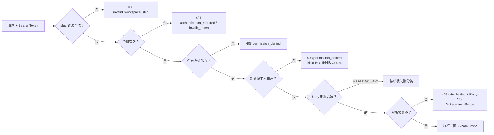
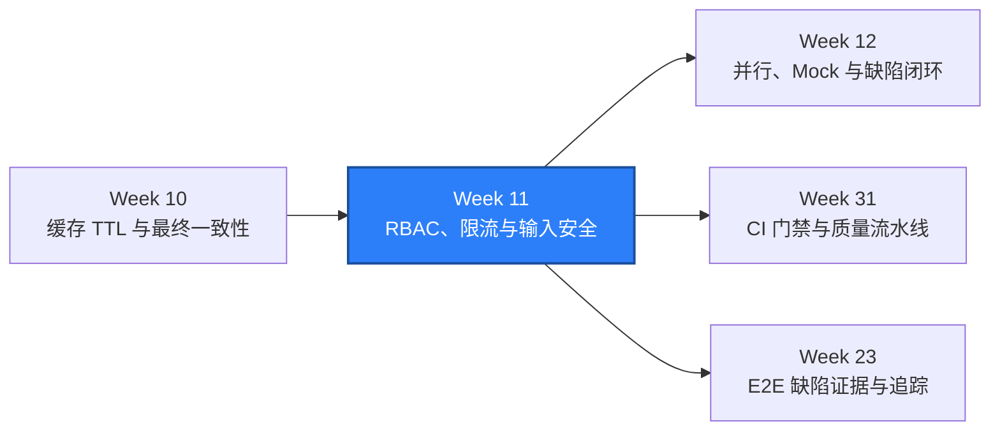

# WEEK-11 - RBAC、BOLA/IDOR、限流边界与输入安全 / RBAC, BOLA/IDOR, Rate-Limit Boundaries, and Input Security

- 计划 / Plan: Week 11，RBAC 角色矩阵、BOLA/IDOR 越权、限流边界、输入安全与失败分类
- 日期范围 / Date Range: 2026-10-16
- 分支 / Branch: study/week-11-rbac-rate-limit-input-security
- 基线提交 / Base Commit: 8c45794（week-10 分支）
- 计划提交 / Plan Commit: 269a036
- Pull Request: https://github.com/htb123-maker/quality-engineering-lab/pull/6
  （堆叠在 Week 10 分支上）

## 计划目标 / Plan Goal

Week 7 到 Week 10 一直只在验证“输入合不合法”“数据有没有被隔离”“答案是不是旧的”。
Week 11 换到**权限与边界**这一层，验证的是：认证只回答“你是谁”，授权才回答
“你能碰什么”，而且这两件事必须能被分别证明。

本计划交付四类能力，全部落到可执行的断言上：

1. **RBAC 角色矩阵**：把散落在 handler 里的 `role in {...}` 字面量比较，收敛成
   唯一的能力注册表（capability registry），并用一个自描述接口
   `GET /api/v1/auth/permissions` 暴露调用者能力。
2. **BOLA/IDOR 越权**：对象 id 是连续自增的，必须证明别的租户的 id 读不到，
   而且“读不到”不能反过来变成对象存在性 oracle。
3. **限流边界**：预算要在触发前就被响应头公开，且换 `X-QA-Client-Id` 不能重置；
   密码授予要有独立的失败计数器。
4. **输入安全与失败分类**：把“body 读不出来”“body 太大”“媒体类型不对”
   “字段违规”拆成 400 / 413 / 415 / 422，并让每一类都归到明确的责任方。

English summary: Week 11 replaces scattered role literals with one capability
registry, adds a self-describing permissions endpoint and a real membership API,
proves that object ids do not cross tenants without leaking existence, moves the
write budget into Redis with a second per-principal bucket, throttles repeated
failed password grants, and splits request-shape failures into 400/413/415/422
with an owning category for each code.

## Week 10 状态复核 / Week 10 Status Review

本计划开始前先复核 Week 10 的验收结论（Windows 本机 + Compose SUT）：

| Week 10 门禁 / Gate | 报告结论 / Reported | 本次复核 / Re-checked |
| --- | --- | --- |
| Ruff | `All checks passed!` | 复现 |
| Mypy | `91 source files` | 复现（91 source files） |
| Unit tests | `155 passed` | 复现（155 passed，需先修好下面的临时目录问题） |
| Schema contract | `tables=3, views=1, violations=0` | 复现 |
| Integration tests | `40 passed` | 复现 |
| API serial | `148 passed, 1 xfailed` | 复现 |
| API parallel `-n 4` | `148 passed, 1 xfailed`，遗留命名空间 0 | 复现（修好脚本的 basetemp 后） |
| Linux container | `188 passed, 1 xfailed` | 复现 |

复核中发现两个**环境问题**，都不是 Week 10 的代码回归：

1. `%TEMP%\pytest-of-quan` 与 `artifacts\pytest-tmp` 两个目录不可访问
   （`PermissionError: [WinError 5]`、`icacls` 也报 Access is denied）。它们由上一次
   沙箱会话创建，当前账号既不是目录所有者也没有有效 ACE，且当前账号没有管理员权限，
   无法 `takeown`。因此 11 条使用 `tmp_path` 的用例在 setup 阶段失败。
   复核时用 `PYTEST_DEBUG_TEMPROOT=.tmp-pytest` 把 pytest 的临时根目录指到工作区
   内（该路径被 `.gitignore` 的 `.tmp-*` 覆盖）后，155 条用例全绿。
2. `scripts/run_api_parallel.ps1` 把 xdist 的 basetemp 硬编码到
   `artifacts\pytest-tmp`，而它正是上面那个不可访问的目录，于是并行门禁直接
   以退出码 3 失败。已把 base temp 改到 `.tmp-pytest\api-parallel`（同样被 gitignore
   覆盖），并行门禁恢复，并且不再复用一个可能被上一次会话写坏的路径。

## 完成状态 / Completion Status

通过 / PASS（Windows 本机 + Linux 容器）。

- Windows 本机：Ruff、Mypy（106 个源文件）、203 条单元测试通过。
- Windows 本机数据库集成：44 条用例通过（`tests/integration`，其中 4 条为 Week 11
  新增的成员持久化与注入围堵用例）。
- Windows 本机 API：231 条用例，`230 passed, 1 xfailed`；`pytest -n 4` →
  `230 passed, 1 xfailed in 24.56s`，运行后遗留命名空间为 0。其中 82 条为 Week 11
  新增（RBAC 矩阵、BOLA/IDOR、限流边界、登录锁定、输入安全）。
- Linux 容器：`tests/integration` + `tests/api` 合计 `274 passed, 1 xfailed`。
- Schema 只读契约检查：`tables=3, views=1, violations=0`（本计划未改数据库 Schema，
  成员管理复用既有 `users` 表）。
- RBAC 证据：四个角色 × 六个动作的矩阵全部按镜像比对；`owner` 无法通过接口指派
  （422 `$.role`）；admin 授权 `admin` 被 403 `role_escalation_forbidden` 拒绝；
  owner 行被 403 `owner_protected` 保护；管理员自改/自删被 403
  `self_modification_forbidden` 拒绝；成员被删除后其访问令牌立即 401。
- BOLA/IDOR 证据：别的租户真实存在的 `item_id` 与随手编造的 id 返回完全同形状的
  `404 item_not_found`；跨租户成员 id 的 PATCH/DELETE 返回 `404 member_not_found`；
  跨租户成员列表返回 `403 permission_denied` 且响应体不含对方 slug 与成员邮箱。
- 限流证据：成功响应即带 `X-RateLimit-*`，`Remaining` 从 19 逐次递减到 0，
  第 21 次请求 429 且 `Retry-After` 等于 `X-RateLimit-Reset`；连续 40 次请求每次
  都换 `X-QA-Client-Id`，第 41 次仍被
  `X-RateLimit-Scope: principal` 的桶拦下；被 403 拒绝的写请求不消耗预算。
- 登录锁定证据：Redis 计数器 `auth:signin-failures:*` 数值等于
  `QA_AUTH_SIGNIN_FAILURE_MAX`，TTL 落在窗口内，第 11 次失败请求返回 429；
  成功登录后计数器归零；锁定只影响该账号，`/health/live` 与目录读仍然可用。
- 输入安全证据：超限 body → 413（且返回 `Connection: close`，随后的健康检查与写请求
  仍成功）；`text/plain` → 415；坏 JSON / 非对象 JSON / 非 UTF-8 body → 400；
  5000 层嵌套 JSON → 400 而不是 500；文本字段里的控制字符 → 422 `$.name`；
  9 种非法 slug → 400 `invalid_workspace_slug`；`<script>`、`DROP TABLE`、
  `../../etc/passwd` 等文本被原样存储、原样返回，且不进入响应头。
- 唯一 xfail 与 Week 9/10 相同（不支持的方法返回 HTML 501），不计为通过。

## 完成范围 / Scope

1. 能力矩阵替代角色字面量
   - `apps/compose/api/app.py`：`ROLE_CAPABILITIES`（八种能力 × 四种角色）、
     `has_capability` / `capabilities_for`；`_workspace_scope` 统一做
     “slug 词法校验 → 认证 → 能力判断 → 工作区存在性 → 租户判断”五步。
   - `packages/qa_core/security/roles.py`：测试侧镜像矩阵，由单元测试锁死与 SUT 一致。
   - `GET /api/v1/auth/permissions`：返回 `role` 与 `capabilities`，权限自描述。
2. 成员管理（复用 `users` 表，不改 schema）
   - `GET/POST /api/v1/workspaces/{slug}/members`、
     `PATCH/DELETE /api/v1/workspaces/{slug}/members/{user_id}`。
   - `MemberCreate` / `MemberRoleUpdate` 的 `role` 只接受 `admin|member|viewer`，
     因此“把自己或别人提成 owner”在契约层就不可能。
   - admin 不能授予 `admin`；owner 行不可改不可删；任何人不能改删自己的成员记录。
3. BOLA/IDOR
   - 新增 `GET /api/v1/workspaces/{slug}/catalog/items/{item_id}`（需要
     `catalog:read`）；别人的 item id 与不存在的 id 一律 404，保持不可区分。
   - 成员 id 的读写都以 `(workspace_id, id)` 为谓词，跨租户落在 404。
   - 跨租户读与写都返回 `403 permission_denied`，响应体只有 `error` 与 `message`。
4. 限流边界
   - 双桶：client 桶（`QA_RATE_LIMIT_WRITE_MAX`，可被 header 轮换重置）
     + principal 桶（`QA_RATE_LIMIT_PRINCIPAL_MAX`，按登录用户计）。
   - 计数器落在 Redis（`ratelimit:write:*`）而不是进程内存：多副本共享，
     且 `NamespacePool` 释放租约时清除该工作区用户的 principal 桶，
     避免复用的 owner 用户把上一个用例的预算带进下一个用例。
   - 每个受限响应都回 `X-RateLimit-Limit/Remaining/Reset/Scope`；429 另带
     `Retry-After`。
   - 授权先于限流：403 不消耗预算。
5. 登录暴力破解防护
   - `auth:signin-failures:{sha256(client|email)}` 按 `(客户端, 账号)` 计数，
     TTL 即窗口；累计到阈值后返回 429 + `Retry-After`；成功登录清零。
   - Redis 不可用时失败开放并记录日志（本地 SUT 不因缓存故障变成不可写）。
6. 输入加固与失败分类
   - 400：坏 JSON、JSON 不是对象、非 UTF-8、嵌套过深（显式捕获 `RecursionError`）。
   - 413：超过 `QA_MAX_REQUEST_BYTES`，有界 drain 后显式 `Connection: close`。
   - 415：JSON API 收到非 `application/json`；OAuth2 端点保持 RFC 6749 的
     400 `invalid_request`。
   - 422：控制字符等字段级违规（`CatalogItemCreate.name` 增加校验器）。
   - 400 `invalid_workspace_slug`：slug 在进入 SQL 之前先过词法白名单。
   - `qa_core/api_errors.py` 为全部新错误码补齐 `_EXACT` 映射与责任方。
7. 测试与工具
   - `packages/qa_core/security/`：`roles.py`（矩阵镜像）、`members.py`
     （`MemberApiFactory`）、`limits.py`（预算响应头解析、`SignInThrottleProbe`、
     预算键与清理）、`probes.py`（注入文本、超大 body、深层嵌套、非法 slug）。
   - 契约与 OpenAPI：新增成员模型、权限模型、item 读接口，以及限流响应头文档。
   - `scripts/run_api_parallel.ps1`：basetemp 移出不可访问的 `artifacts\pytest-tmp`。

不在本计划内：

- Webhook 出站投递、队列持久化与重试，属于生产化/通知阶段。
- 并行编排、Mock、Toxiproxy 故障注入与缺陷生命周期闭环，属于 Week 12。
- 目录读接口 `GET /api/v1/workspaces/{slug}/catalog` 仍然免认证（Week 2 起的既有
  契约），本计划只把它记录为已知边界。
- 所有权转让、邀请链接/过期、审计落库，见 ADR-0009 的重新评估条件。

## 术语解释 / Glossary

| 名词 / Term | 简单解释 / Plain Meaning | 作用 / Purpose | 在本项目中的位置 / Position |
| --- | --- | --- | --- |
| 认证 / Authentication | 证明“你是谁” | 401 的来源 | `_authenticated_user` |
| 授权 / Authorization | 决定“你能碰什么” | 403 的来源 | `has_capability` |
| RBAC | 按角色分配权限 | 让权限可读、可测 | `ROLE_CAPABILITIES` |
| 能力 / Capability | 一个具体动作许可，如 `catalog:write` | 权限判断的唯一单位 | `_workspace_scope` 的入参 |
| 权限矩阵 / Role Matrix | 角色 × 能力的对照表 | 用一张表覆盖所有组合 | `qa_core.security.roles` |
| BOLA | 用别人的对象 id 访问别人的对象 | 越权读写的典型形态 | item id / member id 用例 |
| IDOR | 直接猜对象 id 拿到不该拿的数据 | 自增 id 的经典风险 | `test_bola_idor.py` |
| 存在性 oracle / Existence Oracle | 状态码差异泄露“对象是否存在” | 403/404 混用会泄露信息 | item 读接口统一 404 |
| 租户 / Tenant | 互相不可见的数据边界 | 本项目的“工作区” | `workspace_id` |
| 限流 / Rate Limiting | 限制单位时间的请求量 | 保护服务与防误用 | 双桶预算 |
| 固定窗口 / Fixed Window | 每个窗口独立计数，窗口边界重置 | 实现简单、语义清楚 | Redis `INCR` + `EXPIRE` |
| 主体 / Principal | 已认证的调用者身份 | 无法被 header 伪造的限流键 | `user:{id}` 桶 |
| 桶 / Bucket | 一份独立的预算计数 | 让不同维度互不干扰 | client / principal |
| `Retry-After` | 服务端告诉客户端多久后再试 | 429/503 的标准退避信号 | 429 响应头 |
| 暴力破解 / Brute Force | 反复尝试口令 | 认证端点的主要风险 | 失败计数器 |
| 失败开放 / Fail Open | 依赖故障时放行而不是拒绝 | 可用性与严格性的取舍 | Redis 故障时限流失效 |
| 输入加固 / Input Hardening | 在业务逻辑前拒绝畸形输入 | 把 400/413/415/422 分开 | `_read_request_payload` |
| 输出编码 / Output Encoding | 渲染时才处理危险字符 | 说明“转义不是存储层职责” | 恶意文本用例的边界 |
| 失败分类 / Failure Classification | 把失败归到明确责任方 | 红跑时知道该找谁 | `qa_core/api_errors.py` |

## 通俗解读 / Plain Language Guide

Week 8 是“每个人一张试验台”，Week 9 是“两个人同时伸手拿同一件器材”，
Week 10 是“值班室白板上的清单可能过期”。Week 11 是**门禁与工牌**：

门卫认识你了（认证），但这不等于你能进所有房间。工牌上写着你能开哪几扇门（能力）；
别人房间的编号就算被你猜到了，也开不开，而且门卫不会告诉你“这个编号确实存在”
（BOLA/IDOR）。有人拿着一张写着别人名字的访客卡想混进来，门卫不认那张卡
（限流键不能被调用方自报）；有人在门口连续试错密码，试到一定次数就先让他等一会儿
（登录锁定）。最后，不合规的申请表要分开退回：看不清的表（400）、太厚的表（413）、
用错纸张格式的表（415）、字段填错的表（422）——四种退回要写四句不同的话，
否则出了问题没人知道该谁改。

**一句话理解：** Week 11 是在给“你是谁”和“你能碰什么”之间加上一道可验证的闸门。



## 计划在整体路线中的位置 / Plan Position



Week 11 依赖 Week 8 的命名空间隔离（每个用例一个工作区、一个 owner）和 Week 10 的
Redis 契约（缓存键、计数器、租约清理）。它产出的能力矩阵、成员接口、越权断言、
失败分类和限流证据，是 Week 12 缺陷闭环（失败归因）、Week 23 E2E（证据与追踪）
和 Week 31 CI 门禁（安全基础测试集）的输入。

## 质量检查 / Quality Checks

| 检查项 / Check | 结果 / Status | 执行环境 / Environment | 证据 / Evidence |
| --- | --- | --- | --- |
| Ruff | 通过 / PASS | Windows | `All checks passed!` |
| Mypy | 通过 / PASS | Windows | `Success: no issues found in 106 source files` |
| Unit tests | 通过 / PASS | Windows | `203 passed` |
| Schema contract | 通过 / PASS | Windows + Compose SUT | `tables=3, views=1, violations=0` |
| Integration tests | 通过 / PASS | Windows + Compose SUT | `44 passed` |
| API serial | 通过 / PASS | Windows + Compose SUT | `230 passed, 1 xfailed` |
| API parallel `-n 4` | 通过 / PASS | Windows + Compose SUT | `230 passed, 1 xfailed in 24.56s` |
| Leftover check | 通过 / PASS | Windows | `test_namespaces=0, prefix='qa-ns-'` |
| Linux container | 通过 / PASS | Linux container | `274 passed, 1 xfailed` |
| RBAC evidence | 通过 / PASS | Windows | 4 角色 × 6 动作按镜像矩阵逐一断言 |
| BOLA evidence | 通过 / PASS | Windows | 跨租户 item/member id 返回同形状 404 |
| Rate-limit evidence | 通过 / PASS | Windows | `Remaining` 19→0；换 header 仍被 principal 桶拦下 |
| Lockout evidence | 通过 / PASS | Windows | Redis 计数 10、TTL 在窗口内、第 11 次 429 |
| Input evidence | 通过 / PASS | Windows | 400/413/415/422 四类各有用例 |
| Allure | 通过 / PASS | Windows | `artifacts/allure-report-week11/index.html`（274 条结果） |

说明：`PASS`、`FAILED`、命令输出和错误信息保留原始英文，避免改变工具语义。

## 验收方式 / Acceptance Method

### 前置条件 / Preconditions

1. 使用项目 `.venv`，Python 3.12。
2. Docker Desktop Linux engine 运行中；改动 SUT 代码后需重建镜像：
   `.\scripts\start_sut.ps1`。
3. `QA_POSTGRES_DSN`、`QA_REDIS_URL` 指向本地测试库与本地 Redis。
4. 若 Windows 上 `%TEMP%\pytest-of-quan` 不可写（沙箱遗留），先设置
   `PYTEST_DEBUG_TEMPROOT` 到工作区内目录，见下面的执行命令。

### 执行命令 / Commands

```powershell
.\scripts\start_sut.ps1
$env:PYTEST_DEBUG_TEMPROOT="$PWD\.tmp-pytest"
.\.venv\Scripts\python.exe -m ruff check .
.\.venv\Scripts\python.exe -m mypy packages tests
.\.venv\Scripts\python.exe -m pytest tests\unit -q -p no:cacheprovider
.\.venv\Scripts\python.exe scripts\check_schema.py
.\.venv\Scripts\python.exe -m pytest tests\integration -q -p no:cacheprovider
.\.venv\Scripts\python.exe -m pytest tests\api -q -p no:cacheprovider
.\scripts\run_api_parallel.ps1 -Workers 4
.\scripts\run_integration_linux.ps1 -SkipSutStart
```

### 实际结果 / Actual Results

```text
All checks passed!
Success: no issues found in 106 source files
203 passed in 0.70s
PASS Schema contract: tables=3, views=1, violations=0
44 passed in 11.42s
230 passed, 1 xfailed
230 passed, 1 xfailed in 24.56s
PASS Namespace leftovers: test_namespaces=0, prefix='qa-ns-'
SUT ready: True
274 passed, 1 xfailed in 55.13s
```

### RBAC 与越权证据 / RBAC and Object-Authorization Evidence

```text
GET /api/v1/auth/permissions：viewer -> [catalog:read, events:read, jobs:read]
                              owner  -> 8 项能力（与镜像矩阵完全一致）
viewer 写目录 403 permission_denied；member/admin/owner 写目录 201
admin 邀请 admin         -> 403 role_escalation_forbidden
owner 邀请 role=owner    -> 422 validation_failed（$.role）
owner 被降级 / 被删除     -> 403 owner_protected（数据库里仍是唯一 owner）
admin 改删自己            -> 403 self_modification_forbidden
成员被删除后              -> 401 invalid_token（刷新令牌同时失效）
别人的 item id（真实存在） -> 404 item_not_found（与随手编造的 id 同形状）
跨租户 member id PATCH/DELETE -> 404 member_not_found
跨租户成员列表            -> 403 permission_denied，响应体不含对方 slug/邮箱
```

### 限流与登录锁定证据 / Rate-Limit and Lockout Evidence

```text
第一次成功写：X-RateLimit-Limit=20 Remaining=19 Scope=client
同一 client id 连续 20 次：Remaining 19→…→0（每次都带预算响应头）
第 21 次：429 rate_limited，Retry-After == X-RateLimit-Reset
连续 40 次请求每次换 X-QA-Client-Id：第 41 次 429，Scope=principal
被 403 拒绝的写请求：不消耗预算（同 client id 的 owner 写仍 201）
登录失败 10 次：auth:signin-failures:* 计数=10，TTL 在窗口内
第 11 次登录：429 rate_limited + Retry-After
成功登录后：计数器 = 0；其它账号与 /health/live、目录读不受影响
```

### 输入安全证据 / Input-Hardening Evidence

```text
QA_MAX_REQUEST_BYTES+4096 的 body -> 413 payload_too_large（Connection: close；
                                     随后 /health/ready 200、下一次写入 201）
text/plain                        -> 415 unsupported_media_type
{not-json / 数组 / 非 UTF-8        -> 400 invalid_request
5000 层嵌套 JSON                  -> 400 invalid_request（不是 500）
name 含控制字符（\n \r \0 \x1b \x7f）-> 422 validation_failed（$.name）
9 种非法 slug（%2f、%2e%2e、大写、%00…）-> 400 invalid_workspace_slug
<script> / DROP TABLE / ../../etc/passwd -> 201 原样存储，读回完全一致，
                                     且不出现在任何响应头
注入后：schema violations=0，3 张表仍在，种子行计数不变
```

### 契约变更登记 / Contract Changes

Week 11 有意改动了三处既有行为，并同步更新了旧用例：

| 变更 / Change | 旧行为 / Before | 新行为 / After | 更新的用例 / Updated tests |
| --- | --- | --- | --- |
| JSON API 的媒体类型错误 | `400 invalid_request` | `415 unsupported_media_type` | `tests/api/test_negative_inputs.py` |
| `GET .../catalog/items/{item_id}` | 无该路由（404 `not_found`） | 需要 `catalog:read`，未认证 401 | `tests/api/test_negative_inputs.py` |
| OpenAPI 的 item 路径方法集 | `{patch, delete}` | `{get, patch, delete}` | `tests/unit/test_contracts.py` |

### 证据路径 / Evidence

- SUT 实现：`apps/compose/api/app.py`
- 测试侧安全工具：`packages/qa_core/security/roles.py`、`members.py`、`limits.py`、`probes.py`
- 契约与错误语义：`packages/qa_core/contracts/api.py`、`openapi.py`、`packages/qa_core/api_errors.py`
- 配置：`packages/qa_core/config/settings.py`、`.env.example`、`apps/compose/compose.yaml`
- 资源池：`packages/qa_core/resource_pools/namespaces.py`
- API 用例：`tests/api/test_rbac_matrix.py`、`test_bola_idor.py`、
  `test_rate_limit_boundaries.py`、`test_auth_lockout.py`、`test_input_security.py`
- 集成用例：`tests/integration/test_membership_rbac_db.py`
- 单元用例：`tests/unit/test_role_matrix.py`、`test_rate_budget_window.py`、
  `test_security_classification.py`、`test_input_hardening_contract.py`
- ADR：`docs/adr/0009-rbac-bola-and-input-hardening.md`
- Runbook：`docs/runbooks/authorization-and-input-security-triage.md`
- Allure：`artifacts/allure-report-week11/index.html`

### 未验证项 / Unverified Items

- 公开目录读接口 `GET /api/v1/workspaces/{slug}/catalog` 仍免认证；本计划不改动它，
  因此“未认证的租户能读到目录摘要”这一既有边界依然存在。
- 跨租户写入仍返回 403 而不是 404。已记录取舍理由（slug 本身可由公开读接口枚举），
  但没有在真实多租户对外场景中验证过。
- 限流是固定窗口，不是令牌桶或滑动窗口：窗口边界处允许瞬时双倍突发，未做压测对比。
- Redis 故障时限流与登录锁定**失败开放**，只有单元测试（假 Redis）覆盖；
  没有在真实停掉 Redis 的集成环境里验证该分支。
- 登录锁定只有计数，没有账号冻结、解锁流程、告警或验证码；也没有覆盖
  “锁定期间换账号继续撞库”的横向风险。
- 成员接口没有邀请链接、过期时间、二次确认，也没有审计落库。
- 415/413 分支只验证了 Windows 本机 Docker Desktop 路径；未在 Linux 容器里单独
  验证（Linux 容器门禁跑的是完整 integration + api 套件，包含这些用例）。
- 限流预算现在是每次写两次 Redis 往返，未测量其对写延迟的影响（属于性能专题）。
- `tests/integration` 仍为串行执行；并发用例与 xdist 的连接数预算属于 Week 12。
- 文档索引与语雀同步工具（`README.md`、`docs/README.md`、`reports/README.md`、
  `scripts/doc_index.py`、`scripts/build_doc_index.py`、`scripts/sync_yuque.py`、
  `tests/unit/test_doc_index.py`、`tests/unit/test_sync_yuque.py`、
  `docs/runbooks/yuque-project-hub.md`、`docs/architecture/project-overview.md`）
  从 Week 10 之前一直未提交。已在本计划收口后单独提交为 `8b68296` 并推送，
  GitHub 现在有了根 `README.md` 首页；语雀同步本身仍未对真实空间执行过。
- 四个堆叠分支（Week 08 到 Week 11）在收口后补推送，并分别创建了 PR #3、#4、#5、
  #6；PR 正文使用各自的周报内容。

## 变更文件 / Files Changed

- `apps/compose/api/app.py`（能力矩阵、成员接口、item 读接口、slug 校验、双桶限流、
  登录失败计数、请求体加固、`_close_quietly`）
- `apps/compose/compose.yaml`、`.env.example`（限流、登录锁定、body 上限）
- `packages/qa_core/config/settings.py`（`rate_limit_principal_max`、
  `auth_signin_failure_*`、`max_request_bytes`）
- `packages/qa_core/contracts/api.py`（能力、成员、权限模型；`name` 控制字符校验）
- `packages/qa_core/contracts/__init__.py`、`openapi.py`（新模型、5 条新路径、
  限流响应头文档）
- `packages/qa_core/api_errors.py`（8 个新错误码与责任方）
- `packages/qa_core/security/__init__.py`、`roles.py`、`members.py`、`limits.py`、
  `probes.py`（新增）
- `packages/qa_core/resource_pools/namespaces.py`（租约释放时清理 principal 预算桶）
- `scripts/run_api_parallel.ps1`（xdist basetemp 移出不可访问的旧路径）
- `tests/api/conftest.py`（`member_api`、`role_sessions`、`signin_throttle` 夹具）
- `tests/api/test_rbac_matrix.py`、`test_bola_idor.py`、
  `test_rate_limit_boundaries.py`、`test_auth_lockout.py`、`test_input_security.py`（新增）
- `tests/api/test_negative_inputs.py`（登记 415 与 item 读路由两处契约变更）
- `tests/integration/test_membership_rbac_db.py`（新增）
- `tests/unit/test_role_matrix.py`、`test_rate_budget_window.py`、
  `test_security_classification.py`、`test_input_hardening_contract.py`（新增）
- `tests/unit/test_contracts.py`（登记 item 路径方法集变化）
- `docs/adr/0009-rbac-bola-and-input-hardening.md`（新增）
- `docs/runbooks/authorization-and-input-security-triage.md`（新增）
- `docs/runbooks/local-sut-compose.md`（新增路由与安全配置说明）
- `reports/weekly/WEEK-11.md`

## 环境 / Environment

- Python: 3.12，项目 `.venv`
- pytest: 8.x + `pytest-xdist`
- SUT API: `http://127.0.0.1:18000`（`paths=19`）
- PostgreSQL: 16-alpine，`127.0.0.1:15432`（Schema 未变更：3 表 1 视图）
- Redis: 7-alpine，`127.0.0.1:26379`（缓存、队列、任务记录、限流桶、登录失败计数）
- Docker Desktop: Linux engine（Start 期间观察到 v29.8.1）；Linux 容器验收使用
  `python:3.12-slim` 一次性容器接入 `quality-engineering-lab_default` 网络
- 本机临时目录限制：`%TEMP%\pytest-of-quan` 与 `artifacts\pytest-tmp` 不可访问
  （沙箱遗留 ACL），故本机 pytest 运行使用 `PYTEST_DEBUG_TEMPROOT=.tmp-pytest`

## 风险与限制 / Risks and Limitations

- **能力矩阵是双份代码**：SUT 一份、测试镜像一份。单元测试锁死了二者一致，
  但新增能力时仍必须同时修改两处；否则 `test_role_matrix.py` 会红。
- **403 与 404 的混用是有意设计**：按 id 读对象用 404 防枚举，跨租户写用 403 保持
  既有契约。评审者若不理解这条规则，很容易在某次改动里把它统一成一种码。
- **限流依赖 Redis**：Redis 掉线时预算与锁定都失效（失败开放）。这是可用性优先的
  显式取舍，已写进 ADR 与 runbook。
- **principal 桶必须随租约清理**：`NamespacePool` 复用同一个 owner 用户，
  如果忘记清理 `ratelimit:write:principal:*`，后面的用例会莫名其妙 429。
  已实现清理，且 `tests/api/test_namespace_isolation.py` 的残留检查仍然覆盖。
- **固定窗口允许边界突发**：`INCR` + `EXPIRE` 的实现简单，代价是窗口切换瞬间
  可能出现两倍速率。
- **控制字符白名单只覆盖 `name`**：成员 `display_name` 与邮箱走契约长度/正则约束，
  没有逐字段做同样的控制字符校验；Week 12 若要统一，应抽出共享校验器。
- **恶意文本原样存储**：本计划证明的是“不执行、不反射”，不是“转义”。
  真正的 XSS 防护属于渲染侧，SUT 不具备渲染面。
- **测试口径**：本计划的 RBAC/越权/限流用例都跑在 Windows 本机 + 单容器环境，
  多副本 API 或真实网关场景未验证。

## 下一步 / Next Plan

Week 12：把并行、隔离、Mock 与缺陷生命周期串成一个闭环——`pytest -n` 下的连接数预算
与数据隔离压力测试、Toxiproxy/超时/重试/降级故障注入、失败指纹与缺陷草稿、
Allure 证据链，并把 API 测试总数推进到 220 条以上。
