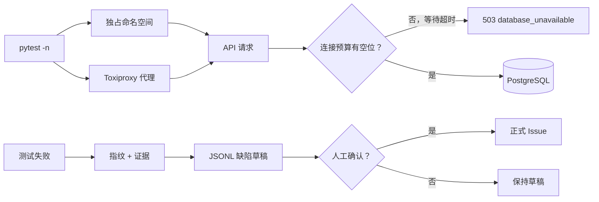
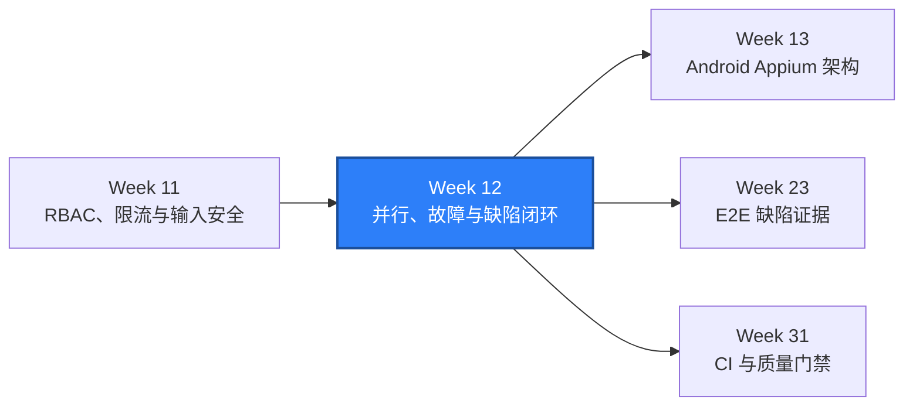

# WEEK-12 - 并行、Mock、Toxiproxy 与缺陷闭环 / Parallelism, Mocks, Toxiproxy, and Defect Loop

- 计划 / Plan: Week 12，并行连接预算、真实故障注入、失败指纹与缺陷草稿
- 日期范围 / Date Range: 2026-10-17
- 分支 / Branch: study/week-12-parallel-mock-defect-loop
- 基线提交 / Base Commit: 8057a4a（week-11 分支）
- 计划提交 / Plan Commit: 8481979
- Pull Request: https://github.com/htb123-maker/quality-engineering-lab/pull/7

## 计划目标 / Plan Goal

Week 12 把 Week 8 的命名空间隔离、Week 10 的降级路径和 Week 11 的失败分类串成
一个运行期闭环：

1. `pytest -n` 下 API 与 PostgreSQL 的连接数量有硬上限，不靠数据库自身兜底。
2. 在真实 TCP 层注入断连、延迟和超时，验证客户端重试有边界、恢复可观察。
3. 失败自动生成带指纹和复现证据的缺陷草稿，但不自动创建正式 Issue。
4. 缺陷状态迁移必须有人类批准，自动化没有关闭缺陷的路径。
5. API 测试规模保持在 220 条以上，并增加同一命名空间内的并发写入用例。

English summary: bound database concurrency, add real transport-fault injection,
produce human-reviewable defect drafts with stable fingerprints, and keep formal
defect creation and closure behind explicit approval.

## 当前状态 / Current Status

**通过 / PASS。**

已完成并验证：

- SUT 全部 PostgreSQL 访问统一经过 `ConnectionBudget`，容量和等待超时可由环境变量配置。
- 8 个并发写请求在同一命名空间内全部成功，SKU 保持唯一。
- pytest call-phase 失败自动写入 JSONL 缺陷草稿，跨线程并发写入有文件锁。
- 缺陷生命周期有显式状态图，迁移必须提供人工审批人。
- Toxiproxy 控制客户端、Compose profile、worker 端口分配和两条 API 故障用例已实现。
- 本机 Toxiproxy 镜像最终拉取成功，两条真实故障用例均通过。
- 单元测试与静态检查通过。

尚未完成或被环境阻塞：

- PR [#7](https://github.com/htb123-maker/quality-engineering-lab/pull/7) 的两个 CI 检查
  均已通过，PR 保持 draft，等待人工评审。
- SUT 到 PostgreSQL/Redis 的依赖流量还没有串入 Toxiproxy，因此真实数据库超时和
  Redis 断连仍需后续扩展代理拓扑。

## 完成范围 / Scope

### 1. PostgreSQL 连接预算

- `ConnectionBudget` 使用 `threading.BoundedSemaphore` 限制并发连接。
- `QA_POSTGRES_MAX_CONNECTIONS` 默认 16。
- `QA_POSTGRES_CONNECTION_TIMEOUT_SECONDS` 默认 2 秒。
- 记录 `capacity`、`active`、`peak`，单元测试验证峰值和释放。
- 所有 `_find_user_*`、目录、成员、任务与写接口的数据库 helper 都改走
  `_postgres_connection()`。
- 预算耗尽走现有 `503 database_unavailable` 语义。

### 2. 并发写与隔离

- `tests/api/test_parallel_isolation.py` 新增 8 个线程同时写同一 owner 命名空间。
- 每个请求使用不同 `X-QA-Client-Id`，避免 client 桶误伤并发用例。
- 断言 8 个 201、SKU 全部不同、目录读回全部写入对象。
- 仍由 `NamespacePool` 在租约释放时清理缓存、幂等键和 principal 预算。

### 3. 真实故障注入

- 新增 `qa_core.resilience.ToxiproxyClient`，封装 proxies 与 toxics 控制 API。
- Compose 增加 `fault-injection` profile，正常启动不依赖该镜像。
- 每个 xdist worker 使用 `18100 + worker_index` 的代理端口。
- 故障用例覆盖：
  - 关闭代理时快速返回 `httpx.ConnectError`，重新启用后健康检查恢复。
  - 注入 300ms latency 后，50ms read timeout 在 2 次尝试后抛错，日志可数。
- 未启动 Toxiproxy 时明确 skip，不计为 pass。

### 4. 缺陷草稿与生命周期

- `DefectEvidence` 保存 test id、pytest node id、commit、环境、命令、Allure 路径、
  CI Run 和第一段失败文本。
- `DefectDraft` 固定要求人工批准，并固定标记未自动创建 Issue。
- `JsonlDefectDraftStore` 使用追加写与跨进程锁；同一指纹只保存一次。
- pytest 插件在 call-phase 失败后写入
  `artifacts/defect-drafts/defects.jsonl`。
- `DefectState` 覆盖 draft、new、triage、confirmed、in progress、verification、
  closed、duplicate、rejected、deferred、wont_fix 和 reopened。
- `require_transition` 拒绝空审批人和非法跳转；没有自动进入 closed 的路径。

### 5. Mock 与确定性单元测试

- Toxiproxy 控制 API 使用 `httpx.MockTransport` 做确定性单元测试。
- 故障分类单测区分 assertion、timeout、connection 和 unknown。
- HTTP 客户端原有的 retry/timeout Mock 用例继续作为快速回归。

## 术语解释 / Glossary

| 名词 / Term | 简单解释 / Plain Meaning | 作用 / Purpose | 在本项目中的位置 / Position |
| --- | --- | --- | --- |
| 连接预算 / Connection Budget | 允许同时开多少个数据库连接 | 防止并行请求耗尽 PostgreSQL 会话 | `ConnectionBudget` |
| 背压 / Backpressure | 满载时让请求等待或快速失败 | 避免资源无限增长 | 预算等待超时与 503 |
| 故障注入 / Fault Injection | 主动破坏网络观察系统反应 | 证明超时、重试和恢复路径 | Toxiproxy |
| 代理 / Proxy | 客户端与服务端之间的可控制转发点 | 不修改业务代码即可制造故障 | `fault_proxy` fixture |
| Toxic | Toxiproxy 的一个故障规则 | latency / timeout / reset | 控制 API |
| 缺陷指纹 / Fingerprint | 把失败关键特征归一化后做哈希 | 去重和追踪同一根因 | `DefectFingerprint` |
| 缺陷草稿 / Draft | 尚未经人工确认的候选 Issue | 保留证据但不污染正式流程 | `DefectDraft` |
| 人工审批 / Human Approval | 有名字的人确认状态变化 | 防止自动化误建或误关缺陷 | `require_transition` |
| xdist worker | pytest 并行进程 | 隔离数据、端口与代理 | `pytest -n` |

## 通俗解读 / Plain Language Guide

Week 8 是每个 worker 有自己的试验台，Week 10 是 Redis 值班室可能给出旧答案，
Week 11 是门禁与工牌。Week 12 相当于给整栋楼装上三样东西：

1. 数据库门口的取号机最多发 16 个号码，拿不到号码的请求不能无限排队；
2. 网络维修员可以在不拆墙的情况下切断或延迟一条线，观察系统有没有按预期报错、
   重试和恢复；
3. 一次失败会装进带标签的证据袋，但不会自动变成正式案件，是否立案和结案仍由人决定。

**一句话理解：** Week 12 是把“能并行、能恢复、能追踪”变成有上限、有证据、有审批的运行闭环。



## 计划在整体路线中的位置 / Plan Position



Week 12 依赖 Week 8 的命名空间、Week 10 的降级路径和 Week 11 的失败分类。它为
Week 23 的 E2E 证据链与 Week 31 的 CI 质量门禁提供结构化草稿、稳定指纹和故障注入工具。

## 质量检查 / Quality Checks

| 检查项 / Check | 结果 / Status | 执行环境 / Environment | 证据 / Evidence |
| --- | --- | --- | --- |
| Ruff | 通过 / PASS | Windows | `All checks passed!` |
| Mypy | 通过 / PASS | Windows | `Success: no issues found in 119 source files` |
| Unit tests | 通过 / PASS | Windows | `213 passed` |
| Schema contract | 通过 / PASS | Windows + Compose SUT | `tables=3, views=1, violations=0` |
| Integration tests | 通过 / PASS | Windows + Compose SUT | `44 passed` |
| API serial | 通过 / PASS | Windows + Compose SUT | `233 passed, 1 xfailed in 62.70s` |
| API parallel `-n 4` | 通过 / PASS | Windows + Compose SUT | `233 passed, 1 xfailed in 17.31s` |
| Leftover check | 通过 / PASS | Windows | `test_namespaces=0, prefix='qa-ns-'` |
| Toxiproxy fault tests | 通过 / PASS | Windows | `2 passed in 0.39s` |
| Linux container | 通过 / PASS | GitHub Actions Ubuntu | Integration `44 passed`；API parallel `233 passed, 1 xfailed` |
| PR CI | 通过 / PASS | GitHub Actions | [Quality Gates](https://github.com/htb123-maker/quality-engineering-lab/actions/runs/39049991541)、[SUT Integration](https://github.com/htb123-maker/quality-engineering-lab/actions/runs/39049991577) |

## 验收方式 / Acceptance Method

### 前置条件 / Preconditions

1. 使用项目 `.venv` 和 Python 3.12。
2. Docker Desktop Linux engine 运行中。
3. 故障注入需要能拉取 `ghcr.io/shopify/toxiproxy:2.9.0`。
4. 测试数据库与 Redis 只允许本地 Compose 实例。

### 执行命令 / Commands

```powershell
.\scripts\start_sut.ps1
$env:PYTEST_DEBUG_TEMPROOT="$PWD\.tmp-pytest"
uv run --no-sync ruff check .
uv run --no-sync mypy packages tests
uv run --no-sync pytest tests/unit -q
uv run --no-sync python scripts/check_schema.py
uv run --no-sync pytest tests/integration -q
uv run --no-sync pytest tests/api -q
.\scripts\run_api_parallel.ps1 -Workers 4
```

故障注入命令：

```powershell
.\scripts\start_sut.ps1 -FaultInjection
uv run --no-sync pytest tests/api/test_fault_injection.py -q -m fault_injection
```

### 预期结果 / Expected Results

```text
All checks passed!
Success: no issues found in 119 source files
213 passed
PASS Schema contract: tables=3, views=1, violations=0
44 passed
233 passed, 1 xfailed
233 passed, 1 xfailed in 17.31s
2 passed
```

### 证据路径 / Evidence

- 连接预算：`apps/compose/api/app.py`、`tests/unit/test_connection_budget.py`
- 并发隔离：`tests/api/test_parallel_isolation.py`
- 故障注入：`packages/qa_core/resilience/toxiproxy.py`、
  `tests/api/test_fault_injection.py`
- 缺陷草稿：`packages/qa_core/reporting/defect_draft.py`、
  `artifacts/defect-drafts/defects.jsonl`
- pytest 插件：`packages/qa_core/plugins/defect_drafts.py`
- 生命周期：`packages/qa_core/integrations/defect_tracking/lifecycle.py`
- 决策与排障：`docs/adr/0010-parallel-budgets-fault-injection-and-defect-drafts.md`、
  `docs/runbooks/fault-injection-and-defect-drafts.md`

### 未验证项 / Unverified Items

- 多副本 SUT 下每个进程各有独立连接预算，总连接数未做压测。
- setup/teardown 失败尚未生成缺陷草稿。
- 正式 GitHub/GitLab Issue Adapter 尚未实现。

## 变更文件 / Files Changed

- `apps/compose/api/app.py`：连接预算与全部 PostgreSQL helper 收口。
- `apps/compose/compose.yaml`、`.env.example`：预算和 Toxiproxy profile。
- `scripts/start_sut.ps1`、`scripts/stop_sut.ps1`：可选故障注入启动。
- `packages/qa_core/resilience/toxiproxy.py`：控制 API 客户端。
- `packages/qa_core/reporting/defect_draft.py`：草稿模型与 JSONL 存储。
- `packages/qa_core/integrations/defect_tracking/lifecycle.py`：人工审批状态机。
- `packages/qa_core/plugins/defect_drafts.py`：pytest 失败草稿插件。
- `tests/unit/test_connection_budget.py`、`test_toxiproxy_client.py`、
  `test_defect_draft.py`。
- `tests/api/test_fault_injection.py`、`test_parallel_isolation.py`、`conftest.py`。
- `pyproject.toml`、`.github/workflows/*`。
- ADR、runbook、测试策略与 `reports/weekly/WEEK-12.md`。

## 环境 / Environment

- Python: 3.12，项目 `.venv`
- pytest: 8.x + `pytest-xdist`
- SUT API: `http://127.0.0.1:18000`
- PostgreSQL: 16-alpine，`127.0.0.1:15432`
- Redis: 7-alpine，`127.0.0.1:26379`
- Docker Desktop Linux engine: 29.8.1
- Toxiproxy 镜像: `ghcr.io/shopify/toxiproxy:2.9.0`（已拉取，故障用例通过）

## 风险与限制 / Risks and Limitations

- **Toxiproxy 需要额外镜像**：正常启动不依赖它，但故障专题需要该 profile 和镜像。
- **进程内预算不等于全局连接池**：一个 SUT 副本的上限是硬的，多副本需要重新计算。
- **文件锁依赖操作系统**：Windows 使用 `msvcrt`，POSIX 使用 `fcntl`；共享网络文件系统
  的锁语义未验证。
- **指纹可能受动态错误文本影响**：稳定去重仍需人工比较 stack 和 boundary。
- **草稿自动生成不等于自动立案**：正式缺陷创建、优先级、owner 和关闭全部保留人工审批。

## 下一步 / Next Plan

1. 在可拉取镜像的环境执行两条 Toxiproxy 用例，并记录代理清理结果。
2. 重跑 `pytest -n 4`，确认并发写、连接预算和命名空间残留检查。
3. Week 12 已完成本地与 PR CI 验收，等待人工决定是否合并。
4. Week 13 进入 Android Appium 架构、UiAutomator2、ADB 与 PyCharm 调用链调试。
