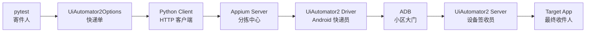
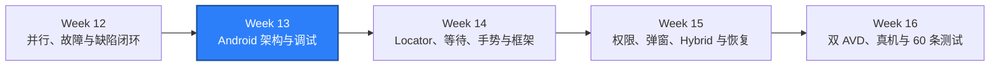

# WEEK-13 - Android Appium 架构、UiAutomator2、ADB 与调试 / Android Appium Architecture, UiAutomator2, ADB, and Debugging

- 计划 / Plan: Week 13，Android 从 pytest 到 AVD 的完整调用链
- 日期范围 / Date Range: 2026-10-18
- 分支 / Branch: study/week-13-android-appium-architecture
- 基线提交 / Base Commit: c68ffd5（week-12 分支）
- 计划提交 / Plan Commit: b24a3d4
- Pull Request: 未创建 / Not created

## 计划目标 / Plan Goal

Week 13 不急着增加业务用例，而是先解释清楚一条 Android 测试命令如何到达设备：

1. pytest 如何通过 Driver Factory 生成 `UiAutomator2Options`。
2. Appium Python Client 如何把命令转换成 W3C WebDriver HTTP 请求。
3. Appium Server 如何选择 UiAutomator2 Driver。
4. Driver 如何通过 ADB 找到 AVD、启动 device-side server 和目标 App。
5. 失败时如何在 PyCharm、Appium 日志和 ADB 证据之间判断边界。
6. 哪些 platform capability 必须留在 Driver Factory，不能散落到业务测试。

English summary: document and verify the Android session startup chain from
pytest through Appium, UiAutomator2, ADB, and the target app, with explicit
capability ownership and a repeatable debug path.

## 当前状态 / Current Status

**通过 / PASS（本地验收）。**

Week 13 要求的 Android Appium 架构与调试基线已完成并通过本地验收：

- Android capability 契约新增单元测试，覆盖 UDID、设备、Android 版本、包名和
  Activity 的映射。
- Driver Factory 的 Appium endpoint 去掉尾斜杠行为由单元测试锁定。
- Android 的 `newCommandTimeout` 提升到 300 秒，避免 PyCharm 断点停留超过默认
  60 秒后 Appium 主动销毁 session。
- 调用链文档从一张流程图扩展为实际 session 启动 sequence。
- 新增 Android Session Debugging runbook，覆盖 ADB、Appium 日志和 PyCharm 断点。
- 使用当前运行中的 Appium 2.19.0、UiAutomator2 Driver 4.2.9 和 Android 15 AVD
  采集了真实设备证据。

不在本周范围、已明确后移：

- 将 60 条 Android 测试、双 AVD、真机或设备云留到 Week 14 到 Week 16。
- 本轮只建立架构与调试基线，不加入定位器、显式等待和手势框架。

PyCharm 人工断点已验证：

- 单元能力测试 Debug 结果为 `2 tests passed`。
- 真实 Android Session Debug 命中 `build_android_options` 与 session 创建后的测试行。
- Appium session `52be8ce2-54e1-41a9-bee8-6e26e00ea200` 完成
  `POST /session 200`、`getCurrentPackage 200`、`window/rect 200` 和
  `DELETE /session 200`。
- 验证结束后 Appium session 列表为空，无残留 Session。

## 完成范围 / Scope

### 1. Capability 契约

`tests/unit/test_android_driver_options.py` 锁定：

- `platformName=Android`
- `appium:automationName=UiAutomator2`
- `appium:udid`
- `appium:deviceName`
- `appium:platformVersion`
- `appium:appPackage`
- `appium:appActivity`
- `appium:noReset=true`
- `appium:newCommandTimeout=300`

同时验证 `create_android_driver()` 使用配置中的 Appium 地址，并移除尾斜杠，
避免 `POST //session` 一类端点错误。

### 2. 调用链文档

`docs/architecture/mobile-driver-call-chain.md` 新增：

- pytest 到 target app 的 sequence diagram。
- Appium 2.19.0、Driver 4.2.9、BaseDriver 9.18.0、UiAutomator2 server 7.7.1
  的当前证据。
- capability 来源、owner 和失败边界表。
- Host 侧与 device 侧证据清单。
- PyCharm 调试路径。

### 3. ADB 与 Session Debugging

`docs/runbooks/android-session-debugging.md` 覆盖：

- AVD 和 Appium 隐藏启动。
- 一次 Android session 的成功判据。
- PyCharm 断点和条件断点。
- `adb devices`、`getprop`、`service check`、`pm list`、`ps`。
- Appium `POST /session` 完整启动序列。
- Python Client、Appium、Driver、ADB、Android service、UiAutomator2 server、
  目标 App 和 teardown 的责任边界。

## 术语解释 / Glossary

| 名词 / Term | 简单解释 / Plain Meaning | 作用 / Purpose | 在本项目中的位置 / Position |
| --- | --- | --- | --- |
| Appium Python Client | Python 测试侧的 W3C WebDriver 客户端 | 把 Python 调用变成 HTTP 命令 | `appium.webdriver.Remote` |
| Appium Server | 接收 WebDriver 命令并选择 Driver 的服务 | 统一入口和 session 管理 | `127.0.0.1:4723` |
| UiAutomator2 Driver | Appium 的 Android 适配层 | 选择设备、启动 server 和 App | `appium-uiautomator2-driver` |
| UiAutomator2 Server | 运行在 Android 设备侧的自动化服务 | 执行元素查询和 UI 操作 | device app / instrumentation |
| ADB | 主机与 Android 设备之间的调试桥 | 查询设备、安装包、启动 instrumentation | `adb.exe` |
| AVD | Android Virtual Device | 本地 Android 运行环境 | `Pixel_API_35_AOSP_ATD` |
| Capability | 描述目标平台、设备和 App 的参数 | 决定 session 连接对象 | `build_android_options` |
| Instrumentation | Android 测试代码在设备进程内运行的机制 | 提供 UiAutomator2 server 执行环境 | `androidTest` APK |
| Session | 一次 Appium 自动化连接的生命周期 | 从 POST /session 到 DELETE /session | `driver.session_id` |

## 通俗解读 / Plain Language Guide

Android 自动化像寄一件必须当面签收的快递：

pytest 是寄件人，capability 是快递单，Appium Server 是分拣中心，UiAutomator2 Driver
是负责 Android 线路的快递员，ADB 是进入小区的大门，UiAutomator2 Server 是设备里的
签收员，目标 App 才是最终收件人。只看到快递单打印成功，不代表包裹已经签收；必须看到
`POST /session 200`，并在设备上确认目标 App 已被启动。

**一句话理解：** Week 13 是给 Android 测试画出“从 Python 到设备”的完整路线，并标出每一段失败该找谁。



## 计划在整体路线中的位置 / Plan Position



Week 13 依赖 Week 1 已完成的 Android Session，以及 Week 4 到 Week 12 形成的配置、
日志和失败分类习惯。它产出的调用链和调试路径是 Week 14 业务框架设计的入口。

## 质量检查 / Quality Checks

| 检查项 / Check | 结果 / Status | 执行环境 / Environment | 证据 / Evidence |
| --- | --- | --- | --- |
| Ruff | 通过 / PASS | Windows | `All checks passed!` |
| Mypy | 通过 / PASS | Windows | `Success: no issues found in 120 source files` |
| Android options | 通过 / PASS | Windows | `2 passed in 0.32s` |
| Unit tests | 通过 / PASS | Windows | `215 passed in 7.91s` |
| Android session smoke | 通过 / PASS | Windows + AVD + Appium | `1 passed in 3.29s` |
| ADB preflight | 通过 / PASS | Windows + emulator-5554 | `device`, boot complete |
| Appium status | 通过 / PASS | Windows | Appium 2.19.0，`ready=true` |
| UiAutomator2 Driver | 通过 / PASS | Windows | `uiautomator2@4.2.9` |
| Device-side packages | 通过 / PASS | Android 15 AVD | settings、server、server.test |
| PyCharm breakpoint | 通过 / PASS | PyCharm + Android | 单元断点 `2 passed`；真实 Session 断点通过 |

## 验收方式 / Acceptance Method

### 前置条件 / Preconditions

1. Android AVD `Pixel_API_35_AOSP_ATD` 已启动。
2. `adb devices` 中目标 UDID 为 `device`。
3. Appium Server 在 `127.0.0.1:4723` ready。
4. 项目 `.venv` 为 Python 3.12。

### 执行命令 / Commands

```powershell
.\scripts\wait_for_android_ready.ps1 `
  -Serial emulator-5554 `
  -TimeoutSeconds 300

.\scripts\start_appium.ps1 -Port 4723 -WaitSeconds 60

$env:PYTEST_DEBUG_TEMPROOT="$PWD\.tmp-pytest"
uv run --no-sync pytest tests/unit/test_android_driver_options.py -q
uv run --no-sync pytest tests/android -q
```

### 预期结果 / Expected Results

```text
state=device, boot_completed=1, bootanim=stopped
Appium is ready on port 4723.
2 passed（Android options）
1 passed（Android session）
215 passed（all unit tests）
POST /session 200
```

### 证据路径 / Evidence

- Driver Factory: `packages/qa_core/driver/android.py`
- Capability tests: `tests/unit/test_android_driver_options.py`
- Session test: `tests/android/test_session.py`
- 调用链: `docs/architecture/mobile-driver-call-chain.md`
- 调试手册: `docs/runbooks/android-session-debugging.md`
- Appium 日志: `artifacts/appium-server.out.log`

### 未验证项 / Unverified Items

- PyCharm UI 单元断点与真实 Android Session 断点均已验证。
- Espresso Driver 对比只停留在边界设计，没有安装或执行 Espresso session。
- 真机、无线调试、双 AVD 并行属于 Week 16。
- 当前 AOSP ATD 目标 App 是系统测试壳，没有真实业务页面。

## 变更文件 / Files Changed

- `.env.example`：增加 Android `newCommandTimeout` 配置。
- `packages/qa_core/config/settings.py`：类型化 Android command timeout。
- `packages/qa_core/driver/android.py`：把 timeout 注入 UiAutomator2 capabilities。
- `tests/android/test_session.py`：真实 Session smoke 的超时与配置对齐。
- `tests/unit/test_android_driver_options.py`：锁定 capability 与 endpoint 契约。
- `docs/architecture/mobile-driver-call-chain.md`：补齐启动 sequence 与责任边界。
- `docs/runbooks/android-session-debugging.md`：新增 ADB、Appium 与 PyCharm 排障路径。
- `docs/README.md`、`reports/README.md`：刷新自动生成的入口索引。
- `reports/weekly/WEEK-13.md`：记录完成范围、证据与限制。

## 环境 / Environment

- Python: 3.12，项目 `.venv`
- Appium: 2.19.0
- UiAutomator2 Driver: 4.2.9
- UiAutomator2 Server: 7.7.1
- Android: 15，x86_64
- AVD: `Pixel_API_35_AOSP_ATD`
- Device: `emulator-5554`
- Appium: `http://127.0.0.1:4723`

## 风险与限制 / Risks and Limitations

- Appium 日志中的 `socket hang up` 可能只是 UiAutomator2 server 启动阶段的短暂连接
  重建，不能脱离最终 `POST /session` 结果单独判为失败。
- AOSP ATD 是自动化测试镜像，系统服务少、启动快，但不能代表所有真机厂商行为。
- capability 测试只能证明参数生成正确，不能证明设备、Driver 或目标 App 可达。
- Appium 默认 60 秒 `newCommandTimeout` 会在断点停留过久时销毁 Session；项目已改为
  300 秒，并在真实 Debug 中确认生效。

## 下一步 / Next Plan

1. Week 13 已完成本地提交前验收；远端分支与 PR 仍需在获得推送授权后创建。
2. 进入 Week 14：Locator、显式等待、手势、Page/Screen/Component/Flow 框架。
3. Week 14 继续使用当前 AVD 与 Appium Session 作为真实回归入口。
