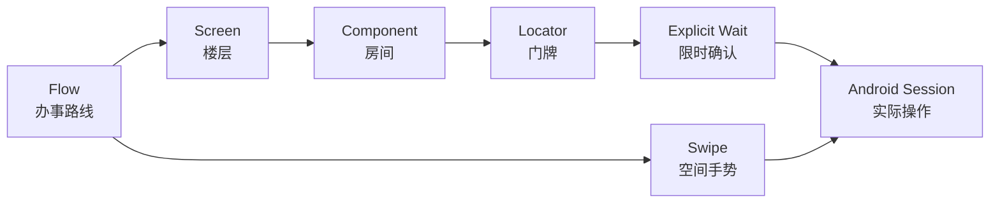

# WEEK-14 - Android Locator、显式等待、手势与 Screen/Component/Flow / Android Locator, Explicit Waits, Gestures, and Screen Framework

- 计划 / Plan: Week 14，Android 测试框架骨架
- 日期范围 / Date Range: 2026-10-18
- 分支 / Branch: study/week-14-android-locators
- 基线提交 / Base Commit: f349f3d（week-13 文档收口）
- 计划提交 / Plan Commit: 2e8eb5f
- 远端分支 / Remote Branch:
  `origin/study/week-14-android-locators`（850373e）
- Pull Request: 未创建 / Not created

## 计划目标 / Plan Goal

Week 14 把 Week 13 的“能建立 Session”推进到“能组织可维护的 Android UI
测试”：

1. Locator 带明确策略、值和诊断名称，不在业务代码里散落未类型化定位元组。
2. 所有元素状态变化使用有截止时间的显式等待，禁止固定 `sleep`。
3. 用 `Screen` 和 `Component` 限定查找范围，减少同名元素和重复代码。
4. 用 `Flow` 表达固定业务步骤，并精确定位失败步骤。
5. 提供经过参数校验的 UiAutomator2 swipe 手势。
6. 在真实 AVD 上执行 Screen 与 swipe smoke，而不只停留在 Mock。

English summary: establish a typed Android UI framework with locator
abstractions, bounded explicit waits, scoped screens and components, named
business flows, validated gestures, and one real-device-path smoke test.

## 完成状态 / Completion Status

**通过 / PASS（Windows 本机 + Android 15 AVD）。**

已实际执行：

- Ruff 全仓库静态检查。
- mypy 对 `packages` 与 `tests` 的类型检查。
- 新增移动框架单元测试与既有 settings 单测。
- `tests/android` 的真实 Appium session、Screen ready 和 swipe smoke。

未执行：

- GitHub Actions；远端分支已推送，但尚未创建 PR，因此没有 PR CI。
- iOS 手势适配；Week 14 只建立 Android 基线。
- 双 AVD、真机和 60 条 Android 测试；按计划属于 Week 16。

## 完成范围 / Scope

### 1. 类型化 Locator

- 新增 `LocatorStrategy`，覆盖 Accessibility ID、Resource ID、UiAutomator 和
  XPath。
- `Locator` 校验空值，并保留 `description` 供超时和失败信息使用。
- `as_tuple()` 统一生成 Appium/Selenium `find_element` 参数。

### 2. 显式等待

- `WaitPolicy` 校验 timeout、poll interval 和两者关系。
- `MobileWait` 支持 `visible`、`present`、`clickable` 和 `gone`。
- 超时抛出 `ElementWaitTimeout`，包含 locator、期望状态和实际超时时间。
- 默认 timeout 与 poll interval 通过 settings 和环境变量配置。

### 3. Screen 与 Component

- `Component.scope()` 把查询限制在 parent element 或 WebDriver。
- `descendant()`、`tap()`、`text_of()`、`send_keys()` 和 `attribute_of()`
  统一经过显式等待。
- `Screen.wait_ready()` 要求屏幕根节点可见后才允许后续操作。

### 4. 业务 Flow

- `FlowStep` 由名称和状态转换函数组成。
- `Flow` 固定顺序执行，不隐式重试。
- `FlowStepFailure` 保存 flow、step index、step name 和原始异常 cause。
- 重复步骤名称和空 Flow 在创建阶段失败。

### 5. Android 手势

- `AndroidGestures.swipe()` 调用 UiAutomator2
  `mobile: swipeGesture`。
- 支持 whole-window 或显式 `ScreenRect`。
- direction、percent、speed 和 rectangle 在发送设备命令前校验。

### 6. 真实回归

- 新增 AOSP System App Screen，使用系统资源 ID 作为基础设施 smoke root。
- 真实 Session 中完成 Screen ready、一次 swipe、package 校验和 teardown。
- 原 Android Session smoke 继续通过。

## 术语解释 / Glossary

| 名词 / Term | 简单解释 / Plain Meaning | 作用 / Purpose | 在本项目中的位置 / Position |
| --- | --- | --- | --- |
| Locator | 找到 UI 元素的条件 | 把“点登录按钮”变成可执行查询 | `qa_core.mobile.locators.Locator` |
| Accessibility ID | 应用暴露给无障碍能力的语义标签 | 通常比层级路径稳定 | `LocatorStrategy.ACCESSIBILITY_ID` |
| Resource ID | Android 应用的资源标识 | 精确指向应用内部控件 | `LocatorStrategy.RESOURCE_ID` |
| UiAutomator | Android 原生 UI 查询表达式 | 处理关系、文本和数量条件 | `LocatorStrategy.UIAUTOMATOR` |
| XPath | 沿 UI 层级找元素的路径 | 最后备选，易受层级变化影响 | `LocatorStrategy.XPATH` |
| Explicit Wait | 在截止时间内反复检查一个条件 | 等待页面状态，不靠猜测睡眠 | `MobileWait` |
| Screen | 一个完整页面 | 拥有页面根节点和页面动作 | `qa_core.mobile.screens.Screen` |
| Component | 页面中的可复用区域 | 把查询限制在局部，避免同名冲突 | `qa_core.mobile.screens.Component` |
| Flow | 有顺序的业务步骤 | 让失败精确落在某一步 | `qa_core.mobile.flows.Flow` |
| Swipe Gesture | 在指定区域按方向和比例滑动 | 处理列表、面板等空间操作 | `AndroidGestures.swipe` |

## 通俗解读 / Plain Language Guide

Week 13 解决的是“测试怎么走进 Android 大楼”。Week 14 像给大楼配了一套导航：

Locator 是门牌，显式等待是“每半秒确认一次门是否打开，但最多等十秒”，
Screen 是一层楼，Component 是楼层中的房间，Flow 是办事路线。门牌找不到时，
先确认自己是否走错楼层，再判断门是否被遮住，不会靠原地睡五秒来碰运气。

**一句话理解：** Week 14 把“能点到一个元素”升级成“能解释为什么找到、何时找到，以及失败发生在路线哪一步”。



## 计划在整体路线中的位置 / Plan Position


Week 14 依赖 Week 13 的真实 Session 和故障边界。它为 Week 15 的系统弹窗、权限和
页面恢复提供可复用的 Screen/Component/Flow 骨架。

## 质量检查 / Quality Checks

| 检查项 / Check | 结果 / Status | 执行环境 / Environment | 证据 / Evidence |
| --- | --- | --- | --- |
| Ruff | 通过 / PASS | Windows | `All checks passed!` |
| Mypy | 通过 / PASS | Windows | `Success: no issues found in 131 source files` |
| Mobile unit tests | 通过 / PASS | Windows | `16 passed in 0.23s` |
| Unit regression | 通过 / PASS | Windows | `230 passed in 7.85s` |
| Android smoke | 通过 / PASS | Windows + Android 15 AVD + Appium 2.19.0 | `2 passed in 5.70s` |
| Appium session | 通过 / PASS | Windows | `POST /session 200`、swipe、`DELETE /session` |

## 验收方式 / Acceptance Method

### 前置条件 / Preconditions

1. Android AVD `Pixel_API_35_AOSP_ATD` 已启动。
2. `emulator-5554` 在 `adb devices` 中为 `device`。
3. Appium Server 2.19.0 在 `127.0.0.1:4723` ready。
4. UiAutomator2 Driver `4.2.9` 已安装。
5. 使用项目 `.venv` 中的 Python 3.12。

### 执行命令 / Commands

```powershell
.\scripts\wait_for_android_ready.ps1 `
  -Serial emulator-5554 `
  -TimeoutSeconds 300

.\scripts\start_appium.ps1 -Port 4723 -WaitSeconds 60

$env:PYTEST_DEBUG_TEMPROOT="$PWD\.tmp-pytest"
.\.venv\Scripts\python.exe -m ruff check .
.\.venv\Scripts\python.exe -m mypy packages tests
.\.venv\Scripts\python.exe -m pytest tests\unit -q -p no:cacheprovider
.\.venv\Scripts\python.exe -m pytest tests\android -q -p no:cacheprovider
```

### 预期结果 / Expected Results

```text
All checks passed!
Success: no issues found in 131 source files
16 passed（定向移动框架与 settings）
230 passed（all unit tests）
2 passed（Android Session + Screen/Swipe）
```

### 证据路径 / Evidence

- 类型化 Locator：`packages/qa_core/mobile/locators.py`
- 显式等待：`packages/qa_core/mobile/waits.py`
- Screen/Component：`packages/qa_core/mobile/screens.py`
- Flow：`packages/qa_core/mobile/flows.py`
- Android 手势：`packages/qa_core/platforms/android/gestures.py`
- 单元测试：`tests/unit/test_mobile_framework.py`
- 真实 Android smoke：`tests/android/test_screen_framework.py`
- 架构说明：`docs/architecture/android-screen-framework.md`
- 排障手册：`docs/runbooks/android-locator-and-wait-triage.md`
- Allure：`artifacts/allure-results/`

### 未验证项 / Unverified Items

- 真实产品页面中的稳定业务 Locator。
- 复杂滚动容器、系统手势冲突和不同屏幕密度下的 swipe 参数。
- iOS XCUITest 的等价 wait、component 和 gesture adapter。
- 双 AVD、真机、设备云和 60 条 Android 测试规模。
- GitHub Actions 与 PR。

## 变更文件 / Files Changed

- `packages/qa_core/mobile/`：Locator、Wait、Screen/Component、Flow。
- `packages/qa_core/platforms/android/gestures.py`：UiAutomator2 swipe。
- `packages/qa_core/config/settings.py`、`.env.example`：UI wait 配置。
- `tests/unit/test_mobile_framework.py`、`test_settings.py`：框架与配置单测。
- `tests/android/conftest.py`、`test_screen_framework.py`、`test_session.py`：
  Android 前置条件复用和真实 Screen smoke。
- `docs/architecture/android-screen-framework.md`：分层与策略说明。
- `docs/runbooks/android-locator-and-wait-triage.md`：失败分类和证据采集。
- `docs/architecture/project-overview.md`、两个入口索引：同步项目结构。
- `reports/weekly/WEEK-14.md`：本周计划和验收记录。

## 环境 / Environment

- Python: 3.12，项目 `.venv`
- Appium: 2.19.0
- UiAutomator2 Driver: 4.2.9
- Android: 15，x86_64
- AVD: `Pixel_API_35_AOSP_ATD`
- Device: `emulator-5554`
- Appium endpoint: `http://127.0.0.1:4723`

## 风险与限制 / Risks and Limitations

- AOSP System App 只有基础容器，能证明框架与手势命令可达，但不能证明真实业务
  页面可交互。
- UiAutomator 和 XPath 字符串表达能力更强，也更容易隐藏脆弱假设；优先使用语义
  和资源 ID。
- 显式等待不会修复错误 Locator。超时时间增长只能扩大观察窗口，不能替代定位。
- Flow 不自动重试。重试、恢复和幂等必须由明确业务边界处理。
- settings 与 `WaitPolicy` 都拒绝 poll interval 大于 timeout 的组合，避免配置
  在进入设备命令前才失败。

## 下一步 / Next Plan

1. Week 15 进入权限、系统弹窗、通知、Hybrid、文件和后台恢复。
2. 为真实业务页面建立首批 `Screen` 和 `Component`，保持 Locator 在页面层。
3. 在系统弹窗和前后台切换场景中复用 `FlowStepFailure`，验证步骤级证据。
4. Week 16 再扩展双 AVD、真机、设备矩阵和 60 条 Android 测试。
