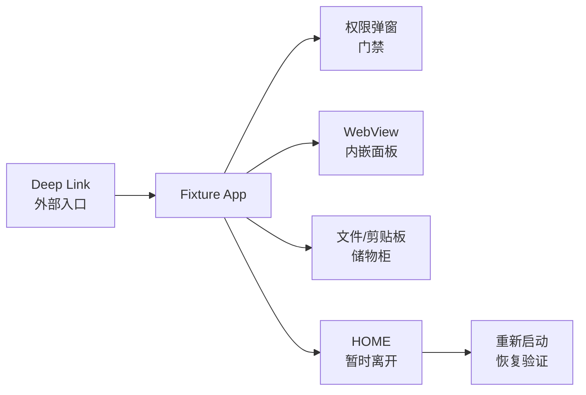
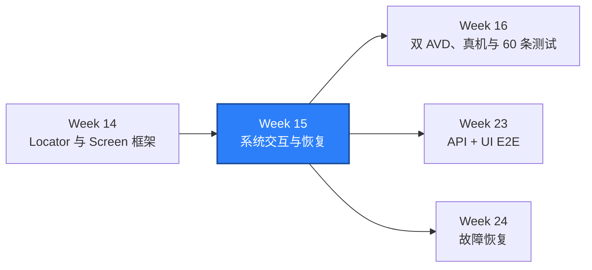

# WEEK-15 - Android 权限、系统弹窗、Hybrid、文件与恢复 / Android Permissions, System UI, Hybrid, Files, and Recovery

- 计划 / Plan: Week 15，Android 系统交互与业务测试
- 日期范围 / Date Range: 2026-10-18
- 分支 / Branch: study/week-15-android-permissions-recovery
- 基线提交 / Base Commit: c36ce05（week-14 已推送分支）
- 计划提交 / Plan Commit: 待记录 / To be recorded in the follow-up docs commit
- Pull Request: 未创建 / Not created

## 计划目标 / Plan Goal

Week 15 把 Android 测试从页面内部推进到应用边界：

1. 检查、授予和撤销运行时权限，并处理真实权限弹窗。
2. 在 Native 与 WebView context 之间安全切换。
3. 向设备写入文件、读取验证并清理，同时恢复剪贴板。
4. 通过 Intent 打开自定义深链接。
5. 离开 App 后重新启动 Activity，验证前台恢复。
6. 修复多个 App 连续测试时的 Session 前台泄漏。

English summary: verify Android permission dialogs, Hybrid contexts, device
files, clipboard restoration, deep links, foreground recovery, and explicit
test-App isolation on a real emulator.

## 完成状态 / Completion Status

**通过 / PASS（Windows 本机 + Android 15 AVD）。**

已实际执行：

- 构建、签名并安装最小 Android 夹具 App。
- 真实 CAMERA 权限弹窗、允许操作和结果页断言。
- 真实 WebView context 切换与 CSS 元素交互。
- `/sdcard/Download` 文件写入、读取、删除和剪贴板恢复。
- `qaweek15://` 深链接、HOME 离开与重新前台。
- 两个既有 Android smoke 与四组新 smoke 连续执行。

未执行：

- GitHub Actions 和 PR CI；本分支尚未推送。
- 真机、双 AVD、设备云和 OEM 权限页。
- 通知栏、系统设置和 OEM 定制弹窗。
- 真进程死亡、WDA/ADB 故障恢复；按后续计划处理。

## 完成范围 / Scope

### 1. Android 测试夹具

- 新增 `apps/android-fixture`，无第三方 Gradle 依赖。
- 使用 SDK 自带 `javac`、`d8`、`aapt`、`zipalign` 和 `apksigner` 构建。
- 声明 CAMERA 权限，提供请求按钮和可见结果状态。
- 内嵌可调试 WebView，提供稳定 CSS 元素。
- 支持 `qaweek15://permission/...` 深链接。
- 提供 resume count，便于观察前台恢复。
- APK 和 debug keystore 写入忽略的 `artifacts/android-fixture/`。

### 2. 权限弹窗

- `AndroidPermissions` 快照去重 requested、granted、denied。
- grant/revoke 使用完整 `android.permission.*` 名称。
- 操作后重新读取状态，避免“命令成功但状态未变”。
- Smoke 验证 `com.android.permissioncontroller` 成为前台 Activity。
- 点击真实 `WHILE USING THE APP` 按钮后验证 App 状态与权限状态。
- 测试结束恢复原始权限。

### 3. Hybrid

- `AndroidWebView` 精确等待 `WEBVIEW_<package>`。
- Context manager 退出后恢复之前的 Native/Context。
- Appium 本地启动参数启用 `chromedriver_autodownload`。
- 当前 Chrome/WebView 124 使用 Chromedriver 124.0.6367.207。
- 通过 CSS 定位验证 `Hybrid ready` 和 Web 按钮。

### 4. 文件与剪贴板

- `AndroidFiles` 支持 UTF-8 push/pull 和 `mobile: deleteFile`。
- 路径必须为绝对路径，拒绝目录穿越。
- `AndroidClipboard.preserve()` 在 finally 恢复原剪贴板。
- 测试使用唯一文件名，结束后验证文件已删除。

### 5. 深链接与恢复

- `AndroidIntent` 生成 `mobile: startActivity` 参数。
- `AndroidActivities` 按 package 或精确 component 等待前台状态。
- 深链接断言 URI 已进入 App。
- 发送 HOME 后等待 launcher package。
- 重新启动组件后验证 package、Activity 和 resume 视图。

### 6. Session 隔离修复

- 发现 AOSP Fake System App 没有 launcher Activity，Session 会残留前一个 App。
- 所有 Android fixture 统一在 Session 后显式启动 package/Activity。
- 全量 Android smoke 连续运行时不再发生前台包串扰。

## 术语解释 / Glossary

| 名词 / Term | 简单解释 / Plain Meaning | 作用 / Purpose | 在本项目中的位置 / Position |
| --- | --- | --- | --- |
| Runtime Permission | App 运行时向用户申请的敏感权限 | 验证允许、拒绝和权限状态 | CAMERA |
| Permission Dialog | 系统权限控制器弹出的确认窗口 | 必须和 App 页面分开断言 | `permissioncontroller` |
| WebView | App 内嵌的浏览器容器 | 使用 Web 定位和交互 | `AndroidWebView` |
| Context | Appium 当前操作 Native 还是 WebView | 决定定位协议和 Driver | `NATIVE_APP`、`WEBVIEW_*` |
| Chromedriver | 自动化 Chromium/WebView 的中间程序 | WebView context 的执行器 | Appium 自动下载 |
| Deep Link | 通过 URI 打开 App 内指定页面 | 验证外部入口和路由 | `qaweek15://` |
| Intent | Android 的跨组件启动请求 | 启动 Activity 和传 URI | `AndroidIntent` |
| Resume | Activity 重新回到前台 | 检查离开后的恢复 | `fixture-resume` |
| Test Fixture App | 为稳定测试提供真实系统行为的小 App | 补足 AOSP Shell 缺失的能力 | `apps/android-fixture/` |

## 通俗解读 / Plain Language Guide

Week 14 像在 App 房间里操作家具；Week 15 开始处理房门、门禁和楼外入口：

权限弹窗是门禁管理员，WebView 是房间里的另一套操作面板，文件是临时储物柜，
深链接是外部访客入口，HOME 后重新打开是“出门再回来”。每一项都要等真正的系统
界面出现，再操作和验证，不能靠睡几秒猜它已经完成。

**一句话理解：** Week 15 把 Android 测试从“页面里点按钮”扩展到“跨过 App 边界，仍能证明系统确实响应并恢复”。



## 计划在整体路线中的位置 / Plan Position



Week 15 依赖 Week 14 的 Locator、等待和 Screen 框架。它为 Week 16 的设备矩阵、
Week 23 的跨层 E2E 和 Week 24 的恢复故障提供真实系统交互能力。

## 质量检查 / Quality Checks

| 检查项 / Check | 结果 / Status | 执行环境 / Environment | 证据 / Evidence |
| --- | --- | --- | --- |
| Fixture build | 通过 / PASS | Windows + Android SDK 35 | `Built fixture-debug.apk`、install `Success` |
| Ruff | 通过 / PASS | Windows | `All checks passed!` |
| Mypy | 通过 / PASS | Windows | `Success: no issues found in 138 source files` |
| Unit tests | 通过 / PASS | Windows | `238 passed in 8.15s` |
| System interaction smoke | 通过 / PASS | Windows + Android 15 AVD | `4 passed in 25.74s` |
| Full Android smoke | 通过 / PASS | Windows + Android 15 AVD | `6 passed in 36.22s` |
| Permission dialog | 通过 / PASS | Android 15 + PermissionController | CAMERA allow flow |
| Hybrid context | 通过 / PASS | WebView 124 + Chromedriver 124.0.6367.207 | CSS element found |
| File cleanup | 通过 / PASS | `/sdcard/Download` | pull equals pushed text，删除后不存在 |

## 验收方式 / Acceptance Method

### 前置条件 / Preconditions

1. Android AVD `Pixel_API_35_AOSP_ATD` 已启动。
2. `emulator-5554` 在 `adb devices` 中为 `device`。
3. Appium Server 2.19.0 在 `127.0.0.1:4723` ready。
4. Appium 由项目 `start_appium.ps1` 启动，允许本地 Chromedriver 自动下载。
5. UiAutomator2 Driver `4.2.9` 已安装。
6. 项目 `.venv` 使用 Python 3.12。

### 执行命令 / Commands

```powershell
.\scripts\wait_for_android_ready.ps1 `
  -Serial emulator-5554 `
  -TimeoutSeconds 300

.\scripts\start_appium.ps1 -Port 4723 -WaitSeconds 60
.\apps\android-fixture\build.ps1 -Serial emulator-5554

$env:PYTEST_DEBUG_TEMPROOT="$PWD\.tmp-pytest"
.\.venv\Scripts\python.exe -m ruff check .
.\.venv\Scripts\python.exe -m mypy packages tests
.\.venv\Scripts\python.exe -m pytest tests\unit -q -p no:cacheprovider
.\.venv\Scripts\python.exe -m pytest tests\android -q -p no:cacheprovider
```

### 预期结果 / Expected Results

```text
Appium is ready on port 4723.
Built ...\artifacts\android-fixture\fixture-debug.apk
Success
All checks passed!
Success: no issues found in 138 source files
238 passed
6 passed（Android Session、Screen、Permission、Hybrid、File、Recovery）
```

### 证据路径 / Evidence

- 夹具源码：`apps/android-fixture/`
- 构建脚本：`apps/android-fixture/build.ps1`
- 系统交互实现：`packages/qa_core/platforms/android/`
- Android smoke：`tests/android/test_system_interactions.py`
- 单元测试：`tests/unit/test_android_system_interactions.py`
- 架构说明：`docs/architecture/android-system-interactions.md`
- 排障手册：`docs/runbooks/android-permissions-and-recovery-triage.md`
- Appium 日志：`artifacts/appium-server.out.log`
- Allure：`artifacts/allure-results/`

### 未验证项 / Unverified Items

- 真机权限页、OEM 定制弹窗和“不要再询问”长期状态。
- 通知栏、系统设置和部分系统 UI 在 AOSP ATD 上不可用。
- 多 WebView、Chrome Custom Tabs 和 WebView 版本矩阵。
- 双 AVD、设备云、无线 ADB 和进程死亡恢复。
- GitHub Actions 与远端 PR。

## 变更文件 / Files Changed

- `apps/android-fixture/`：Android 测试夹具源码、构建脚本和说明。
- `packages/qa_core/platforms/android/activities.py`：Intent 与前台等待。
- `permissions.py`、`files.py`、`clipboard.py`、`hybrid.py`：系统交互封装。
- `packages/qa_core/platforms/android/__init__.py`：统一导出。
- `tests/android/conftest.py`：显式启动目标组件和夹具 Session。
- `tests/android/test_system_interactions.py`：四组真实 smoke。
- `tests/unit/test_android_system_interactions.py`：八条确定性单测。
- `tests/android/test_session.py`、`test_screen_framework.py`：复用隔离 Session。
- `scripts/start_appium.ps1`：本地 Chromedriver 自动下载。
- 架构、runbook、项目总览、入口索引与 `reports/weekly/WEEK-15.md`。

## 环境 / Environment

- Python: 3.12，项目 `.venv`
- Appium: 2.19.0
- UiAutomator2 Driver: 4.2.9
- Android: 15 / API 35，x86_64
- AVD: `Pixel_API_35_AOSP_ATD`
- Device: `emulator-5554`
- Chrome/WebView: 124.0.6367.219
- Chromedriver: 124.0.6367.207
- Fixture package: `com.example.qaweek15`

## 风险与限制 / Risks and Limitations

- 夹具 App 使用系统 WebView 和 PermissionController，行为会随 AVD 镜像版本变化。
- 自动下载 Chromedriver 依赖外网；离线环境需要预置兼容版本。
- WebView context 名称和 app package 绑定，不能只按 `WEBVIEW_` 前缀盲选。
- 权限恢复失败应显式报错，不能用测试通过掩盖残留状态。
- 文件测试只覆盖外部可写目录，不覆盖 Android scoped storage 或 SAF。
- AOSP ATD 不能代表真实厂商的系统弹窗、通知和后台策略。

## 下一步 / Next Plan

1. Week 16 进入双 AVD、真机或设备云、设备矩阵和 60 条 Android 测试。
2. 为夹具补充拒绝权限、二次申请和“不要再询问”场景。
3. 增加多 WebView 和 Chrome Custom Tabs 的 context/tab 选择。
4. 将设备、App 版本、session、权限和深链接证据写入 Allure。
