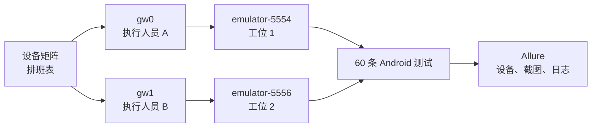
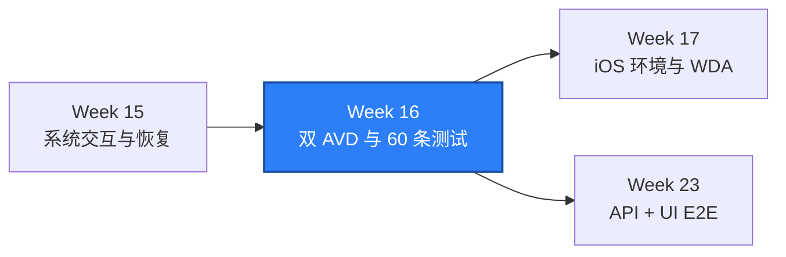

# WEEK-16 - Android 双 AVD、设备矩阵、日志与 60 条测试 / Android Dual AVD, Device Matrix, Logs, and 60 Tests

- 计划 / Plan: Week 16，Android 设备矩阵与测试规模
- 日期范围 / Date Range: 2026-10-18
- 分支 / Branch: study/week-16-android-device-matrix
- 基线提交 / Base Commit: 502081e（Week 15 本地收口）
- 计划提交 / Plan Commit: 570df1f
- 远端分支 / Remote Branch: 未推送 / Not pushed
- Pull Request: 未创建 / Not created

## 计划目标 / Plan Goal

Week 16 把 Android 测试从单设备 smoke 推进到可重复的设备矩阵：

1. 用 YAML 描述主 AVD、并行 AVD 和可选真机。
2. 让 pytest-xdist worker 与不同 UDID 一一绑定，避免设备串扰。
3. 在真实双 AVD 上并行运行 60 条 Android 测试。
4. 统一采集设备、截图、page source、logcat 和 Allure 证据。
5. 修复并行负载下暴露出的 ADB 命令超时边界。

English summary: move the Android suite to an explicit YAML device matrix,
bind xdist workers to distinct UDIDs, run 60 tests on two AVDs in parallel, and
capture device-aware Allure diagnostics.

## 完成状态 / Completion Status

**通过 / PASS（Windows 本机 + 两个 Android 15 AOSP ATD AVD）。**

已实际执行：

- `emulator-5554` 与 `emulator-5556` 同时启动并完成系统 boot 检查。
- 两个 AVD 分别安装同一签名的 Android fixture。
- 60 条 Android 测试通过两个 xdist worker 并行执行。
- Allure 结果确认两台设备都实际参与：主 AVD 26 条，并行 AVD 34 条。
- 失败诊断 hook 已于单设备调试验证阶段实际触发，并产出截图、page source 和 logcat。
- 测试结束后 Appium `/sessions` 返回空列表。

Week 15 未完成项核对：

- GitHub 远端不存在 `study/week-15-android-permissions-recovery`，分支未推送，
  也没有 PR。
- Week 15 的双 AVD 与测试规模在 Week 16 已补齐。
- 真机、设备云、OEM 权限页、通知栏、进程死亡和 GitHub CI 仍未验证。

## 完成范围 / Scope

### 1. 设备矩阵

- 新增 `configs/android-device-matrix.yaml`。
- 主 AVD、并行 AVD 和可选真机都有逻辑 ID、角色、默认 UDID 和环境变量覆盖。
- 缺少必选设备、重复 UDID 或 worker 数量超过设备数量时明确失败。
- pytest-xdist 的 `gw0`、`gw1` 绑定不同 profile。

### 2. 测试夹具

- 夹具增加输入框、提交、校验、重置、计数器、原生对话框和固定状态控件。
- 表单状态使用固定 accessibility id，状态文字变化不再破坏定位。
- 对话框使用系统资源 ID `android:id/button1` 和 `button2`。
- 所有矩阵测试在重启 Activity 后执行，保持测试级 App 状态隔离。

### 3. 60 条 Android 测试

| 范围 | 数量 |
| --- | --- |
| 设备与 App 基线 | 12 |
| 表单校验与输入 | 12 |
| 计数器 | 4 |
| 原生对话框 | 4 |
| 四方向手势 | 4 |
| 权限状态 | 4 |
| Hybrid | 4 |
| 文件与剪贴板 | 4 |
| 深链接与前台恢复 | 6 |
| Week 13-15 既有 smoke | 6 |

新增矩阵模块每个 worker 只创建一个长期 Session，每个测试显式重启 fixture
Activity。这样既避免 54 次 Session 启动开销，也不共享 App 页面状态。

### 4. 并行证据

- 每条 Allure 结果记录 logical device、role 和 UDID。
- 失败时自动附加截图、page source 和最近 1000 行 logcat。
- `run_android_matrix.ps1` 生成独立的 `allure-results`、HTML report 和 console log。

### 5. 并行稳定性修复

首次双 AVD 全量结果为 `59 passed, 1 failed`。失败命令是：

```text
adb shell dumpsys package com.example.qaweek15
timed out after 20000ms
```

UiAutomator2 默认 `adbExecTimeout` 是 20 秒。项目现在显式配置：

```text
QA_ANDROID_ADB_EXEC_TIMEOUT_MS=60000
```

修复后全量重跑得到 `60 passed in 102.79s`。

## 术语解释 / Glossary

| 名词 / Term | 简单解释 / Plain Meaning | 作用 / Purpose | 在本项目中的位置 / Position |
| --- | --- | --- | --- |
| Device Matrix | 多个逻辑设备的配置清单 | 明确测试到底跑在哪台设备 | `configs/android-device-matrix.yaml` |
| UDID | Android 设备的唯一序列号 | 防止多个 worker 操作同一设备 | `QA_ANDROID_UDID_*` |
| pytest-xdist | 把测试分发给多个进程的 pytest 插件 | 并行执行并隔离 worker | `-n 2` |
| Worker | xdist 的一个独立 pytest 进程 | 每个 worker 绑定一个设备 | `gw0`、`gw1` |
| adbExecTimeout | Appium 等待一次 ADB 命令的上限 | 区分慢设备与无限等待 | `android_adb_exec_timeout_ms` |
| Allure Parameter | 写到测试结果上的参数 | 证明结果属于哪台设备 | device、udid、role |
| Page Source | 当前 UI 层级 XML | 失败后判断元素是否真的存在 | 失败附件 |
| Logcat | Android 系统与应用日志 | 补充 Appium 协议外的设备事实 | 失败附件 |

## 通俗解读 / Plain Language Guide

Week 15 像给测试人员发了两张不同房间的门禁卡；Week 16 要保证两个人不会拿
同一张卡同时进同一个房间，而且每次失败都能说清楚是谁、在哪台设备、执行到哪一步。

设备矩阵是排班表，worker 是执行人员，UDID 是工位编号，Allure 是带照片和日志的
工作记录。一个人可以连续处理多项任务，但同一工位不能同时分给两个人。

**一句话理解：** Week 16 把“能在一台模拟器上跑”升级成“能说清 60 条测试分别在哪两台设备上并行运行，并保留可追溯证据”。



## 计划在整体路线中的位置 / Plan Position



Week 16 复用 Week 14 的 Screen/Wait/Gesture 和 Week 15 的权限、Hybrid、文件、
深链接与恢复能力，为 Week 17 的 iOS 设备准备和 Week 23 的跨层 E2E 提供并行、
证据和失败诊断基础。

## 质量检查 / Quality Checks

| 检查项 / Check | 结果 / Status | 执行环境 / Environment | 证据 / Evidence |
| --- | --- | --- | --- |
| Fixture build and install | 通过 / PASS | Windows + two Android 15 AVDs | both installs returned `Success` |
| Ruff | 通过 / PASS | Windows | `All checks passed!` |
| Mypy | 通过 / PASS | Windows | `Success: no issues found in 142 source files` |
| Unit tests | 通过 / PASS | Windows | `242 passed in 8.37s` |
| Android matrix, first run | 部分通过 / PARTIAL | two AVDs + Appium 2.19.0 | `59 passed, 1 failed`; ADB 20s timeout |
| Android matrix, final run | 通过 / PASS | two AVDs + Appium 2.19.0 | `60 passed in 102.79s` |
| Device distribution | 通过 / PASS | Allure results | primary 26, parallel 34 |
| Session cleanup | 通过 / PASS | Appium `/sessions` | empty list |
| Real Android device | 未执行 / NOT RUN | no physical device connected | optional matrix profile only |
| GitHub Actions / PR | 未执行 / NOT RUN | branch not pushed | no remote run |

## 验收方式 / Acceptance Method

### 前置条件 / Preconditions

1. AVD `Pixel_API_35_AOSP_ATD` 使用 `emulator-5554`。
2. AVD `Pixel_API_35_AOSP_ATD_2` 使用 `emulator-5556`。
3. 两个串号在 `adb devices -l` 中均为 `device`。
4. Appium Server 2.19.0 在 `127.0.0.1:4723` ready。
5. UiAutomator2 Driver `4.2.9` 已安装。
6. 项目 `.venv` 使用 Python 3.12。

### 执行命令 / Commands

```powershell
.\scripts\wait_for_android_ready.ps1 `
  -Serial emulator-5554 `
  -TimeoutSeconds 300

.\scripts\wait_for_android_ready.ps1 `
  -Serial emulator-5556 `
  -TimeoutSeconds 300

.\.venv\Scripts\python.exe -m ruff check .
.\.venv\Scripts\python.exe -m mypy packages tests
$env:PYTEST_DEBUG_TEMPROOT="$PWD\.tmp-pytest"
.\.venv\Scripts\python.exe -m pytest tests\unit -q -p no:cacheprovider

.\scripts\run_android_matrix.ps1 `
  -PrimarySerial emulator-5554 `
  -SecondarySerial emulator-5556 `
  -Workers 2 `
  -AppiumPort 4723
```

### 预期结果 / Expected Results

```text
All checks passed!
Success: no issues found in 142 source files
242 passed
60 passed in 102.79s
Report successfully generated to .../artifacts/android-matrix/<run-id>/allure-report
```

### 证据路径 / Evidence

- Device matrix: `configs/android-device-matrix.yaml`
- Matrix assignment: `packages/qa_core/platforms/android/devices.py`
- Worker/session fixtures: `tests/android/conftest.py`
- 54 matrix tests: `tests/android/test_week16_device_matrix.py`
- Fixture screen helpers: `tests/android/week16_fixture.py`
- Fixture app: `apps/android-fixture/`
- Matrix runner: `scripts/run_android_matrix.ps1`
- Final Allure results: `artifacts/android-matrix/20261018-221459/allure-results/`
- Final HTML report: `artifacts/android-matrix/20261018-221459/allure-report/`
- Final console log: `artifacts/android-matrix/20261018-221459/pytest-console.log`
- Appium logs: `artifacts/appium-server.out.log`、`artifacts/appium-server.err.log`

### 未验证项 / Unverified Items

- Android 真机、无线 ADB、设备云和厂商 ROM。
- 第二个 Android 系统版本；本次两台 AVD 均为 Android 15。
- OEM 权限页、通知栏、系统设置和厂商后台策略。
- Android 版本升级、屏幕密度矩阵、字体缩放和深色模式。
- Appium Server 多实例、跨主机设备池和 CI 模拟器。
- Week 15 分支的 GitHub 推送、PR 和 Actions。

## 变更文件 / Files Changed

- `configs/android-device-matrix.yaml`：主 AVD、并行 AVD、可选真机矩阵。
- `packages/qa_core/platforms/android/devices.py`：矩阵加载与 worker 分配。
- `packages/qa_core/config/settings.py`：矩阵路径与 ADB 命令超时。
- `packages/qa_core/driver/android.py`：`adbExecTimeout` capability。
- `tests/android/conftest.py`：worker/device 绑定、共享 Session 和失败诊断。
- `tests/android/test_week16_device_matrix.py`：54 条矩阵测试。
- `tests/android/week16_fixture.py`：夹具 Screen、Locator 和重置逻辑。
- `apps/android-fixture/`：表单、计数器、对话框和稳定 accessibility id。
- `scripts/run_android_matrix.ps1`：双 AVD 构建、启动和 Allure 证据入口。
- `tests/unit/test_android_device_matrix.py`、`test_android_driver_options.py`：
  矩阵与 capability 单测。
- `docs/architecture/android-device-matrix.md`、设备矩阵 runbook 与本报告。

## 环境 / Environment

- Python: 3.12，项目 `.venv`
- Appium: 2.19.0
- UiAutomator2 Driver: 4.2.9
- Android: 15 / API 35，x86_64 AOSP ATD
- AVD: `Pixel_API_35_AOSP_ATD`、`Pixel_API_35_AOSP_ATD_2`
- Device: `emulator-5554`、`emulator-5556`
- Appium endpoint: `http://127.0.0.1:4723`
- Fixture package: `com.example.qaweek15`

## 风险与限制 / Risks and Limitations

- 双 AVD 仍共享同一台 Windows 主机的 CPU、内存、ADB Server 和 Appium Server。
  设备隔离不等于资源隔离。
- 两台 AVD 使用同一系统镜像，不能替代 Android 版本兼容性验证。
- 并行时 `dumpsys` 明显变慢，60 秒是当前主机上的有界配置，不是通用生产参数。
- 长期 Session 提高速度，但要求每个测试主动恢复 App 状态；本轮通过重启 Activity
  实现，后续真实业务仍需独立的数据与账号清理。
- AOSP ATD 没有代表性 OEM 系统 UI，真机结论必须单独采集。
- 本分支尚未提交、推送或创建 PR，因此没有 GitHub Actions 证据。

## 下一步 / Next Plan

1. Week 17 准备 macOS、Xcode、XCUITest 和 WDA 环境并形成 runbook。
2. 记录 Simulator、真机和设备云三条路径的前置条件与失败边界。
3. 把 Android 设备矩阵 abstractions 与 iOS capabilities 保持平台隔离。
4. 如连接真机，补跑至少一条物理 Android 链路并记录厂商、型号和系统版本。
