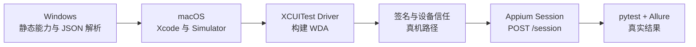
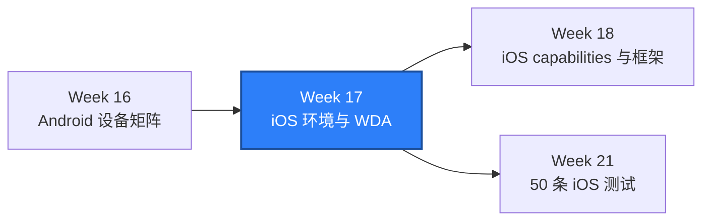

# WEEK-17 - iOS 环境、Xcode、XCUITest、WDA 与签名 / iOS Environment, Xcode, XCUITest, WDA, and Signing

- 计划 / Plan: Week 17，iOS 环境准备与 WDA 诊断
- 日期范围 / Date Range: 2026-10-21 to 2026-10-27（环境阶段收口 / Environment Scope Closed）
- 分支 / Branch: study/week-17-ios-environment-wda
- 基线提交 / Base Commit: b7a9cf2（Week 16 真机矩阵收口）
- 计划提交 / Plan Commit: 08764dc
- Pull Request: 尚未创建 / Not created
- 完成状态 / Completion Status: **部分通过，运行验收延期 / PARTIAL - RUNTIME ACCEPTANCE DEFERRED**

## 验收调度 / Acceptance Schedule

Week 17 的静态验证、环境预检、WDA/签名诊断和自托管真机准备已经形成可用基线。
以下依赖 macOS/Xcode 的运行项不在 Week 17 继续阻塞，统一延期到 Week 21
iOS 阶段验收一起执行：

- 本轮分支的 macOS Simulator 预检，要求 `passed=true`。
- WDA 首次构建、`WebDriverAgentRunner` 启动和真实 Appium session。
- 当前 iOS 代码基线上的 `tests/ios` smoke、Appium 日志和 Allure 证据。
- 真机签名、Provisioning Profile、设备信任和 Developer Mode 的可执行验证；
  仅在 Week 21 已具备 Mac 或设备云时纳入阶段门。

Week 21 验收时使用当时最新的 iOS 分支，不要求重新检出 Week 17 的历史提交。
必须重新执行环境检查、iOS smoke 和证据归档，不能用旧 macOS baseline
代替当前代码结果。若 Week 21 仍没有可用 macOS 环境，该项保持延期，不得
把 `SKIPPED` 或 `NOT RUN` 写成 `PASS`。

English summary: runtime acceptance is deferred to the Week 21 iOS stage gate.
Week 18 may proceed with framework work, but the deferred checks must be rerun
against the then-current iOS branch before the iOS stage can pass.

## 计划目标 / Plan Goal

Week 17 的目标不是立即写出大量 iOS 用例，而是先建立可信的 iOS 执行边界：

1. 明确 macOS、Xcode、Simulator、Appium、XCUITest Driver 和 WDA 的依赖链。
2. 用只读预检区分 Simulator 路径和真机签名路径。
3. 为 macOS 冒烟流水线产出机器可读的环境证据。
4. 记录 WDA 构建、端口、签名、设备信任和失败分类。
5. 明确 Windows 只能验证静态能力，不能把 `skip` 当成 iOS 通过。

English summary: establish a reproducible iOS environment and WDA diagnostic
boundary before building larger iOS suites.

## 第 16 周状态核对 / Week 16 Closure Check

本地工作区与远端 Week 16 分支一致，HEAD 为
`b7a9cf247e372af37d3438301db5fce4da7711c3`。

远端 PR [#8](https://github.com/htb123-maker/quality-engineering-lab/pull/8)
仍为打开状态，合并状态为 `CLEAN`。两个必需检查均由 GitHub Actions 实际执行：

| 检查 / Check | 结论 / Conclusion | 证据 / Evidence |
| --- | --- | --- |
| Quality Gates | `SUCCESS` | run `39456260476` |
| SUT Integration | `SUCCESS` | run `39456260465` |

Week 16 的主验收已经成立：双 AVD 60 条、AVD 与 Redmi K50 混合 60 条、
设备归属和失败诊断证据均已记录。PR 尚未合并，但这不改变 Week 16 本地与
CI 检查通过的结论。

Week 17 从 Week 16 分支继续创建，保持短分支和按周收口策略。

## 本轮完成范围 / Current Scope

### 1. iOS 环境预检

`scripts/check_ios_environment.py` 从原来的五条基础检查扩展为分层预检：

- 检查 macOS、Xcode 路径、Xcode 版本和可用 iOS runtime。
- 从 `simctl` JSON 中选择名称、版本或 UDID 匹配的 Simulator。
- 优先选择较新的 runtime，并在同版本下优先已启动设备。
- 检查 Appium 版本与 XCUITest Driver 安装状态。
- 可选检查 Appium `/status`，证明服务已接受连接。
- `--profile device` 检查 Keychain 中至少存在一个有效代码签名身份。
- `--profile device` 通过 `xctrace` 确认至少一台物理 iPhone/iPad 可见。
- 可选运行较慢的 `appium driver doctor xcuitest`。
- 支持 `--json --output` 输出环境证据。
- 每个失败项提供 remediation，区分“环境未准备”和“测试断言失败”。

### 2. macOS CI

`ios-smoke.yml` 调整为：

```text
选择并启动 Simulator
-> 启动 Appium
-> 写 ios-environment.json 并确认 /status ready
-> 运行 tests/ios
-> 上传 Appium 日志和 Allure 结果
```

预检现在发生在 Appium 启动之后，因此能验证真实的在线服务，而不是只验证
命令行能解析 Driver 名称。

### 3. Runbook 与架构说明

- 更新 `ios-xcuitest-simulator.md`：macOS 准备、Simulator 选择、Appium、
  真机签名、CI、证据包和失败分类。
- 新增 `ios-wda-signing-triage.md`：WDA 构建链、DerivedData、证书、Team、
  provisioning、设备信任、端口和日志分层。
- 更新移动端调用链：明确 Week 17 的 host、runtime、Driver、WDA、session
  和 app 六层边界。

### 4. 测试

新增 12 条参数化/单元测试，覆盖：

- iOS runtime 版本解析。
- 最新可用 Simulator 选择。
- UDID 与平台版本约束。
- 非 iOS 与不可用设备过滤。
- XCUITest Driver JSON。
- 代码签名身份数量解析。
- 物理 iPhone/iPad 可见性解析。
- JSON 环境证据写入。

## 术语解释 / Glossary

| 名词 / Term | 简单解释 / Plain Meaning | 作用 / Purpose | 在本项目中的位置 / Position |
| --- | --- | --- | --- |
| Xcode | Apple 的 iOS 开发工具集合 | 提供编译器、Simulator 和 XCTest | macOS host |
| Simulator | 运行在 Mac 上的模拟 iPhone | 首个 iOS 闭环和本地调试 | `simctl` |
| UDID | Simulator 或真机的唯一标识 | 避免名称相同造成选错设备 | `QA_IOS_UDID` |
| XCUITest | Apple 的 UI 自动化测试框架 | 真机/Simulator 上的系统级 UI 驱动 | Appium Driver 下层 |
| WDA | WebDriverAgent | 把 XCUITest 能力暴露为 WebDriver 接口 | `WebDriverAgentRunner` |
| DerivedData | Xcode 的构建缓存目录 | 保存 WDA 构建产物与诊断线索 | `~/Library/Developer/Xcode/DerivedData` |
| Signing Identity | macOS Keychain 中的签名身份 | 真机 WDA 构建和安装的前提 | `security find-identity` |
| Provisioning Profile | 把 Team、证书、App 和设备关联起来的授权文件 | 决定真机能否安装 | Xcode 项目配置 |

## 通俗解读 / Plain Language Guide

iOS 自动化像进入一栋只有 Apple 门禁的大楼：Windows 可以先检查对讲机型号、
确认说明书和访客卡格式，但真正的门禁、电梯和房间钥匙都在 macOS 和 Xcode 里。



**一句话理解：** Week 17 先证明“门禁系统是否可用”，再让 UI 测试进入房间；
Windows 的跳过只是门禁检查的证据，不是已经进入房间。

## 计划在整体路线中的位置 / Plan Position



Week 17 是 iOS 深度阶段的入口。它不承诺 50 条 iOS 用例，也不提前实现
Week 20 的多 Simulator 和 DerivedData 隔离；它先建立可验证的环境和诊断事实。

## 质量检查 / Quality Checks

| 检查项 / Check | 结果 / Status | 执行环境 / Environment | 证据 / Evidence |
| --- | --- | --- | --- |
| Ruff | 通过 / PASS | Windows | `All checks passed!` |
| Mypy | 通过 / PASS | Windows | `Success: no issues found in 143 source files` |
| Unit tests | 通过 / PASS | Windows | `257 passed in 7.97s` |
| iOS preflight parsing | 通过 / PASS | Windows | `12 passed` targeted tests |
| iOS preflight runtime | 失败 / FAILED（预期平台边界 / expected) | Windows | missing macOS, `xcode-select`, `xcodebuild`, `xcrun` |
| Appium package | 通过 / PASS | Windows | `2.19.0` |
| XCUITest Driver package | 通过 / PASS | Windows | `xcuitest@8.4.3` |
| iOS smoke | 跳过 / SKIPPED | Windows | `1 skipped in 0.20s` |
| Workflow YAML parse | 通过 / PASS | Windows | PyYAML loaded `iOS Appium Smoke` |
| macOS preflight | 延期 / DEFERRED | macOS | Week 21 stage acceptance |
| WDA build | 延期 / DEFERRED | macOS | Week 21 stage acceptance |
| Current-branch macOS smoke | 延期 / DEFERRED | macOS Runner | Week 21 stage acceptance |
| Previous baseline macOS smoke | 通过 / PASS | macOS Runner, `main` | run `37327396190`, 2026-10-05 |

之前的 macOS 成功只能证明流水线在旧提交上可用，不能替代本轮分支的新证据。

### 2026-10-25 真机环境重试 / Physical-Device Retry

本轮尝试从当前 Windows 主机进入真机验收，结论为 **环境阻塞 / ENVIRONMENT BLOCKED**，
不是 iOS 测试失败。

实际检查：

| 检查 / Check | 结果 / Result | 证据 / Evidence |
| --- | --- | --- |
| macOS / Xcode / `xcrun` | `FAILED`（预期平台边界） | Windows 主机不存在这些工具 |
| Keychain 签名身份 | `FAILED` | Windows 无 macOS `security` |
| 物理 iPhone/iPad 可见性 | `FAILED` | 无 macOS `xctrace`，也没有 Apple 设备 |
| Appium 2.19.0 | `PASS` | Windows 包检查 |
| XCUITest Driver 8.4.3 | `PASS` | 仅证明 Python 包安装 |
| 自托管 GitHub Runner | `0` | Repository Runners API |
| Windows iPhone/Apple 设备 | `0` | Windows PnP inventory |

预检命令：

```powershell
.\.venv\Scripts\python.exe scripts\check_ios_environment.py `
  --profile device `
  --json `
  --output artifacts\ios-device-preflight\20261025\windows-preflight.json
```

实际退出码为 `1`，JSON 中 `passed=false`。这是正确结果。

真机验收仍缺三项硬前置：

1. 一台 macOS 主机或可用的自托管 macOS Runner。
2. 已安装并选中的 Xcode，以及可构建 WDA 的 Apple Development 签名身份。
3. 一台已信任 Mac、开启开发者模式并安装目标 App 的 iPhone。

设备云是替代路径，但当前没有已配置的 provider endpoint 或凭据。

### 已准备的自托管真机链路 / Prepared Self-Hosted Path

新增 `ios-device-smoke.yml`，只匹配：

```text
self-hosted + macOS + ios-device
```

XCUITest capabilities 已补齐：

- `xcodeOrgId`
- `xcodeSigningId`
- `updatedWDABundleId`
- `allowProvisioningUpdates`
- `showXcodeLog`

当前 GitHub Runner API 仍返回 `total_count=0`，所以工作流尚未执行。Runner
注册和变量配置见 `docs/runbooks/ios-self-hosted-device-runner.md`。

## 验收方式 / Acceptance Method

### Windows 静态验证

```powershell
$env:PYTEST_DEBUG_TEMPROOT="$PWD\.tmp-pytest"
.\.venv\Scripts\python.exe -m ruff check .
.\.venv\Scripts\python.exe -m mypy packages tests
.\.venv\Scripts\python.exe -m pytest tests\unit -q -p no:cacheprovider
.\.venv\Scripts\python.exe -m pytest tests\ios -q -p no:cacheprovider
```

预期结果：

```text
All checks passed!
Success: no issues found in 143 source files
257 passed
1 skipped
```

Windows 执行实际预检：

```powershell
.\.venv\Scripts\python.exe scripts\check_ios_environment.py --json
```

它应以退出码 `1` 结束，并报告缺少 macOS/Xcode/xcrun。这个失败是正确的环境
分层结果。

### macOS Simulator 验收

```bash
uv sync --frozen
npm install --global appium@2.19.0
appium driver install xcuitest@8.4.3

export QA_IOS_DEVICE_NAME="iPhone 16"
export QA_IOS_BUNDLE_ID="com.apple.Preferences"

xcrun simctl list devices available -j |
  python3 scripts/select_ios_simulator.py \
    --device-name "$QA_IOS_DEVICE_NAME" \
    --fallback-prefix iPhone

uv run --no-sync python scripts/check_ios_environment.py \
  --profile simulator \
  --doctor \
  --json \
  --output artifacts/ios-environment.json
```

启动 Appium 后再次验证在线状态：

```bash
uv run --no-sync python scripts/check_ios_environment.py \
  --profile simulator \
  --server-url http://127.0.0.1:4723 \
  --json \
  --output artifacts/ios-environment.json

uv run --no-sync pytest tests/ios -q
```

通过标准：

```text
iOS simulator environment ready: True
1 passed
```

### macOS CI 验收

推送 Week 17 分支后执行：

```powershell
gh workflow run ios-smoke.yml --ref study/week-17-ios-environment-wda
gh run list --workflow ios-smoke.yml --limit 1
gh run watch <run-id> --exit-status
```

通过标准：

```text
conclusion=success
artifacts/ios-environment.json contains passed=true
artifacts/allure-results exists
```

### 证据路径 / Evidence

- Preflight script: `scripts/check_ios_environment.py`
- Unit tests: `tests/unit/test_ios_environment.py`
- Simulator runbook: `docs/runbooks/ios-xcuitest-simulator.md`
- WDA/signing triage: `docs/runbooks/ios-wda-signing-triage.md`
- Architecture: `docs/architecture/mobile-driver-call-chain.md`
- CI workflow: `.github/workflows/ios-smoke.yml`
- Physical-device workflow: `.github/workflows/ios-device-smoke.yml`
- Self-hosted runner runbook: `docs/runbooks/ios-self-hosted-device-runner.md`
- Environment JSON: `artifacts/ios-environment.json`（macOS 运行时生成）
- Windows physical-device preflight: `artifacts/ios-device-preflight/20261025/windows-preflight.json`
- Appium log: `artifacts/appium-ios.log`
- Previous macOS baseline: https://github.com/htb123-maker/quality-engineering-lab/actions/runs/37327396190

## 未验证项 / Unverified Items

- **延期到 Week 21：** macOS `check_ios_environment.py --doctor` 的真实
  Xcode/WDA 结果。
- **延期到 Week 21：** WDA 首次构建和 `WebDriverAgentRunner` 启动。
- **延期到 Week 21：** Appium `POST /session`、`tests/ios` smoke 和 Allure 证据。
- **延期到 Week 21：** 真机 Apple Team、证书、Provisioning Profile、设备信任
  和 Developer Mode；只有具备 Mac 或设备云时才纳入验收。
- 设备云端点、凭据注入、App 上传和 provider-specific capabilities。
- 两个 iOS Simulator 版本、多 WDA 端口和 DerivedData 隔离；属于 Week 20。
- 50 条 iOS 测试和完整 iOS 业务框架；属于 Week 18 到 Week 21。

## 变更文件 / Files Changed

- `.github/workflows/ios-smoke.yml`：启动 Appium 后执行预检并归档 JSON。
- `scripts/check_ios_environment.py`：分层预检、Simulator 选择、签名检查和证据输出。
- `tests/unit/test_ios_environment.py`：12 条预检测试。
- `docs/runbooks/ios-xcuitest-simulator.md`：完整 iOS 环境 runbook。
- `docs/runbooks/ios-wda-signing-triage.md`：WDA 构建与签名诊断。
- `docs/architecture/mobile-driver-call-chain.md`：iOS 六层环境模型。
- `reports/weekly/WEEK-17.md`：本报告。

## 环境 / Environment

- Windows + PowerShell 7
- Python 3.12，项目 `.venv`
- Appium 2.19.0
- XCUITest Driver 8.4.3
- iOS host: 未提供 / not available
- Xcode: 未提供 / not available
- macOS Runner: 本轮未触发 / not dispatched
- Self-hosted GitHub runners: 0
- Windows physical Apple devices: 0

## 风险与限制 / Risks and Limitations

- Windows 只能证明 Python、配置解析、Simulator JSON 选择和失败提示正确，
  不能证明 iOS UI 自动化可运行。
- 预检中的签名身份数量不等于 provisioning 正确；账户、Team、App ID 和设备
  注册仍是人工验收条件。
- `--doctor` 可能较慢，且不是每次 smoke 都适合执行；它用于故障诊断。
- 当前 CI 使用共享 macOS Runner 和单个 Simulator，尚未处理并行 WDA 端口、
  DerivedData 冲突和真实设备。
- Week 16 PR #8 尚未合并，Week 17 分支暂时建立在 Week 16 提交之上。

## 下一步 / Next Plan

Week 18 进入 iOS 框架骨架：

1. 理顺 XCUITest capabilities 和 Simulator/真机配置边界。
2. 建立 iOS Locator、显式等待、键盘和基础手势。
3. 复用 `qa_core.mobile` 的 Screen/Flow 思路，但不把 Android 定位器硬编码到 iOS。
4. 在 macOS Runner 上记录至少一条真实 iOS session 和一条业务页面操作。
5. 保留 `ios-environment.json`、Appium 日志和 Allure 作为 Week 18 基线证据。

Week 17 延期的 macOS/WDA/session 验收仍以 Week 21 阶段门为准。Week 18 只在
获得 macOS 执行环境时记录本轮证据；否则继续保留为显式未验证项。
