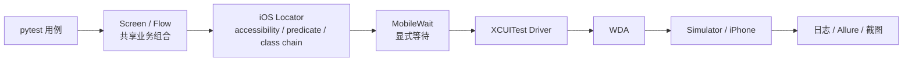
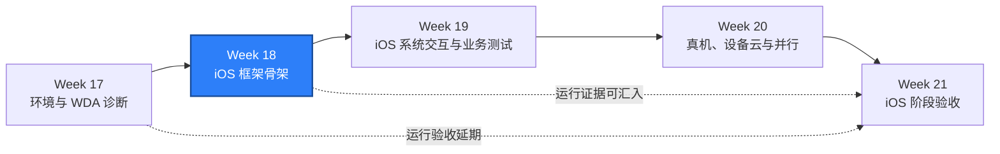

# WEEK-18 - iOS Capabilities、定位、键盘、手势与框架 / iOS Capabilities, Locators, Keyboard, Gestures, and Framework

- 计划 / Plan: Week 18，iOS 框架骨架
- 日期范围 / Date Range: 2026-10-26 to 2026-11-01
- 分支 / Branch: study/week-18-ios-framework
- 基线提交 / Base Commit: 1aed070（Week 17 运行验收延期）
- 计划提交 / Plan Commit: c8e451a
- 远端分支 / Remote Branch: 已推送 / Pushed
- Pull Request: 尚未创建 / Not created
- 状态 / Status: **计划已开启 / PLANNED**

## 计划目标 / Plan Goal

Week 18 对应课表中的“iOS capabilities、定位、键盘、手势和调试”，目标是
建立可复用、可诊断、与 Android 保持平台隔离的 iOS 框架骨架：

1. 明确 Simulator 与真机的 XCUITest capabilities 配置边界。
2. 建立 iOS 专用定位器，覆盖 accessibility id、predicate string 和
   class chain，不把 Android resource-id 或 UIAutomator 表达式混入 iOS。
3. 复用 `qa_core.mobile` 的 Screen、Component、Flow 和显式等待能力。
4. 增加键盘输入、收起键盘和基础滑动/滚动原语。
5. 在可用 macOS 环境中完成至少一条真实 iOS session 和一条稳定页面操作。
6. 形成 iOS 定位、等待、键盘和手势排障 runbook。

English summary: build the Week 18 iOS framework skeleton around explicit
XCUITest capability profiles, iOS-specific locators, keyboard and gesture
primitives, shared Screen/Flow composition, and one macOS-backed smoke.

本计划只开启框架建设。Week 17 延期到 Week 21 的 Simulator/WDA/session
运行验收仍然有效；没有 macOS 环境时，相关项必须保持显式未验证。

## 第 17 周交接 / Week 17 Handoff

Week 17 已完成：

- iOS 环境分层预检和 JSON 证据格式。
- WDA 构建、签名、端口和设备信任诊断 runbook。
- macOS Simulator 与自托管真机的 Appium workflow 定义。
- Windows 上可执行的静态解析、配置和单元测试。

Week 17 延期到 Week 21：

- 当前 iOS 代码基线上的 macOS Simulator 预检 `passed=true`。
- WDA 构建和真实 Appium session。
- `tests/ios` smoke、Appium 日志和 Allure 证据。
- 真机签名与设备信任。

Week 18 不重新定义这些验收标准，只在其上增加框架能力。若本轮获得
macOS Runner，可以把 Week 18 证据作为 Week 21 阶段验收的一部分；否则
继续保留为 `NOT RUN` 或 `SKIPPED`。

## 当前基线 / Current Baseline

- `packages/qa_core/driver/ios.py` 已有类型化 XCUITest options 和 session 创建入口。
- `packages/qa_core/mobile` 已有 Locator、MobileWait、Screen、Component 和 Flow 基础。
- `tests/unit/test_ios_driver_options.py` 已覆盖部分 capability 映射。
- `tests/ios/test_session.py` 已定义最小 iOS session 断言，在 Windows 上显式跳过。
- `qa_core.mobile.locators.LocatorStrategy` 当前主要服务 Android，包含 resource-id
  和 UIAutomator，Week 18 不能直接把这些策略复用于 iOS 页面。
- macOS Runner 和真机仍不是当前本机能力。

## 术语解释 / Glossary

| 名词 / Term | 简单解释 / Plain Meaning | 作用 / Purpose | 在本项目中的位置 / Position |
| --- | --- | --- | --- |
| Capability | Appium 创建 session 时传入的能力配置 | 指定平台、设备、App 和 Driver 行为 | `build_ios_options` |
| XCUITest | Apple 的 UI 自动化框架 | 驱动 Simulator 和真机 | `appium:automationName` |
| WDA | WebDriverAgent | 把 XCUITest 暴露成 WebDriver 接口 | XCUITest Driver 下层 |
| Accessibility ID | iOS 元素的可访问性标识 | 优先使用的稳定业务定位方式 | `AppiumBy.ACCESSIBILITY_ID` |
| Predicate String | 基于元素属性表达式的查询 | 处理 accessibility id 不足的层级和属性条件 | `AppiumBy.IOS_PREDICATE` |
| Class Chain | XCUITest 的层级路径查询 | 在必要时限定页面结构 | `AppiumBy.IOS_CLASS_CHAIN` |
| Keyboard | iOS 软键盘与输入控件 | 验证输入、提交和键盘收起 | 手势与交互模块 |
| Driver Session | Appium Server 到 WDA/设备的执行会话 | 承载一次 UI 自动化交互 | `create_ios_driver` |

## 通俗解读 / Plain-Language Guide

Week 17 像确认 iOS 大楼的门禁、钥匙和访客证；Week 18 开始制作一套只适合
这座大楼的房间地图和操作规则。Android 的地图不能直接拿来用，但“先找房间、
再找房间里的按钮、按固定流程办事”的组织方式可以共享。



**一句话理解：** Week 18 为 iOS 画一张专用地图，并规定如何等待、点击、输入
和记录失败；真正进入大楼仍要在 macOS 环境中执行。

## 计划在整体路线中的位置 / Plan Position



Week 18 依赖 Week 17 的预检、runbook 和 XCUITest options。导航、权限、通知、
WebView、深链接和文件属于 Week 19；多 Simulator、DerivedData 和 WDA 并行
属于 Week 20；50 条 iOS 测试属于 Week 21。

## 实施范围 / Implementation Scope

### 1. Capability Profiles

- 在现有 `build_ios_options` 基础上增加明确的 Simulator/device profile 选择。
- profile 只描述非敏感配置，例如 device name、platform version、UDID 引用、
  bundle id、WDA 端口和超时。
- Apple Team ID、证书名称和其他非密钥标识只从环境或 CI 变量注入。
- 禁止把 Team Secret、私钥、Provisioning Profile 内容写入仓库或报告。
- 配置缺失时给出可定位的错误，不把设备参数静默降级成其他设备。
- 保持 `XCUITestOptions` 的 W3C capability 前缀和现有单元测试风格。

### 2. iOS Locator Set

- 新增平台专用的 iOS locator 表达，不扩大 Android locator 的语义。
- 优先支持 accessibility id。
- 支持 predicate string，用于属性组合和局部层级查询。
- 支持 class chain，用于 accessibility id 无法稳定区分元素的情况。
- 定位器包含面向失败诊断的 label。
- 禁止在 iOS 页面中使用 Android resource-id、UIAutomator 或 `android:id/*`。

### 3. Screen、Component、Flow 与等待

- 复用 `qa_core.mobile.screens.Screen`、`Component` 和 `Flow`。
- 为 iOS 建立至少一个 Simulator 可运行的 Screen。
- 只使用显式等待，不增加固定 `sleep`。
- 等待超时信息必须包含定位器、期望状态和底层异常。
- Flow 失败必须保留具体步骤，不引入隐藏重试。

### 4. 键盘与基础手势

- 封装输入、清空、回车/提交和键盘收起。
- 封装至少上、下两个方向的滑动或滚动原语。
- 明确手势坐标与元素定位的边界，避免依赖单一屏幕尺寸的硬编码。
- 不把手势封装和 Week 19 的权限、通知或 WebView 能力混在一起。

### 5. iOS 测试与证据

- 增加 iOS locator、capability profile、键盘和手势的单元测试。
- 增加一个可在 macOS 上执行的 `tests/ios` 框架 smoke。
- 优先使用页面结构稳定的系统设置页完成 session 和基础交互验证。
- 若系统设置页受语言、系统版本或隐私提示影响，测试必须输出当前 app、
  页面层级和截图，并把不稳定性写入 runbook。
- Allure 标记 Epic、Feature、Story、testcase 和 runbook link。

### 6. 文档

- 新增 iOS Screen/Locator/等待/键盘排障 runbook。
- 新增 iOS 框架架构说明，解释与 Android 的共享和隔离边界。
- 更新移动端调用链，区分 XCUITest capabilities、iOS locator 和共享 Flow。

## 不在本周范围 / Out of Scope

- 权限、通知、系统弹窗、深链接、文件和 WebView，属于 Week 19。
- 两个 Simulator 版本、多 WDA 端口和 DerivedData 隔离，属于 Week 20。
- 50 条 iOS 测试和稳定性矩阵，属于 Week 21。
- 在 Windows 上伪造 iOS session 通过结果。
- 新增设备云依赖；只有现有工具无法支持明确验收目标时才评估，并说明理由。

## 质量检查 / Quality Checks

| 检查项 / Check | 结果 / Status | 执行环境 / Environment | 证据 / Evidence |
| --- | --- | --- | --- |
| Ruff | 未执行 / NOT RUN | Windows | 实现后执行 |
| Mypy | 未执行 / NOT RUN | Windows | 实现后执行 |
| Week 18 targeted unit tests | 未执行 / NOT RUN | Windows | 实现后执行 |
| Full unit regression | 未执行 / NOT RUN | Windows | 收口前执行 |
| iOS session | 未执行 / NOT RUN | macOS | 取决于 macOS Runner |
| iOS screen smoke | 未执行 / NOT RUN | macOS | 取决于 macOS Runner |

`SKIPPED`、`NOT RUN` 和 `PASS` 必须保持区分，不能把平台跳过写成通过。

## 验收方式 / Acceptance Method

### 前置条件 / Preconditions

- 项目 Python 环境由 `.venv` 提供。
- Windows 静态验收不需要模拟器或真机。
- iOS 运行验收需要 macOS、Xcode、XCUITest Driver、WDA 和可用 Simulator。
- 真机验收还需要签名身份、Provisioning Profile、设备信任和 Developer Mode。
- 测试只使用测试配置，不读取或输出生产凭据。

### Windows 静态验证 / Windows Static Verification

```powershell
$env:PYTEST_DEBUG_TEMPROOT="$PWD\.tmp-pytest"
.\.venv\Scripts\python.exe -m ruff check .
.\.venv\Scripts\python.exe -m mypy packages tests
.\.venv\Scripts\python.exe -m pytest tests\unit -q -p no:cacheprovider
.\.venv\Scripts\python.exe -m pytest tests\ios -q -p no:cacheprovider
```

预期结果：

- Ruff 和 Mypy 无错误。
- 全部 unit tests 通过。
- Windows 上的 iOS 运行用例可以显式跳过，但 skip 不计入 iOS 通过证据。

### macOS 运行验收 / macOS Runtime Acceptance

```bash
uv sync --frozen
appium --address 127.0.0.1 --port 4723
```

在另一个终端执行：

```bash
.venv/bin/python scripts/check_ios_environment.py \
  --profile simulator \
  --server-url http://127.0.0.1:4723 \
  --json \
  --output artifacts/week18-ios-environment.json

.venv/bin/python -m pytest tests/ios -q \
  --alluredir=artifacts/week18-allure-results
```

通过标准：

- `week18-ios-environment.json` 中 `passed=true`。
- 至少一条真实 iOS session 通过。
- 至少一条框架 smoke 完成定位、等待和基础交互。
- Appium 日志无未解释的 WDA 构建失败。
- Allure 结果包含实际执行设备和平台证据。

### 证据路径 / Evidence

- 环境 JSON: `artifacts/week18-ios-environment.json`
- Appium 日志: `artifacts/appium-ios.log`
- Allure: `artifacts/week18-allure-results`
- 截图与页面层级: `artifacts/ios-diagnostics/`
- GitHub Run: macOS 实际执行后回填

### 未验证项 / Unverified Items

- 当前分支的 macOS Simulator 环境预检。
- 当前分支的 WDA 构建和真实 Appium session。
- 当前分支的 iOS Screen smoke、键盘与手势。
- 真机签名和设备信任。
- Week 17 延期项仍以 Week 21 阶段门为准。

## 计划变更文件 / Planned Files

- `packages/qa_core/driver/ios.py`
- `packages/qa_core/platforms/ios/locators.py`
- `packages/qa_core/platforms/ios/gestures.py`
- `packages/qa_core/platforms/ios/keyboard.py`
- `tests/unit/test_ios_driver_options.py`
- `tests/unit/test_ios_mobile_framework.py`
- `tests/ios/test_screen_framework.py`
- `docs/runbooks/ios-locator-wait-keyboard-triage.md`
- `docs/architecture/ios-screen-framework.md`
- `docs/architecture/mobile-driver-call-chain.md`
- `reports/weekly/WEEK-18.md`

实际文件以实现为准；不为了匹配清单而创建无用途的模块。

## 环境 / Environment

- Windows + PowerShell 7
- Python 3.12，项目 `.venv`
- Appium 2.19.0
- XCUITest Driver 8.4.3
- iOS host: 待确认 / pending
- Xcode: 待确认 / pending
- macOS Runner: 待确认 / pending
- Self-hosted iOS device runner: 当前未注册

## 风险与限制 / Risks and Limitations

- Windows 只能验证类型、配置、定位器构造和共享框架的静态行为。
- Accessibility id 在系统设置页可能受 iOS 版本和语言影响。
- Predicate string 和 class chain 更容易与页面层级耦合，只作为 accessibility id
  不足时的受控选择。
- WDA 首次构建可能超过普通 smoke 超时，失败应按环境、Driver、签名和测试
  分层诊断。
- 当前分支建立在 Week 17 延期口径之上；若 Week 21 未获得 macOS 环境，
  iOS 阶段不能宣称完成。
- 不新增依赖，除非现有 Appium/Selenium 能力不能表达验收目标，并在提交中
  说明理由。

## 下一步 / Next Plan

Week 19 进入 iOS 系统交互与业务测试：

1. 权限和系统弹窗处理。
2. 通知、深链接、文件和 WebView context。
3. 前后台恢复与失败证据。
4. 复用 Week 18 的 capability profile、iOS locator、等待和 Screen/Flow。
5. 在可用 macOS 环境中保留真实 session 和 Allure 证据。
