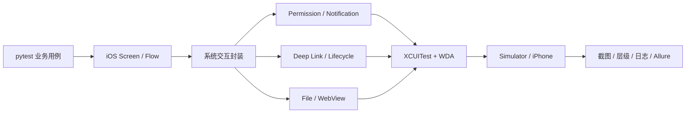
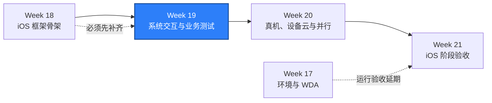

# WEEK-19 - iOS 权限、系统交互、深链接、文件、WebView 与业务测试 / iOS Permissions, System UI, Deep Links, Files, WebView, and Business Tests

- 计划 / Plan: Week 19，iOS 系统交互与业务测试
- 日期范围 / Date Range: 2026-10-27 to 2026-11-02
- 分支 / Branch: study/week-19-ios-system-interactions
- 基线提交 / Base Commit: e58949d（Week 18 完成状态核对）
- 计划提交 / Plan Commit: 322eece
- 远端分支 / Remote Branch: 未推送 / Not pushed
- Pull Request: 尚未创建 / Not created
- 状态 / Status: **计划已开启，实施未开始 / PLANNED ONLY**

## 计划目标 / Plan Goal

Week 19 对应课表中的“权限、系统弹窗、通知、深链接、文件和 WebView”，
目标是在 Week 18 iOS 框架骨架上建立系统交互与业务测试能力：

1. 建立可重复安装和启动的最小 iOS 测试夹具。
2. 覆盖权限允许、拒绝、状态恢复和失败证据。
3. 覆盖系统弹窗、通知授权和通知结果验证。
4. 覆盖深链接、前后台恢复和 App 重新激活。
5. 覆盖受控文件读写边界。
6. 覆盖 WKWebView context 切换、页面操作和 Native context 恢复。
7. 形成至少一条跨多个系统能力的稳定业务流程。
8. 记录 macOS Simulator 与真机的能力差异和排障方法。

English summary: extend the iOS framework with a controlled fixture, permission
and system-dialog handling, notifications, deep links, file boundaries, WebView
context switching, foreground recovery, and a small business journey.

本计划只负责开启 Week 19。当前 Week 18 实施尚未开始，因此本计划不能被视为
已有 iOS 业务测试能力。

## 前置门 / Prerequisite Gate

Week 19 正式实现前必须满足：

1. Week 18 的 iOS capability profile 可用。
2. iOS accessibility id、predicate string 和 class chain 定位器可用。
3. iOS 显式等待、键盘和基础手势原语可用。
4. 至少一个共享 `Screen`/`Component`/`Flow` 示例可在 macOS 上运行。
5. Week 18 的静态检查和 Windows 单元测试通过。

当前核对结果：

- Week 18 只有计划与状态提交，没有实现提交。
- `packages/qa_core/platforms/ios` 不存在。
- `tests/ios` 仍只有既有 session smoke。
- Week 18 的所有质量检查均为 `NOT RUN`。
- Week 17/18 的 macOS、WDA 和 session 运行验收仍延期到 Week 21。

因此 Week 19 当前状态只能是 `PLANNED ONLY`。计划可以继续细化，代码实施应先
补齐 Week 18，或由人工明确批准调整顺序。

## 当前基线 / Current Baseline

- `packages/qa_core/driver/ios.py` 可构建基础 XCUITest options。
- `tests/ios/test_session.py` 可创建和退出最小 iOS session。
- Android 已有权限、系统交互、Hybrid、文件和恢复实现，可以作为设计参考，
  但不能直接复用平台语义。
- 当前没有 iOS 测试夹具 App。
- 当前本机没有 macOS、Xcode、WDA 或 iOS Simulator。
- GitHub 上已有 macOS Simulator workflow 和自托管真机 workflow，但尚未在
  Week 18/19 代码上取得运行证据。

## 术语解释 / Glossary

| 名词 / Term | 简单解释 / Plain Meaning | 作用 / Purpose | 在本项目中的位置 / Position |
| --- | --- | --- | --- |
| iOS Fixture | 专为测试构建、可控制状态的最小 App | 稳定触发权限、通知、深链接和 WebView | `apps/ios-fixture` |
| Permission Alert | iOS 请求相机、照片、通知等权限时的系统弹窗 | 验证允许、拒绝和后续状态 | SpringBoard / 测试 App |
| SpringBoard | iOS 主屏幕和系统 UI 进程 | 承载部分系统弹窗和通知界面 | iOS 系统层 |
| Notification | App 或系统展示的通知 | 验证授权、展示和跳转 | Notification Center |
| Deep Link | 通过 URL 打开 App 指定页面 | 验证冷启动、热启动和错误参数 | `simctl openurl` / Appium |
| App Container | iOS App 的沙盒文件目录 | 验证文件写入和读取边界 | Simulator/真机文件系统 |
| WKWebView | iOS 的 WebView 组件 | 验证 Native 与 Web context 切换 | Hybrid 测试 |
| Context | Appium 当前操作的 Native 或 WebView 上下文 | 避免在错误上下文查找元素 | `driver.contexts` |
| Foreground Recovery | App 从后台返回后恢复预期页面 | 区分页面恢复与 session 失效 | Appium lifecycle |

## 通俗解读 / Plain-Language Guide

Week 18 像给 iOS 准备房间地图和开关；Week 19 要测试门禁、公告栏、暗门、
文件柜和内置浏览器。每个能力都要先能稳定触发，再判断产品行为，否则失败时
无法区分是 App 问题、系统弹窗问题，还是测试环境问题。



**一句话理解：** Week 19 不是单纯多点几个按钮，而是给系统边界装上可控开关，
让每次失败都能说明是谁没有打开门。

## 计划在整体路线中的位置 / Plan Position



Week 19 依赖 Week 18 的 locator、等待、键盘、手势和 Screen/Flow。
Week 20 再把当前单 Simulator 能力扩展到真机、设备云、多 Simulator、WDA
端口和 DerivedData 隔离。Week 21 负责 50 条 iOS 测试和阶段验收。

## 实施范围 / Implementation Scope

### 1. 最小 iOS 测试夹具

新增 `apps/ios-fixture`，使用 Apple 原生工程，不引入第三方依赖：

- Bundle ID 默认 `com.example.qaweek19`。
- 首页提供稳定的 accessibility id 和可预测初始状态。
- 提供权限请求、重置说明和结果状态。
- 提供本地通知授权、发送和结果状态。
- 注册 `qaweek19://` URL scheme，支持成功和错误参数。
- 提供文件写入、读取和状态验证页面。
- 提供受控 WKWebView 页面，不使用外部公网服务。
- 提供前后台状态计数和恢复标记。
- UI 文案和测试定位器分离，避免多语言变化直接破坏定位。

夹具不是产品 App 的替代品。它先证明 iOS 系统交互可稳定测试，再用同一框架
迁移到真实业务旅程。

### 2. 权限与系统弹窗

- 新增 iOS permission/system-dialog 封装。
- 区分“系统权限状态”“弹窗已出现”“弹窗操作结果”三层事实。
- Simulator 优先通过 `simctl privacy` 建立可重复前置状态。
- 真机不假设可以自动重置权限；无法自动化时明确标记人工步骤。
- 对允许、拒绝和后续受限行为分别断言。
- 失败证据包含截图、页面层级、当前 App、Alert 文本和系统版本。

### 3. 通知

- 测试本地通知授权流程，不依赖外部推送服务或生产凭据。
- 验证允许、拒绝和未决定状态。
- 验证通知发送后 App 内状态，并在系统 UI 允许时验证通知中心展示。
- 通知点击跳转和冷启动场景单独记录，不与普通深链接测试混写。
- 系统 UI 定位不稳定时保留截图和层级，并将其标记为环境或系统边界。

### 4. 深链接与生命周期

- 深链接由 iOS 平台适配器统一构造，不在业务测试中直接拼 Appium 命令。
- Simulator 使用 `xcrun simctl openurl` 作为独立触发路径。
- 覆盖冷启动、App 已在前台、App 在后台和非法参数。
- 使用显式等待验证目标页面和状态迁移。
- 前后台恢复验证 App 标识、页面根元素和业务状态，不只检查 session 仍存在。

### 5. 文件边界

- 通过夹具 App 自身页面完成文件写入、读取和删除。
- 需要直接访问 App Container 时，先确认当前 XCUITest Driver 的实际支持方式。
- 不在测试输出中暴露用户目录、证书、私钥或个人文件。
- 每个测试清理自己创建的文件；清理失败作为独立诊断记录。
- 不把文件数据库或报告写入系统非测试目录。

### 6. WebView 与 Hybrid

- 使用夹具内置 WKWebView，避免公网内容导致不确定性。
- 等待 WebView context 出现，禁止固定 `sleep`。
- 在 Web context 中验证标题、输入和按钮。
- 操作结束后必须恢复 Native context。
- 明确 WebView context 不可用的失败分类：Driver 配置、App 调试开关、
  WDA/Simulator 状态或页面尚未加载。
- 若当前 Driver 版本不支持所需 context 行为，先记录兼容性证据，再决定是否
  调整实现，不新增无依据依赖。

### 7. 业务旅程与测试规模

Week 19 至少形成以下可执行用例：

1. 权限允许路径。
2. 权限拒绝路径。
3. 权限状态恢复。
4. 通知授权和 App 内结果。
5. 深链接热启动。
6. 深链接冷启动或非法参数。
7. 文件写入、读取和清理。
8. WebView context 进入、页面操作和 Native 恢复。
9. 后台到前台恢复。
10. 一条组合权限、深链接、文件或通知结果的业务流程。

目标为至少 10 条 iOS 测试，其中运行测试必须在 macOS 上真实执行。Windows
上的 skip 只证明跳过逻辑正确，不增加 iOS 通过数量。

### 8. 文档

- 新增 iOS 权限、通知和系统 UI 排障 runbook。
- 新增 iOS 深链接、文件和 Hybrid runbook。
- 更新 iOS 调用链，增加 SpringBoard、Notification Center、URL scheme、
  App Container 和 WKWebView context 边界。
- 记录 Simulator 与真机可自动化能力的差异。

## 不在本周范围 / Out of Scope

- 50 条 iOS 测试和完整稳定性矩阵，属于 Week 21。
- 多 Simulator、真机设备矩阵、WDA 并行和 DerivedData 隔离，属于 Week 20。
- 生产推送、生产凭据、公网依赖和真实用户文件。
- 自动修改真机权限以外的系统安全设置。
- 用 Android 命令、resource-id 或 UIAutomator 表达式冒充 iOS 实现。
- 在没有 macOS 执行证据时宣称 iOS 业务测试通过。

## 质量检查 / Quality Checks

| 检查项 / Check | 结果 / Status | 执行环境 / Environment | 证据 / Evidence |
| --- | --- | --- | --- |
| Ruff | 未执行 / NOT RUN | Windows | 实现后执行 |
| Mypy | 未执行 / NOT RUN | Windows | 实现后执行 |
| iOS platform unit tests | 未执行 / NOT RUN | Windows | 实现后执行 |
| Full unit regression | 未执行 / NOT RUN | Windows | 收口前执行 |
| iOS fixture build | 未执行 / NOT RUN | macOS | 实现后执行 |
| iOS system interaction tests | 未执行 / NOT RUN | macOS Simulator | 实现后执行 |
| Physical-device checks | 未执行 / NOT RUN | iPhone + macOS | 有设备时执行 |

## Week 18 依赖检查 / Week 18 Dependency Checks

以下条件没有全部满足时，不得把 Week 19 标记为完成：

- [ ] iOS capability profile 和单元测试可用。
- [ ] iOS locator 支持 accessibility id、predicate 和 class chain。
- [ ] iOS 显式等待、键盘和手势原语可用。
- [ ] 至少一个 iOS Screen/Flow smoke 在 macOS 执行。
- [ ] iOS locator/keyboard/gesture 排障 runbook 存在。

## 验收方式 / Acceptance Method

### 前置条件 / Preconditions

- Week 18 前置门已满足。
- macOS、Xcode、XCUITest Driver、WDA 和可用 Simulator 已准备。
- iOS 测试夹具可构建、安装和启动。
- Appium Server 可在 `127.0.0.1:4723` 启动。
- 测试只使用本地夹具和测试配置，不读取生产凭据。

### Windows 静态验证 / Windows Static Verification

```powershell
$env:PYTEST_DEBUG_TEMPROOT="$PWD\.tmp-pytest"
.\.venv\Scripts\python.exe -m ruff check .
.\.venv\Scripts\python.exe -m mypy packages tests
.\.venv\Scripts\python.exe -m pytest tests\unit -q -p no:cacheprovider
.\.venv\Scripts\python.exe -m pytest tests\ios -q -p no:cacheprovider
```

预期结果：

- Ruff 和 Mypy 通过。
- 全部 unit tests 通过。
- Windows 上 iOS 运行测试可以显式跳过。
- skip 不产生 iOS 运行通过证据。

### macOS 夹具与运行验收 / macOS Fixture and Runtime Acceptance

夹具实现后执行：

```bash
xcodebuild \
  -project apps/ios-fixture/QaIosFixture.xcodeproj \
  -scheme QaIosFixture \
  -sdk iphonesimulator \
  -configuration Debug \
  -derivedDataPath artifacts/ios-fixture-derived \
  build

.venv/bin/python scripts/check_ios_environment.py \
  --profile simulator \
  --server-url http://127.0.0.1:4723 \
  --json \
  --output artifacts/week19-ios-environment.json

.venv/bin/python -m pytest tests/ios -q \
  --alluredir=artifacts/week19-allure-results
```

权限前置示例：

```bash
xcrun simctl privacy "$QA_IOS_UDID" reset all com.example.qaweek19
xcrun simctl privacy "$QA_IOS_UDID" revoke camera com.example.qaweek19
```

深链接示例：

```bash
xcrun simctl openurl "$QA_IOS_UDID" \
  "qaweek19://system-interactions?case=deep-link"
```

通过标准：

- 夹具成功构建、安装和启动。
- 环境 JSON 中 `passed=true`。
- 至少 10 条 iOS 测试通过，且测试证据来自 macOS。
- 权限、通知、深链接、文件、WebView 和前后台恢复均至少覆盖一次。
- Native context 在 WebView 测试后恢复。
- 失败用例具有 App、系统版本、截图、页面层级和 Appium/WDA 日志。

### 证据路径 / Evidence

- 环境 JSON: `artifacts/week19-ios-environment.json`
- iOS 夹具构建: `artifacts/ios-fixture-derived`
- Appium 日志: `artifacts/appium-ios.log`
- Allure: `artifacts/week19-allure-results`
- 截图与页面层级: `artifacts/ios-diagnostics/`
- GitHub Run: macOS 实际执行后回填

### 未验证项 / Unverified Items

- Week 18 框架前置能力。
- iOS 夹具构建、安装和启动。
- 权限弹窗与通知系统 UI。
- 深链接冷启动和前台恢复。
- 文件读写边界。
- WKWebView context 切换。
- 真机签名、通知展示和系统权限重置能力。
- Week 17/18 延期到 Week 21 的运行验收。

## 计划变更文件 / Planned Files

- `apps/ios-fixture/`
- `packages/qa_core/platforms/ios/permissions.py`
- `packages/qa_core/platforms/ios/system_ui.py`
- `packages/qa_core/platforms/ios/notifications.py`
- `packages/qa_core/platforms/ios/deep_links.py`
- `packages/qa_core/platforms/ios/files.py`
- `packages/qa_core/platforms/ios/hybrid.py`
- `packages/qa_core/platforms/ios/lifecycle.py`
- `tests/unit/test_ios_system_interactions.py`
- `tests/ios/test_system_interactions.py`
- `docs/runbooks/ios-permissions-notifications-triage.md`
- `docs/runbooks/ios-deep-links-files-webview.md`
- `docs/architecture/mobile-driver-call-chain.md`
- `reports/weekly/WEEK-19.md`

实际模块以实现和测试边界为准。只有在确实减少重复或提供清晰失败分类时才新增
模块，不为了匹配清单创建空封装。

## 环境 / Environment

- Windows + PowerShell 7
- Python 3.12，项目 `.venv`
- Appium 2.19.0
- XCUITest Driver 8.4.3
- iOS host: 未提供 / not available
- Xcode: 未提供 / not available
- macOS Runner: 本轮未执行 / not executed
- Self-hosted iOS device runner: 当前未注册

## 风险与限制 / Risks and Limitations

- iOS 真机权限不能像 Android 权限一样依赖统一命令行自动重置。
- SpringBoard、通知中心和系统弹窗定位会随 iOS 版本变化。
- WKWebView context 可能受 App 调试开关、Driver 版本和 Simulator 状态影响。
- XCUITest Driver 对文件操作的接口和支持范围需要以实际版本文档和运行结果为准。
- 通知栏和多任务切换会增加失败噪声，必须保留页面层级和截图。
- Week 18 尚未实现，直接开始 Week 19 代码会扩大返工和误判风险。
- 没有 macOS 环境时只能完成静态实现和单元测试，不能完成 Week 19 运行验收。

## 下一步 / Next Plan

Week 20 进入 iOS 设备与并行能力：

1. 两个 Simulator 版本或设备 profile。
2. 真机或设备云链路。
3. 多 WDA 端口和 session 隔离。
4. DerivedData 隔离。
5. 设备、Xcode、WDA 和 Appium 日志联合诊断。
6. 为 Week 21 的 50 条 iOS 阶段验收准备设备证据。
