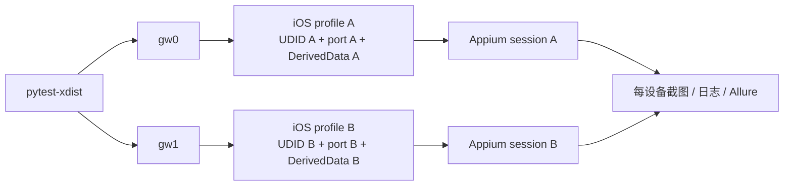
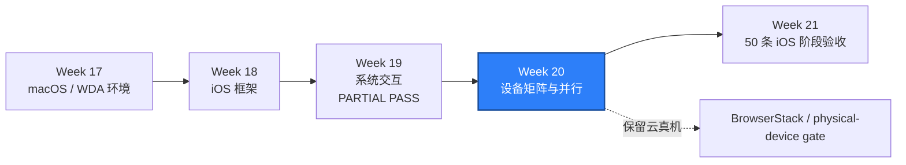

# WEEK-20 - iOS 设备矩阵、WDA 并行与 DerivedData 隔离 / iOS Device Matrix, Parallel WDA, and DerivedData Isolation

- 计划 / Plan: Week 20，iOS 设备矩阵与并行能力
- 日期范围 / Date Range: 2026-11-03 to 2026-11-09
- 分支 / Branch: study/week-20-ios-device-matrix
- 基线提交 / Base Commit: ffa52a3（Week 19 计划快照；云执行证据位于 `e87a94e`）
- 计划提交 / Plan Commit: 本文件首次提交 / Initial commit for this file
- 远端分支 / Remote Branch: 尚未推送 / Not pushed
- Pull Request: 尚未创建 / Not created
- 状态 / Status: **计划已开启，实施未开始 / PLANNED ONLY - NOT RUN**

## 计划目标 / Plan Goal

Week 20 对应课表中的 iOS 设备与并行能力，目标是在 Week 19 单设备、单
Simulator 基线上建立可重复的 iOS 设备矩阵：

1. 用 YAML 描述当前主版本 Simulator、前一主版本 Simulator 和可选云真机。
2. 让 pytest-xdist worker 与设备 profile 一一绑定，避免两个 session 共用设备。
3. 为每个 worker 分配唯一 WDA 本地端口，并在启动前检查冲突。
4. 为每个 worker 分配独立 DerivedData 目录，避免并行 WDA/Xcode 构建串扰。
5. 在 macOS Runner 上并行运行两个 Simulator session，并保存每台设备的证据。
6. 保留 BrowserStack 云真机路径，验证 capability 和证据采集没有被本地矩阵破坏。
7. 形成设备、Xcode、WDA、Appium 和 pytest 的联合诊断方法。

English summary: introduce an explicit iOS device matrix, bind xdist workers to
distinct Simulator/cloud profiles, allocate isolated WDA ports and DerivedData
directories, and prove parallel session isolation on macOS plus a retained real
cloud-device path.

## 完成状态 / Completion Status

**计划已开启 / PLANNED ONLY**

本轮只完成 Week 19 状态复核、分支和 Week 20 计划骨架，尚未实现或执行
Week 20 的设备矩阵运行验收。当前不得把以下目标写成 `PASS`：

- 两个 iOS Simulator 版本通过。
- 两个 iOS session 并行通过。
- 云真机多设备并行通过。
- WDA 端口和 DerivedData 隔离已验证。

### Week 19 入口核对 / Week 19 Entry Audit

Week 19 为 **PARTIAL PASS**，不是完整通过：

- 真实 iPhone 14 / iOS 16 cloud run 成功，`1 passed in 86.65s`。
- fixture 构建、IPA 打包、BrowserStack 上传和系统交互基线通过。
- 计划要求至少 10 条 iOS 测试，当前只收集到 1 条 cloud 聚合用例。
- WKWebView context 不可用，只完成 native page source fallback。
- 外部冷启动深链接、通知点击和通知中心展示未执行。
- Windows unit tests 为 `300 passed`；`tests/ios` 为 `4 skipped`，不构成
  iOS 运行证据。

Week 19 的单设备基础足以开始 Week 20 的矩阵基础设施，但 Week 20 最终收口
必须继续携带上述缺口，不能通过切换计划默认将其视为完成。

## 完成范围 / Scope

### 1. iOS 设备矩阵配置

计划新增 `configs/ios-device-matrix.yaml`，至少包含：

```yaml
version: 1
devices:
  - id: simulator-current-primary
    provider: local
    role: primary-simulator
    runtime: current
    device_name_env: QA_IOS_SIM_DEVICE_CURRENT
    required: true
  - id: simulator-previous-compat
    provider: local
    role: compatibility-simulator
    runtime: previous-major
    device_name_env: QA_IOS_SIM_DEVICE_PREVIOUS
    required: false
  - id: cloud-iphone
    provider: browserstack
    role: real-device-cloud
    device_name_env: QA_IOS_CLOUD_DEVICE_NAME
    required: false
```

最终字段以实现时的校验规则为准，不在计划阶段虚构未实现能力。加载器必须
拒绝以下情况：

- 重复的逻辑设备 ID 或 UDID。
- worker 数量超过可用设备 profile 数量。
- 必选 profile 缺少 UDID、runtime、设备名或 provider 配置。
- 同一设备被两个 xdist worker 同时占用。
- WDA 端口或 DerivedData 目录重复。

### 2. Worker 与设备绑定

- 复用 Android 设备矩阵中已经验证的思路，但保持 iOS 模块和配置独立。
- `gw0`、`gw1` 映射到不同设备 profile，不在业务测试中散落索引判断。
- Session 级 fixture 记录 logical device、provider、UDID、runtime、WDA 端口
  和 DerivedData 路径。
- 每个测试仍负责恢复自身 App 状态，不把“设备不共享”误当成“App 状态隔离”。

### 3. WDA 端口分配

- 从矩阵配置或 worker 顺序生成唯一 `wdaLocalPort`。
- 创建 session 前检查端口是否被监听；冲突时给出 profile、端口和占用线索。
- Appium Server 端口与 WDA 本地端口是两个不同概念，文档和日志必须分开记录。
- 默认串行运行继续使用现有 `8100`，并行时不允许两个 worker 使用同一端口。

### 4. DerivedData 隔离

- 每个 worker 使用独立构建目录，例如：
  `artifacts/ios-derived/<run-id>/<device-id>/`。
- 目录必须位于项目工作区内，便于 CI 上传和清理。
- 不把删除 DerivedData 当作默认修复手段；先记录路径、构建时间和错误证据。
- 如果当前 XCUITest Driver 版本无法直接通过 capability 指定构建目录，则在
  runner/Appium 启动边界实现隔离，并用实际版本验证后再写文档。

### 5. 并行 Simulator 验收

- 在 macOS Runner 上发现并启动两个不同 Simulator profile。
- 当前主版本必须实际执行；前一主版本缺失时明确记录 `BLOCKED`，不得用同一
  runtime 的两个设备冒充“双版本兼容性通过”。
- 两个 xdist worker 并行创建、执行最小 fixture flow 并退出 session。
- 验证两个 session 的 UDID、WDA 端口和 DerivedData 路径互不重复。
- 测试结束后检查 `/sessions` 为空，并保留每个 worker 的日志和截图。

### 6. 云真机链路

- 保留 Week 19 已通过的 BrowserStack fixture 构建、上传和 session 路径。
- 云设备 capability 生成继续由 `qa_core.driver.ios` 负责。
- 至少执行一条 Week 20 云 smoke，验证矩阵重构没有破坏真实设备路径。
- 多台云真机并行取决于账号并发额度；额度不足时记录 `DEFERRED`，不能用
  Simulator 结果替代真实设备证据。

### 7. 日志与证据

每个 session 至少记录：

- logical device id、role、provider。
- 设备名、iOS 版本和 UDID 的脱敏策略。
- Appium endpoint、WDA 本地端口和 DerivedData 路径。
- Appium、Xcode/WDA 和 pytest worker 日志。
- 失败截图、page source 和 session 创建/退出时间。

Allure 结果名称必须包含 logical device id，避免多个 worker 的同名结果混淆。

## 不在本周范围 / Out of Scope

- Week 21 的 50 条 iOS 阶段验收和完整稳定性矩阵。
- 为追求版本数量下载不受控的大型 Simulator runtime。
- 自动修改 Apple 证书、Provisioning Profile 或设备信任设置。
- 生产设备云凭据写入仓库或日志。
- 用 Android 设备矩阵实现替代 iOS 平台隔离。
- 用单设备串行结果冒充并行、双版本或云真机矩阵通过。

## 术语解释 / Glossary

| 名词 / Term | 简单解释 / Plain Meaning | 作用 / Purpose | 在本项目中的位置 / Position |
| --- | --- | --- | --- |
| Device Matrix | 一张列出要跑哪些设备的配置表 | 把覆盖目标变成可重复输入 | `configs/ios-device-matrix.yaml` |
| Simulator Profile | 一个设备类型与 iOS runtime 的组合 | 区分主回归和兼容性环境 | macOS Runner + XCUITest |
| UDID | 每个 Simulator 或设备的唯一标识 | 防止 session 连错设备 | `appium:udid` |
| WDA | WebDriverAgent，XCUITest Driver 在 iOS 上启动的代理 | 接收元素和手势操作 | XCUITest Driver / iPhone / Simulator |
| WDA Local Port | Appium 与 WDA 在本机通信的端口 | 并行时避免端口冲突 | `appium:wdaLocalPort` |
| DerivedData | Xcode 保存 WDA 等构建中间产物的目录 | 隔离并行构建和诊断缓存 | Xcode/WDA 构建层 |
| xdist Worker | pytest-xdist 启动的并行执行进程 | 每个 worker 绑定一份设备资源 | `gw0`、`gw1` |
| Session | Appium 与一台设备建立的一次自动化连接 | 承载一次独立测试运行 | XCUITest session |
| Profile Binding | 给 worker 固定分配设备、端口和目录 | 防止并行任务互相抢占 | iOS device fixture / matrix loader |

## 通俗解读 / Plain-Language Guide

设备矩阵像排班表，xdist worker 像两名测试员；如果排班表只写“用手机”，
两个人可能同时拿同一台设备。Week 20 要给每个人分配独立工位、独立门禁卡
和独立工具箱，分别对应 UDID、WDA 端口和 DerivedData。



**一句话理解：** 并行不是把同一个环境同时开两次，而是让每个执行者拿到一套
互不重叠的设备、端口和构建目录。

## 计划在整体路线中的位置 / Plan Position



Week 20 依赖 Week 18 的 capability、locator、等待和 Screen/Flow 骨架，也依赖
Week 19 已验证的单设备 fixture 与云真机链路。它为 Week 21 的测试规模、
稳定性分析和版本兼容性提供设备证据。

## 实施顺序 / Implementation Order

1. 定义并加载 iOS matrix，补齐配置校验和单元测试。
2. 建立 worker 到 profile 的确定性绑定。
3. 实现 WDA 端口分配和冲突检查。
4. 实现 DerivedData 路径隔离。
5. 让 XCUITest options 消费解析后的 profile，不直接读取散落环境变量。
6. 在 macOS Runner 上先串行验证两个 profile，再启用 `-n 2`。
7. 运行云真机 smoke，确认未破坏 Week 19 路径。
8. 汇总 artifacts、Allure、环境和 runbook，形成阶段结论。

## 质量检查 / Quality Checks

| 检查项 / Check | 结果 / Status | 执行环境 / Environment | 证据 / Evidence |
| --- | --- | --- | --- |
| Ruff | 未执行 / NOT RUN | Windows | 实现后执行 |
| Mypy | 未执行 / NOT RUN | Windows | 实现后执行 |
| Matrix unit tests | 未执行 / NOT RUN | Windows | 实现后执行 |
| Full unit regression | 未执行 / NOT RUN | Windows | 收口前执行 |
| iOS environment check | 未执行 / NOT RUN | macOS Runner | 实现后执行 |
| Dual-profile parallel smoke | 未执行 / NOT RUN | macOS Runner | 实现后执行 |
| Cloud real-device smoke | 未执行 / NOT RUN | BrowserStack | 实现后执行 |

本计划的 `NOT RUN` 是当前事实。不得从 Week 19 的 cloud run 推断 Week 20
已经通过并行或设备矩阵验收。

## 验收方式 / Acceptance Method

### 前置条件 / Preconditions

- 使用项目 `.venv` 和 Python 3.12。
- Windows 本机完成静态检查和单元测试。
- macOS Runner 安装 Xcode、Appium 2.19.0 和 XCUITest Driver 8.4.3。
- 至少两个可用 iOS Simulator profile；前一主版本缺失时如实记录。
- 云真机验收需要测试账号、最小权限凭据和可用 BrowserStack 额度。
- 所有 App、设备和账号均为测试资源，不读取生产凭据。

### Windows 静态验证 / Windows Static Verification

```powershell
$env:PYTEST_DEBUG_TEMPROOT="$PWD\.tmp-pytest"
.\.venv\Scripts\python.exe -m ruff check .
.\.venv\Scripts\python.exe -m mypy packages tests
.\.venv\Scripts\python.exe -m pytest tests\unit -q -p no:cacheprovider
.\.venv\Scripts\python.exe -m pytest tests\ios -q -p no:cacheprovider -rs
```

预期结果：

- Ruff 和 Mypy 通过。
- 矩阵、端口、路径和 capability 单元测试通过。
- 全量 unit tests 通过。
- Windows 上 iOS 运行测试可以显式跳过，但 skip 不增加 iOS 通过数量。

### macOS 双 Simulator 并行验收 / macOS Parallel Simulator Acceptance

```bash
xcrun simctl list devices available -j
.venv/bin/python scripts/check_ios_environment.py \
  --profile simulator \
  --server-url http://127.0.0.1:4723 \
  --json \
  --output artifacts/ios-environment.json
.venv/bin/python -m pytest tests/ios -q \
  -n 2 \
  --alluredir=artifacts/week20-allure-results
```

如果实现时选择独立的 matrix smoke 文件，命令可聚焦该文件，但最终必须至少
证明两个不同 Simulator profile 并行完成 session 创建、最小交互和退出。

预期结果：

- 两个 worker 分别绑定不同 logical device id 和 UDID。
- 两个 worker 的 WDA 本地端口不同且启动成功。
- 两个 worker 的 DerivedData 路径不同。
- session 退出后 `/sessions` 为空。
- Allure 中能从设备元数据区分两个 worker。

### 云真机验收 / Cloud Real-Device Acceptance

```bash
.venv/bin/python -m pytest tests/ios/test_cloud_session.py -q \
  --alluredir=artifacts/week20-cloud-allure-results
```

预期结果：

- 至少一条真实 iPhone session 通过。
- 设备名、平台版本和 provider 出现在证据中。
- 凭据不出现在日志、Allure、page source 或报告正文。
- 多设备并发未获额度时保持 `DEFERRED`，不写成 `PASS`。

### 证据路径 / Evidence

- Matrix: `configs/ios-device-matrix.yaml`
- Matrix loader: `packages/qa_core/platforms/ios/devices.py`
- Environment JSON: `artifacts/ios-environment.json`
- Appium/WDA logs: `artifacts/ios-logs/<device-id>/`
- DerivedData: `artifacts/ios-derived/<run-id>/<device-id>/`
- Allure: `artifacts/week20-allure-results/`
- Cloud Allure: `artifacts/week20-cloud-allure-results/`
- GitHub Run: 实现后回填
- Architecture/runbook: 实现后新增或更新

### 未验证项 / Unverified Items

- 当前只开启计划，没有任何 Week 20 实现或运行结果。
- 前一主版本 Simulator runtime 是否在 Runner 上可用尚未检查。
- BrowserStack 并发额度是否支持多台云真机尚未确认。
- 当前 XCUITest Driver 对 DerivedData capability 的实际支持方式尚未验证。
- 本地 Apple 签名、Provisioning 和设备信任仍不属于云真机基线已证明内容。
- Week 19 的 10 条测试规模和 WebView context 缺口仍未闭合。

## 变更文件 / Files Changed

计划阶段：

- `reports/weekly/WEEK-19.md`
- `reports/weekly/WEEK-20.md`
- `reports/README.md`

实现阶段预计涉及：

- `configs/ios-device-matrix.yaml`
- `packages/qa_core/config/settings.py`
- `packages/qa_core/driver/ios.py`
- `packages/qa_core/platforms/ios/devices.py`
- `tests/unit/test_ios_device_matrix.py`
- `tests/ios/conftest.py`
- `tests/ios/test_week20_device_matrix.py`
- `.github/workflows/ios-smoke.yml`
- `scripts/check_ios_environment.py`
- `docs/architecture/ios-device-matrix.md`
- `docs/runbooks/ios-parallel-wda-deriveddata-triage.md`

实际文件以最小实现和测试边界为准，不为匹配清单创建空模块。

## 环境 / Environment

- Windows + PowerShell 7
- Python 3.12，项目 `.venv`
- Appium 2.19.0
- XCUITest Driver 8.4.3
- macOS Runner: GitHub `macos-15`（已有 Week 17 到 Week 19 证据）
- Xcode: 16.4（已有证据）
- Device cloud: BrowserStack App Automate
- 已通过的云设备: iPhone 14 / iOS 16
- 本地 iOS host: 未提供
- Self-hosted iOS device runner: 未使用

## 风险与限制 / Risks and Limitations

- Windows 不能本地构建 WDA、启动 iOS Simulator 或执行真机签名。
- macOS Runner 的 Xcode 与 runtime 组合会变化，前一主版本不保证预装。
- 两个 Simulator 并行仍共享宿主机 CPU、内存、Appium Server 和 Xcode 工具链；
  设备隔离不等于完整资源隔离。
- WDA 端口空闲检查与最终绑定之间存在时间窗口，仍可能被其他进程抢占。
- 云真机网络、排队和设备可用性会放大 session 创建时间，需要明确超时上限。
- DerivedData 隔离会增加磁盘占用，必须生成到项目 `artifacts/` 并有界清理。
- Week 19 未闭环的测试数量和 WebView 约束不能因 Week 20 开工而消失。

## 下一步 / Next Plan

Week 20 的最小可执行任务是：

1. 新增 iOS matrix schema、加载器和 Windows 单元测试。
2. 证明重复设备、重复端口、重复 DerivedData 路径会被拒绝。
3. 把 logical device 写入 Session 元数据和 Allure。
4. 在 macOS Runner 上运行一个 Simulator profile，确认矩阵重构无回归。
5. 再扩展到两个 profile 并行，并保留失败日志与设备证据。

通过标准是“两个 worker 使用独立设备、WDA 端口和 DerivedData，真实并行完成
session 生命周期”，而不是只存在一份 YAML。
