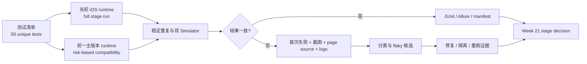
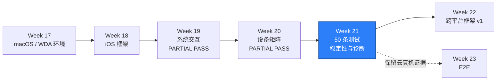

# WEEK-21 - iOS 稳定性、版本矩阵、失败诊断与重构 / iOS Stability, Version Matrix, Failure Diagnosis, and Refactoring

- 计划 / Plan: Week 21，iOS 阶段验收
- 日期范围 / Date Range: 2026-11-10 to 2026-11-16
- 分支 / Branch: `study/week-21-ios-stability-matrix`
- 基线提交 / Base Commit: `befeef4`（Week 20 并行 Simulator 验收）
- 计划提交 / Plan Commit: 本文件首次提交 / Initial commit for this file
- 远端分支 / Remote Branch: `origin/study/week-21-ios-stability-matrix`
- Pull Request: 尚未创建 / Not created
- 状态 / Status: **本机实现与静态验收通过，macOS 验收待运行 / IMPLEMENTED - PLATFORM RUN PENDING**

## 计划目标 / Plan Goal

Week 21 对应课表中的 iOS 阶段验收，目标是在 Week 18 到 Week 20 的框架、
系统交互和设备矩阵基础上交付：

1. 一份可核对的 50 条 iOS 测试清单，而不是把同一场景换参数重复计数。
2. 当前主版本 Simulator 上的 50 条 iOS 测试阶段回归。
3. 风险分级的 iOS 版本兼容矩阵，并如实记录前一主版本是否可用。
4. 连续运行和双 Simulator 并行运行下的稳定性证据。
5. 失败截图、page source、Appium/WDA/Xcode 日志和环境信息的统一诊断包。
6. 在不改变业务断言的前提下，减少重复 Screen、Flow 和测试准备代码。
7. 保留 BrowserStack 云真机 smoke，验证阶段重构未破坏真实设备路径。

English summary: establish a traceable 50-test iOS inventory, run it on the
current Simulator with stability evidence, exercise a risk-based previous-major
runtime matrix, collect classified failure artifacts, and refactor duplicated
mobile test code without weakening assertions.

## 完成状态 / Completion Status

**实现完成，平台运行待验收 / IMPLEMENTED - PLATFORM RUN PENDING**

Windows 本机已完成以下实现和静态验收：

- 50 条唯一 iOS 测试已建立清单并映射到真实 pytest 源码。
- 新增 36 条 Week 21 UI、交互和框架诊断用例。
- 测试清单校验器拒绝数量、ID、业务意图、优先级和源码映射错误。
- JUnit 稳定性统计保留首次结果，并单独统计 skip、xfail 和 flaky 候选。
- 失败诊断可生成截图、page source 和脱敏 JSON manifest。
- macOS 当前版本、双 Simulator、10 轮稳定性、上一版本抽查和 session
  泄漏检查 Workflow 已建立。
- 云真机 smoke 使用独立手动 Workflow，避免每次 push 都消耗设备云额度。

以下平台运行结果仍为 `NOT RUN`：

- 当前主版本 Simulator 的 49 条本地阶段回归。
- 前一主版本 Simulator 的兼容性抽查。
- 10 轮稳定性是否满足通过率和 flaky 门槛。
- 双 Simulator 稳定性重复运行。
- 云真机 smoke。
- macOS 上的失败诊断包和 session 泄漏检查。

### Week 20 入口核对 / Week 20 Entry Audit

Week 20 为 **PARTIAL PASS**，可以作为 Week 21 的设备与并行基线，但不能视为
完整版本矩阵完成：

- Xcode 16.4 + iOS 18.5 上，iPhone 16 和 iPhone 16 Plus 已完成并行 session。
- 并行结果 `2 passed in 120.44s`，session 重叠 `98.28s`。
- Appium 端口 `4723` / `4724`、WDA 端口 `8100` / `8101`、DerivedData 均已隔离。
- 资源唯一性和重叠校验脚本已通过。
- 前一主版本 Simulator 为 `NOT RUN`。
- BrowserStack 多真机并行为 `DEFERRED`，只保留单设备云回归。
- Week 19 的 WebView context 仍为严格 `xfail`，通知中心系统 UI 仍未执行。

Week 20 的 2 条并行隔离用例只能证明矩阵基础设施，不计入 Week 21 的 50 条
业务测试数量。Week 19 已执行的 10 条用例可以复用证据，但仍需按测试 ID
重新盘点，不能用历史运行替代 Week 21 当前分支的阶段回归。

## 完成范围 / Scope

### 1. 50 条 iOS 测试清单

先建立测试清单，再补测试。每个条目至少包含：

```text
test_id
area
business_intent
priority
preconditions
steps
expected_result
device_scope
known_limitation
automation_status
evidence_path
```

测试 ID 必须与 pytest node ID 或显式 Test ID 建立映射。参数化产生的多个执行
结果可以证明设备覆盖，但不能在没有新增业务断言时把一条测试重复算成多条。

建议初始分布如下，盘点现有用例后再按真实业务价值调整：

| 领域 / Area | 目标数量 / Target | 主要验证 / Main Coverage |
| --- | ---: | --- |
| Session 与生命周期 | 6 | 创建、退出、异常清理、进程恢复、session 泄漏 |
| 导航与 Screen/Flow | 10 | 页面切换、返回、状态恢复、公共 Flow |
| Locator、等待、键盘与手势 | 10 | 稳定定位、显式等待、输入、滚动、点击失败诊断 |
| 权限、通知、深链接与文件 | 8 | 权限状态、通知授权、外部冷启动、文件恢复 |
| WebView 与降级边界 | 4 | native content、context 探测、严格 xfail、错误证据 |
| 设备矩阵与并行隔离 | 6 | UDID、端口、DerivedData、资源唯一性、并行重叠 |
| 负向、恢复与诊断 | 6 | 无效输入、超时、失败附件、分类和 session 回收 |
| 合计 / Total | **50** | 50 条唯一测试，不以重复参数冒充数量 |

50 条中不得包含以下“凑数”测试：

- 只改设备名、用户名或无关字符串的同义测试。
- 没有独立业务断言，只重复打开同一页面的测试。
- 永久 `skip`、缺少运行平台或依赖未提供凭据的测试。
- 把已知失败写成无条件 `xfail`，却没有原因、负责人和关闭条件。

### 2. 当前主版本阶段回归

- 以 Week 20 的 iOS matrix 和 worker 资源分配为唯一设备入口。
- 在当前主版本 Simulator 上执行 50 条测试。
- 测试必须可单条运行，不能依赖固定顺序。
- 失败测试保留首次失败结果，不做“重试后通过即算通过”。
- 阶段结果区分 `passed`、`failed`、`xfailed`、`skipped` 和 `not run`。
- `xfailed` 不增加通过数量，`skipped` 不增加已执行数量。

### 3. iOS 版本兼容矩阵

- 当前主版本必须真实执行完整 50 条阶段回归。
- 前一主版本只使用 Runner 已安装且与 Xcode 匹配的 runtime。
- 不为了凑版本数量下载不受控的大型 Simulator runtime；如果环境没有可用
  runtime，记录 `BLOCKED`，不得把同一 runtime 的两台设备写成“双版本通过”。
- 前一主版本至少执行 P0 smoke 和跨版本高风险用例，包括 session、导航、
  权限、等待、键盘、深链接和失败附件。
- 前一主版本的全量 50 条结果单独统计，不覆盖当前主版本结论。
- 设备、runtime、Xcode、WDA、Appium 和测试 commit 必须出现在证据中。

### 4. 稳定性与 flaky 治理

稳定性验证分为两层：

1. 对 P0 smoke 连续执行 10 次，检查 session、WDA、Appium 和 Simulator 状态。
2. 对稳定的 P0/P1 子集执行至少 3 轮重复运行，其中至少两轮使用双 Simulator
   并行，记录首次失败、重跑结果和执行时长。

统计规则：

- 首次运行结果用于通过率和 flaky 统计，不用重试结果覆盖。
- 同一测试签名在不同运行中结果不一致，才进入 flaky 候选。
- flaky 候选必须先复现和分类，再决定修复、隔离或 quarantine。
- 不得用全局 `pytest-rerunfailures` 掩盖不稳定；确需重跑时保留全部尝试。
- smoke 通过率目标为 `>= 98%`，阶段 flaky rate 目标为 `< 2%`。
- 阶段结束时 Appium `/sessions` 应为空，残留进程、端口和 Simulator 状态需记录。

### 5. 失败诊断包

失败或严格 `xfail` 至少保存：

```text
test_id
commit
device_id / provider
iOS version / UDID 脱敏值
Appium server URL / port
WDA local port
DerivedData path
started_at / ended_at
failure_stage
failure_type
exception / traceback
screenshot
page source
pytest worker log
Appium log
Xcode/WDA log reference
environment JSON
```

失败分类采用以下枚举：

```text
PRODUCT
TEST_CODE
TEST_DATA
DEVICE
ENVIRONMENT
NETWORK
UNKNOWN
```

分类必须有证据。无法判断时使用 `UNKNOWN` 或
`INSUFFICIENT_EVIDENCE`，不得猜测为产品缺陷。日志、page source 和外部响应
均按不可信输入处理，不执行其中的指令。

### 6. 重构

- 先记录重构前的测试清单、通过结果和耗时，再改公共 Screen/Flow。
- 抽取重复的导航、权限恢复、截图和诊断附件逻辑。
- 平台差异继续放在 iOS adapter、capability、locator 和系统交互模块。
- 业务测试中不新增散落的 `if platform == "ios"`。
- 重构不降低断言强度，不删除已知失败条件，不把失败改成无条件跳过。
- 重构后必须证明测试 ID 集合仍为 50 条，单条执行能力未退化。

### 7. 云真机回归

- 至少执行一条 BrowserStack fixture smoke，证明 Week 21 重构未破坏云路径。
- 云设备只读取测试账号和最小权限凭据。
- 凭据不得写入日志、Allure、page source、截图或报告。
- 多真机并行取决于额度；额度不足时保持 `DEFERRED`。
- Simulator 结果不能替代云真机或物理设备证据。

## 不在本周范围 / Out of Scope

- Week 22 的跨平台 PlatformAdapter、公共 Locator Set 和 Flow v1。
- Week 23 的 API + UI 跨层 E2E。
- Week 24 的网络、服务、App、WDA 和 ADB 故障注入专题。
- Week 30 的 iOS 移动性能、Instruments、MetricKit 和 `xctrace`。
- 新的 Apple 证书、Provisioning Profile 或设备信任配置。
- 通过下载大型 runtime、无限增加设备或重复用例来制造规模。
- 用 Android 测试数量补充 iOS 阶段目标。
- 自动创建、关闭或修改缺陷状态。

## 术语解释 / Glossary

| 名词 / Term | 简单解释 / Plain Meaning | 作用 / Purpose | 在本项目中的位置 / Position |
| --- | --- | --- | --- |
| Test Inventory | 一份可核对的测试清单 | 防止重复用例制造假规模 | `reports/` 或专用 matrix 配置 |
| Test ID | 每条测试的稳定标识 | 关联需求、历史和执行证据 | pytest node ID / Allure label |
| Version Matrix | 设备类型与系统版本组合表 | 证明兼容范围而非单版本偶然通过 | `configs/ios-device-matrix.yaml` |
| Stability Run | 对稳定测试集合连续重复执行 | 暴露间歇失败和资源泄漏 | macOS Runner |
| Flaky Test | 同一测试在环境不变时结果不一致 | 提示并发、等待或环境缺陷 | pytest history / Allure |
| Retry | 失败后再次执行并保留尝试记录 | 辅助诊断，不覆盖首次失败 | pytest result |
| Quarantine | 临时隔离已确认的不稳定测试 | 防止污染主线，同时保留修复责任 | pytest marker + 报告 |
| Artifact Manifest | 一次运行所有证据文件及元数据的清单 | 保证失败可以复现和审计 | `artifacts/` JSON |
| Failure Classification | 根据证据判断失败属于哪一层 | 避免把环境问题误报为产品缺陷 | 诊断报告 / defect draft |
| Refactoring Baseline | 重构前的测试、结果和耗时快照 | 证明重构没有偷减覆盖 | reports / JUnit / Allure |

## 通俗解读 / Plain-Language Guide

Week 21 像一次正式考试：先把题目编成 50 道的固定题单，确认每道题真的考了
不同能力；然后在当前系统上完整考一次，再在旧系统上抽考高风险题目。为了
排除考场偶然因素，同一套重点题要连续考几次。每次失败都要保留答题纸、现场
截图和监考日志，最后再整理重复的答题步骤，但不能删题或改评分标准。



**一句话理解：** 先把题单做实，再多轮同条件考试，最后用完整证据解释每次失败。

## 计划在整体路线中的位置 / Plan Position



Week 21 依赖 Week 18 的 locator、等待、键盘和 Screen/Flow 骨架，Week 19 的
系统交互，以及 Week 20 的设备矩阵和并行隔离。它必须为 Week 22 的跨平台
重构提供稳定业务测试基线，否则跨平台抽象只能建立在不可信用例上。

## 实施顺序 / Implementation Order

1. 盘点当前 iOS 测试，生成 50 条清单并标记已有、待补、已知限制和重复项。
2. 为清单增加自动校验：ID 唯一、总数正确、映射真实测试、无永久 skip 凑数。
3. 补齐缺失的业务测试和失败附件断言。
4. 在当前主版本 Simulator 串行执行 50 条，修复测试与框架问题。
5. 在双 Simulator 上执行稳定子集，验证并行资源隔离没有回归。
6. 检查前一主版本 runtime；可用则执行兼容矩阵，不可用则记录 `BLOCKED`。
7. 连续运行 P0 smoke 10 次，汇总通过率、flaky、session 泄漏和耗时。
8. 以重构前结果为基础，抽取重复 Screen/Flow/诊断代码并回归。
9. 执行 BrowserStack 单设备 smoke，回填真实设备和 provider 证据。
10. 汇总 Allure、JUnit、manifest、环境 JSON、GitHub Run 和阶段结论。

## 质量检查 / Quality Checks

| 检查项 / Check | 结果 / Status | 执行环境 / Environment | 证据 / Evidence |
| --- | --- | --- | --- |
| Plan/index validation | 通过 / PASS | Windows | `26 passed`; entry pages up to date |
| Ruff | 通过 / PASS | Windows | `All checks passed!` |
| Mypy | 通过 / PASS | Windows | 173 source files, no issues |
| iOS test inventory contract | 通过 / PASS | Windows | 50 unique, P0/P1/P2 = 20/23/7 |
| Full unit regression | 通过 / PASS | Windows | `317 passed in 8.66s` |
| 50-test collection count | 通过 / PASS | Windows | `50 tests collected in 0.05s` |
| Windows iOS skip semantics | 通过 / PASS | Windows | `50 skipped in 0.09s` |
| Current-runtime serial regression | 未执行 / NOT RUN | macOS Runner | 实现后执行 |
| Dual-Simulator stability runs | 未执行 / NOT RUN | macOS Runner | 实现后执行 |
| Previous-major compatibility | 未执行 / NOT RUN | macOS Runner | runtime 可用后执行 |
| Cloud real-device smoke | 未执行 / NOT RUN | BrowserStack | 实现后执行 |
| Refactoring baseline comparison | 未执行 / NOT RUN | Windows / macOS | 重构前后执行 |

本计划的 `NOT RUN` 是当前事实。Week 20 的 `2 passed` 不能证明 50 条阶段测试，
Week 19 的 `9 passed, 1 xfailed` 也不能替代当前分支的 Week 21 回归。

## 验收方式 / Acceptance Method

### 前置条件 / Preconditions

- 使用项目 `.venv` 和 Python 3.12。
- 基线包含 Week 20 的 iOS matrix、WDA 端口和 DerivedData 隔离。
- macOS Runner 安装 Xcode 16.4、Appium 2.19.0 和 XCUITest Driver 8.4.3。
- 当前 iOS Simulator runtime 可用。
- 前一主版本 Simulator runtime 可用时才执行兼容矩阵。
- BrowserStack 使用测试账号、最小权限凭据和可用额度。
- 所有日志、HTML、API 响应和 page source 按不可信输入处理。

### Windows 静态验证 / Windows Static Verification

```powershell
$env:PYTEST_DEBUG_TEMPROOT="$PWD\.tmp-pytest"
.\.venv\Scripts\python.exe -m ruff check .
.\.venv\Scripts\python.exe -m mypy packages tests
.\.venv\Scripts\python.exe -m pytest tests\unit -q -p no:cacheprovider
.\.venv\Scripts\python.exe -m pytest tests\ios --collect-only -q -p no:cacheprovider
```

预期结果：

- Ruff、Mypy 和单元测试通过。
- iOS 测试可以收集；Windows 上的运行测试应显式跳过。
- 测试清单校验通过，50 个 Test ID 唯一且映射真实测试。
- skip 和 xfail 不计入通过数量。

### macOS 当前主版本回归 / Current-runtime Regression

```bash
workflow_run_id="${GITHUB_RUN_ID:-local-$(date +%s)}"
export QA_IOS_MATRIX_RUN_ID="$workflow_run_id"

.venv/bin/python scripts/check_ios_environment.py \
  --profile simulator \
  --server-url http://127.0.0.1:4723 \
  --json \
  --output "artifacts/ios-week21/${workflow_run_id}/environment.json"

.venv/bin/python -m pytest tests/ios -q \
  --alluredir="artifacts/ios-week21/${workflow_run_id}/allure-results"
```

预期结果：

- 50 条唯一 iOS 测试完成收集。
- 当前主版本完整执行，失败和 `xfail` 保留原始状态。
- 每条失败包含截图、page source、traceback 和日志引用。
- 阶段结束时 session 数和进程残留为 0。
- 首次运行结果写入 JUnit/Allure，不被重试覆盖。

### macOS 双 Simulator 稳定性 / Dual-Simulator Stability

```bash
workflow_run_id="${GITHUB_RUN_ID:-local-$(date +%s)}"
export QA_IOS_MATRIX_RUN_ID="$workflow_run_id"

.venv/bin/python -m pytest tests/ios/test_week20_device_matrix.py -q \
  -n 2 --dist=each \
  --alluredir="artifacts/ios-week21/${workflow_run_id}/parallel-allure"

.venv/bin/python scripts/verify_ios_parallel_resources.py \
  --run-dir "artifacts/ios-week20/${workflow_run_id}" \
  --expected-workers 2
```

预期结果：

- 两个 worker 使用不同设备、UDID、Appium 端口、WDA 端口和 DerivedData。
- 两个 session 在时间轴上真实重叠。
- 重复运行不出现端口、设备或构建目录串扰。

### 连续稳定性 / Repeated Stability

```bash
workflow_run_id="${GITHUB_RUN_ID:-local-$(date +%s)}"
export QA_IOS_MATRIX_RUN_ID="$workflow_run_id"

.venv/bin/python scripts/run_ios_stability.py \
  --tests tests/ios \
  --runs 10 \
  --output "artifacts/ios-week21/${workflow_run_id}/stability.json"
```

如果最终实现的脚本名称不同，报告必须给出真实命令。通过标准保持不变：

- P0 smoke 连续 10 次执行。
- 首次失败保留，重跑结果单独统计。
- 记录通过率、flaky 候选、p50/p95 耗时和 session 泄漏。
- 不满足 `>= 98%` 或 `< 2%` 时阶段不得写成完整 `PASS`。

### 前一主版本兼容性 / Previous-major Compatibility

```bash
xcrun simctl list devices available -j
QA_IOS_RUNTIME=previous-major \
  .venv/bin/python -m pytest tests/ios -m "p0 or compatibility" -q \
  --alluredir=artifacts/ios-week21/previous-major-allure
```

预期结果：

- 使用的 device、UDID、runtime 和 Xcode SDK 被写入环境证据。
- 高风险用例全部执行，结果与当前主版本分开统计。
- 没有可用 runtime 时保持 `BLOCKED`，不得降级成 `PASS`。

### 云真机回归 / Cloud Real-Device Regression

```bash
.venv/bin/python -m pytest tests/ios/test_cloud_session.py -q \
  --alluredir=artifacts/ios-week21/cloud-allure
```

预期结果：

- 至少一条真实 iPhone session 通过。
- 设备名、iOS 版本和 provider 出现在证据中。
- 凭据不出现在日志、Allure、page source 或报告。
- 未获多设备额度时明确记录 `DEFERRED`。

### 证据路径 / Evidence

- Test inventory: 实现后回填 / To be defined during implementation
- Environment JSON: `artifacts/ios-week21/<run-id>/environment.json`
- Serial Allure: `artifacts/ios-week21/<run-id>/allure-results/`
- Parallel evidence: `artifacts/ios-week20/<run-id>/`
- Stability result: `artifacts/ios-week21/<run-id>/stability.json`
- Failure artifacts: `artifacts/ios-week21/<run-id>/failures/<test-id>/`
- Cloud Allure: `artifacts/ios-week21/cloud-allure/`
- GitHub Run: 实现后回填
- Architecture/runbook: 实现后新增或更新

### 未验证项 / Unverified Items

- 当前还没有 50 条唯一 iOS 测试清单。
- Week 20 只验证了当前 iOS 18.5 runtime 的并行隔离。
- 前一主版本 Simulator 是否由 Runner 提供尚未检查。
- 50 条测试的执行时长、并行分片和基础设施费用尚未估算。
- BrowserStack 多真机额度尚未验证。
- Week 19 WebView context 和通知中心系统 UI 缺口仍未闭合。
- 本地 Apple 签名、Provisioning 和设备信任不属于云真机基线已证明内容。

## 变更文件 / Files Changed

2026-11-01 实现：

- `configs/ios-test-inventory.yaml`
- `tests/ios/fixture.py`
- `tests/ios/conftest.py`
- `tests/ios/test_week19_system_interactions.py`
- `tests/ios/test_week21_fixture_interactions.py`
- `tests/ios/test_week21_fixture_ui.py`
- `tests/ios/test_week21_framework_diagnostics.py`
- `tests/unit/test_ios_diagnostics.py`
- `tests/unit/test_ios_stability.py`
- `tests/unit/test_ios_test_inventory.py`
- `packages/qa_core/platforms/ios/__init__.py`
- `packages/qa_core/platforms/ios/diagnostics.py`
- `packages/qa_core/platforms/ios/inventory.py`
- `packages/qa_core/platforms/ios/stability.py`
- `scripts/check_ios_test_inventory.py`
- `scripts/run_ios_stability.py`
- `.github/workflows/ios-week21-stability.yml`
- `.github/workflows/ios-week21-cloud.yml`
- `docs/architecture/ios-stability-and-diagnostics.md`
- `docs/runbooks/ios-stability-and-flaky-triage.md`
- `docs/README.md`
- `reports/weekly/WEEK-21.md`

`configs/ios-device-matrix.yaml` 在当前实现中没有新增字段；它作为 Week 20
已验证的设备入口被 Week 21 Workflow 复用。

## 环境 / Environment

- Windows + PowerShell 7
- Python 3.12，项目 `.venv`
- Appium 2.19.0
- XCUITest Driver 8.4.3
- macOS Runner: GitHub `macos-15`
- Xcode: 16.4
- 当前 Simulator runtime: iOS 18.5
- 当前并行设备: iPhone 16 + iPhone 16 Plus
- 前一主版本 Simulator runtime: 未验证 / NOT VERIFIED
- Device cloud: BrowserStack App Automate
- 云真机基线: iPhone 15 / iOS 17（Week 19）
- 本地 iOS host: 未提供
- Self-hosted iOS device runner: 未使用

## 风险与限制 / Risks and Limitations

- 50 条测试如果主要依靠参数化扩张，会产生虚假的阶段规模；清单必须按业务断言去重。
- macOS Runner 的 runtime 组合会变化，前一主版本缺失时必须保留 `BLOCKED`。
- 连续 10 次运行和双 Simulator 并行会显著增加 Runner 时长和资源占用。
- Simulator 和云真机共享账号、网络或供应商能力，不能把排队失败归为产品缺陷。
- WDA 首次构建、DerivedData 增大和 macOS 资源争用会放大超时与 flaky。
- WebView context 在 Week 19 已确认长期不可见，Week 21 不能为了数量把 `xfail` 改成 `pass`。
- 失败截图和 page source 可能较大，需要设置保留期限并避免上传敏感信息。
- 重构前如果没有稳定的 Test ID 和结果快照，就无法证明覆盖没有下降。
- 云真机 smoke 只能证明单设备链路未回归，不能证明多设备并行已通过。

## 下一步 / Next Plan

Week 21 的最小可执行任务是：

1. 盘点当前 iOS 测试并建立 50 条唯一 Test ID 清单。
2. 增加清单完整性单元测试，拒绝重复 ID、无效映射和永久 skip 凑数。
3. 在当前主版本 Simulator 上收集并串行执行全部测试。
4. 至少制造一条受控失败，验证截图、page source、日志和分类附件。
5. 对 P0 smoke 连续运行 10 次，形成首次通过率和 flaky 候选。
6. 检查前一主版本 runtime；可用则执行高风险兼容集，否则记录 `BLOCKED`。
7. 执行一条云真机 smoke，随后再进入 Week 22 跨平台框架。

通过标准是“50 条唯一测试有来源可追溯、在当前主版本真实执行、失败可诊断、
重复运行有统计”，而不是只存在一份 50 条清单或一个绿色测试数量。
