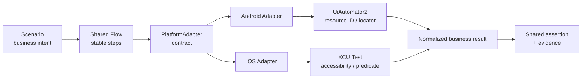
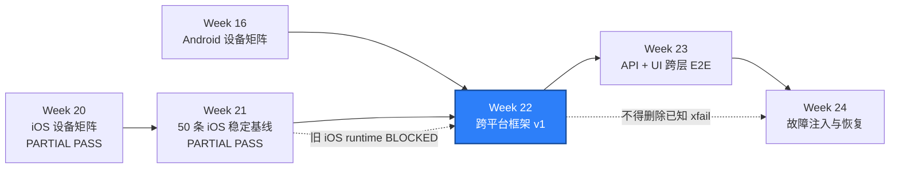

# WEEK-22 - 跨平台框架 v1、PlatformAdapter、公共 Flow 与 Locator Set / Cross-Platform Framework v1: PlatformAdapter, Shared Flows, and Locator Sets

- 计划 / Plan: Week 22，跨平台框架 v1
- 日期范围 / Date Range: 2026-11-17 to 2026-11-23
- 分支 / Branch: `study/week-22-cross-platform-framework`
- 基线提交 / Base Commit: `465c67d`（Week 21 阶段验收证据）
- 计划提交 / Plan Commit: `a55b6bf`
- 远端分支 / Remote Branch: `origin/study/week-22-cross-platform-framework`
- Pull Request: [#14](https://github.com/htb123-maker/quality-engineering-lab/pull/14)
- 状态 / Status: **核心范围通过，继承限制继续保留 / PASS - CORE SCOPE COMPLETE**

## 计划目标 / Plan Goal

Week 22 是“跨平台与 E2E”阶段的第一周，目标是在 Week 21 已建立的 iOS
50 条测试清单和 Android/iOS 现有移动框架上，交付一个最小但可验证的
跨平台框架 v1：

1. 用统一 Scenario、Step 和业务断言表达跨平台业务意图。
2. 建立 `PlatformAdapter` 边界，把 capability、locator、手势、文件、
   系统交互和诊断能力收口到平台实现。
3. 建立语义化 Locator Set，业务层不再直接依赖 Android resource ID 或
   XCUITest predicate/class chain。
4. 复用现有 `Flow`、`Screen`、`MobileWait`，不另造一套重复执行引擎。
5. 迁移一条导航 Flow 和一条文件交互 Flow，证明 Android 与 iOS 使用同一
   业务断言。
6. 用 fake adapter 契约测试保证接口完整，再在可用的 Android Emulator、
   iOS Simulator 或合法设备云环境执行真实 smoke。
7. 保持 Week 21 的 50 条 iOS Test ID、严格 `xfail` 和已知限制不退化。

English summary: introduce a minimal cross-platform scenario layer, semantic
locator sets, and capability-oriented platform adapters; migrate one navigation
flow and one file flow without leaking platform branches into business tests,
then verify the contract with fakes and real platform smoke where available.

## 完成状态 / Completion Status

**核心范围通过 / CORE SCOPE PASS**

Week 22 的跨平台框架 v1 已完成并在真实平台验证：

- `PlatformAdapter`、`FilePort`、capability 和 adapter registry 已实现。
- 语义化 Locator Set 已实现，缺失键会抛出 `MissingLocatorError`。
- Scenario/Step 保留稳定 ID；失败可定位到 `scenario_id + step_id + cause`。
- 导航和文件两条 Scenario 使用同一业务断言。
- fake adapter 契约测试为 `10 passed`。
- Android 真机 Redmi K50 / Android 14：`2 passed in 21.07s`。
- iOS Simulator：`2 passed in 280.84s`。
- Week 21 的 50 条 iOS inventory 保持 `50 unique`，P0/P1/P2 =
  `20/23/7`。

Week 22 不关闭以下继承或环境范围：

- iOS 云真机 smoke 本周未执行，保持 `DEFERRED`。
- 物理 iPhone、签名和 Provisioning 保持 `DEFERRED`。
- 前一主版本 iOS Simulator 保持 `BLOCKED`。
- WebView context 仍为严格 `xfail`，通知中心系统 UI 仍未执行。

### Week 21 入口核对 / Week 21 Entry Audit

Week 21 的最终结论是 **PARTIAL PASS**，不是完整阶段通过。可以作为 Week 22
的当前主版本基线，但必须继续携带未闭合项：

已通过的当前版本证据：

- 50 条唯一 iOS 测试已映射真实 pytest 源码。
- 当前 iOS 18.5 本地阶段套件为 `48 passed, 1 xfailed`。
- BrowserStack iPhone 15 / iOS 17 云 smoke 为 `1 passed in 20.03s`。
- 双 Simulator 并行验收为 `2 passed in 43.63s`。
- P0 连续 10 轮为 `60 passed`，`pass_rate=1.0`、`flaky_rate=0.0`。
- [macOS Week 21 Run 41452512333](https://github.com/htb123-maker/quality-engineering-lab/actions/runs/41452512333)。
- [BrowserStack Week 21 Cloud Run 41465860140](https://github.com/htb123-maker/quality-engineering-lab/actions/runs/41465860140)。

未闭合项：

- GitHub `macos-15` Runner 没有可选的前一主版本 iOS Simulator，兼容矩阵为
  `BLOCKED`。
- Week 19 WebView context 仍只暴露 `NATIVE_APP`，对应测试保持严格 `xfail`。
- 通知中心系统 UI 仍未执行。
- 本地 Apple 签名、Provisioning 和设备信任仍未验证。
- Week 21 没有形成重构前耗时基线，只有 Test ID 集合和结果证明。

入口判断：

- Week 22 可以使用当前 iOS Simulator、设备云 smoke 和 50 条清单作为跨平台
  基线，不需要等待旧主版本 runtime。
- `BLOCKED` 不等于通过；Week 22 不得把旧版本兼容、物理设备或完整 iOS 矩阵
  写成已完成。
- 跨平台改造不能通过删减 iOS 用例、把失败改为跳过或降低业务断言来换取
  双平台通过。

## 计划范围 / Planned Scope

### 1. 场景与步骤契约

新增一个轻量 Scenario 层，优先复用现有 `qa_core.mobile.flows.Flow`：

- `scenario_id` 稳定且唯一，用于报告、历史和失败追踪。
- `name` 描述业务意图，不包含平台实现细节。
- `platforms` 声明允许运行的平台。
- `steps` 使用稳定 step ID 和业务语义名称。
- 业务断言读取规范化结果，不依赖某台设备的具体 UI 文案。
- 不支持某平台时显式声明 `unsupported` 或严格 `xfail`，不能静默 skip。

第一版不引入第三方 BDD 依赖。现有 dataclass、Protocol 和 Flow 足以表达
最小契约；新增依赖必须有明确收益并单独说明。

### 2. PlatformAdapter 边界

`PlatformAdapter` 只暴露业务层需要的能力，不把原始 WebDriver 到处透传。
第一版至少覆盖：

| 能力 / Capability | 第一版职责 / First-version Responsibility |
| --- | --- |
| identity | 返回 `android` / `ios`、设备角色和诊断元数据 |
| locators | 按语义键解析平台 locator |
| launch | 启动或激活 fixture |
| gestures | 提供有边界的滑动、点击等操作 |
| files | 提供文件写入、读取和清理语义 |
| diagnostics | 返回截图、page source 和可脱敏环境上下文 |

权限弹窗、通知、深链接、键盘和 WebView 先保留现有平台实现。只有当迁移的
Flow 确实需要时才提升为公共端口，避免第一版接口过宽。

平台选择只允许出现在 adapter factory/registry 或 pytest fixture 中。业务
Scenario 和共享业务断言不得散落 `if platform == "android"` /
`if platform == "ios"`。

### 3. 语义化 Locator Set

Locator Set 用业务键描述元素，例如：

```text
fixture.root
fixture.title
fixture.deep_link_button
fixture.deep_link_status
fixture.write_file_button
fixture.read_file_button
fixture.file_status
```

Android adapter 映射到 resource ID、accessibility ID 或 UiAutomator；
iOS adapter 映射到 accessibility ID、predicate 或 class chain。业务层只使用
语义键。

缺失键必须抛出明确的契约错误，例如 `MissingLocatorError`，并在错误中给出
scenario、platform 和 semantic key；禁止回退到另一个平台的 locator。

### 4. 第一条共享导航 Flow

建议迁移 Week 21 已稳定的 fixture 启动和深链接状态链路：

```text
launch fixture
-> verify fixture root
-> trigger in-app navigation/deep-link action
-> verify semantic status changed
-> capture evidence
```

共享断言只检查业务结果，例如 fixture 已加载、导航动作已完成、状态结果符合
预期。Android 与 iOS 的具体按钮、状态文本和系统实现由 adapter 提供。

本 Flow 的验收重点不是新增系统能力，而是证明同一业务 Scenario 可以由两个
平台适配器执行。

### 5. 第二条共享文件 Flow

建议迁移“临时文本写入并读回”的业务语义：

```text
write text
-> confirm write
-> read text
-> confirm content
-> clean up
```

允许平台实现方式不同：

- Android 继续使用现有 `AndroidFiles` 或 fixture 能力。
- iOS 继续使用现有 fixture 的 write/read 控件。
- 共享层只依赖 `FileInteractionPort` 的写入、读取、清理和业务结果。

如果 Android 与 iOS 观察到的业务结果无法严格等价，必须在计划收口时拆分
Scenario，而不是用宽松断言伪装成同一条跨平台用例。

### 6. 契约测试与真实 smoke

先用 fake adapter 验证框架行为：

- 两个 fake adapter 可以运行同一 Scenario。
- 缺少 Locator Set 键时失败明确。
- 不支持的平台显式报告 unsupported。
- FlowStep 失败保留 step ID 和原始 cause。
- 业务断言失败时不会吞掉异常。
- adapter registry 不依赖测试文件中的手工平台分支。

再在真实环境执行最小 smoke：

- Android Emulator：至少一条导航 Flow 和一条文件 Flow。
- iOS Simulator：至少一条导航 Flow 和一条文件 Flow。
- iOS cloud smoke：如额度和凭据可用，保留一条真实设备回归。
- 物理 iOS/Android 真机和旧 iOS runtime 仍由现有环境门控制。

### 7. 兼容性与证据基线

- Week 21 的 50 条 iOS Test ID 必须保持不变。
- Week 21 的严格 `xfail` 和失败分类不能因为跨平台抽象被删除。
- 跨平台迁移前后分别记录 Android/iOS 结果。
- 证据必须区分 Windows 静态检查、Android Emulator、iOS Simulator 和
  设备云执行，不能把 collect-only 或 skip 写成 pass。
- 失败报告至少可回溯 scenario、step、platform、device、session 和截图。

## 不在本周范围 / Out of Scope

- Week 23 的 API 建数、Appium 操作、API 验证跨层 E2E。
- Week 24 的网络、服务、App、WDA 和 ADB 故障注入。
- “30 条以上跨层 E2E”的阶段验收，它是 Week 22 到 24 的整体目标，不是
  Week 22 单周完成条件。
- 解锁前一主版本 iOS Simulator。
- 修复 WebView context 或通知中心系统 UI。
- 本地 Apple 签名、Provisioning 和设备信任配置。
- 为跨平台抽象引入 BDD、依赖注入框架或新的设备云 SDK。
- 自动创建、更新、关闭或批准缺陷。

## 术语解释 / Glossary

| 名词 / Term | 简单解释 / Plain Meaning | 作用 / Purpose | 在本项目中的位置 / Position |
| --- | --- | --- | --- |
| Scenario | 一条带稳定 ID 的业务场景 | 让 Android/iOS 共用业务意图 | 计划中的跨平台场景层 |
| Step | Scenario 中一个有名字的状态转换 | 精确指出失败发生在哪一步 | `qa_core.mobile.flows.FlowStep` |
| Flow | 按固定顺序执行 Step 的组合 | 复用确定性业务步骤 | `packages/qa_core/mobile/flows.py` |
| PlatformAdapter | 把统一业务能力映射到具体平台的适配器 | 集中平台差异 | Android/iOS adapter 实现 |
| Locator Set | 用业务名称索引各平台 locator 的集合 | 业务层不直接依赖元素定位语法 | Android/iOS locator 映射 |
| Business Assertion | 只验证业务结果、不绑定实现细节的断言 | 保证两个平台验证同一件事 | 共享 Scenario 测试 |
| Contract Test | 检查接口行为是否满足约定的测试 | 先快速发现 adapter 缺能力 | `tests/unit` fake adapter tests |
| Capability | 某平台当前能提供的测试能力 | 明确支持、阻塞和未实现范围 | Adapter capability metadata |
| Unsupported | 平台明确不提供该能力 | 防止把不适用的能力算成 skip/pass | Scenario 平台声明 |
| xfail | 已知限制下的预期失败 | 保留真实缺口和关闭条件 | Week 21 WebView 用例 |

## 通俗解读 / Plain-Language Guide

Week 22 像做一个“万能遥控器”：遥控器上的按钮叫“打开首页”“发送”“写入文件”，
但每个按钮背后仍然连接不同品牌的电视。业务测试只按统一按钮，Android 和
iOS 各自负责把按钮翻译成真实设备动作。



映射回项目：

- Scenario 和 Flow 放在 `packages/qa_core/mobile/`。
- Android/iOS 差异放在 `packages/qa_core/platforms/<platform>/`。
- 两个平台的真实 driver 仍由 `qa_core.driver` 创建。
- 结果和诊断进入 `artifacts/cross-platform/week22/<run-id>/`。

**一句话理解：** 共享的是业务语言，隔离的是设备和定位器的“方言”。

## 计划在整体路线中的位置 / Plan Position



Week 22 依赖 Android Screen/System Interaction、iOS 50 条测试基线和公共
mobile primitive。它为 Week 23 的 API + UI 跨层旅程提供统一业务入口，也为
Week 24 的故障恢复提供可替换的 adapter 边界。

## 实施顺序 / Implementation Order

1. 盘点 Week 21 iOS 和现有 Android 用例，列出可共享业务语义及平台差异。
2. 定义 Scenario/Step 元数据和最小业务结果模型。
3. 定义 `PlatformAdapter` Protocol、capability 和错误类型。
4. 建立语义 Locator Set 及缺失键测试。
5. 实现 Android adapter 和 iOS adapter 的最小能力。
6. 用 fake adapter 跑通导航 Scenario 契约测试。
7. 迁移真实导航 Flow，并在两个平台可执行环境验证。
8. 用 fake adapter 跑通文件 Flow 契约测试。
9. 迁移真实文件 Flow，补齐清理和失败证据。
10. 回归 Week 21 的 50 条 iOS 清单、严格 xfail 和既有 Android smoke。
11. 更新架构文档、排障 runbook、周报结果和证据索引。

## 质量检查 / Quality Checks

| 检查项 / Check | 结果 / Status | 执行环境 / Environment | 证据 / Evidence |
| --- | --- | --- | --- |
| Plan/index validation | 通过 / PASS | Windows | `entry pages are up to date.` |
| Shared contract tests | 通过 / PASS | Windows | `10 passed in 0.18s` |
| Full unit regression | 通过 / PASS | Windows | `327 passed in 8.56s` |
| Ruff | 通过 / PASS | Windows | `All checks passed!` |
| Mypy | 通过 / PASS | Windows | 185 source files, no issues |
| Cross-platform collection | 通过 / PASS | Windows | `4 tests collected` |
| Week 21 inventory | 通过 / PASS | Windows | 50 unique Test IDs; P0/P1/P2 = 20/23/7 |
| Android smoke | 通过 / PASS | Redmi K50 / Android 14 | `2 passed in 21.07s` |
| iOS smoke | 通过 / PASS | macOS 15 / iOS 18.5 Simulator | `2 passed in 280.84s` |
| Appium session cleanup | 通过 / PASS | Android real device | `/sessions` returned `[]` |
| iOS cloud smoke | 延期 / DEFERRED | Device cloud | Week 22 未执行 |
| Previous-major iOS | 继承阻塞 / BLOCKED | macOS Runner | 不属于 Week 22 解锁范围 |
| Physical devices | 部分通过 / PARTIAL | Android real device | Android PASS；iOS physical DEFERRED |

`PASS`、`FAILED`、命令输出和错误信息保留原始英文，避免改变工具语义。

## 验收方式 / Acceptance Method

### 前置条件 / Preconditions

- 使用项目 `.venv` 和 Python 3.12。
- 基线为 Week 21 commit `465c67d`。
- Week 21 的 50 条 iOS inventory 可校验。
- Android 环境按现有设备矩阵准备 Appium、ADB 和 fixture。
- iOS 环境使用现有 macOS/Simulator 或合法设备云凭据。
- 所有日志、page source、API 响应和设备输出按不可信输入处理。
- 不读取、打印或提交账号、访问密钥、签名证书和生产凭据。

### Windows 静态验证 / Windows Static Verification

```powershell
$env:PYTEST_DEBUG_TEMPROOT="$PWD\.tmp-pytest"
.\.venv\Scripts\python.exe scripts\check_ios_test_inventory.py
.\.venv\Scripts\python.exe -m ruff check .
.\.venv\Scripts\python.exe -m mypy packages tests
.\.venv\Scripts\python.exe -m pytest tests\unit -q -p no:cacheprovider
.\.venv\Scripts\python.exe -m pytest tests\android tests\ios --collect-only -q -p no:cacheprovider
.\.venv\Scripts\python.exe scripts\build_doc_index.py --check
```

预期结果：

- iOS inventory 仍为 50 条，P0/P1/P2 数量不回退。
- Ruff、Mypy 和单元测试通过。
- Android/iOS 测试可以收集；Windows 上不能执行的设备测试保持显式 skip。
- 生成的 README 索引与仓库文档一致。

### Android 跨平台 Smoke / Android Cross-Platform Smoke

```powershell
$env:PYTEST_DEBUG_TEMPROOT="$PWD\.tmp-pytest"
$env:QA_ANDROID_UDID="<physical-device-serial>"
$env:QA_ANDROID_DEVICE_NAME="<physical-device-model>"
$env:QA_ANDROID_PLATFORM_VERSION="<android-version>"
$env:QA_ANDROID_APP_PACKAGE="com.example.qaweek15"
$env:QA_ANDROID_APP_ACTIVITY=".MainActivity"
.\.venv\Scripts\python.exe -m pytest tests\cross_platform -m android -q `
  --alluredir=artifacts\allure-week22-android `
  --junitxml=artifacts\week22-android-junit.xml
```

通过标准：

- 导航 Flow 和文件 Flow 在 Android 真机或 Emulator 上真实执行。
- Scenario 业务断言与平台无关。
- 失败时 step ID、设备、session、截图和 page source 可回溯。
- 清理后测试文件和 Appium session 释放完成。

### iOS 跨平台 Smoke / iOS Cross-Platform Smoke

```bash
gh workflow run week22-cross-platform.yml \
  --repo htb123-maker/quality-engineering-lab \
  --ref study/week-22-cross-platform-framework
```

通过标准：

- 导航 Flow 和文件 Flow 在 iOS Simulator 上真实执行。
- 同一业务断言复用 Android 的 Scenario 定义。
- Week 21 的 WebView 严格 `xfail`、通知缺口和旧版本 `BLOCKED` 保持显式。
- 结束 session 和 Appium 端口没有残留。

### Week 21 基线回归 / Week 21 Baseline Regression

```bash
.venv/bin/python scripts/check_ios_test_inventory.py
.venv/bin/python -m pytest tests/ios --collect-only -q
```

预期结果：

- 50 个 Test ID 唯一且仍映射真实源码。
- 不为跨平台重构删除、合并或重命名已有业务能力。
- `xfailed` 和 `skipped` 不计入通过数。

### 证据路径 / Evidence

- Scenario contract: `packages/qa_core/mobile/`
- Platform adapters: `packages/qa_core/platforms/android/`、`packages/qa_core/platforms/ios/`
- Contract tests: `tests/unit/`
- Cross-platform smoke: `tests/cross_platform/`
- Android JUnit: `artifacts/week22-android-junit.xml`
- Android Allure: `artifacts/allure-week22-android/`
- iOS GitHub artifact: `week22-cross-platform-ios`
- Failure evidence: `artifacts/cross-platform/week22/<run-id>/failures/`
- Architecture: `docs/architecture/cross-platform-framework.md`
- Runbook: `docs/runbooks/cross-platform-failure-triage.md`
- Weekly result: `reports/weekly/WEEK-22.md`
- iOS Workflow: [41664160293](https://github.com/htb123-maker/quality-engineering-lab/actions/runs/41664160293)

### 未验证项 / Unverified Items

以下内容仍未验证，不能算入 Week 22 核心通过结果：

- iOS 云真机 smoke，本周为 `DEFERRED`。
- 旧主版本 iOS Simulator 兼容性。
- WebView context 与通知中心系统 UI。
- 物理 iPhone、本地 Apple 签名、Provisioning 和设备信任。
- 30 条跨层 E2E，属于 Week 22 到 24 的阶段目标。

## 变更文件 / Files Changed

- `packages/qa_core/mobile/platforms.py`：Platform、Locator Set、FilePort、
  PlatformAdapter 和 registry。
- `packages/qa_core/mobile/scenarios.py`：Scenario/Step 与失败身份。
- `packages/qa_core/mobile/fixture_scenarios.py`：导航和文件业务断言。
- `packages/qa_core/mobile/diagnostics.py`：跨平台失败证据。
- `packages/qa_core/mobile/waits.py`：文本前缀显式等待。
- `packages/qa_core/platforms/android/adapter.py`：Android adapter。
- `packages/qa_core/platforms/ios/adapter.py`：iOS adapter。
- `apps/ios-fixture/QaIosFixture/ViewController.swift`：fixture 文件删除控件。
- `tests/unit/test_cross_platform_framework.py`：fake adapter 契约测试。
- `tests/cross_platform/`：Android/iOS 真实 smoke。
- `.github/workflows/week22-cross-platform.yml`：iOS Simulator smoke。
- `docs/architecture/cross-platform-framework.md`。
- `docs/runbooks/cross-platform-failure-triage.md`。
- `reports/weekly/WEEK-22.md` 和 `reports/README.md`。

## 环境 / Environment

- Windows + PowerShell
- Python 3.12，项目 `.venv`
- Appium Python Client 5.x
- Appium 2.19.0
- Android：UiAutomator2 4.2.9；Redmi K50 `22041211AC`；Android 14 / API 34
- iOS：XCUITest 8.4.3、Xcode 16.4、iOS 18.5 Simulator
- Android 真机：`2 passed in 21.07s`
- iOS Simulator：`2 passed in 280.84s`
- BrowserStack：Week 21 单设备 smoke 基线可用，Week 22 尚未执行
- 前一主版本 iOS runtime：`BLOCKED`
- 物理 iPhone：`DEFERRED`

## 风险与限制 / Risks and Limitations

- 过早抽象会把两个平台的偶然实现差异固化成公共接口；先用两条真实 Flow
  验证，再扩展能力。
- Locator Set 若只换命名但仍泄露定位策略，业务测试依然会耦合平台实现。
- 文件 Flow 的 Android 设备文件操作和 iOS App 内文件状态可能不是同一业务
  语义；无法严格对齐时必须拆分。
- Android 和 iOS 的真实 UI 文案、系统弹窗和等待时间不同，共享断言不能依赖
  单一平台的精确文本。
- Android 真机首次运行暴露了中文标题问题；adapter 已改为依赖稳定
  accessibility 标识和 deep-link URI，而不是英文文案。
- 设备云额度、macOS Runner 时长和 WDA 冷启动会增加跨平台 smoke 成本。
- 重构期间若删除 xfail、减少 iOS 测试或放宽断言，会造成虚假通过。
- Week 21 的旧 iOS runtime、WebView 和通知缺口仍未闭合，不得在跨平台报告中
  被稀释或遗漏。

## 下一步 / Next Plan

Week 23 在 Week 22 的 adapter 和 Scenario 契约上进入 API + UI 跨层 E2E：

1. 用 API 创建隔离测试数据。
2. 通过 Android 和 iOS 共享业务 Flow 操作 UI。
3. 再用 API 或只读测试数据库验证最终业务状态。
4. 保持数据、账号、设备、端口和 session 隔离。
5. 证明一次失败可以回溯 API 请求、UI step、设备和报告。

Week 22 的核心范围已经双平台真实通过。后续扩展必须继续沿用 Scenario 和
adapter 契约，并把 iOS 云真机、物理 iPhone 和旧 runtime 保持为显式
`DEFERRED` / `BLOCKED`，不能用 Week 22 的 Simulator 结果替代。
