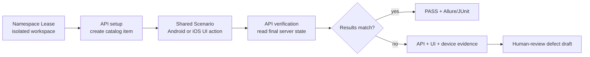
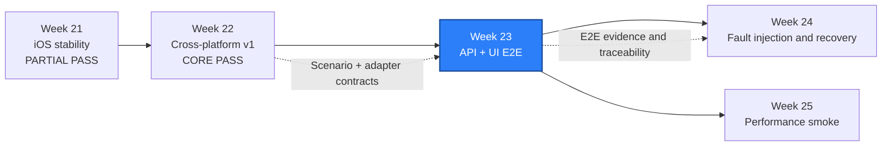

# WEEK-23 - API 建数、UI 操作与 API 验证的跨层 E2E / Cross-Layer E2E from API Setup to UI Action and API Verification

- 计划 / Plan: Week 23，API + Android/iOS 跨层 E2E
- 日期范围 / Date Range: 2026-11-24 to 2026-11-30
- 分支 / Branch: `study/week-23-e2e`
- 基线提交 / Base Commit: `350e652`（Week 22 跨平台框架 v1）
- 计划提交 / Plan Commit: `923a67e`
- 远端分支 / Remote Branch: `origin/study/week-23-e2e`
- Pull Request: 尚未创建 / Not created
- 验收日期 / Acceptance Date: 2026-11-06
- 状态 / Status: **验收未通过 / ACCEPTANCE NOT PASSED**

## 验收结论 / Acceptance Verdict

**验收未通过 / ACCEPTANCE NOT PASSED**

Week 23 的现有工程基线没有退化，但本计划要求的跨层 E2E 实现尚不存在，因此
不能进入完成或部分完成状态：

- 当前分支相对 Week 22 基线的文件变化只有 `AGENTS.md`、
  `reports/README.md` 和本计划文件。
- `packages/qa_core/e2e/`、`tests/e2e/`、
  `configs/e2e-test-inventory.yaml`、跨层架构文档、排障 runbook 和 Workflow
  均不存在。
- Week 23 E2E Test ID 为 `0/30`。
- 现有 `tests/cross_platform/` 只能收集到 Week 22 的 4 条流程，不能代替
  API 建数、UI 操作和 API 验证的跨层 E2E。
- 没有 Android 或 iOS 跨层真实执行，也没有 API/UI/session/设备证据关联。

验收判定：

```text
Week 22 基线: PASS
Week 23 计划入口: PASS
Week 23 E2E implementation: FAILED
Week 23 30-test inventory: FAILED (0/30)
Week 23 Android execution: NOT RUN
Week 23 iOS execution: NOT RUN
Week 23 acceptance: ACCEPTANCE NOT PASSED
```

### 正式验收命令 / Acceptance Commands

| 命令 / Command | 结果 / Result | 解释 / Interpretation |
| --- | --- | --- |
| `python scripts/build_doc_index.py --check` | `PASS` | `entry pages are up to date.` |
| `python -m ruff check .` | `PASS` | `All checks passed!` |
| `python -m mypy packages tests` | `PASS` | 185 个源文件无错误 |
| `python -m pytest tests/unit -q -p no:cacheprovider` | `PASS` | `327 passed in 8.97s` |
| `python -m pytest tests/e2e --collect-only -q` | `FAILED` | 目录不存在，`0` 条 Week 23 E2E |
| `python -m pytest tests/cross_platform --collect-only -q` | `4 collected` | 仅 Week 22 的 Android/iOS 导航和文件流程 |
| Week 23 Test ID inventory | `FAILED` | `0/30` 唯一 Test ID |
| Android cross-layer smoke | `NOT RUN` | 没有测试实现，不能执行 |
| iOS cross-layer smoke | `NOT RUN` | 没有测试实现，不能执行 |
| Failure evidence correlation | `NOT RUN` | 没有失败 manifest 或跨层证据 |

通过上述命令说明项目原有质量基线可运行，但不能证明 Week 23 的交付目标完成。
本次验收没有生成设备运行、Allure、JUnit 或缺陷草稿证据，因为这些产物尚未
实现。

## Week 22 入口核对 / Week 22 Entry Audit

Week 22 的核心范围已经完成：

- `PlatformAdapter`、Locator Set、Scenario/Step 和共享业务断言已实现。
- Android 真机执行 `2 passed in 21.07s`。
- iOS Simulator 执行 `2 passed in 280.84s`。
- 共享契约测试 `10 passed`，完整单元回归 `327 passed`。
- Week 21 的 iOS inventory 保持 `50 unique`，P0/P1/P2 = `20/23/7`。
- PR [#14](https://github.com/htb123-maker/quality-engineering-lab/pull/14)
  的 Python 与 Compose 检查均为 `SUCCESS`。

入口判断：

- Week 22 判定为 **PASS - CORE SCOPE COMPLETE**，可以作为 Week 23 基线。
- PR #14 仍是开放中的 Draft，尚未合并；本计划不代替人工合并审批。
- iOS 云真机保持 `DEFERRED`，前一主版本 iOS Simulator 保持 `BLOCKED`。
- Week 19 WebView context 和通知中心系统 UI 缺口仍不得写成通过。
- Week 23 必须复用 Week 22 的 Scenario/adapter，不能另建一套平台分支。

## 计划目标 / Plan Goal

Week 23 建立一条真实可追溯的跨层 E2E 主链路：

```text
API 创建隔离测试数据
-> Android 或 iOS 共享 Scenario 操作 UI
-> API 验证服务端最终状态
-> 生成可回溯的失败证据和缺陷草稿
```

本周目标：

1. 复用 `NamespaceFactory`、`AuthClient`、`CatalogApiFactory` 和现有 SUT API。
2. 在 Week 22 `MobileScenario`/`PlatformAdapter` 上增加最小 API-backed UI 能力。
3. 用同一业务 Scenario 覆盖 Android 和 iOS，平台定位与系统差异继续留在 adapter。
4. 将 API request ID、Scenario ID、step ID、platform、device、session 和
   Allure/JUnit 证据关联起来。
5. 失败时生成人工审核的缺陷草稿，不自动创建、更新或关闭正式缺陷。
6. 逐步扩展为不少于 30 条不重复的跨层 E2E 测试。

English summary: add a minimal API-backed UI journey on top of the Week 22
scenario layer, verify the server state again through the API, correlate
failure evidence across API and mobile layers, and expand to 30 non-duplicate
cross-layer E2E tests.

## 完成状态 / Completion Status

**验收未通过 / ACCEPTANCE NOT PASSED**

本文件只定义 Week 23 的执行边界和验收方式。以下结果当前均为 `NOT RUN`：

- API-backed mobile Scenario 与 E2E Journey 编排器。
- fixture 的最小 catalog 操作和对应 Android/iOS locator。
- Namespace、账号、设备、端口、session 和 Redis 状态隔离。
- API request -> UI step -> API verification 的证据关联。
- Android 和 iOS 的真实跨层 smoke。
- 30 条跨层 E2E 测试及覆盖率清单。
- 缺陷草稿、追踪链接和人工审批边界。

## 计划范围 / Planned Scope

### 1. E2E Journey 编排

新增轻量编排层，建议放在 `packages/qa_core/e2e/`：

- `E2eContext`：run ID、worker、scenario ID、platform、设备角色和环境。
- `ApiSetupPort`：创建隔离 namespace、用户和初始业务数据。
- `MobileJourneyPort`：执行 Week 22 的 `MobileScenario`。
- `ApiVerificationPort`：读取最终业务状态并核对服务端事实。
- `E2eJourney`：按 `setup -> mobile action -> verify -> cleanup` 顺序执行。
- 每一步失败必须保留原始 cause 和稳定 step ID。

编排层只组合已有能力，不复制 HTTP Client、认证、数据库工厂、adapter 或
等待实现。

### 2. 最小 API-backed UI 能力

第一条纵向链路建议使用 catalog 业务域：

```text
NamespaceFactory 创建隔离 workspace 和 owner
-> AuthClient 登录该 workspace
-> CatalogApiFactory 通过 API 创建 item
-> App 读取该 item，并由 Appium 触发一次状态变更
-> API 重新读取 item，确认服务端最终状态
```

实现要求：

- fixture 只接收非敏感的 workspace slug、item ID、API base URL 和短生命周期
  测试会话参数。
- access token、密码、设备 UDID 和凭据不得渲染到 UI、Allure、page source、
  截图、日志或缺陷草稿。
- App 的网络调用必须使用可注入的 base URL，禁止把 localhost 写死导致模拟器、
  真机和设备云行为不一致。
- UI 文案只用于平台 adapter 内部等待；共享业务断言读取规范化结果。
- 如果 Android/iOS 无法保持同一业务语义，必须拆成两个 Scenario，不能降低断言
  后伪装成同一条跨平台用例。

### 3. Scenario 与 Locator 扩展

在 Week 22 契约上按需增加：

- `CATALOG_SYNC_SCENARIO` 或等价业务 Scenario。
- 语义键 `catalog.root`、`catalog.refresh_button`、`catalog.item_status`。
- Android resource/accessibility locator。
- iOS accessibility identifier locator。
- `catalog.sync` capability，仅在两个 adapter 都真实实现后开放。

业务 Scenario 不允许出现 `if platform == "android"` 或
`if platform == "ios"`。平台选择只允许在 adapter factory、registry 或 pytest
fixture 中出现。

### 4. 数据与资源隔离

- 每个 worker 使用独立 `NamespacedLease`。
- API 建数和清理复用 `NamespacePool`，不直接操作生产数据库。
- catalog cache、幂等 key 和写预算随 namespace 清理。
- 每个 Appium worker 使用自己的设备、端口和 session。
- E2E 保留 run ID，失败证据目录必须按 run、platform 和 worker 分隔。
- 测试结束清理文件、item、namespace、Redis 状态和 Appium session。

### 5. 证据与缺陷草稿

一次失败至少应关联：

```text
test ID
+ scenario ID + failing step ID
+ platform + device class + app version
+ Appium session + screenshot + page source
+ API method/path/status + request ID
+ Allure result + JUnit
+ commit + environment + command
```

新增 E2E 失败 manifest，复用 `MobileDiagnostics` 和
`build_defect_draft`。草稿必须标记 `requires_human_approval=true`，
`automatically_created_issue=false`。

### 6. 跨层用例规模

Week 23 的目标是不少于 30 条不重复的跨层 E2E，优先覆盖：

- API 成功但 UI 未刷新。
- UI 操作成功但服务端状态错误。
- API 写入后 UI 读取到旧缓存。
- 重复请求和幂等。
- 权限不足时 UI 操作失败，服务端状态不变。
- 状态转换成功、非法转换被拒绝。
- 数据隔离：worker A 看不到 worker B 的 item。
- 清理后 API 和 UI 都不再暴露测试数据。

数量必须来自不同业务断言、角色、状态和失败路径，不能用同一断言只改随机 SKU
或设备参数凑数。`skip`、`xfail`、`BLOCKED` 和 `DEFERRED` 不计入 30 条通过。

## 不在本周范围 / Out of Scope

- Week 24 的网络、服务、App、WDA、ADB 故障注入和恢复。
- 性能测试、容量结论和负载模型。
- 旧主版本 iOS Simulator 兼容矩阵。
- WebView context、通知中心系统 UI 和本地 Apple 签名。
- 自动创建正式缺陷、修改优先级、合并 PR 或关闭缺陷。
- 为 E2E 引入新的 BDD 框架、依赖注入框架或设备云 SDK。

## 术语解释 / Glossary

| 名词 / Term | 简单解释 / Plain Meaning | 作用 / Purpose | 在本项目中的位置 / Position |
| --- | --- | --- | --- |
| E2E Journey | 从建数到 UI 操作再到服务端验证的完整旅程 | 证明跨层业务结果一致 | `packages/qa_core/e2e/` |
| API Setup Port | 通过 API 准备业务前置条件的接口 | 避免 UI 做低价值准备工作 | 复用 `AuthClient`、`CatalogApiFactory` |
| API Verification Port | 从服务端事实核对最终状态的接口 | 防止只信 UI 结果 | 复用 SUT catalog API |
| Scenario | 平台无关的业务步骤组合 | 让 Android/iOS 验证同一业务意图 | `qa_core.mobile.scenarios` |
| PlatformAdapter | 把共享动作翻译成平台操作 | 收口定位、手势和系统差异 | `qa_core.mobile.platforms` |
| Namespace Lease | 一个测试独占的隔离业务空间 | 防止并行测试互相污染 | `qa_core.resource_pools` |
| Failure Manifest | 一次失败的结构化证据清单 | 让失败可复现、可审计 | `qa_core.mobile.diagnostics` |
| Defect Draft | 等待人工审核的缺陷候选 | 保留失败闭环但避免自动误建单 | `qa_core.reporting.defect_draft` |
| Traceability | 测试、证据、缺陷和运行记录之间的可追溯关系 | 支持分诊和回归 | Allure/JUnit/GitHub Run |
| Idempotency | 重复请求不会重复改变业务结果 | 验证重试和重复提交安全 | `Idempotency-Key` 与 SUT 状态 |

## 通俗解读 / Plain-Language Guide

Week 23 像一次完整的“办证”流程：先在后台系统登记资料（API 建数），
再到服务窗口用 App 完成确认（UI 操作），最后回到后台核对最终记录
（API 验证）。如果窗口显示成功但后台记录不对，测试必须保留两边证据，
而不是只看窗口上的“成功”两个字。



**一句话理解：** 不能只相信 App 显示成功，必须回到服务端核对真实结果。

## 计划在整体路线中的位置 / Plan Position



Week 23 依赖 Week 22 的双平台 adapter、Locator Set、Scenario/Step 身份和失败
证据。它为 Week 24 的故障恢复、Week 31 的 CI 门禁和 Week 32 的完整缺陷闭环
提供跨层证据基础。

## 实施顺序 / Implementation Order

1. 盘点 catalog API、namespace factory、Week 22 adapter 和现有 Allure 证据。
2. 定义 `E2eContext`、Journey step 身份和结构化结果模型。
3. 用 fake setup/mobile/verification ports 写编排契约测试。
4. 扩展 fixture 和设备云可配置的 API base URL，先实现 Android 最小链路。
5. 在 Android 上执行一条 `setup -> UI -> verify` 纵向 smoke。
6. 实现 iOS 等价 adapter 和 fixture 行为，执行同一条 Scenario。
7. 增加失败注入：API 成功但 UI 刷新失败、UI 成功但 API 状态错误。
8. 把 API 和 UI 证据写入同一 failure manifest，并生成缺陷草稿。
9. 扩展状态、权限、幂等、隔离和清理场景到 30 条 E2E。
10. 更新架构文档、跨层失败 runbook、周报和证据索引。

## 质量检查 / Quality Checks

| 检查项 / Check | 结果 / Status | 执行环境 / Environment | 证据 / Evidence |
| --- | --- | --- | --- |
| Plan/index validation | 通过 / PASS | Windows | `entry pages are up to date.` |
| Journey contract tests | 缺失 / FAILED | Windows | `packages/qa_core/e2e` 和 `tests/e2e` 不存在 |
| Ruff | 通过 / PASS | Windows | `All checks passed!` |
| Mypy | 通过 / PASS | Windows | `Success: no issues found in 185 source files` |
| Full unit regression | 通过 / PASS | Windows | `327 passed in 8.97s` |
| E2E collection contract | 失败 / FAILED | Windows | `tests\e2e` 不存在，`0` 条收集 |
| 30-test inventory | 失败 / FAILED | Windows | `0/30` 唯一 Test ID |
| API + database setup | 待执行 / NOT RUN | Linux container | Compose SUT |
| Android cross-layer smoke | 未执行 / NOT RUN | Android device | 没有 Week 23 E2E 测试可执行 |
| iOS cross-layer smoke | 未执行 / NOT RUN | iOS Simulator | 没有 Week 23 E2E 测试可执行 |
| Failure evidence correlation | 未执行 / NOT RUN | Platform run | 没有 manifest/Allure 跨层证据 |
| Session and namespace cleanup | 未执行 / NOT RUN | Platform/API | 没有真实 E2E 运行可清理 |
| iOS cloud real device | 延期 / DEFERRED | Device cloud | Week 23 初始范围 |
| Previous-major iOS | 继承阻塞 / BLOCKED | macOS Runner | Week 21 限制 |

`PASS`、`FAILED`、`NOT RUN`、`BLOCKED` 和 `DEFERRED` 保留原始语义。

## 验收方式 / Acceptance Method

### 前置条件 / Preconditions

- 使用项目 `.venv` 和 Python 3.12。
- 本地 Compose SUT、PostgreSQL 和 Redis 可启动。
- Android Emulator 或真机、Appium 2 和 UiAutomator2 可用。
- iOS 使用 macOS Runner、Simulator 或合法设备云。
- 测试账号仅拥有测试环境最小权限。
- Week 22 的 `327 passed`、双平台 smoke 和 50 条 iOS inventory 基线可复现。
- 所有日志、page source、API 响应和设备输出按不可信输入处理。

### Windows 静态验证 / Windows Static Verification

```powershell
$env:PYTEST_DEBUG_TEMPROOT="$PWD\.tmp-pytest"
.\.venv\Scripts\python.exe -m ruff check .
.\.venv\Scripts\python.exe -m mypy packages tests
.\.venv\Scripts\python.exe -m pytest tests\unit -q -p no:cacheprovider
.\.venv\Scripts\python.exe -m pytest tests\e2e --collect-only -q -p no:cacheprovider
.\.venv\Scripts\python.exe scripts\build_doc_index.py --check
```

通过标准：

- Ruff 和 Mypy 无错误。
- Journey contract tests 与完整单元回归通过。
- 30 条 E2E Test ID 唯一，且映射真实测试源码。
- 未执行的 Android/iOS 用例保持显式 skip，不计入通过数。

### API 建数与验证 / API Setup and Verification

```powershell
docker compose -f apps\compose\compose.yaml up -d
uv run pytest tests\e2e -m "e2e and api" -q `
  --alluredir=artifacts\allure-week23-api
```

通过标准：

- 每个测试使用独占 namespace。
- API 建数、任务步骤和最终服务端状态可关联同一 run ID。
- 清理后 item、Redis 状态和 namespace 无残留。

### Android 跨层 Smoke / Android Cross-Layer Smoke

```powershell
$env:PYTEST_DEBUG_TEMPROOT="$PWD\.tmp-pytest"
uv run pytest tests\e2e -m "e2e and android" -q `
  --alluredir=artifacts\allure-week23-android `
  --junitxml=artifacts\week23-android-junit.xml
```

通过标准：

- API 创建的数据能在 App 中读到或操作。
- Appium 操作后，API 读取到预期最终状态。
- 失败时包含 API 响应摘要、UI step、截图、page source 和设备元数据。
- Appium session 和 namespace 在 teardown 后释放。

### iOS 跨层 Smoke / iOS Cross-Layer Smoke

```bash
.venv/bin/python -m pytest tests/e2e -m "e2e and ios" -q \
  --alluredir=artifacts/allure-week23-ios \
  --junitxml=artifacts/week23-ios-junit.xml
```

通过标准：

- 与 Android 复用同一业务 Scenario 和共享断言。
- API base URL、workspace 和 item 参数不依赖 Windows 的 `localhost`。
- 失败证据不包含 token、密码、完整 UDID 或供应商凭据。
- session、设备和临时文件清理完成。

### 证据路径 / Evidence

- E2E orchestration: `packages/qa_core/e2e/`
- Shared Scenario: `packages/qa_core/mobile/`
- Android adapter: `packages/qa_core/platforms/android/`
- iOS adapter: `packages/qa_core/platforms/ios/`
- E2E tests: `tests/e2e/`
- E2E inventory: `configs/e2e-test-inventory.yaml`
- Allure: `artifacts/allure-week23-{api,android,ios}/`
- JUnit: `artifacts/week23-{android,ios}-junit.xml`
- Failure evidence: `artifacts/e2e/week23/<run-id>/<platform>/`
- Defect drafts: `artifacts/defect-drafts/week23/`
- Architecture: `docs/architecture/cross-layer-e2e.md`
- Runbook: `docs/runbooks/cross-layer-e2e-triage.md`
- Weekly result: `reports/weekly/WEEK-23.md`

### 未验证项 / Unverified Items

- 任何 Android/iOS E2E 真实执行。
- API 创建的数据是否能被 App 稳定读取和操作。
- 30 条 E2E 的最终业务覆盖和去重结果。
- API、UI、设备、session、Allure 和缺陷草稿能否完整关联。
- 多 worker 下的 namespace、设备、端口和 session 隔离。
- iOS 云真机、物理 iPhone 和旧主版本 runtime。
- WebView context、通知中心系统 UI 和本地 Apple 签名。

## 变更文件 / Files Changed

开周计划：

- `reports/weekly/WEEK-23.md`
- `reports/README.md`（由索引脚本刷新）
- `docs/README.md`（如索引脚本检测到日期或内容变化）

实施后预计涉及：

- `packages/qa_core/e2e/`：Journey、ports 和证据上下文。
- `packages/qa_core/mobile/`：catalog Scenario 和规范化结果。
- `packages/qa_core/platforms/android/adapter.py`：Android catalog 能力。
- `packages/qa_core/platforms/ios/adapter.py`：iOS catalog 能力。
- `apps/android-fixture/`、`apps/ios-fixture/`：最小 API-backed catalog UI。
- `tests/unit/`、`tests/e2e/`：契约、纵向 smoke 和 30 条清单。
- `configs/e2e-test-inventory.yaml`。
- `docs/architecture/cross-layer-e2e.md`。
- `docs/runbooks/cross-layer-e2e-triage.md`。
- `.github/workflows/week23-e2e.yml`。
- `reports/weekly/WEEK-23.md`：实测结果和证据回填。

最终文件列表以实际实现为准，不在开周时虚构已完成产物。

## 环境 / Environment

- Windows + PowerShell
- Python 3.12，项目 `.venv`
- Appium Python Client 5.x
- Appium 2.19.0
- Android：UiAutomator2，Redmi K50 / Android 14 基线可用
- iOS：XCUITest 8.4.3、Xcode 16.4、iOS 18.5 Simulator 基线可用
- SUT：本地 Docker Compose、PostgreSQL、Redis
- iOS 云真机：Week 23 初始范围 `DEFERRED`
- 前一主版本 iOS runtime：`BLOCKED`
- 物理 iPhone：`DEFERRED`

## 风险与限制 / Risks and Limitations

- fixture 当前只覆盖本地导航和文件语义，尚未连接 SUT；Week 23 必须补真实
  API-backed UI 行为，不能只把 API 断言和 UI 断言放在同一个测试文件里。
- Android Emulator 访问宿主机 API 的地址与 iOS Simulator 不同，必须配置化。
- 在 capability、日志或 UI 中传递凭据会造成泄漏，测试会话必须短生命周期并脱敏。
- 30 条测试若只改 SKU、用户名或设备参数，会产生虚假规模。
- Appium session、namespace 和 Redis 清理不完整会放大并行 flaky。
- iOS Simulator 和云真机网络、WDA 冷启动和端口行为不同，不能互相替代。
- 失败归因必须区分产品、测试、数据、设备、Appium/WDA 和 SUT 基础设施。
- 本地 Compose 数据只能用于测试，不得连接生产数据库或使用生产凭据。

## 下一步 / Next Plan

Week 24 在 Week 23 的 Journey 和证据链上增加故障注入与恢复：

1. API 延迟、丢包、限流和服务不可用。
2. UI 等待、重试、幂等和最终一致性。
3. Android ADB/App/second session 恢复。
4. iOS WDA/Simulator session 恢复。
5. 至少 5 条故障恢复测试，并保持失败证据和人工缺陷审批边界。

Week 23 收口前必须明确：哪些 E2E 已在 Android/iOS 真实执行，哪些只通过
fake port，哪些仍是 `NOT RUN`、`BLOCKED` 或 `DEFERRED`。
