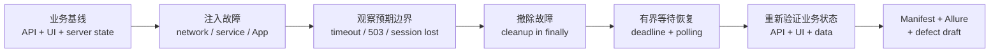
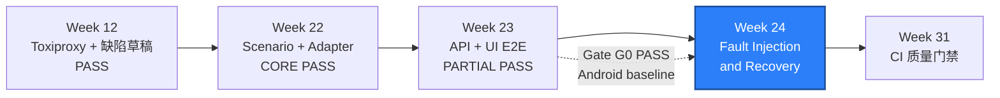

# WEEK-24 - 网络、服务、App、WDA 与 ADB 故障注入和恢复 / Fault Injection and Recovery Across Network, Services, App, WDA, and ADB

- 计划 / Plan: Week 24，故障注入、恢复与缺陷闭环
- 日期范围 / Date Range: 2026-12-01 to 2026-12-07
- 分支 / Branch: `study/week-24-recovery`
- 基线提交 / Base Commit: `cb9efcf`（Week 23 Android 跨层实现）
- 计划提交 / Plan Commit: `b539dd3`
- 实施提交 / Implementation Commits: `d6ebb3b`, `891bdd4`
- 远端分支 / Remote Branch: `origin/study/week-24-recovery`
- Pull Request: 尚未创建 / Not created
- 状态 / Status: **实施中，API 恢复与 Gate G0 已通过 / IN PROGRESS**

## Week 23 入口核对 / Week 23 Entry Audit

2026-11-07 重新核对并推送了 `study/week-23-e2e`：

- 远端分支更新为 `f3d8cbd..cb9efcf`，本地与远端同步。
- `packages/qa_core/e2e/`、`tests/e2e/`、`configs/e2e-test-inventory.yaml`、
  `docs/architecture/cross-layer-e2e.md` 和跨层 triage runbook 均存在。
- Week 23 Android 30 条跨层用例的既有报告为
  **PARTIAL PASS - IOS NOT RUN**，不是 COMPLETE；该状态保持不变。
- Week 24 分支已 rebase 到 Week 23 实现提交，不再停留在旧计划基线。

入口结论：

- Gate G0 在 Android 15 Emulator 上真实执行 `E2E-CAT-001` 并通过。
- API 建数、fixture 读取、归档操作和服务端复核使用同一 run ID 和 item。
- iOS 跨层入口仍为 `NOT RUN`，不能由 Android 或 fake adapter 替代。
- Week 24 可以继续 API 恢复与 Android 恢复；iOS 恢复必须在 macOS、Simulator
  或合法设备云上执行。

### 已有可复用能力 / Existing Reusable Capabilities

- Week 12 已有 Toxiproxy 控制客户端、独立 worker 代理端口和 API 断连/超时用例。
- Week 15/16 已有 Android 前后台恢复、进程死亡、后台软杀和无线 ADB 重连证据。
- Week 19/21 已有 iOS 前后台、terminate/activate 和 session 回收证据。
- Week 20/21 已有 iOS 双 Simulator、WDA 端口、DerivedData 和 Appium 端口隔离。
- Week 12 已有缺陷草稿、稳定指纹和人工审批边界。
- Week 22 已有共享 Scenario、PlatformAdapter、Locator Set 和移动失败证据。

这些能力是积木，不是 Week 24 的完成证明。Week 24 必须回答：故障被注入后，
系统在哪里失败、边界是否符合预期、故障撤除后是否真正恢复、业务数据是否一致。

## 计划目标 / Plan Goal

Week 24 建立一条可重复的故障恢复验收链：

```text
建立可验证业务基线
-> 注入一个有边界、可撤销的故障
-> 观察预期失败或降级
-> 撤除故障
-> 等待恢复并重新验证业务状态
-> 保存结构化证据和人工审核缺陷草稿
```

本周目标：

1. 在真实 API 和移动 App 之间建立至少一条可复用的恢复验收链路。
2. 覆盖网络延迟、超时、断连、服务不可用和限流边界。
3. 覆盖 Android App 进程死亡、ADB 掉线和 Appium session 恢复。
4. 覆盖 iOS App terminate/activate、WDA/Appium session 失效后的重建路径。
5. 用截止时间、条件轮询和有界重试判断恢复，不使用固定 `sleep` 掩盖问题。
6. 把故障类型、注入时间、恢复时间、业务状态和原始证据写到同一 manifest。
7. 失败只生成需要人工审批的缺陷草稿，不自动创建、更新或关闭正式缺陷。

English summary: build a reversible fault-and-recovery contract on top of the
Week 23 cross-layer journey, then prove transport, service, Android, and iOS
recovery with bounded waits and structured evidence.

## 完成状态 / Completion Status

**实施中 / IN PROGRESS**

已完成并有执行证据：

- `FaultSpec`、`FaultType`、`RecoveryContext`、`RecoveryJourney`、
  `RecoveryPolicy`、`RecoveryResult` 和结构化 recovery manifest。
- 8 条恢复契约单元测试：基线、注入、观察、恢复轮询、超时、清理和脱敏。
- 5 条真实 API 恢复用例：latency、timeout、reset peer、proxy disabled、
  upstream unavailable；全部通过，且恢复后重新读取同一 catalog item。
- Gate G0：Android 15 Emulator 上 `E2E-CAT-001` 真实通过。
- 清理检查：test namespace `0`、Appium sessions `[]`、ADB reverse 无输出。

仍未完成：

- Android App 进程死亡、ADB 掉线和 Week 24 Appium session 重建用例。
- iOS App terminate/activate、WDA/Appium session 恢复。
- 限流窗口恢复用例；当前服务不可用已由真实 upstream 切换覆盖。
- 双平台 UI 故障恢复、并发 worker 矩阵和正式缺陷闭环。
- Week 24 最终至少 8 条非重复恢复执行的完整清单。

因此 Week 24 仍为 **IN PROGRESS**，不是 COMPLETE。

## 计划范围 / Planned Scope

### 1. Week 23 入口门 / Gate G0

Week 24 的恢复验收依赖一条真实的跨层基线：

```text
API 创建隔离数据
-> App 读取或操作该数据
-> API 验证最终服务端状态
```

Gate G0 通过条件：

- `packages/qa_core/e2e/` 有可执行 Journey 编排层。
- `tests/e2e/` 至少有一条 Android 或 iOS 的真实纵向 smoke。
- 该 smoke 的 API 建数、UI step 和 API 验证引用同一 run ID。
- 失败时可以回溯 API request ID、UI step、platform、device、session 和报告。

Gate G0 未通过时：

- API/Toxiproxy 恢复用例仍可独立执行。
- 依赖 App 到 SUT 的恢复用例保持 `BLOCKED`，不得用本地 fixture 冒充。
- 周报结论最多是 `PARTIAL`，不能声称 Week 24 完成。

### 2. 故障场景契约

在现有 Scenario、Flow 和诊断能力上增加最小恢复编排，不复制 HTTP Client、
Appium fixture 或缺陷模块。

建议新增：

```text
FaultSpec
+ fault_type
+ target
+ expected_boundary
+ timeout_seconds
+ cleanup_action
```

```text
RecoveryJourney
+ baseline
+ inject
+ observe
+ remove
+ wait_until_recovered
+ verify_business_state
+ collect_evidence
```

约束：

- 每个 Step 使用稳定 ID，失败时保留原始异常。
- 注入前必须确认基线可执行，否则不能把初始失败误判为恢复问题。
- `finally` 必须撤除 toxic、代理、限流、ADB 状态和临时配置。
- 等待恢复使用带截止时间的条件轮询；超时后保留最后观察状态。
- 重试只用于读取或明确幂等的操作，并记录 attempt 次数。
- 恢复后必须重新验证业务事实，不只看健康检查是否返回 `200`。

### 3. 网络与服务故障

复用 Week 12 的 Toxiproxy 客户端和 worker 独立代理端口，新增至少以下边界：

| 故障 / Fault | 预期观察 / Expected Observation | 恢复证明 / Recovery Proof |
| --- | --- | --- |
| latency | 客户端在预算内超时或有界重试 | 撤除 toxic 后 API 和 Journey 恢复 |
| timeout | 请求不会无限挂起 | 撤除 toxic 后原业务可继续 |
| reset peer | 已建立连接被中断 | 新连接或重建路径可用 |
| proxy disabled | 快速连接失败，不堆积 | 重新启用后健康检查和业务恢复 |
| service unavailable | 明确 `503` 或连接失败分类 | 测试服务恢复后重新验证 |
| rate limit | 返回 `429` 和恢复建议时间 | 等待窗口后成功，失败不被重试掩盖 |

服务不可用测试只能操作专用测试 Compose 环境，不得连接生产环境。停止或重启
服务前后必须记录容器状态、health、目标 business object 和清理结果。

### 4. Android 恢复

复用现有 Android fixture、ADB 和 session fixture，覆盖：

1. App 进程被强制停止后，由新 session 或仍存活的 session 恢复 App。
2. 旧 session 的失效边界必须明确，不能把 `NoSuchSession` 当成产品缺陷。
3. 无线 ADB 断开时记录失败阶段，重连后重新创建或恢复 session。
4. 故障前后验证同一个 namespace 下的业务状态，不创建无名残留数据。
5. 结束后清理 Appium session、临时文件、代理和 namespace。

恢复测试必须区分：

- App 进程死亡。
- UiAutomator2/Appium session 失效。
- ADB transport 断开。
- 测试机网络与宿主机网络问题。

### 5. iOS 恢复

复用现有 XCUITest、Simulator、WDA 端口和 Appium Server 隔离：

1. App terminate 后 activate 或重建 session，验证 fixture 状态恢复。
2. Appium/WDA session 失效后，在隔离端口和 DerivedData 下重建 session。
3. Simulator 或 WDA 不可恢复时保留日志和环境快照，标记 `BLOCKED`。
4. iOS 恢复验收只能在 macOS Runner、合法 Simulator 或设备云执行。
5. Windows 主机上的 collect-only、skip 或 fake adapter 不计入 iOS 通过数。

本机无法主动制造稳定的 WDA 内部故障时，可以通过重启隔离的 Appium/WDA
进程模拟控制面失效；不得把随机等待或偶发失败当成确定性注入。

### 6. 业务一致性与隔离

每个恢复用例必须使用独占 namespace，并验证：

- 故障前对象存在且状态为已知基线。
- 故障期间没有产生不可解释的重复写入。
- 恢复后不存在重复 item、重复事件或孤儿 session。
- 幂等重试没有改变最终业务状态。
- 清理后 API 不再暴露测试对象，Redis key 和 namespace 无残留。

不能在故障注入期间关闭鉴权、绕过业务断言或直接修改生产式数据库状态。

### 7. 证据与缺陷草稿

每次故障运行至少保存：

```text
run_id
+ test_id
+ scenario_id
+ failing_step_id
+ fault_type + target + toxic/proxy
+ injection_start + injection_end
+ expected_boundary
+ observed_boundary
+ recovery_start + recovery_end
+ platform + device class + app version
+ Appium session + appium port + wda port
+ API request ID + method/path/status
+ namespace + business object ID
+ screenshot + page source
+ Allure/JUnit + command + commit
```

失败时复用 `MobileDiagnostics` 和 `build_defect_draft`，并增加恢复字段。
草稿必须保持：

```text
requires_human_approval=true
automatically_created_issue=false
```

正式缺陷的创建、优先级、owner 和关闭仍必须由具名人员批准。

### 8. 本周测试规模

目标建立至少 8 条不重复恢复用例：

| 类别 / Category | 最少数量 / Minimum | 说明 / Notes |
| --- | ---: | --- |
| API transport | 3 | disabled、latency/timeout、reset peer |
| API service/limit | 2 | service unavailable、rate limit |
| Android recovery | 2 | process/session、ADB reconnect |
| iOS recovery | 1 | terminate/activate 或 session rebuild |

数量不能通过修改随机 ID、端口或设备参数重复计数。受环境阻塞的移动用例保留
在清单中，但不计入 `passed`。若 Gate G0 未通过，移动恢复用例不能为了凑数
降级成本地控件测试。

## 不在本周范围 / Out of Scope

- 补齐 Week 23 的全部 30 条跨层 E2E。
- Week 25 到 Week 29 的性能、容量和长稳测试。
- 连接生产数据库、生产 Redis 或执行生产环境故障注入。
- 自动创建正式 Issue、自动修改 owner/优先级或自动关闭缺陷。
- 修复 WebView context 和通知中心系统 UI 的继承缺口。
- 解锁前一主版本 iOS Simulator。
- 为故障注入引入 Chaos Mesh、Kubernetes 或新 BDD 框架。
- 把设备云偶发排队、Runner 资源不足或凭据缺失写成产品恢复通过。

## 术语解释 / Glossary

| 名词 / Term | 简单解释 / Plain Meaning | 作用 / Purpose | 在本项目中的位置 / Position |
| --- | --- | --- | --- |
| Fault Injection | 主动制造可控故障来观察系统反应 | 验证失败边界和恢复能力 | Toxiproxy、ADB、Appium、Compose |
| Toxic | Toxiproxy 的一条网络故障规则 | 注入延迟、超时或断连 | `ToxiproxyClient` |
| Recovery | 故障撤除后恢复业务可用和状态一致 | 区分“坏了”与“能恢复” | `RecoveryJourney` |
| Expected Boundary | 故障时预期出现的错误或降级 | 防止任何失败都被当作产品缺陷 | `FaultSpec` |
| Bounded Retry | 有最大次数和总时间预算的重试 | 避免无限等待或掩盖故障 | `RetryPolicy` |
| WDA | WebDriverAgent，iOS XCUITest 的代理 | 承载 iOS 元素和手势操作 | XCUITest Driver |
| ADB | Android Debug Bridge | 安装、启动、终止和诊断 Android App | Android 测试主机 |
| Session | Appium 与设备的一次自动化连接 | 承载一个设备执行上下文 | Appium `/sessions` |
| Manifest | 结构化的故障与恢复证据清单 | 支持失败归因和人工审核 | `artifacts/e2e/week24/` |
| Defect Draft | 等待人工审核的缺陷候选 | 保留闭环但不自动误建单 | `qa_core.reporting.defect_draft` |

## 通俗解读 / Plain-Language Guide

Week 24 像给一条已经能正常送货的路线做“封路演练”：先确认货物能送到，
再临时封路或延迟交通，观察系统是否明确报错或降级，最后解除封路并确认货物
真的重新送达。只看“封路成功”不够，必须证明道路解除后业务恢复。



**一句话理解：** 好的恢复测试不是“制造一次报错”，而是证明故障有边界、
恢复有期限、数据没有坏。

## 计划位置 / Plan Position



Week 24 依赖 Week 12 的真实 API 故障注入、Week 15/16/19/21 的移动恢复证据
和 Week 22 的共享 adapter。它同时依赖 Week 23 的真实跨层入口。Week 25 的
性能基线已完成，但不能替代本周的功能恢复和会话恢复验收。

## 实施顺序 / Implementation Order

1. 审计 Week 23 分支，确认是否存在可执行 API + UI 纵向链路。
2. 建立 `FaultSpec`、`RecoveryJourney` 和故障 manifest 契约测试。
3. 复用 Toxiproxy，先完成 disabled、latency/timeout、reset peer 和恢复。
4. 增加服务不可用与限流边界，验证测试环境清理。
5. 在 Gate G0 通过后接入一条 API + Android UI + API 验证恢复链路。
6. 增加 Android 进程死亡、ADB 断连和 session 重建用例。
7. 在 macOS 环境接入 iOS terminate/activate 和 session 重建用例。
8. 验证故障期间幂等、数据一致性和 namespace 清理。
9. 将 API、UI、设备、session、恢复耗时和缺陷草稿写入统一证据。
10. 更新架构图、恢复 runbook、周报和文档索引。

## 质量检查 / Quality Checks

| 检查项 / Check | 结果 / Status | 执行环境 / Environment | 证据 / Evidence |
| --- | --- | --- | --- |
| Week 23 implementation audit | 通过 / PASS | Windows | `cb9efcf` and `tests/e2e` |
| Gate G0 Android cross-layer | 通过 / PASS | Android 15 Emulator | `1 passed, 29 deselected in 10.69s` |
| Plan/index validation | 通过 / PASS | Windows | `entry pages are up to date.` |
| Fault contract tests | 通过 / PASS | Windows | `8 passed in 0.23s` |
| Ruff | 通过 / PASS | Windows | `All checks passed!` |
| Mypy | 通过 / PASS | Windows | `200 source files`, no issues |
| Full unit regression | 通过 / PASS | Windows | `340 passed in 8.76s` |
| E2E collection | 通过 / PASS | Windows | `36 tests collected` |
| API transport recovery | 通过 / PASS | Windows + Linux container | `W24-API-NET-001..004` |
| API service recovery | 通过 / PASS | Linux container | `W24-API-SVC-001` |
| API rate-limit recovery | 待执行 / NOT RUN | Linux container | no recovery pass claim |
| Android process/session recovery | 待执行 / NOT RUN | Android device | Appium + ADB |
| Android ADB reconnect | 待执行 / NOT RUN | Android device | wireless ADB |
| iOS App/session recovery | 待执行 / NOT RUN | macOS / Simulator | XCUITest + WDA |
| Namespace/session cleanup | 通过 / PASS | Platform/API | namespace `0`, sessions `[]`, no reverse |
| Defect draft approval boundary | 待执行 / NOT RUN | Platform run | human approval |
| iOS cloud real device | 延期 / DEFERRED | Device cloud | inherited scope |
| Previous-major iOS | 继承阻塞 / BLOCKED | macOS Runner | Week 21 limitation |

`PASS`、`FAILED`、`NOT RUN`、`BLOCKED` 和 `DEFERRED` 保留原始语义。

## 验收方式 / Acceptance Method

### 前置条件 / Preconditions

- 使用项目 `.venv`、Python 3.12 和锁定的 uv 依赖。
- 本地 Compose SUT、PostgreSQL 和 Redis 可启动。
- Toxiproxy 镜像可从 `ghcr.io/shopify/toxiproxy:2.9.0` 获取。
- Android 使用测试设备或 Emulator，并启用 Appium/UiAutomator2。
- iOS 使用 macOS Runner、Simulator 或合法设备云。
- 测试账号只有测试环境最小权限。
- 所有日志、page source、API 响应和设备输出按不可信输入处理。
- 不读取、打印或提交 token、密码、证书、完整 UDID 或供应商凭据。

### Gate G0 / Week 23 Cross-Layer Entry

```powershell
pytest tests\e2e\test_catalog_cross_layer.py -q `
  -k E2E-CAT-001 `
  --alluredir=artifacts\allure-week24-gate0 `
  --junitxml=artifacts\week24-gate0-junit.xml
```

通过标准：

- 至少一条 API 建数 + UI 操作 + API 验证真实执行。
- run ID、API request ID、scenario ID、step ID、platform 和 session 可关联。
- 清理后 namespace、item、Appium session 无残留。

实际结果：`1 passed, 29 deselected in 10.69s`。UI 与服务端最终状态均为
`archived`，setup 和 verification request ID 均存在。

### Windows 静态验证 / Windows Static Verification

```powershell
$env:PYTEST_DEBUG_TEMPROOT="$PWD\.tmp-pytest"
uv run --no-sync python -m ruff check .
uv run --no-sync python -m mypy packages tests
uv run --no-sync python -m pytest tests\unit -q -p no:cacheprovider
uv run --no-sync python -m pytest tests\api tests\e2e --collect-only -q -p no:cacheprovider
uv run --no-sync python scripts\build_doc_index.py --check
```

通过标准：

- Ruff、Mypy 和单元测试通过。
- API/E2E 测试可收集。
- 文档索引无差异。
- collect-only 和 skip 不计入恢复通过数。

### API 故障与恢复 / API Fault and Recovery

```powershell
.\scripts\start_sut.ps1 -FaultInjection -WaitSeconds 180
uv run --no-sync pytest tests\api\test_fault_injection.py `
  tests\e2e\test_week24_network_recovery.py -q `
  -m "fault_injection or recovery" `
  --alluredir=artifacts\allure-week24-api `
  --junitxml=artifacts\week24-api-junit.xml
.\scripts\stop_sut.ps1 -FaultInjection
```

通过标准：

- 故障时观察到的错误属于预期边界。
- 每个请求的重试次数和总耗时不超过配置预算。
- 撤除 toxic 或恢复服务后可重新读取健康状态和业务对象。
- 代理、临时 item、namespace 和 Redis 状态清理完成。

### Android 恢复 / Android Recovery

```powershell
$env:PYTEST_DEBUG_TEMPROOT="$PWD\.tmp-pytest"
uv run --no-sync pytest tests\e2e\test_week24_android_recovery.py -q `
  -m "e2e and android and recovery" `
  --alluredir=artifacts\allure-week24-android `
  --junitxml=artifacts\week24-android-junit.xml
```

通过标准：

- App 或 session 故障的失败阶段明确。
- 重新创建或恢复 session 后，业务断言通过。
- ADB 断线恢复不会创造重复业务数据。
- 测试结束 Appium session、临时文件和 namespace 清理完成。

### iOS 恢复 / iOS Recovery

```bash
.venv/bin/python -m pytest tests/e2e/test_week24_ios_recovery.py -q \
  -m "e2e and ios and recovery" \
  --alluredir=artifacts/allure-week24-ios \
  --junitxml=artifacts/week24-ios-junit.xml
```

通过标准：

- 只在 macOS、Simulator 或合法设备云真实执行。
- terminate/activate 或 session rebuild 后业务断言通过。
- WDA/Appium 端口、session 和日志可回溯。
- 无法恢复时保留 `BLOCKED`，不能把 skip 计入通过数。

### 预期结果 / Expected Results

```text
Gate G0: PASS or explicit BLOCKED
API recovery: >= 5 non-duplicate cases, all expected-boundary checks pass
Android recovery: available cases pass; unavailable cases are NOT RUN
iOS recovery: available cases pass; unavailable cases are BLOCKED/DEFERRED
Cleanup: no proxy, namespace, temp file, or Appium session residue
Defects: drafts only; requires_human_approval=true
```

### 证据路径 / Evidence

- Recovery orchestration: `packages/qa_core/e2e/recovery.py`
- Fault models: `packages/qa_core/e2e/faults.py`
- API recovery tests: `tests/e2e/test_week24_network_recovery.py`
- Android recovery tests: `tests/e2e/test_week24_android_recovery.py`
- iOS recovery tests: `tests/e2e/test_week24_ios_recovery.py`
- Contract tests: `tests/unit/`
- Allure: `artifacts/allure-week24-{api,android,ios}/`
- JUnit: `artifacts/week24-{api,android,ios}-junit.xml`
- Failure evidence: `artifacts/e2e/week24/<run-id>/<platform>/`
- Defect drafts: `artifacts/defect-drafts/week24/`
- Architecture: `docs/architecture/fault-recovery.md`
- Runbook: `docs/runbooks/fault-recovery-triage.md`
- Weekly result: `reports/weekly/WEEK-24.md`

### 未验证项 / Unverified Items

- Android App 进程死亡、ADB 掉线和 Week 24 Appium session 重建。
- iOS App terminate/activate、WDA 和 Appium session 恢复。
- 限流窗口耗尽后的真实恢复等待。
- 故障注入下的 Android/iOS API + UI 跨层恢复。
- 当前 fixture 是否能稳定支持进程死亡后的跨层业务状态验证。
- ADB 断线后的旧 session 是否能确定性恢复，还是必须重建 session。
- WDA 内部故障的可控注入方式和恢复边界。
- 多 worker 下的 namespace、设备、ADB、WDA、Appium 和代理端口隔离。
- iOS 云真机、物理 iPhone 和前一主版本 runtime。
- Week 19 WebView context 和通知中心系统 UI 的继承缺口。

## 变更文件 / Files Changed

本轮实际变更：

- `packages/qa_core/e2e/faults.py`：`FaultType` 和 `FaultSpec`。
- `packages/qa_core/e2e/recovery.py`：恢复上下文、编排、轮询和 manifest。
- `packages/qa_core/e2e/__init__.py`：公开恢复契约。
- `tests/unit/test_recovery_journey.py`：8 条恢复契约测试。
- `tests/e2e/conftest.py`：Week 24 Toxiproxy fixture。
- `tests/e2e/test_week24_network_recovery.py`：5 条真实 API 恢复用例。
- `docs/architecture/fault-recovery.md`。
- `docs/runbooks/fault-recovery-triage.md`。
- `reports/weekly/WEEK-24.md`。
- `reports/README.md`（由索引脚本刷新）。

尚未创建 `.github/workflows/week24-recovery.yml`，不把计划文件写成已完成 CI。

## 环境 / Environment

- Windows + PowerShell
- Python 3.12，项目 `.venv`
- Appium Python Client 5.x
- Appium 2.19.0
- Android：UiAutomator2、ADB、Android 15 ATD Emulator 已执行
- Android 物理设备：Redmi K50 / Android 14 已识别，但 MIUI 安装确认阻止覆盖
  当前 fixture，因此本次 `NOT RUN`
- iOS：XCUITest 8.4.3、Xcode 16.4、iOS 18.5 Simulator
- SUT：本地 Docker Compose、PostgreSQL、Redis
- Fault injection：Toxiproxy 2.9.0，控制端口 `18474`
- Worker proxy ports：`18100-18103`
- 前一主版本 iOS runtime：`BLOCKED`
- 物理 iPhone：`DEFERRED`
- 跨主机 Android 设备池：`DEFERRED`

## 风险与限制 / Risks and Limitations

- 物理 Android 的 USB 安装确认可能在 `adb install` 阶段阻止 fixture 更新。
- 网络代理地址在 Android Emulator、物理 Android、iOS Simulator 和设备云中
  不同，必须配置化，不能写死 `localhost`。
- 停止 Compose 服务会影响同一环境中的其他测试，必须使用专用 project name
  和串行清理。
- ADB 或 WDA 故障可能来自设备、主机、网络、工具链或 Appium，不能默认归因产品。
- 重试可能掩盖真实失败，必须保留每次 attempt 和最终边界。
- 固定 `sleep` 会让恢复看起来很快或很慢，但不能证明状态真的恢复。
- iOS WDA 内部故障不一定能从测试代码稳定触发，必要时只验证 session 重建并
  明确记录限制。
- 故障用例与并行测试共享代理、端口或服务时容易互相污染，必须保持 worker
  和 namespace 隔离。
- 失败证据可能包含 token、完整 UDID、URL 参数或业务敏感数据，写入前必须脱敏。
- 自动生成缺陷草稿不等于正式缺陷，人工审批和回归证据仍不可省略。

## 下一步 / Next Plan

Week 25 的性能 Smoke 已在独立分支完成，但 Week 24 不以性能阶段替代功能恢复。

Week 24 收口前必须明确：

1. Gate G0 已通过；下一步基于 `E2E-CAT-001` 接入 Android 进程和 session 恢复。
2. API 网络/服务恢复已有 5 条真实通过；限流恢复仍未执行。
3. iOS 恢复必须在 macOS、Simulator 或合法设备云执行，Windows 保持 `NOT RUN`。
4. 移动恢复必须重新验证同一 namespace、item 和 session 的业务事实。
5. 失败只生成人工审批缺陷草稿，不自动创建正式 Issue。

Week 25 之后进入 Baseline/Load 时，故障恢复证据可以作为性能失败分析输入，
但不能替代容量、资源和 SLO 结论。
