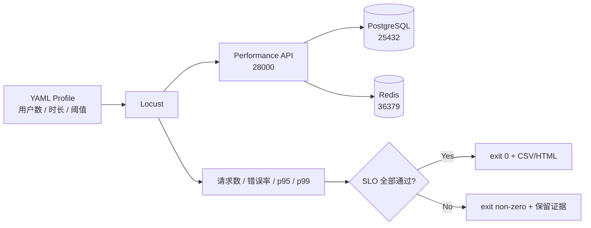
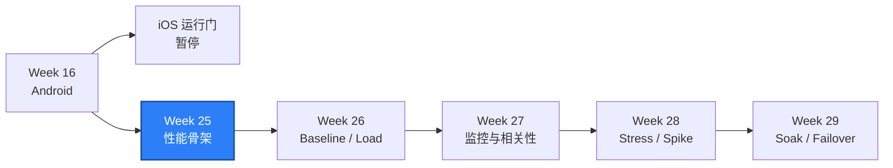

# WEEK-25 - SLI、SLO、负载模型、独立性能环境与 Locust Smoke / SLI, SLO, Load Model, Isolated Environment, and Locust Smoke

- 计划 / Plan: Week 25，性能方案、独立环境与 Smoke
- 日期范围 / Date Range: 2026-10-29 to 2026-11-04
- 首轮执行日期 / First Run Date: 2026-10-29
- 分支 / Branch: codex/week25-performance-smoke-20261101
- 基线提交 / Base Commit: befeef4（Week 20 parallel matrix acceptance）
- 远端分支 / Remote Branch: 目标为 `origin/codex/week25-performance-smoke-20261101`
- 状态 / Status: **基线完成 / BASELINE COMPLETE**
- iOS 依赖 / iOS Dependency: 无 / None

## 执行顺序调整 / Schedule Adjustment

当前 Windows 主机没有 macOS、Xcode、WDA、Simulator 或物理 iPhone。iOS 工作
拆成两个门：

- macOS 运行门：负责 Simulator、WDA、Appium session、pytest 和 Allure。
- 物理设备门：负责签名、Provisioning、设备信任、真机矩阵和真机系统行为。

Week 17 的运行项、Week 18 到 Week 24 的 iOS 完成收口已暂停，先执行
Week 25 到 Week 29。恢复 iOS 时从 Week 17 运行验收开始，不能跳到 Week 20
或 Week 21。完整队列记录在 `docs/PLAN.md` 第 5.1 节。

**2026-10-31 更新：** GitHub 托管 macOS Runner 已通过 Week 17 Simulator、
WDA、Appium session 和 iOS smoke。iOS 工作恢复为 Week 18 到 Week 21，
物理设备门仍保持延期。

## 计划目标 / Plan Goal

Week 25 不追求容量结论，而是先建立一条可信的性能基线链：

1. 用独立 Compose project、端口和数据卷隔离性能测试。
2. 用 YAML 固定用户数、启动速率、运行时长和工作区。
3. 用 Locust 生成有名称的只读用户旅程。
4. 收集请求数、错误率、p95 和 p99。
5. 任一 SLO 未达到时，让 Locust 以非零状态退出。
6. 保存 CSV、HTML、环境检查结果和失败排查方法。

## 完成范围 / Completed Scope

### 1. 独立性能环境

- Compose project name：`quality-engineering-lab-performance`。
- API：`http://127.0.0.1:28000`。
- PostgreSQL：`127.0.0.1:25432`。
- Redis：`127.0.0.1:36379`。
- 使用独立网络与数据卷，不读取日常 `.env`。
- 新增 `.env.performance.example`，其中只有本地非生产默认值。

### 2. 类型化负载 Profile

`configs/performance-smoke.yaml` 定义：

```text
4 users
+ 2 users/second spawn rate
+ 10 seconds
+ atlas read workspace
+ p95 / error rate / request count thresholds
```

`qa_core.performance` 负责 YAML 校验和阈值判定。阈值名称必须唯一，所有判定
结果都会保留，便于一次看到延迟、错误率和样本量是否同时达标。

### 3. Locust 只读旅程

- `GET /api/v1/workspaces/atlas/catalog`：权重 4。
- `GET /openapi.json`：权重 2。
- `GET /health/live`：权重 1。

每个请求使用稳定名称，便于比较历史趋势。Smoke 不执行写请求，避免提前引入
数据池、限流和清理噪声。

### 4. 可执行入口

| 入口 / Entry | 用途 / Purpose |
| --- | --- |
| `scripts/start_performance_sut.ps1` | 启动独立性能环境并做 readiness |
| `scripts/run_performance_smoke.ps1` | 执行 Locust、保存 CSV/HTML、检查 SLO |
| `scripts/stop_performance_sut.ps1` | 停止独立性能环境 |
| `scripts/start_sut.ps1` | 支持 project name、env file 和检查地址参数 |

### 5. 文档

- ADR-0011：独立环境与机器可判定 SLO。
- 性能负载模型：术语、Little's Law、旅程和后续阶段。
- 性能 Smoke runbook：环境、请求、SLO 和清理排查。
- 目标与计划：拆分 macOS 运行门和物理设备门，更新执行队列。

## 通俗解读 / Plain English

独立性能环境像一间单独的实验厨房：菜单可以一样，但库存、操作台和计时器
不能和日常功能测试共用。否则别人刚改过冰箱里的食材，量出来的“做菜时间”
就不可信。



**一句话理解：** Week 25 先证明性能测量尺是准的，再拿它比较不同负载。

## 计划位置 / Plan Position



## 质量检查 / Quality Checks

| 检查项 / Check | 结果 / Status | 执行环境 / Environment | 证据 / Evidence |
| --- | --- | --- | --- |
| Dependency lock | 通过 / PASS | Windows | `uv lock` 解析 79 个包 |
| Dependency sync | 通过 / PASS | Windows | `uv sync` 安装 Locust 2.47.0 |
| Targeted performance tests | 通过 / PASS | Windows | `3 passed in 0.04s` |
| Full unit regression | 通过 / PASS | Windows | `312 passed in 8.17s` |
| Ruff | 通过 / PASS | Windows | `All checks passed!` |
| Mypy | 通过 / PASS | Windows | `Success: no issues found in 169 source files` |
| Performance SUT readiness | 通过 / PASS | isolated Compose | 首轮实测 API、PostgreSQL、Redis 全 PASS |
| Locust smoke | 通过 / PASS | Windows + isolated Compose | 首轮实测 107 requests, 0 failures |
| SLO gate | 通过 / PASS | Locust quitting listener | 首轮实测 p95 22 ms, p99 24 ms, exit 0 |
| iOS | 延期 / DEFERRED | macOS / iPhone | 不属于 Week 25 |

Agent 监控已嵌入目标与计划，但不是 Week 25 的完成条件。本阶段的
deterministic SLO、CSV/HTML 和 runbook 将作为后续性能监控 Agent 的证据输入；
Agent 不能替代 SLO 判定或调整阈值。

2026-11-01 推送前复核运行了锁文件、静态检查和全量单测；本机 Docker Desktop
daemon 未启动，因此没有重复执行 Compose/Locust smoke。报告中的 107 请求和
SLO 数据保留为首轮实测证据，不把本轮“未重跑”写成新运行。

## 验收命令 / Acceptance Commands

### 静态检查

```powershell
.\.venv\Scripts\python.exe -m ruff check .
.\.venv\Scripts\python.exe -m mypy packages tests performance
$env:PYTEST_DEBUG_TEMPROOT="$PWD\.tmp-pytest"
.\.venv\Scripts\python.exe -m pytest tests\unit -q -p no:cacheprovider
```

### 独立环境与 Smoke

```powershell
.\scripts\start_performance_sut.ps1 -WaitSeconds 180
.\scripts\run_performance_smoke.ps1
.\scripts\stop_performance_sut.ps1
```

Smoke 通过标准：

```text
SLO PASS smoke p95 latency
SLO PASS smoke error rate
SLO PASS smoke request evidence
Locust exit code = 0
```

## 实测结果 / Observed Result

| 指标 / Metric | 实测 / Observed | 阈值 / Threshold |
| --- | --- | --- |
| Total requests | 107 | `>= 20` |
| Failing requests | 0 | error rate `<= 1%` |
| Error rate | 0.00% | `<= 1%` |
| p95 | 22 ms | `<= 1000 ms` |
| p99 | 24 ms | 仅记录 |
| Average | 8 ms | 仅记录 |
| Max | 24 ms | 仅记录 |

各请求：

| 请求 / Request | Count | Failures | Avg ms | p95 ms |
| --- | --- | --- | --- | --- |
| `GET catalog` | 63 | 0 | 7 | 19 |
| `GET openapi` | 35 | 0 | 12 | 24 |
| `GET health live` | 9 | 0 | 3 | 4 |

结果只代表本机 Windows、独立 Docker Compose 和 4 个只读用户，不是容量结论。

## 证据路径 / Evidence

- Profile：`configs/performance-smoke.yaml`
- Locust：`performance/locustfiles/api_journeys.py`
- SLO model：`packages/qa_core/performance/models.py`
- Unit tests：`tests/unit/test_performance_profile.py`
- Raw stats：`artifacts/performance/week25/smoke_stats.csv`
- History：`artifacts/performance/week25/smoke_stats_history.csv`
- HTML：`artifacts/performance/week25/smoke.html`
- Design：`docs/performance/load-model.md`
- ADR：`docs/adr/0011-isolated-performance-environment-and-slo-gates.md`
- Runbook：`docs/runbooks/performance-smoke-triage.md`

## 已知限制 / Limitations

- 只有 3 条读旅程和 1 个 smoke 档位；8 到 10 条旅程和 6 个以上档位属于后续。
- 尚未接入 Prometheus、Grafana、Trace、PostgreSQL 和 Redis 指标对齐。
- 尚未使用独立压力机、分布式 Locust 或开环模型。
- 未执行 Baseline、Stress、Spike、Soak 和容量实验。
- 单次 smoke 不能证明稳定性，也不能用于生产 SLO 或 SLA。
- 写旅程需要数据池、限流和幂等清理，尚未纳入 Week 25。
- iOS 已恢复到 Week 20，部分完成；Week 21 的稳定性矩阵仍未执行。

## 下一步 / Next Plan

Week 26 进入 Baseline 与 Load：

1. 固定一份可重复的 baseline profile。
2. 增加隔离数据池和认证旅程。
3. 记录 p50、p95、p99、错误率、吞吐量和资源使用。
4. 对比 baseline 与 load 的同版本结果。
5. 判断瓶颈在应用、数据库、Redis、网络还是压测机。
6. 保持 iOS 运行收口为显式延期，直到 macOS 运行门放行。
