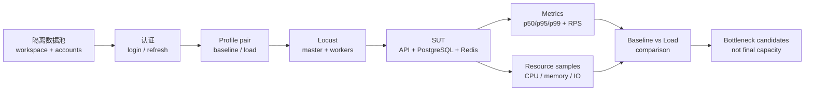
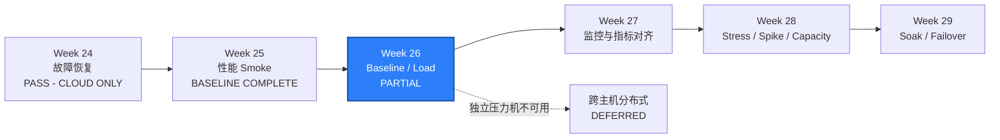

# WEEK-26 - Baseline、Load、数据库数据池与分布式 Locust / Baseline, Load, Database Data Pool, and Distributed Locust

- 计划 / Plan: Week 26，Baseline、Load、数据库数据池与分布式 Locust
- 日期范围 / Date Range: 2026-11-05 to 2026-11-11
- 当前工作区 / Current Worktree: `C:\Users\quan\.codex\worktrees\week25-26-performance-push\Appium 2 study`
- 当前分支 / Current Branch: `codex/week25-26-performance-20261108`
- 基线提交 / Base Commit: `b8ee3bd`（远端 `study/week-20-ios-device-matrix`）
- 计划提交 / Plan Commit: `96e7159`（远端首次发布提交）
- Pull Request: 尚未创建 / Not created
- 状态 / Status: **部分通过 / PARTIAL - ONE-HOST COMPLETE, CROSS-HOST DEFERRED**
- iOS 依赖 / iOS Dependency: 无 / None

## 前置周核对 / Previous Week Audit

### Week 24

正式报告位于独立 worktree：

```text
C:\Users\quan\.codex\worktrees\week-24-recovery\Appium 2 study\reports\weekly\WEEK-24.md
```

仓库相对路径仍为 `reports/weekly/WEEK-24.md`。主工作区看不到该文件，是因为
Week 24 报告属于 `study/week-24-recovery` worktree，不代表报告缺失。

Week 24 的报告结论为 **PASS - DEVICE CLOUD ONLY**，范围为用户指定的设备云
验收路径：

- 6 条 API 故障与恢复用例通过。
- 2 条 Android 15 Emulator 恢复用例通过。
- 2 条 BrowserStack iPhone 15 / iOS 17 恢复用例通过。
- 合并恢复套件为 `8 passed in 90.29s`。
- iOS 设备云 workflow 为 Run `42389853343`。
- `W24-AND-002` 首次执行 `FAILED`，修复 reverse tunnel 后重跑通过，失败历史
  被保留。

以下项目仍是 `NOT RUN`、`BLOCKED` 或 `DEFERRED`，不属于 Week 24 本次通过范围：

- 本地 iOS Simulator 和 WDA 内部故障注入。
- 故障注入下的 iOS API + UI 跨层恢复。
- 无线 ADB 物理设备断连与重连。
- 多云并发和物理 iPhone 恢复矩阵。
- 前一主版本 iOS Simulator。

### Week 25

Week 25 当前报告位于本工作区 `reports/weekly/WEEK-25.md`，状态为
**基线完成 / BASELINE COMPLETE**。本次打开 Week 26 前核对了原始工件：

| 证据 / Evidence | 核对结果 / Audit Result |
| --- | --- |
| `artifacts/performance/week25/smoke_stats.csv` | 107 requests, 0 failures |
| p95 | 22 ms |
| p99 | 24 ms |
| `artifacts/performance/week25/smoke_stats_history.csv` | 存在，含逐时间片历史 |
| `artifacts/performance/week25/smoke.html` | 存在，约 952 KB |
| `tests/unit/test_performance_profile.py` | 本次连同新测试通过，见质量检查 |

核对结论：

- Week 25 已完成其定义的 Smoke 骨架、独立性能环境、只读 Locust 旅程和
  SLO 退出码门禁。
- 107 个请求只代表一次 10 秒、4 用户的本地 Smoke，不是容量结论。
- Week 25 没有覆盖认证旅程、隔离性能数据池、p50、吞吐量、资源指标或
  分布式 Locust。
- Week 25 实现和报告已随 `codex/week25-26-performance-20261108` 发布。

## 计划目标 / Plan Goal

Week 26 把 Week 25 的“能跑一次 Smoke”推进为可重复的 Baseline 与 Load
对照链：

```text
准备隔离性能数据池
-> 获取认证 token
-> 运行同版本 warmup
-> 执行 Baseline
-> 执行 Load
-> 采集延迟、吞吐量和资源样本
-> 比较同版本结果
-> 给出瓶颈候选和下一步实验
```

本周要交付：

1. 一份固定 Baseline profile 和一份固定 Load profile，只改变负载形状。
2. 一个独立于日常测试和固定种子数据的性能数据池。
3. 一条认证读取旅程，以及现有只读业务旅程的稳定命名。
4. p50、p95、p99、错误率、请求数、吞吐量和运行时长。
5. 容器级 CPU、内存、网络和块 IO 样本，以及与时间片关联的原始 CSV。
6. Baseline 与 Load 的结构化结果、差异报告和可复现 manifest。
7. Locust master/worker 拓扑验证；独立压力机不可用时明确保留 `DEFERRED`。
8. 对应用、数据库、Redis、网络或压测机瓶颈给出候选判断。

English summary: turn the Week 25 smoke skeleton into a repeatable
baseline-versus-load workflow with an isolated authenticated data pool,
resource sampling, versioned profiles, and an explicit distributed-Locust
acceptance boundary.

## 完成状态 / Completion Status

**单机范围完成，整体部分通过 / ONE-HOST COMPLETE, OVERALL PARTIAL**

已完成并真实执行：

- Baseline、Load 和分布式 Smoke 三份版本化 profile。
- 幂等性能数据池：1 workspace、16 accounts、100 catalog items。
- 双 run 数据池隔离：清理 run A 后 run B 的数据完整保留。
- 认证登录、token refresh、`/auth/me` 和 catalog 读取旅程。
- p50/p95/p99、错误率、请求数、吞吐量、运行时长和容器资源采样。
- 三次 Baseline 与三次 Load，各含一次不计入结果的 warmup。
- 单主机 Locust master + 1 worker 聚合和最终 SLO gate。
- Baseline/Load `comparison.json`、HTML 报告和失败尝试证据。
- 数据池、runtime 凭据文件、Redis key 和 Compose 服务清理。

未完成：

- 第二台独立压力机上的跨主机 Locust worker 未执行，状态为 `DEFERRED`。
- Week 27 的 Prometheus/Grafana、Trace 和指标时间线不属于本周。

因此单机范围内可以标记 `COMPLETE`；Week 26 整体仍不标记 `COMPLETE`，因为标题
中的“独立压力机分布式验收”仍缺环境证据。

### 实测结果 / Observed Results

| Metric | Baseline median | Load median | Delta |
| --- | ---: | ---: | ---: |
| Total requests | 669 | 1340 | +100.3% |
| Throughput | 11.03 req/s | 22.11 req/s | +100.5% |
| p50 | 7 ms | 8 ms | +14.3% |
| p95 | 16 ms | 18 ms | +12.5% |
| p99 | 24 ms | 26 ms | +8.3% |
| Error rate | 0% | 0% | 0 |

| Service | Baseline CPU | Load CPU | Baseline memory | Load memory |
| --- | ---: | ---: | ---: | ---: |
| API | 5.49% | 8.99% | 51.8 MB | 53.8 MB |
| PostgreSQL | 1.66% | 2.82% | 25.1 MB | 25.2 MB |
| Redis | 0.82% | 1.09% | 7.4 MB | 7.6 MB |

单主机分布式 Smoke：56 requests、0 failures、p50 9 ms、p95 23 ms、
p99 25 ms、SLO `PASS`。

## 计划范围 / Planned Scope

### 1. Baseline 与 Load Profile

新增两份版本化 profile，复用现有 `PerformanceProfile` 和行程实现：

| Profile | Users | Spawn rate | Duration | 用途 |
| --- | ---: | ---: | ---: | --- |
| `configs/performance-baseline.yaml` | 4 | 2/s | 60s | 稳定参考 |
| `configs/performance-load.yaml` | 8 | 4/s | 60s | 预期负载对照 |

约束：

- 两份 profile 使用相同 base URL、workspace、旅程权重、think time 和阈值版本。
- Baseline 与 Load 只改变 `users`、`spawn_rate`，不改变业务混合比例。
- profile 名称、文件哈希、运行时间和 commit 必须写入结果 manifest。
- 每个 profile 先执行一次不计入统计的 warmup，再执行三次测量。
- 结果使用三次运行的中位数；同时保留每次原始结果，不删除异常运行。
- 阈值必须在运行前固定。看到结果后再调整阈值会使对照失效。

Week 25 的 `performance-smoke.yaml` 保持兼容，不覆盖历史 Smoke 证据。

### 2. 隔离性能数据池

固定使用 `atlas` 种子数据只能证明读取路径存在，无法证明性能数据隔离。Week 26
新增显式的 test-only 数据池：

```text
run_id
+ unique workspace slug
+ owner account
+ viewer account
+ stable catalog dataset
+ token/session material
+ cleanup manifest
```

计划行为：

- 每次性能运行使用唯一 `run_id` 和 workspace slug。
- 创建 1 个 workspace、至少 2 个账号和一组固定规模的 catalog item。
- 账号、密码和 token 只进入本地临时文件或进程环境，不打印、不提交。
- provisioning 必须幂等；相同 `run_id` 重试不会创建重复对象。
- cleanup 必须幂等，并验证 workspace、用户、catalog item、Redis key 和
  临时文件无残留。
- 数据池只连接独立性能 Compose 的 PostgreSQL，不连接日常环境或生产环境。
- 直接数据库准备仅允许使用专用 test-only 账号；若后续提供测试建数 API，
  优先通过 API 准备。

数据池模拟的是“每位虚拟用户拿到自己的测试账号”，像考试前按座位号发卷，
而不是所有考生抢同一张答题卡。这样认证和读取结果不会因共享状态互相污染。

### 3. 认证读取旅程

在现有三条只读请求上增加认证路径：

| 旅程 / Journey | 计划行为 / Planned Behavior | 指标名称 / Name |
| --- | --- | --- |
| login | 虚拟用户启动时从数据池取得账号并登录 | `POST login` |
| refresh | 运行超过 token 生命周期后刷新一次 | `POST token refresh` |
| current user | 使用 token 读取当前用户与 workspace | `GET auth me` |
| catalog | 读取当前 workspace catalog | `GET catalog` |
| OpenAPI | 检查契约入口 | `GET openapi` |
| liveness | 检查进程存活 | `GET health live` |

约束：

- 登录和刷新使用命名请求，不能混入匿名聚合结果。
- 每个 worker 使用唯一账号或 token，避免同一 refresh token 被并发消费。
- 请求失败时保留 HTTP 状态和旅程名称，不记录完整 Authorization header。
- 认证失败直接让运行失败，不能回退到匿名 `atlas` 请求。
- token 只在内存和受忽略的本地环境中保存。

### 4. 指标与资源采样

Week 25 只结构化 p95、p99、错误率和请求数。Week 26 扩展为：

```text
p50 / p95 / p99
+ total requests
+ requests per second
+ error rate
+ run duration
+ users / spawn rate
+ container CPU / memory / network / block IO
```

计划新增一个资源采样入口，使用 Docker CLI 对以下服务按固定间隔采样：

- `api`
- `postgres`
- `redis`
- 可选 `toxiproxy`，仅当该环境启用时

输出至少包含：

```text
timestamp
run_id
profile
service
cpu_percent
memory_usage_bytes
memory_limit_bytes
network_received_bytes
network_sent_bytes
block_read_bytes
block_write_bytes
```

约束：

- Docker 本身是采样工具，不是完整监控系统。
- CPU 百分比和容器内存必须绑定具体 service，不能只记录宿主机总数。
- 每份 Locust 结果和资源 CSV 使用相同 `run_id` 与时间基准。
- Week 27 才接入 Prometheus/Grafana；Week 26 不声称已有完整可观测性。
- 若 Docker daemon 或容器不存在，运行结果为 `BLOCKED`，不能生成空文件后
  宣称资源采集通过。

### 5. Locust 分布式拓扑

分布式 Locust 分两个门：

| 门 / Gate | 验收 / Acceptance | 当前计划 |
| --- | --- | --- |
| 单主机 master + worker | 1 master + 1 worker 能聚合统计并执行 SLO gate | Week 26 核心 |
| 独立压力机 | 至少 2 台主机运行 Locust workers，SUT 地址可达 | 环境可用时执行 |

单主机多进程只证明 master/worker 协议和结果聚合，不证明压测机资源隔离。
独立压力机需要单独报告：

- 压力机 host role、worker 数量、CPU 和网络位置。
- SUT 的可达地址和防火墙边界。
- master 聚合后的总请求数、错误率、p50/p95/p99。
- 每台压力机的 Locust 日志与 worker 退出码。

没有第二台合法测试主机时，这一项保持 `DEFERRED`，Week 26 最多判定为
`PARTIAL`，不能把本机两个进程写成“跨主机分布式压测”。

### 6. Baseline / Load 对照

三次 Baseline 和三次 Load 完成后生成结构化比较：

| 指标 / Metric | 比较方式 / Comparison |
| --- | --- |
| p50 / p95 / p99 | Load 相对 Baseline 的绝对值和百分比变化 |
| requests/s | 两档吞吐量和增幅 |
| error rate | 两档是否越过同一阈值 |
| CPU / memory | API、PostgreSQL、Redis 的变化 |
| network / block IO | 是否出现异常增幅 |
| request mix | 各命名请求占比是否保持 |

输出：

```text
artifacts/performance/week26/<run-id>/
  manifest.json
  baseline/
    run-01/
    run-02/
    run-03/
    summary.json
  load/
    run-01/
    run-02/
    run-03/
    summary.json
  resources/
    baseline.csv
    load.csv
  comparison.json
  report.html
```

比较只说明本次环境中的相关性，不直接证明因果。例如 API CPU 和 p95 同时上升
只能形成“应用层可能是瓶颈”的候选，仍需 Week 27 的 Prometheus、数据库和
Redis 指标对齐。

### 7. 数据库数据池验证

性能数据池完成后至少验证：

- 每个 run 的 workspace slug 唯一。
- 认证用户只能读取自己的 workspace。
- 同一 catalog 查询的响应 workspace 与 profile 一致。
- 三次运行之间没有数据漂移。
- stale run 可以按 `run_id` 清理，且不会删除当前 run。
- 清理前后对象计数可追踪。

数据库写入仅限专用性能测试环境。默认数据库访问仍为只读，只有显式
provision/cleanup 命令可写。

### 8. 证据与审查

每次运行保存：

```text
run_id
+ profile name + profile SHA-256
+ git commit + worktree status
+ Locust version + Python version
+ Docker Compose project
+ container image digests
+ start/end time
+ user count + spawn rate + duration
+ named request results
+ SLO pass/fail
+ resource CSV
+ cleanup result
```

敏感信息不得写入 manifest：

- Authorization header。
- access token / refresh token。
- 密码或数据库凭证。
- 完整 UDID 或供应商账号。

## 不在本周范围 / Out of Scope

- Week 27 的 Prometheus、Grafana、Trace 和数据源时间线对齐。
- Week 28 的 Stress、Spike、容量拐点和排队模型。
- Week 29 的 Soak、Failover、慢查询、锁、WAL 和 Redis 淘汰深挖。
- 生产环境或公共环境压测。
- 以一次负载结果宣布容量上限或生产 SLA。
- 移动端启动、jank、CPU、内存、电量和弱网指标。
- 修复 Week 19 WebView context 和通知中心系统 UI 缺口。
- 解锁前一主版本 iOS Simulator。
- Agent 自动修改阈值或宣布性能通过。

## 术语解释 / Glossary

| 名词 / Term | 简单解释 / Plain Meaning | 作用 / Purpose | 在本项目中的位置 / Position |
| --- | --- | --- | --- |
| Baseline | 固定版本和环境下重复测得的参考结果 | 后续比较的尺子 | `performance-baseline.yaml` |
| Load | 按预期业务负载运行测试 | 看预期压力下是否达标 | `performance-load.yaml` |
| Warmup | 不计入结果的预热运行 | 避免冷启动污染正式样本 | Week 26 runner |
| Data Pool | 预先准备且可追踪归属的测试数据集合 | 隔离账号和业务对象 | 性能 workspace + accounts |
| Throughput | 单位时间完成的请求数 | 描述系统处理速度 | requests/s |
| p50 | 50% 请求不高于该耗时 | 看典型体验 | summary/manifest |
| p95 | 95% 请求不高于该耗时 | 看大多数用户体验边界 | SLO 和 comparison |
| p99 | 99% 请求不高于该耗时 | 看长尾延迟 | summary/manifest |
| Master | Locust 汇总统计和控制运行的角色 | 聚合 worker 结果 | distributed mode |
| Worker | 实际生成负载的 Locust 进程 | 水平和跨主机扩展 | distributed mode |
| Bottleneck Candidate | 有证据支持但仍需继续验证的嫌疑层 | 防止过早归因 | comparison report |
| CoV / Coefficient of Variation | 标准差相对均值的比例 | 判断三次运行是否稳定 | Week 26 可选分析 |

## 通俗解读 / Plain-Language Guide

Week 25 像让一辆车在空地上开 10 秒，证明发动机能启动；Week 26 要先给每辆车
发独立油卡（数据池），然后在同一条路线上分别跑“轻载”和“标准载重”，同时
记录仪表盘上的速度、排队时间和发动机温度。



映射回项目：

- 数据池和认证旅程进入 `performance/` 与 test-only seeding 入口。
- 指标模型继续放在 `packages/qa_core/performance/`。
- Locust 入口继续放在 `performance/locustfiles/`。
- 资源原始证据进入 `artifacts/performance/week26/`。
- 对照解释更新 `docs/performance/load-model.md` 和 runbook。

**一句话理解：** 先用独立数据把尺子校准，再用同一把尺子比较轻载和标准负载。

## 计划在整体路线中的位置 / Plan Position



Week 26 依赖 Week 25 的独立 Compose、类型化 profile 和 Locust SLO gate。
它为 Week 27 的监控、Week 28 的容量拐点和 Week 29 的长稳恢复提供可比基线。

## 实施顺序 / Implementation Order

1. 审计 Week 25 profile、测试和现有工件，确认兼容边界。
2. 扩展性能模型，加入 p50、吞吐量、duration 和资源样本契约。
3. 增加 Baseline/Load profile 及 profile 哈希、结果 manifest。
4. 实现 test-only 数据池 provisioning、验证和幂等清理。
5. 增加认证登录、token refresh 和 `/auth/me` 命名旅程。
6. 增加 Docker 资源采样和 `run_id` 关联。
7. 将 Week 25 固定的 `week25` 工件路径改为按 profile/run 参数化。
8. 先执行功能 readiness 和一次 Smoke 回归。
9. 执行 warmup、三次 Baseline、warmup、三次 Load。
10. 生成 comparison、HTML 和资源时间线，保留每次原始 CSV。
11. 验证单主机 Locust master/worker 聚合。
12. 有第二台合法测试主机时执行跨主机 worker；否则保留 `DEFERRED`。
13. 更新负载模型、triage runbook、周报和文档索引。

## 验收方式 / Acceptance Method

### 前置条件 / Preconditions

- 使用项目 `.venv`、Python 3.12 和锁定的 uv 依赖。
- Docker Desktop Linux engine 已运行。
- 独立 Compose project 固定为 `quality-engineering-lab-performance`。
- API、PostgreSQL、Redis readiness 全部通过。
- 性能数据池使用显式 test-only 账号和独立 workspace。
- 不读取或打印生产凭据、token、证书和完整设备标识。
- 运行前关闭其他高负载任务，记录宿主机资源状态。
- 不与其他性能实验并行运行。

### 静态检查 / Static Checks

```powershell
uv run python scripts/build_doc_index.py
uv run python scripts/build_doc_index.py --check
uv run python -m pytest tests\unit -q -p no:cacheprovider
```

预期结果：

- 文档索引包含 `reports/weekly/WEEK-26.md`。
- `--check` 无差异。
- Week 25 profile 测试仍通过。

### 性能环境 / Performance Environment

```powershell
.\scripts\start_performance_sut.ps1 -WaitSeconds 180
```

预期结果：

```text
API: PASS
PostgreSQL: PASS
Redis: PASS
SUT ready: True
```

### 数据池 / Data Pool

实际入口：

```powershell
.\scripts\prepare_performance_data.ps1 `
  -RunId week26-local `
  -WorkspaceSlug qa-perf-week26-local `
  -ItemCount 100 `
  -AccountCount 16
```

通过标准：

- 唯一 workspace、owner、viewer 和稳定 catalog 数据集创建成功。
- provisioning 重试结果幂等。
- 认证后 `/api/v1/auth/me` 与 `/catalog` 读取同一 workspace。
- token 和密码不出现在 stdout、manifest 或 Git 状态中。

### Warmup、Baseline 与 Load

实际入口：

```powershell
.\scripts\run_performance_profile.ps1 `
  -Profile configs\performance-baseline.yaml `
  -Label baseline `
  -OutputDir artifacts\performance\week26\week26-local `
  -DataFile artifacts\performance\week26\data\week26-local\runtime.json `
  -WarmupSeconds 15 `
  -MeasuredRuns 3

.\scripts\run_performance_profile.ps1 `
  -Profile configs\performance-load.yaml `
  -Label load `
  -OutputDir artifacts\performance\week26\week26-local `
  -DataFile artifacts\performance\week26\data\week26-local\runtime.json `
  -WarmupSeconds 15 `
  -MeasuredRuns 3
```

通过标准：

- 两个 profile 都完成三次可分析运行。
- 每次运行都有命名请求、p50/p95/p99、错误率、RPS 和资源 CSV。
- 数据池、profile 和 commit 可追溯到同一 manifest。
- 一次失败或 SLO 越界不能通过重跑覆盖；必须保留失败和最终结论。

### 分布式 Locust

单主机拓扑实际入口：

```powershell
.\scripts\run_distributed_locust.ps1 `
  -DataFile artifacts\performance\week26\data\week26-local\runtime.json `
  -OutputDir artifacts\performance\week26\week26-local\distributed-local `
  -RunId week26-distributed-local `
  -Role local `
  -ExpectedWorkers 1
```

通过标准：

- master 与 worker 都正常退出。
- master 聚合结果与 SLO gate 可读取。
- 日志能区分 master、worker 和 SUT 错误。

跨主机路径必须另行保存两台主机的 role、worker 数量和聚合结果。仅有
`HostMode local` 时，不得把跨主机分布式验收写成 `PASS`。

### 清理 / Cleanup

```powershell
.\scripts\cleanup_performance_data.ps1 `
  -RunId week26-local `
  -WorkspaceSlug qa-perf-week26-local
.\scripts\stop_performance_sut.ps1
```

需要删除独立性能卷时：

```powershell
.\scripts\stop_performance_sut.ps1 -RemoveVolumes
```

删除卷前必须确认 project name 是 `quality-engineering-lab-performance`。

### 预期结果 / Expected Results

```text
Baseline: 3 measured runs + raw evidence
Load: 3 measured runs + raw evidence
Data pool: isolated and cleaned
Resource samples: API/PostgreSQL/Redis present
Comparison: p50/p95/p99/RPS/resource deltas present
Distributed local topology: PASS or explicit FAILED
Cross-host distributed: PASS or DEFERRED
Week completion: COMPLETE only when every required gate has real evidence
```

本次实际结论：

```text
Baseline: PASS
Load: PASS
Data pool cleanup: PASS
Resource samples: PASS
Comparison: PASS
Distributed local topology: PASS
Cross-host distributed: DEFERRED
Week 26: PARTIAL
```

### 证据路径 / Evidence

- Baseline profile: `configs/performance-baseline.yaml`
- Load profile: `configs/performance-load.yaml`
- Locust journeys: `performance/locustfiles/api_journeys.py`
- Performance models: `packages/qa_core/performance/`
- Data pool: `packages/qa_core/performance/data_pool.py`
- Resource sampler: `packages/qa_core/performance/resources.py`
- Data pool evidence: `artifacts/performance/week26/data/week26-local/metadata.json`
- Isolation evidence: `artifacts/performance/week26/isolation-verification.json`
- Raw results: `artifacts/performance/week26/<run-id>/`
- Distributed result: `artifacts/performance/week26/week26-local/distributed-local/result.json`
- Comparison: `artifacts/performance/week26/week26-local/comparison.json`
- HTML comparison: `artifacts/performance/week26/week26-local/report.html`
- Architecture: `docs/performance/load-model.md`
- Runbook: `docs/runbooks/performance-smoke-triage.md`
- Weekly result: `reports/weekly/WEEK-26.md`

### 未验证项 / Unverified Items

以下仍未验证：

- 第二台独立压力机上的跨主机 Locust：`DEFERRED`。
- 跨主机网络、时钟同步和多 worker 聚合：`NOT RUN`。
- Week 27 的 Prometheus/Grafana、Trace、PostgreSQL/Redis 时间线：不属于本周。

继承但不由 Week 26 解锁：

- 前一主版本 iOS Simulator：`BLOCKED`。
- iOS WebView context：严格 `xfail`。
- 通知中心系统 UI：`NOT RUN`。
- 物理 iPhone 和完整真机矩阵：`DEFERRED`。

## 变更文件 / Files Changed

- `configs/performance-baseline.yaml`
- `configs/performance-load.yaml`
- `configs/performance-distributed-smoke.yaml`
- `packages/qa_core/performance/models.py`
- `packages/qa_core/performance/data_pool.py`
- `packages/qa_core/performance/resources.py`
- `packages/qa_core/performance/results.py`
- `packages/qa_core/performance/__init__.py`
- `performance/locustfiles/api_journeys.py`
- `scripts/prepare_performance_data.py`
- `scripts/cleanup_performance_data.py`
- `scripts/verify_performance_data_pool_isolation.py`
- `scripts/run_performance_profile.py`
- `scripts/compare_performance_runs.py`
- `scripts/run_distributed_locust.py`
- `scripts/prepare_performance_data.ps1`
- `scripts/cleanup_performance_data.ps1`
- `scripts/verify_performance_data_pool_isolation.ps1`
- `scripts/run_performance_profile.ps1`
- `scripts/compare_performance_runs.ps1`
- `scripts/run_distributed_locust.ps1`
- `tests/unit/test_performance_profile.py`
- `tests/unit/test_week26_performance.py`
- `docs/performance/load-model.md`
- `docs/runbooks/performance-smoke-triage.md`
- `docs/PLAN.md`
- `reports/weekly/WEEK-26.md`
- `reports/README.md`（由索引脚本刷新）

## 环境 / Environment

- Windows + PowerShell
- Python 3.12.13
- Locust 2.47.0
- Docker Compose v5.5.1
- Docker engine：29.8.1，Linux containers
- 项目虚拟环境：`.venv`
- 性能 Compose：已真实启动、执行并停止
- API：`127.0.0.1:28000`
- PostgreSQL：`127.0.0.1:25432`
- Redis：`127.0.0.1:36379`
- 独立压力机：没有第二台合法测试主机，跨主机验收 `DEFERRED`
- iOS：不属于 Week 26

## 质量检查 / Quality Checks

| 检查项 / Check | 结果 / Status | 执行环境 / Environment | 证据 / Evidence |
| --- | --- | --- | --- |
| Week 24 report audit | 通过 / PASS | Windows | Report and committed worktree evidence inspected |
| Week 25 report/artifact audit | 通过 / PASS | Windows | 107 requests, 0 failures, p95 22 ms, p99 24 ms |
| Week 26 report/index build | 通过 / PASS | Windows | `build_doc_index.py` updated `reports/README.md` |
| Week 26 report/index check | 通过 / PASS | Windows | `entry pages are up to date.` |
| Week 25 profile regression | 通过 / PASS | Windows | Included in `9 passed in 0.17s` |
| Week 26 report link | 通过 / PASS | Windows | `reports/README.md` points to `weekly/WEEK-26.md` |
| Dependency sync | 通过 / PASS | Windows | `uv sync`, 78 packages installed |
| Ruff | 通过 / PASS | Windows | `All checks passed!` |
| Mypy | 通过 / PASS | Windows | `Success: no issues found in 169 source files` |
| Full unit regression | 通过 / PASS | Windows | `306 passed in 9.16s` |
| Week 26 contract tests | 通过 / PASS | Windows | `9 passed in 0.17s` |
| PowerShell syntax | 通过 / PASS | Windows | All scripts parsed successfully |
| JSON evidence validation | 通过 / PASS | Windows | 34 evidence files parsed |
| Resource sample presence | 通过 / PASS | Windows | Six measured runs have samples |
| Python version | 通过 / PASS | Windows | Python 3.12.13 |
| Locust version | 通过 / PASS | Windows | Locust 2.47.0 |
| Docker engine | 通过 / PASS | Windows | Server 29.8.1 |
| Performance SUT readiness | 通过 / PASS | Isolated Compose | `SUT ready: True` |
| Data pool provisioning | 通过 / PASS | PostgreSQL | `1 workspace / 16 users / 100 items` |
| Data pool idempotency | 通过 / PASS | PostgreSQL | Repeated provision kept counts unchanged |
| Dual-run data isolation | 通过 / PASS | PostgreSQL + Redis | A cleaned, B preserved, then both zero |
| Authenticated preflight | 通过 / PASS | Windows + Compose | 53 requests, 0 failures |
| Baseline profile | 通过 / PASS | Windows + Compose | 3 runs, 669 requests, p95 16 ms |
| Load profile | 通过 / PASS | Windows + Compose | 3 runs, 1340 requests, p95 18 ms |
| Resource sampling | 通过 / PASS | Docker CLI | API/PostgreSQL/Redis CSV samples |
| Comparison report | 通过 / PASS | Windows | `comparison.json` + `report.html` |
| Distributed local topology | 通过 / PASS | Windows | 56 requests, 0 failures, master SLO pass |
| Week 25 smoke compatibility | 通过 / PASS | Windows + Compose | 108 requests, 0 failures, exit 0 |
| Week 25 artifact preservation | 受限 / LIMITED | Windows | Original raw files overwritten; historical values remain in WEEK-25 |
| Cleanup | 通过 / PASS | PostgreSQL + Redis | `workspaces=0, users=0, items=0` |
| Runtime credential removal | 通过 / PASS | Windows | `runtime.json` removed |
| Initial baseline resource parse | 失败 / FAILED | Windows | Docker emitted `1e+03kB`; parser fixed |
| Initial distributed worker exit | 失败 / FAILED | Windows | Worker evaluated empty stats; fixed |
| Cross-host load generators | 延期 / DEFERRED | Independent hosts | No second host confirmed |
| iOS gaps | 继承 / INHERITED | macOS / iPhone | No Week 26 claim |

`PASS`、`FAILED`、`BLOCKED`、`NOT RUN` 和 `DEFERRED` 必须保留原始语义。

## 风险与限制 / Risks and Limitations

- 性能运行 manifest 记录了当时混合工作区的 `worktree_dirty=true`；远端发布分支
  是整理后的快照，不等于原始运行工作区的 Git 状态。
- 同一 Windows 主机同时运行 SUT、PostgreSQL、Redis、Locust 和资源采样，
  可能互相竞争 CPU、内存和磁盘 IO。
- 三次运行仍不足以证明长期稳定；Week 29 才覆盖 Soak。
- 固定种子数据不能替代隔离数据池，匿名共享数据会让结果互相污染。
- 登录和 refresh 会写 Redis 状态，必须使用唯一账号并清理 token。
- p50 只描述典型值，不能替代 p95/p99 和错误率。
- 资源采样只来自 Docker CLI，不能替代 Prometheus 时间序列和数据库内部指标。
- 单主机 master/worker 不证明独立压力机能力。
- 首次 Baseline 因 Docker 科学计数法输出失败；修复后用三次新运行完成。
- 首次分布式拓扑的 worker 因空统计 SLO 误判返回 1；修复后 master/worker
  正常退出。两次失败证据均保留在独立目录。
- 如果跨主机分布式是本周硬性验收而环境不可用，Week 26 必须保持
  `PARTIAL`，不能标记 `COMPLETE`。
- 瓶颈判断必须保留证据和置信边界，不能把相关性写成确定因果。

## 下一步 / Next Plan

Week 27 的下一步：

1. 接入 Prometheus 和 Grafana。
2. 采集 API、PostgreSQL、Redis 和容器指标。
3. 通过 Trace ID 和 run ID 对齐请求、数据库和缓存时间线。
4. 用 Week 26 Baseline/Load 结果验证监控能否解释延迟变化。
5. 补充慢查询、连接池、Redis 命中率和内存指标。

Week 26 收口结论：

- Baseline 和 Load 各有三次真实测量运行。
- 数据池已隔离、幂等准备并完成清理。
- 双 run 选择性清理已验证，不会误删另一个 performance run。
- p50/p95/p99、RPS、错误率和资源样本完整。
- 单主机 master/worker 通过。
- 跨主机分布式为 `DEFERRED`。
- Week 26 结论为 `PARTIAL`，不是 `COMPLETE`。
