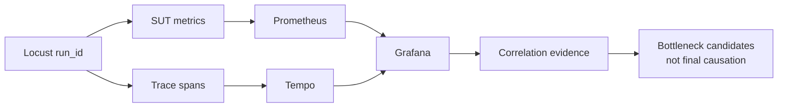
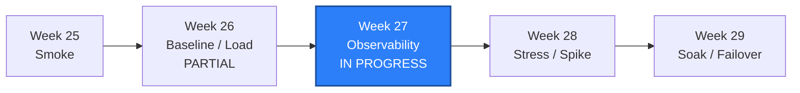

# WEEK-27 - Prometheus、Grafana、Trace 与 PostgreSQL/Redis 指标 / Prometheus, Grafana, Trace, and Database/Cache Metrics

- 计划 / Plan: Week 27，性能监控面板与指标时间线
- 计划日期范围 / Planned Date Range: 2026-11-12 to 2026-11-18
- 实际开启日期 / Opened: 2026-11-10，按用户要求提前开启
- 当前工作区 / Current Worktree: `D:\Codex projects\Appium 2 study`
- 当前分支 / Current Branch: `study/week-20-ios-device-matrix`
- 基线提交 / Base Commit: `a1c0306`，其上有未提交的 Week 25/26 实现
- 状态 / Status: **进行中 / IN PROGRESS - API METRICS PASS, MONITORING STACK BLOCKED**
- iOS 依赖 / iOS Dependency: 无 / None

## 前置周核对 / Previous Week Audit

Week 26 报告位于 `reports/weekly/WEEK-26.md`，结论为：

```text
Week 26: PARTIAL
Single-host performance workflow: COMPLETE
Cross-host distributed Locust: DEFERRED
```

本次重新核对了以下证据：

| 证据 / Evidence | 核对结果 / Audit Result |
| --- | --- |
| `comparison.json` | Baseline 669 requests、Load 1340 requests |
| p95 / p99 | Baseline 16/24 ms，Load 18/26 ms |
| `distributed-local/result.json` | 56 requests、0 failures、SLO PASS |
| `isolation-verification.json` | Run A 清理后 Run B 数据保留 |
| `metadata.json` | 1 workspace、16 accounts、100 items |
| Week 26 targeted tests | `9 passed in 0.17s` |

Week 26 的跨主机分布式 Locust 仍是 `DEFERRED`，没有第二台合法测试主机。
Week 27 不修改这个历史结论，也不把 Week 26 自动提升为 `COMPLETE`。

## 本周目标 / Weekly Goal

Week 27 要从“能保存几次资源样本”升级为可查询的性能观测链：

```text
Locust run_id
-> SUT /metrics
-> Prometheus 抓取 API / PostgreSQL / Redis / container
-> Tempo 保存请求 Trace
-> Grafana 在统一时间窗口展示
-> 人类结合 Week 26 Baseline/Load 形成瓶颈候选
```

本周核心交付：

1. SUT Prometheus 指标与低基数 route label。
2. `X-Request-Id`、`X-Trace-Id`、W3C Trace Context 关联。
3. Prometheus scrape 配置和 PostgreSQL/Redis/cAdvisor exporter。
4. Grafana datasource、Dashboard 文件化 provisioning。
5. Tempo OTLP HTTP 接入和按精确 Trace ID 查询。
6. 一键启动、验证脚本、unit contract 和真实 acceptance 命令。
7. 将 Week 26 Baseline/Load 与 Week 27 时间线关联。

## 完成状态 / Completion Status

### 已完成 / Completed

- SUT `/metrics` endpoint 已实现。
- 请求 Counter、latency Histogram 和 in-progress Gauge 已实现。
- 动态 route label 已归一化为 `{slug}`、`{item_id}`、`{job_id}`。
- Locust 已发送 `X-QA-Run-Id`。
- SUT 已返回 `X-Request-Id` 和 `X-Trace-Id`。
- OTLP HTTP exporter 和 Tempo Compose 配置已实现。
- Prometheus、Grafana、Tempo、PostgreSQL/Redis exporter、cAdvisor 配置已实现。
- `monitoring` Compose profile 和启动/验证脚本已实现。
- Week 27 unit contract tests 已通过。
- Compose 配置静态解析已通过。
- API metrics 和 Trace 头已在本机 Python 进程真实执行。

### 未完成或阻塞 / Incomplete or Blocked

- Prometheus 容器未启动：镜像拉取网络超时，`BLOCKED`。
- Grafana 容器未启动：同一次镜像拉取失败，`NOT RUN`。
- Tempo 容器未启动：同一次镜像拉取失败，`NOT RUN`。
- PostgreSQL/Redis exporter 和 cAdvisor：镜像未拉取，`NOT RUN`。
- Prometheus target、Grafana dashboard、Tempo trace retrieval 的真实 acceptance：
  `BLOCKED`，等待可信镜像来源恢复。
- 与 Week 26 Baseline/Load 的完整时间线叠加：`NOT RUN`。

因此本周当前只能标记 `IN PROGRESS`，不能标记 `PASS` 或 `COMPLETE`。

### 真实执行证据 / Observed Evidence

API 本地进程：

```text
STATUS 200
X-REQUEST-ID 3f1f003f5f4940108f99393a3abb8c71
X-TRACE-ID 3aa6ca8baea5def374ef921311086cc1
qa_sut_http_requests_total{method="GET",route="/health/live",status="200"} 1.0
qa_sut_last_request_run_info{run_id="week27-local-probe"} 1.0
```

监控栈启动失败证据：

```text
Error response from daemon:
Get "https://registry-1.docker.io/v2/":
net/http: request canceled while waiting for connection
(Client.Timeout exceeded while awaiting headers)
```

随后尝试官方 `mirror.gcr.io` 缓存，Prometheus 镜像部分层开始下载，但后续请求：

```text
Error response from daemon:
Get "https://mirror.gcr.io/v2/":
context deadline exceeded (Client.Timeout exceeded while awaiting headers)
```

该失败属于镜像来源网络阻塞，不是 Compose YAML 解析失败。

## 术语解释 / Glossary

| 名词 / Term | 简单解释 / Plain Meaning | 作用 / Purpose | 在本项目中的位置 / Position |
| --- | --- | --- | --- |
| Metric | 可聚合的数值事实，例如请求数或 CPU | 看趋势和阈值 | `/metrics`、Prometheus |
| Label | 指标维度，例如 route 和 status | 支持分组查询 | `qa_sut_http_requests_total` |
| Cardinality | label 组合的数量 | 过高会膨胀存储和查询 | route 必须模板化 |
| Trace | 一次请求跨步骤的结构化调用记录 | 解释单次耗时 | Tempo |
| Span | Trace 中一个有时间边界的操作 | 组成调用树 | SUT HTTP span |
| OTLP | OpenTelemetry 的遥测导出协议 | 把 span 发给 Tempo | API exporter |
| Exporter | 把组件内部状态转成 Prometheus 指标的服务 | 统一采集协议 | PostgreSQL / Redis exporter |
| Provisioning | 用文件定义 Grafana 数据源和 Dashboard | 可重建、可审查 | `infra/monitoring/grafana` |
| Trace ID | 一次 Trace 的全局标识 | 精确关联请求与 span | `X-Trace-Id` |
| Run ID | 一次 Locust 负载运行的标识 | 关联压测结果与指标窗口 | `X-QA-Run-Id` |

## 通俗解读 / Plain-Language Guide

Week 26 像每跑完一圈就手写一张仪表读数；Week 27 则把转速表、油温表、
数据库仪表和一次行程记录同时接到同一块面板上。面板显示“转速高”仍然只是
线索，不能直接断言发动机就是唯一原因。



**一句话理解：** 先把同一段时间里的请求、数据库、缓存、资源和 Trace 接到一根
时间轴上，再讨论瓶颈。

## 计划位置 / Plan Position



Week 27 使用 Week 26 的 Profile、run id 和 Baseline/Load 结果作为分析输入。
它为 Week 28 的容量拐点和 Week 29 的长稳退化判断提供可查询时间序列。

## 验收方式 / Acceptance Method

### 静态检查

```powershell
uv run python -m ruff check .
uv run pytest tests\unit\test_week27_observability.py -q -p no:cacheprovider
docker compose --profile monitoring `
  --env-file .env.performance.example `
  -f apps\compose\compose.yaml config --quiet
```

### 真实监控栈

```powershell
.\scripts\start_performance_sut.ps1 -WaitSeconds 240 -Monitoring
.\scripts\verify_observability.ps1 -WaitSeconds 90
```

通过标准：

```text
API exposes request metrics and trace headers
Prometheus sut-api/postgres/redis/cadvisor targets are up
Grafana health is HTTP 200
Grafana provisions dashboard uid week27-sut-overview
Tempo /ready is HTTP 200
Tempo retrieves the exact X-Trace-Id
```

### 证据路径 / Evidence

- API: `apps/compose/api/app.py`
- Compose profile: `apps/compose/compose.yaml`
- Prometheus: `infra/monitoring/prometheus/prometheus.yml`
- Grafana datasource: `infra/monitoring/grafana/provisioning/datasources/`
- Grafana dashboard: `infra/monitoring/grafana/dashboards/week27-overview.json`
- Tempo: `infra/monitoring/tempo/tempo.yaml`
- Verification script: `scripts/verify_observability.py`
- Runtime evidence: `artifacts/performance/week27/observability.json`（Git 忽略）

## 质量检查 / Quality Checks

| 检查项 / Check | 结果 / Status | 执行环境 / Environment | 证据 / Evidence |
| --- | --- | --- | --- |
| Week 26 evidence audit | 通过 / PASS | Windows | comparison、isolation、distributed result inspected |
| Week 26 targeted regression | 通过 / PASS | Windows | `9 passed in 0.17s` |
| Week 27 unit contracts | 通过 / PASS | Windows | `14 passed in 1.17s` |
| Full unit regression | 通过 / PASS | Windows | `311 passed in 8.34s` |
| Ruff | 通过 / PASS | Windows | `All checks passed!` |
| Mypy | 通过 / PASS | Windows | `Success: no issues found in 170 source files` |
| Python interpreter | 通过 / PASS | Windows | `.venv\Scripts\python.exe`, Python 3.12.13 |
| Python compile | 通过 / PASS | Windows | `py_compile` exit 0 |
| Compose config | 通过 / PASS | Windows Docker CLI | `config --quiet` exit 0 |
| API local metrics | 通过 / PASS | Windows Python process | request/histogram/run-info metrics observed |
| API trace headers | 通过 / PASS | Windows Python process | request id and trace id observed |
| OTLP export to Tempo | 阻塞 / BLOCKED | Windows local process | connection refused; Tempo not running |
| Prometheus stack | 阻塞 / BLOCKED | Docker | mirror/registry connection timeout |
| Grafana dashboard runtime | 未运行 / NOT RUN | Docker | image unavailable |
| Tempo trace retrieval | 未运行 / NOT RUN | Docker | image unavailable |
| Database/cache exporters | 未运行 / NOT RUN | Docker | images unavailable |
| cAdvisor | 未运行 / NOT RUN | Docker | image unavailable |
| Week 26 cross-host Locust | 继承延期 / DEFERRED | Independent hosts | no second host |
| iOS gaps | 继承 / INHERITED | macOS / iPhone | no Week 27 claim |

## 变更文件 / Files Changed

- `apps/compose/api/app.py`
- `apps/compose/api/requirements.txt`
- `apps/compose/compose.yaml`
- `performance/locustfiles/api_journeys.py`
- `scripts/start_sut.ps1`
- `scripts/start_performance_sut.ps1`
- `scripts/verify_observability.py`
- `scripts/verify_observability.ps1`
- `infra/monitoring/prometheus/prometheus.yml`
- `infra/monitoring/tempo/tempo.yaml`
- `infra/monitoring/grafana/provisioning/datasources/datasources.yml`
- `infra/monitoring/grafana/provisioning/dashboards/dashboards.yml`
- `infra/monitoring/grafana/dashboards/week27-overview.json`
- `tests/unit/test_week27_observability.py`
- `tests/integration/test_observability.py`
- `docs/architecture/performance-observability.md`
- `docs/runbooks/monitoring-stack-triage.md`
- `docs/adr/0012-performance-observability-and-trace-correlation.md`
- `docs/performance/load-model.md`
- `docs/PLAN.md`（仅状态说明）
- `README.md`
- `.env.performance.example`
- `pyproject.toml`
- `uv.lock`
- `reports/weekly/WEEK-27.md`

## 风险与限制 / Risks and Limitations

- Docker 镜像来源不可达会阻塞整条监控栈，不能用静态配置代替。
- Grafana 使用本机匿名管理员，仅适用于隔离学习环境。
- 当前数据库和 Redis 只有 exporter 指标，没有自动 OTel 客户端 Trace。
- Trace span 覆盖 HTTP 请求，不包含完整 SQL 和 Redis command span。
- cAdvisor 在 Docker Desktop 上的容器 label 和挂载行为仍需真实运行确认。
- Dashboard JSON 通过结构契约测试不等于 Grafana 已成功渲染。
- 当前工作树有大量未提交改动，必须以实际文件状态和后续 commit 为准。

## 下一步 / Next Plan

1. 在可信镜像来源恢复后重新执行 monitoring profile 启动。
2. 运行 `verify_observability.ps1`，保存完整 JSON 证据。
3. 用 Week 26 smoke 或 Baseline run 验证 run id、时间窗口和 Trace ID 对齐。
4. 若 Grafana Dashboard 有查询错误，修正 PromQL 和 panel schema。
5. 补数据库/Redis 客户端 span 或确认继续以 exporter 指标为本周边界。
6. 真实链路通过后，再把 Week 27 从 `IN PROGRESS` 更新为 `PASS`。
