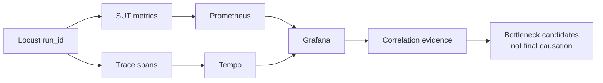
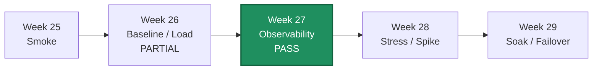

# WEEK-27 - Prometheus、Grafana、Trace 与 PostgreSQL/Redis 指标 / Prometheus, Grafana, Trace, and Database/Cache Metrics

- 计划 / Plan: Week 27，性能监控面板与指标时间线
- 计划日期范围 / Planned Date Range: 2026-11-12 to 2026-11-18
- 实际开启日期 / Opened: 2026-11-10，按用户要求提前开启
- 实际完成日期 / Completed: 2026-11-14
- 当前工作区 / Current Worktree: `D:\Codex projects\Appium 2 study`
- 当前分支 / Current Branch: `study/week-20-ios-device-matrix`
- 基线提交 / Base Commit: `a1c0306`，其上有未提交的 Week 25/26/27 实现
- 状态 / Status: **通过 / PASS - MONITORING STACK AND RUN-ID TIMELINE VERIFIED**
- iOS 依赖 / iOS Dependency: 无 / None

## 前置周核对 / Previous Week Audit

Week 26 报告位于 `reports/weekly/WEEK-26.md`，结论为：

```text
Week 26: PARTIAL
Single-host performance workflow: COMPLETE
Cross-host distributed Locust: DEFERRED
```

本次重新核对了以下证据：

| 证据 / Evidence | 核对结果 / Audit Result |
| --- | --- |
| `comparison.json` | Baseline 669 requests、Load 1340 requests |
| p95 / p99 | Baseline 16/24 ms，Load 18/26 ms |
| `distributed-local/result.json` | 56 requests、0 failures、SLO PASS |
| `isolation-verification.json` | Run A 清理后 Run B 数据保留 |
| `metadata.json` | 1 workspace、16 accounts、100 items |
| Week 26 targeted tests | `9 passed in 0.17s` |

Week 26 的跨主机分布式 Locust 仍是 `DEFERRED`，没有第二台合法测试主机。
Week 27 不修改这个历史结论，也不把 Week 26 自动提升为 `COMPLETE`。

## 本周目标 / Weekly Goal

Week 27 要从“能保存几次资源样本”升级为可查询的性能观测链：

```text
Locust run_id
-> SUT /metrics
-> Prometheus 抓取 API / PostgreSQL / Redis / container
-> Tempo 保存请求 Trace
-> Grafana 在统一时间窗口展示
-> 人类结合 Week 26 Baseline/Load 形成瓶颈候选
```

本周核心交付：

1. SUT Prometheus 指标与低基数 route label。
2. `X-Request-Id`、`X-Trace-Id`、W3C Trace Context 关联。
3. Prometheus scrape 配置和 PostgreSQL/Redis/cAdvisor exporter。
4. Grafana datasource、Dashboard 文件化 provisioning。
5. Tempo OTLP HTTP 接入和按精确 Trace ID 查询。
6. 一键启动、验证脚本、unit contract 和真实 acceptance 命令。
7. 将 Week 26 Baseline/Load 与 Week 27 时间线关联。

## 完成状态 / Completion Status

### 已完成 / Completed

- SUT `/metrics` endpoint 已实现。
- 请求 Counter、latency Histogram 和 in-progress Gauge 已实现。
- 动态 route label 已归一化为 `{slug}`、`{item_id}`、`{job_id}`。
- 所有 Locust 认证和匿名请求都已发送 `X-QA-Run-Id`，包括显式携带认证头的请求。
- SUT 已返回 `X-Request-Id` 和 `X-Trace-Id`。
- OTLP HTTP exporter 已把真实请求 span 发送到 Tempo。
- Prometheus、Grafana、Tempo、PostgreSQL/Redis exporter 和 cAdvisor 已真实启动。
- `monitoring` Compose profile 中的九个服务均达到 healthy。
- `sut-api`、`postgres`、`redis`、`cadvisor` 四个 Prometheus target 均为 `up`。
- Prometheus 已查询到 PostgreSQL `pg_stat_database_numbackends` 和 Redis
  `redis_connected_clients` 的真实时间序列。
- Grafana 健康检查通过，并 provision 了 `week27-sut-overview` Dashboard。
- Tempo readiness 通过，并能按精确 `X-Trace-Id` 查询到请求 Trace。
- Week 26 Baseline/Load profile 已关联 monitoring 重新执行，两个 run ID 都能在
  Prometheus 30 分钟窗口中查询到样本。
- Baseline/Load 本次受控关联运行的 SLO 均通过，并生成 comparison 和 HTML 报告。

### 历史失败与解除 / Historical Failures Resolved

- Docker Hub 和 `mirror.gcr.io` 初始超时，保留下载失败事实。
- 使用可信镜像代理完成 Prometheus、Grafana、Tempo、exporter 和 cAdvisor 拉取，
  并以 Compose 官方镜像名重新标记后真实启动。
- 用户中断后 Docker Desktop 引擎停止，首次恢复验收得到 502；重启引擎并等待
  scrape 周期后重新验收通过。502 不归属于应用代码缺陷。
- Windows `gevent` C 扩展加载失败；runner 在 Windows 使用受控的 pure-Python
  gevent fallback，并修复失败日志的本地编码读取。
- 首次认证 Locust 请求覆盖了类级 `X-QA-Run-Id`，导致 Prometheus 无 run ID
  序列；修复请求头合并后重新执行 Baseline/Load。

上述失败目录和修复后的证据均保留，没有通过覆盖日志把失败改写为通过。

### 真实执行证据 / Observed Evidence

完整观测验收（2026-11-14）：

```text
PASS API trace headers
PASS API Prometheus metrics
PASS Prometheus scrape targets
PASS Prometheus PostgreSQL metrics
PASS Prometheus Redis metrics
PASS Prometheus run_id week26-baseline-run-01
PASS Prometheus run_id week26-load-run-01
PASS Grafana health
PASS Grafana dashboard provisioning
PASS Tempo readiness
PASS Tempo trace retrieval
Observability ready: True
```

本次 Prometheus 结果：

```text
targets = cadvisor/up, postgres/up, redis/up, sut-api/up
PostgreSQL metric series = 4
Redis metric series = 1
week26-baseline-run-01 = 1 series, 4 samples / 30 minutes
week26-load-run-01 = 1 series, 5 samples / 30 minutes
```

Trace 证据：

```text
X-Trace-Id = 6f5d5bc5ebf600873b4f56638731221a
Tempo query status = 200
Tempo response bytes = 1116
```

时间线关联运行：

| Profile | Run ID | Requests | RPS | p50 / p95 / p99 | Error | SLO |
| --- | --- | ---: | ---: | --- | ---: | --- |
| Baseline | `week26-baseline-run-01` | 670 | 11.04 | 8 / 17 / 26 ms | 0% | PASS |
| Load | `week26-load-run-01` | 1335 | 22.01 | 9 / 17 / 29 ms | 0% | PASS |

这两次各一条 measured run 只用于证明监控时间线可关联，不替代 Week 26 的三次
Baseline 与三次 Load 稳定性样本，也不形成容量上限结论。

## 术语解释 / Glossary

| 名词 / Term | 简单解释 / Plain Meaning | 作用 / Purpose | 在本项目中的位置 / Position |
| --- | --- | --- | --- |
| Metric | 可聚合的数值事实，例如请求数或 CPU | 看趋势和阈值 | `/metrics`、Prometheus |
| Label | 指标维度，例如 route 和 status | 支持分组查询 | `qa_sut_http_requests_total` |
| Cardinality | label 组合的数量 | 过高会膨胀存储和查询 | route 必须模板化 |
| Trace | 一次请求跨步骤的结构化调用记录 | 解释单次耗时 | Tempo |
| Span | Trace 中一个有时间边界的操作 | 组成调用树 | SUT HTTP span |
| OTLP | OpenTelemetry 的遥测导出协议 | 把 span 发给 Tempo | API exporter |
| Exporter | 把组件内部状态转成 Prometheus 指标的服务 | 统一采集协议 | PostgreSQL / Redis exporter |
| Provisioning | 用文件定义 Grafana 数据源和 Dashboard | 可重建、可审查 | `infra/monitoring/grafana` |
| Trace ID | 一次 Trace 的全局标识 | 精确关联请求与 span | `X-Trace-Id` |
| Run ID | 一次 Locust 负载运行的标识 | 关联压测结果与指标窗口 | `X-QA-Run-Id` |

## 通俗解读 / Plain-Language Guide

Week 26 像每跑完一圈就手写一张仪表读数；Week 27 则把转速表、油温表、
数据库仪表和一次行程记录同时接到同一块面板上。面板显示“转速高”仍然只是
线索，不能直接断言发动机就是唯一原因。



**一句话理解：** 先把同一段时间里的请求、数据库、缓存、资源和 Trace 接到一根
时间轴上，再讨论瓶颈。

## 计划位置 / Plan Position



Week 27 使用 Week 26 的 Profile、run id 和 Baseline/Load 结果作为分析输入。
它为 Week 28 的容量拐点和 Week 29 的长稳退化判断提供可查询时间序列。

## 验收方式 / Acceptance Method

### 静态检查

```powershell
uv run python -m ruff check .
uv run pytest tests\unit\test_week27_observability.py `
  tests\unit\test_week26_performance.py -q -p no:cacheprovider
docker compose --profile monitoring `
  --env-file .env.performance.example `
  -f apps\compose\compose.yaml config --quiet
```

### 真实监控栈

```powershell
.\scripts\start_performance_sut.ps1 -WaitSeconds 240 -Monitoring
.\scripts\verify_observability.ps1 `
  -WaitSeconds 90 `
  -WindowMinutes 30 `
  -RunId week26-baseline-run-01,week26-load-run-01
```

通过标准：

```text
API exposes request metrics and trace headers
Prometheus sut-api/postgres/redis/cadvisor targets are up
Prometheus returns PostgreSQL and Redis metric series
Prometheus returns both expected Locust run IDs
Grafana health is HTTP 200
Grafana provisions dashboard uid week27-sut-overview
Tempo /ready is HTTP 200
Tempo retrieves the exact X-Trace-Id
```

### 证据路径 / Evidence

- API: `apps/compose/api/app.py`
- Compose profile: `apps/compose/compose.yaml`
- Prometheus: `infra/monitoring/prometheus/prometheus.yml`
- Grafana datasource: `infra/monitoring/grafana/provisioning/datasources/`
- Grafana dashboard: `infra/monitoring/grafana/dashboards/week27-overview.json`
- Tempo: `infra/monitoring/tempo/tempo.yaml`
- Verification script: `scripts/verify_observability.py`
- Runtime evidence: `artifacts/performance/week27/observability.json`（Git 忽略）
- Timeline Baseline summary: `artifacts/performance/week27/timeline/baseline/summary.json`
- Timeline Load summary: `artifacts/performance/week27/timeline/load/summary.json`
- Timeline comparison: `artifacts/performance/week27/timeline/comparison.json`
- Timeline HTML: `artifacts/performance/week27/timeline/report.html`
- Failed attempt evidence: `artifacts/performance/week27/timeline/*-missing-run-id/`

## 质量检查 / Quality Checks

| 检查项 / Check | 结果 / Status | 执行环境 / Environment | 证据 / Evidence |
| --- | --- | --- | --- |
| Week 26 evidence audit | 通过 / PASS | Windows | comparison、isolation、distributed result inspected |
| Week 26 + Week 27 targeted regression | 通过 / PASS | Windows | `15 passed in 0.37s` |
| Full unit regression | 通过 / PASS | Windows | `318 passed in 9.01s` |
| Ruff | 通过 / PASS | Windows | `All checks passed!` |
| Changed-file Mypy | 通过 / PASS | Windows | `Success: no issues found in 9 source files` |
| Full Mypy | 继承失败 / FAILED | Windows | 10 个既有 Android verifier `str \| None` 类型错误，不归 Week 27 |
| Python interpreter | 通过 / PASS | Windows | `.venv\Scripts\python.exe`, Python 3.12.13 |
| Compose config | 通过 / PASS | Windows Docker CLI | `config --quiet` exit 0 |
| Monitoring Compose readiness | 通过 / PASS | Docker Desktop Linux | 9 containers healthy |
| API metrics and trace headers | 通过 / PASS | Isolated performance Compose | HTTP 200 plus request/trace IDs |
| Prometheus targets | 通过 / PASS | Docker | four required targets `up` |
| PostgreSQL metrics | 通过 / PASS | Prometheus | `pg_stat_database_numbackends`, 4 series |
| Redis metrics | 通过 / PASS | Prometheus | `redis_connected_clients`, 1 series |
| Grafana health and provisioning | 通过 / PASS | Docker | 11.3.0, dashboard UID found |
| Tempo readiness and exact trace | 通过 / PASS | Docker | `/ready` 200 and trace retrieval 200 |
| Baseline timeline run | 通过 / PASS | Windows + Compose | 670 requests, SLO PASS |
| Load timeline run | 通过 / PASS | Windows + Compose | 1335 requests, SLO PASS |
| Run ID timeline correlation | 通过 / PASS | Prometheus | both run IDs found in 30-minute window |
| Comparison report | 通过 / PASS | Windows | `comparison.json` and `report.html` |
| Integration observability tests | 通过 / PASS | Isolated performance Compose | `2 passed in 0.17s` |
| Week 26 cross-host Locust | 继承延期 / DEFERRED | Independent hosts | no second host |
| iOS gaps | 继承 / INHERITED | macOS / iPhone | no Week 27 claim |

## 变更文件 / Files Changed

- `apps/compose/api/app.py`
- `apps/compose/api/requirements.txt`
- `apps/compose/compose.yaml`
- `performance/locustfiles/api_journeys.py`
- `scripts/start_sut.ps1`
- `scripts/start_performance_sut.ps1`
- `scripts/run_performance_profile.py`
- `scripts/verify_observability.py`
- `scripts/verify_observability.ps1`
- `infra/monitoring/prometheus/prometheus.yml`
- `infra/monitoring/tempo/tempo.yaml`
- `infra/monitoring/grafana/provisioning/datasources/datasources.yml`
- `infra/monitoring/grafana/provisioning/dashboards/dashboards.yml`
- `infra/monitoring/grafana/dashboards/week27-overview.json`
- `tests/unit/test_week27_observability.py`
- `tests/unit/test_week26_performance.py`
- `tests/integration/test_observability.py`
- `docs/architecture/performance-observability.md`
- `docs/runbooks/monitoring-stack-triage.md`
- `docs/adr/0012-performance-observability-and-trace-correlation.md`
- `docs/performance/load-model.md`
- `docs/PLAN.md`（仅状态说明）
- `README.md`
- `.env.performance.example`
- `pyproject.toml`
- `uv.lock`
- `reports/weekly/WEEK-27.md`

## 风险与限制 / Risks and Limitations

- Docker 镜像来源仍然较慢；本次通过可信镜像代理完成下载并重新标记为原镜像名。
- Grafana 使用本机匿名管理员，仅适用于隔离学习环境。
- 当前数据库和 Redis 只有 exporter 指标，没有自动 OTel 客户端 Trace。
- Trace span 覆盖 HTTP 请求，不包含完整 SQL 和 Redis command span。
- Windows 主机缺少可用的 gevent C 扩展运行库，因此 Locust 使用 pure-Python
  fallback；本次时间线运行不代表压测机性能上限。
- 时间线关联只执行了 Baseline/Load 各一条 measured run；Week 26 的三次运行
  中位数仍是稳定性比较的事实来源。
- Grafana Dashboard 已 provisioning，但本报告没有把面板截图当作唯一证据；
  查询正确性由 Prometheus/Tempo API 结果约束。
- 当前工作树有大量未提交改动，必须以实际文件状态和后续 commit 为准。

## 下一步 / Next Plan

Week 27 完成门已闭合。Week 28 的最小任务：

1. 定义 Stress 和 Spike profile，固定阶段、到达率和停止条件。
2. 至少执行一条 Stress 和一条 Spike 真实负载路径。
3. 从 Prometheus 时间线提取吞吐、p95/p99、错误率和资源拐点候选。
4. 用 Little's Law 校核并发数、吞吐和响应时间，不把单点结果写成容量承诺。
5. 输出容量与拐点报告，并保留失败、过载和恢复证据。
