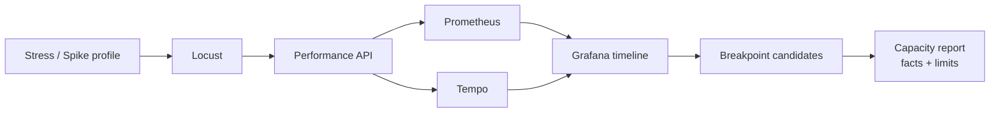
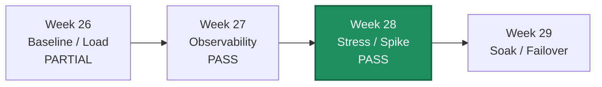

# WEEK-28 - Stress、Spike、容量与拐点 / Stress, Spike, Capacity, and Breakpoints

- 计划 / Plan: Week 28，Stress、Spike、容量与 Little's Law
- 计划日期范围 / Planned Date Range: 2026-11-19 to 2026-11-25
- 实际开启日期 / Opened: 2026-11-14，Week 27 完成后提前开启
- 实际完成日期 / Completed: 2026-11-14
- 当前工作区 / Current Worktree: `D:\Codex projects\Appium 2 study`
- 当前分支 / Current Branch: `study/week-20-ios-device-matrix`
- 基线提交 / Base Commit: `a1c0306`，其上有未提交的 Week 25/26/27 实现
- 状态 / Status: **通过 / PASS - STRESS/SPIKE VERIFIED, NO BREAKPOINT THROUGH 24 SUSTAINED USERS**
- iOS 依赖 / iOS Dependency: 无 / None

## 前置周核对 / Previous Week Audit

Week 27 已于 2026-11-14 通过，真实执行证据包括：

- Prometheus、Grafana、Tempo、PostgreSQL/Redis exporter 和 cAdvisor 全部启动。
- 四个 Prometheus target 为 `up`。
- PostgreSQL 和 Redis 指标都能查询到真实 series。
- Baseline `week26-baseline-run-01` 和 Load `week26-load-run-01` 都能在
  Prometheus 时间窗口内查询到样本。
- Grafana Dashboard 已 provisioning。
- Tempo 能按精确 Trace ID 返回请求 Trace。

详细证据：`reports/weekly/WEEK-27.md`。

## 本周目标 / Weekly Goal

Week 28 从“预期负载下未观察到瓶颈”推进到容量探索：

```text
Stress 阶梯增加负载
+ Spike 短时突增与恢复
+ Prometheus 请求/资源时间线
+ Tempo 慢请求 Trace
+ Little's Law 校核
-> 容量与拐点候选
```

本周核心交付：

1. 版本化 Stress 和 Spike profile。
2. test-only 独立数据池与认证读取旅程。
3. 两种负载形状的真实执行结果和失败/过载证据。
4. 按阶段对齐 RPS、p50/p95/p99、错误率和资源指标。
5. 容量和拐点报告，区分事实、候选和未验证项。
6. Little's Law 校核和下一轮实验建议。

## 完成状态 / Completion Status

### 已完成 / Completed

- 定义 `configs/performance-stress.yaml`。
- 定义 `configs/performance-spike.yaml`。
- Stress 使用 4 / 8 / 12 / 16 / 24 users 五个阶段。
- Spike 使用 4 -> 32 -> 4 users 的突增与恢复形状。
- 两份 profile 使用相同独立 workspace、48 个账号的池和认证方式，覆盖 Spike
  阶段 32 个虚拟用户，避免多个用户共享同一刷新 token。
- 创建并验证 test-only 数据池：1 workspace、48 users、100 items。
- Stress 和 Spike 均已真实执行，SLO 全部通过。
- 两个 run ID 均能在 Prometheus 30 分钟窗口和 Grafana 时间线中关联。
- Tempo 精确 Trace 查询通过。
- 新增按阶段对齐 Locust、Prometheus 和 Docker 资源的容量分析器。
- 输出结构化 `capacity-analysis.json`。
- 修复 keep-alive 空闲连接被错误计为 in-progress，以及 `/metrics` 自观测抬高
  并发 Gauge 的问题。
- 新增容量与拐点方法文档。
- 新增 profile 契约测试。
- 创建本周正式周报并更新计划索引。

### 结论边界 / Conclusion Boundary

- 24 个持续用户和 32 个短时 Spike 用户内未观察到拐点。
- 这不代表 24 用户是容量上限；它是当前单机环境和 guardrail 下的已验证下界。
- 没有第二台独立压力机，因此不能排除 Locust/Docker Desktop 先饱和。
- 本轮只执行一次 measured Stress 和一次 measured Spike，长期稳定性留给 Week 29。

## Profile 设计 / Profile Design

| Profile | 阶段 | 目的 | 阈值 |
| --- | --- | --- | --- |
| `week28-stress` | 4 / 8 / 12 / 16 / 24 users，每阶段 20s | 观察吞吐饱和和延迟/错误恶化 | p95 <= 2000ms；error <= 10%；至少 1000 requests；RPS >= 8 |
| `week28-spike` | 4 users 20s -> 32 users 10s -> 4 users 20s | 观察突增吸收和恢复 | p95 <= 2000ms；error <= 10%；至少 400 requests；RPS >= 5 |

阈值是当前隔离环境的实验 guardrail，不是生产 SLO。Stress 运行若越过阈值，
必须保留 `FAILED` 证据，不能为了让流程通过而临时放宽。

## 实测结果 / Observed Results

### Stress 分阶段结果

| Users | Prom RPS | Locust RPS 均值 / 峰值 | Locust p95 中位 / 峰值 ms | Prom p95 ms | Prom p99 ms | Error |
| ---: | ---: | ---: | ---: | ---: | ---: | ---: |
| 4 | 6.37 | 8.00 / 11.3 | 22 / 24 | 9.77 | 18.66 | 0% |
| 8 | 13.10 | 16.49 / 21.9 | 18 / 26 | 12.50 | 32.13 | 0% |
| 12 | 23.78 | 28.11 / 34.8 | 17.5 / 19 | 14.15 | 28.33 | 0% |
| 16 | 35.12 | 38.95 / 45.9 | 19 / 24 | 16.32 | 25.03 | 0% |
| 24 | 47.43 | 54.28 / 67.1 | 24 / 36 | 19.07 | 38.15 | 0% |

| Users | API CPU | PostgreSQL CPU | Redis CPU | API memory max |
| ---: | ---: | ---: | ---: | ---: |
| 4 | 12.61% | 2.64% | 1.98% | 61.9 MB |
| 8 | 14.45% | 3.47% | 2.16% | 62.0 MB |
| 12 | 18.82% | 4.92% | 2.33% | 62.7 MB |
| 16 | 23.90% | 6.72% | 2.52% | 63.4 MB |
| 24 | 28.86% | 8.26% | 2.73% | 65.9 MB |

Stress 总量：3584 requests、35.55 req/s 全阶段平均、p95 22 ms、p99 37 ms、
0 failures、SLO `PASS`。

### Spike 分阶段结果

| Stage | Users | Prom RPS | Locust RPS 均值 / 峰值 | Locust p95 中位 / 峰值 ms | Prom p95 ms | Prom p99 ms | Error |
| --- | ---: | ---: | ---: | ---: | ---: | ---: | ---: |
| before | 4 | 12.17 | 8.61 / 11.4 | 17 / 23 | 13.07 | 22.20 | 0% |
| spike | 32 | 13.88 | 20.41 / 45.6 | 109.5 / 180 | 30.23 | 113.71 | 0% |
| recovery | 4 | 44.37 | 56.06 / 86.7 | 23 / 37 | 26.55 | 146.01 | 0% |

Spike 峰值阶段 API CPU 15.34%、PostgreSQL CPU 3.02%、Redis CPU 2.08%，
API memory max 66.6 MB。Recovery 阶段的 RPS 高于 before，主要反映积压请求
排空和 30 秒 rate window，不是新的稳定容量档位。

Spike 总量：1553 requests、30.73 req/s 全阶段平均、p95 25 ms、p99 180 ms、
0 failures、SLO `PASS`。分阶段 p99 峰值曾达到 1.3 秒，但整体错误率为 0，
且下一阶段恢复到 p95 26.55 ms。

### 拐点结论

- 用户数从 16 增至 24（+50%）时，Prometheus RPS 从 35.12 增至 47.43
  （+35%），没有出现“用户继续增加但吞吐停止”的饱和形态。
- 24 用户 p95 为 19.07 ms，错误率 0%，API CPU 28.86%，未越过 guardrail。
- 因此当前测试范围内 `breakpoint_observed = false`。
- 已验证容量下界为 24 个持续用户、约 47.43 req/s；32 用户 Spike 可被吸收，
  但只持续 10 秒，不能写成 32 用户持续容量。

### Little's Law 校核

最高 Stress 档位：

```text
expected request concurrency
= 47.43 req/s x 6.49 ms
= 0.308

observed in-progress Gauge mean = 0.818
```

所有阶段的期望请求并发都小于 1，说明 Latency 为 5 到 10 ms 时，主要时间花在
Locust think time，而不是服务端排队。Gauge 使用 5 秒 scrape，无法精确测量
亚秒级瞬时并发，因此只能判断两者处于同一“单请求以下并发”量级，不能宣布
精确等式通过。修复前 Gauge 会保留空闲 keep-alive 连接和 `/metrics` 自观测，
修复后空闲值为 `0.0`，修复前后的数据没有混用。

## 术语解释 / Glossary

| 名词 / Term | 简单解释 / Plain Meaning | 作用 / Purpose | 在本项目中的位置 / Position |
| --- | --- | --- | --- |
| Stress | 逐档增加负载，直到系统明显恶化 | 找退化区和拐点候选 | `performance-stress.yaml` |
| Spike | 短时间内突然增加负载，再回落 | 验证突增吸收和恢复 | `performance-spike.yaml` |
| Capacity | 在给定环境、版本和 SLO 下可承受的业务量 | 后续容量建议 | Week 28 报告 |
| Breakpoint | 资源或延迟开始非线性恶化的负载点 | 说明拐点候选 | Prometheus 时间线 |
| Little's Law | 并发 = 到达率 × 平均停留时间 | 校核负载、吞吐和延迟是否一致 | `docs/performance/capacity-and-breakpoints.md` |
| Guardrail | 实验期间不能越过的安全边界 | 防止 silently 接受严重退化 | profile thresholds |
| Coordinated Omission | 慢请求期间少发请求，导致延迟被低估 | 提醒不能只看平均 RPS | Stress 分析 |

## 通俗解读 / Plain-Language Guide

Stress 像逐级给电梯增加重量，观察哪一层开始变慢或报警；Spike 像突然涌进
一群人，观察电梯是否能承受，以及人群离开后是否恢复正常。



**一句话理解：** 先逐级加压和突然加压，再用同一时间轴解释系统在哪里开始
变慢、为什么可能变慢。

## 计划位置 / Plan Position



Week 27 提供可查询的时间序列和 Trace。Week 28 使用它们寻找拐点，Week 29 再
验证长时间运行、慢查询、锁、连接池、WAL、缓存淘汰和恢复。

## 验收方式 / Acceptance Method

### 前置条件 / Preconditions

- Docker Desktop Linux engine 正在运行。
- 性能 Compose project 为 `quality-engineering-lab-performance`。
- monitoring profile 正常运行。
- 使用项目 `.venv` 和 Python 3.12。
- 不连接生产系统，不运行公共环境压测。

### 数据池 / Data Pool

```powershell
.\scripts\prepare_performance_data.ps1 `
  -RunId week28-capacity `
  -WorkspaceSlug qa-perf-week28-capacity `
  -ItemCount 100 `
  -AccountCount 48
```

### Stress

```powershell
.\scripts\run_performance_profile.ps1 `
  -Profile configs\performance-stress.yaml `
  -Label stress `
  -OutputDir artifacts\performance\week28\week28-capacity `
  -DataFile artifacts\performance\week26\data\week28-capacity\runtime.json `
  -WarmupSeconds 10 `
  -MeasuredRuns 1
```

### Spike

```powershell
.\scripts\run_performance_profile.ps1 `
  -Profile configs\performance-spike.yaml `
  -Label spike `
  -OutputDir artifacts\performance\week28\week28-capacity `
  -DataFile artifacts\performance\week26\data\week28-capacity\runtime.json `
  -WarmupSeconds 10 `
  -MeasuredRuns 1
```

### 观测关联 / Observability Correlation

```powershell
.\scripts\verify_observability.ps1 `
  -WaitSeconds 90 `
  -WindowMinutes 30 `
  -RunId week28-stress-run-01,week28-spike-run-01
```

### 分阶段容量分析 / Stage Analysis

```powershell
.\scripts\analyze_capacity_results.ps1 `
  -StressProfile configs\performance-stress.yaml `
  -StressRun artifacts\performance\week28\week28-capacity\stress\run-01 `
  -SpikeProfile configs\performance-spike.yaml `
  -SpikeRun artifacts\performance\week28\week28-capacity\spike\run-01
```

### 实际结果 / Actual Results

```text
Stress run: PASS, 3584 requests, p95 22 ms, 0 failures
Spike run: PASS, 1553 requests, p95 25 ms, 0 failures
Prometheus run IDs: both PASS in a 30-minute window
Grafana: dashboard provisioned and health PASS
Tempo: exact trace retrieval PASS
Capacity analysis: no breakpoint through 24 sustained users
Recovery: PASS after the 32-user spike
```

### 证据路径 / Evidence

- Stress profile: `configs/performance-stress.yaml`
- Spike profile: `configs/performance-spike.yaml`
- Locust journeys: `performance/locustfiles/api_journeys.py`
- Capacity method: `docs/performance/capacity-and-breakpoints.md`
- Stage analyzer: `scripts/analyze_capacity_results.py`
- Capacity analysis: `artifacts/performance/week28/week28-capacity/capacity-analysis.json`
- Runtime root: `artifacts/performance/week28/week28-capacity/`（Git 忽略）
- Prometheus/Tempo acceptance: `artifacts/performance/week27/observability.json`
- Stress run: `artifacts/performance/week28/week28-capacity/stress/run-01/`
- Spike run: `artifacts/performance/week28/week28-capacity/spike/run-01/`
- Preserved failed/metadata attempts: `artifacts/performance/week28/week28-capacity/*-invalid-*`,
  `*-pre-in-progress-fix/`

### 未验证项 / Unverified Items

- 单机压力机是否先于 SUT 饱和。
- 数据库锁、连接池、WAL 和 Redis 淘汰深挖。
- 跨主机压力机和生产容量。
- 24 用户以上持续 Stress 的精确饱和点。
- Week 29 的 Soak 与 Failover。

## 质量检查 / Quality Checks

| 检查项 / Check | 结果 / Status | 执行环境 / Environment | 证据 / Evidence |
| --- | --- | --- | --- |
| Week 27 completion audit | 通过 / PASS | Windows + Docker | Monitoring and run-ID timeline verified |
| Week 28 profile and analyzer contracts | 通过 / PASS | Windows | Included in full unit regression |
| Full unit regression | 通过 / PASS | Windows | `322 passed in 8.57s` |
| Ruff | 通过 / PASS | Windows | `All checks passed!` |
| Changed-file Mypy | 通过 / PASS | Windows | `Success: no issues found in 7 source files` |
| Windows virtual environment | 通过 / PASS | Windows | `.venv\Scripts\python.exe`, Python 3.12.13 |
| Data pool | 通过 / PASS | PostgreSQL + Redis | 1 workspace, 48 users, 100 items |
| Stress real execution | 通过 / PASS | Windows + Compose | 3584 requests, p95 22 ms, 0 failures |
| Spike real execution | 通过 / PASS | Windows + Compose | 1553 requests, p95 25 ms, 0 failures |
| Observability integration | 通过 / PASS | Windows + Compose | `2 passed in 0.20s` |
| Prometheus run-ID correlation | 通过 / PASS | Prometheus | Stress 22 samples / Spike 23 samples |
| In-progress Gauge regression | 通过 / PASS | Windows + Compose | Idle value `0.0` after fix |
| Tempo exact trace retrieval | 通过 / PASS | Tempo | `trace_id=84ab04778857170aacfed40d6229a295` |
| Capacity analysis | 通过 / PASS | Windows + Prometheus | `capacity-analysis.json` |
| Breakpoint conclusion | 通过 / PASS（未观察到） | Windows + Compose | No breakpoint through 24 sustained users |
| Data pool cleanup | 通过 / PASS | PostgreSQL + Redis | workspaces/users/items = 0, runtime removed |

## 变更文件 / Files Changed

- `apps/compose/api/app.py`（in-progress Gauge 修正）
- `configs/performance-stress.yaml`
- `configs/performance-spike.yaml`
- `scripts/analyze_capacity_results.py`
- `scripts/analyze_capacity_results.ps1`
- `scripts/run_performance_profile.py`（Locust 版本环境与日志兼容）
- `tests/unit/test_week28_capacity.py`
- `tests/unit/test_week27_observability.py`
- `tests/unit/test_week26_performance.py`
- `docs/performance/capacity-and-breakpoints.md`
- `docs/performance/load-model.md`
- `docs/PLAN.md`
- `reports/weekly/WEEK-28.md`
- `reports/README.md`（由索引脚本刷新）

## 风险与限制 / Risks and Limitations

- 当前 SUT、数据库、缓存、监控和 Locust 共用一台 Windows 主机，可能先压到
  压测机或 Docker Desktop 资源边界。
- Windows gevent pure-Python fallback 会降低 Locust 生成能力，因此本轮结果
  只能描述当前环境，不能直接外推生产容量。
- Prometheus 5 秒 scrape 对 sub-request concurrency 的分辨率不足；Little's Law
  只能做量级校核，不能证明精确瞬时并发。
- 24 用户以上没有继续加压，因此“无拐点”只适用于已经执行的负载范围。
- 单次 Stress/Spike 不足以证明长期稳定性；Week 29 才覆盖 Soak。
- 阈值越界可能是预期发现，不能为了得到绿色结果修改阈值或隐藏失败。
- Grafana Dashboard 是查询界面，容量结论仍必须引用原始 Prometheus 时间线、
  Locust 结果和 Trace。

## 下一步 / Next Plan

Week 28 完成门已闭合，下一计划为 Week 29：

1. 定义 Soak profile，覆盖更长时间和稳定数据池。
2. 观察内存、连接、队列、Redis key 和 p95/p99 是否随时间退化。
3. 执行数据库慢查询、锁等待、连接池和 WAL 专题。
4. 执行 Redis 淘汰、缓存命中和服务故障恢复专题。
5. 保留恢复时间、错误窗口、数据一致性和未验证项。
