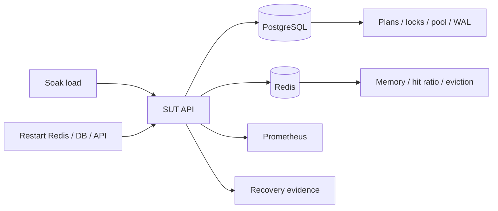
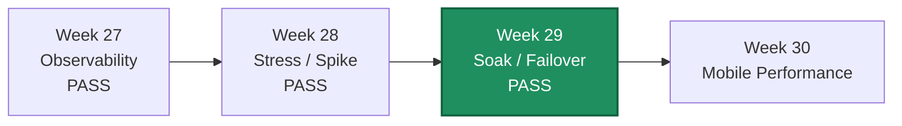

# WEEK-29 - Soak、Failover、慢查询、锁、连接池、WAL 与缓存 / Soak, Failover, Slow Queries, Locks, Connection Pools, WAL, and Cache

- 计划 / Plan: Week 29，长稳、故障恢复与数据库/缓存性能
- 计划日期范围 / Planned Date Range: 2026-11-26 to 2026-12-02
- 实际开启日期 / Opened: 2026-11-15，Week 28 完成后提前开启
- 实际完成日期 / Completed: 2026-11-17
- 当前工作区 / Current Worktree: `D:\Codex projects\Appium 2 study`
- 当前分支 / Current Branch: `study/week-20-ios-device-matrix`
- 基线提交 / Base Commit: `a1c0306`，其上有未提交的 Week 25/26/27/28 实现
- 状态 / Status: **通过 / PASS - SOAK, FAILOVER, DATABASE/CACHE EVIDENCE VERIFIED**
- iOS 依赖 / iOS Dependency: 无 / None

## 前置周核对 / Previous Week Audit

Week 28 已于 2026-11-14 通过：

- Stress 3584 requests、p95 22 ms、0 failures。
- Spike 1553 requests、p95 25 ms、0 failures。
- 32 用户 Spike 可被吸收，24 个持续用户范围内未观察到拐点。
- Prometheus、Grafana、Tempo 和 run ID 关联全部通过。
- 数据池已清理，运行时凭据已删除。

详细证据：`reports/weekly/WEEK-28.md`。

## 计划目标 / Plan Goal

Week 29 从短时容量实验推进到稳定性和恢复能力：

```text
600s Soak
+ Redis / PostgreSQL / API restart recovery
+ 慢查询与执行计划
+ 行锁、NOWAIT 和死锁
+ PostgreSQL 连接池与 WAL
+ Redis 内存、命中率和淘汰
-> 长稳与恢复报告
```

本周核心交付：

1. 版本化 Soak profile 和真实长稳运行。
2. 首尾时间窗 RPS、p95/p99、错误率和资源漂移。
3. Redis、PostgreSQL、API 故障与恢复时间。
4. 慢查询、执行计划、锁/死锁和连接池证据。
5. PostgreSQL WAL、数据库 IO、Redis 内存和缓存命中率。
6. 明确 `PASS`、`FAILED`、`BLOCKED`、`NOT RUN` 和恢复边界。

## 完成状态 / Completion Status

### 已完成 / Completed

- 创建 `configs/performance-soak.yaml`。
- 固定 Soak 形状：8 users、2 users/s spawn、600 seconds。
- 固定 p95、错误率、请求量和吞吐 guardrail。
- 创建并清理 test-only 数据池：1 workspace、16 users、100 items。
- 完成 600 秒 Soak 真实运行，13,304 requests、0 failures。
- 完成 Soak 首尾窗口漂移分析。
- 完成 Redis、PostgreSQL、API restart recovery。
- 完成 PostgreSQL 查询计划、行锁、NOWAIT 和死锁测试。
- 完成 PostgreSQL WAL、连接池、Redis 内存和缓存命中率证据采集。
- 修复 Windows `geventhttpclient` C 解析器不可用时的 Locust 兼容路径。
- 新增 PostgreSQL 连接 budget metrics。
- 创建并验证 Soak、Failover、数据库/缓存诊断入口。

## 实测结果 / Observed Results

### Soak

| Metric | Result |
| --- | ---: |
| Duration | 600.56 s |
| Requests | 13,304 |
| Throughput | 22.15 req/s |
| p50 / p95 / p99 | 9 / 23 / 29 ms |
| Error rate | 0% |
| SLO | PASS |

首尾各 20% 时间窗：

| Metric | First window | Last window | Delta |
| --- | ---: | ---: | ---: |
| p95 | 11.29 ms | 9.93 ms | -11.98% |
| p99 | 22.22 ms | 21.61 ms | -2.73% |
| Error ratio | 0 | 0 | 0 |
| API memory mean | 62.34 MB | 62.85 MB | +0.83% |
| API CPU mean | 12.24% | 12.80% | +4.54% |
| PostgreSQL connections | 2 | 2 | 0 |
| Connection budget peak | 4 / 32 | 4 / 32 | capacity unchanged |
| Redis hit ratio | 78.32% | 86.28% | +10.16% |
| Redis memory mean | 1.595 MB | 1.594 MB | -0.02% |
| Redis evictions | 0 | 0 | 0 |

Soak 首窗包含用户 ramp-up，因此 RPS 从 17.36 增至 22.57 是预热后的稳定化，
不是性能退化。首尾延迟没有上升，API 内存没有泄漏形态。

### Failover

| Service | Failed probes | First failure | Recovery | Final live / ready |
| --- | ---: | ---: | ---: | --- |
| Redis | 2 | 0.343 s | 0.812 s | 200 / 200 |
| PostgreSQL | 2 | 0.235 s | 0.828 s | 200 / 200 |
| API | 4 | 0.250 s | 3.672 s | 200 / 200 |

结论：三个依赖的短暂 restart 都被探针捕获，并在重启后恢复到 live/ready。
这是受控容器 restart，不等价于网络分区、磁盘损坏或生产故障。

### PostgreSQL / WAL / 连接池

- PostgreSQL 版本：16.16。
- `max_connections = 100`，测试期间数据库连接为 2。
- deadlocks = 0。
- WAL：10,114,708 bytes、27,681 records、1,476 FPI、
  33 次 `wal_buffers_full`、926 次 `wal_write`。
- API connection budget：capacity 32、peak 4、active 0。
- `pg_stat_statements` 未安装，状态为 `NOT_INSTALLED`；慢查询证据由
  `EXPLAIN (ANALYZE, BUFFERS, FORMAT JSON)` 和实际集成测试提供。
- 查询计划诊断：seed 小表使用 Seq Scan，0.366 ms；集成测试在 20,000+ 行数据
  上验证了 composite index 使用、Sequential Scan 回退和实际 buffer/timing。

### 锁、死锁与缓存

- `tests/integration/test_query_plans.py`、`test_locks_and_deadlock.py`、
  `test_redis_cache.py`：`12 passed in 5.23s`。
- 覆盖真实 blocking pair、SQLSTATE `55P03`、死锁 `40P01` 和锁清理。
- 覆盖 Redis TTL 过期、直接数据库更新后的 stale HIT、缓存失效和负缓存。
- Soak 活跃期间 Redis hit ratio 为 78.32% -> 86.28%，无 eviction。
- 诊断时 `noeviction`、maxmemory 为 0，说明当前容量下没有触发淘汰策略。

## 术语解释 / Glossary

| 名词 / Term | 简单解释 / Plain Meaning | 作用 / Purpose | 在本项目中的位置 / Position |
| --- | --- | --- | --- |
| Soak | 较低负载持续运行较长时间 | 发现泄漏和渐进退化 | `performance-soak.yaml` |
| Drift | 首尾时间窗指标发生持续变化 | 判断是否稳定 | Soak analyzer |
| Failover | 依赖失败后恢复服务能力 | 验证恢复时间与错误窗口 | restart recovery |
| EXPLAIN ANALYZE | PostgreSQL 实际执行查询并返回计划与耗时 | 解释慢查询和索引选择 | integration tests |
| WAL | PostgreSQL 预写日志 | 保证持久性并影响写入 IO | `pg_stat_wal` |
| Connection Pool | 限制和复用数据库连接 | 防止连接耗尽 | API connection budget |
| Hit Ratio | 缓存命中占读取请求的比例 | 判断缓存有效性 | Redis INFO |
| Eviction | Redis 因内存限制删除 key | 可能导致穿透和延迟变化 | Redis stats |

## 通俗解读 / Plain-Language Guide

Soak 像让系统连续跑一整段时间，观察是否慢慢漏油；Failover 像运行中突然
拔掉一条电源，再确认备用路径能否自动接上。



**一句话理解：** 先证明系统能持续稳定运行，再证明关键依赖短暂断开后能恢复。

## 计划位置 / Plan Position



Week 28 提供容量下界和观测入口。Week 29 验证时间维度、恢复和数据库/缓存
内部证据，为 Week 30/31 的移动性能和 CI 稳定性提供故障基线。

## 验收方式 / Acceptance Method

### 数据池 / Data Pool

```powershell
.\scripts\prepare_performance_data.ps1 `
  -RunId week29-soak `
  -WorkspaceSlug qa-perf-week29-soak `
  -ItemCount 100 `
  -AccountCount 16
```

### Soak

```powershell
.\scripts\run_performance_profile.ps1 `
  -Profile configs\performance-soak.yaml `
  -Label soak `
  -OutputDir artifacts\performance\week29\week29-soak `
  -DataFile artifacts\performance\week26\data\week29-soak\runtime.json `
  -WarmupSeconds 10 `
  -MeasuredRuns 1
```

### 观测关联 / Observability Correlation

```powershell
.\scripts\verify_observability.ps1 `
  -WaitSeconds 90 `
  -WindowMinutes 1440 `
  -RunId week29-soak-run-01
```

### Soak 漂移分析

```powershell
.\scripts\analyze_soak_results.ps1 `
  -Profile configs\performance-soak.yaml `
  -Run artifacts\performance\week29\week29-soak\soak\run-01
```

### Failover

```powershell
.\scripts\verify_failover.ps1 `
  -WaitSeconds 90 `
  -Output artifacts\performance\week29\week29-soak\failover.json
```

### 数据库与缓存诊断

```powershell
.\scripts\collect_database_cache_diagnostics.ps1 `
  -EnvFile .env.performance `
  -Output artifacts\performance\week29\week29-soak\database-cache-diagnostics.json
```

### 实际结果 / Actual Results

```text
Soak: PASS, 13,304 requests, p95 23 ms, 0 failures
Soak drift: PASS, p95 decreased and memory drift stayed below 1%
Prometheus run ID: PASS, 130 samples in the 24-hour query window
Failover: PASS for Redis, PostgreSQL, and API
Database/cache integration: PASS, 12 tests
WAL and connection budget diagnostics: PASS
Data pool cleanup: PASS
```

### 证据路径 / Evidence

- Soak profile: `configs/performance-soak.yaml`
- Runtime root: `artifacts/performance/week29/week29-soak/`（Git 忽略）
- Soak result: `artifacts/performance/week29/week29-soak/soak/run-01/result.json`
- Soak drift: `artifacts/performance/week29/week29-soak/soak-analysis.json`
- Failover: `artifacts/performance/week29/week29-soak/failover.json`
- Database/cache: `artifacts/performance/week29/week29-soak/database-cache-diagnostics.json`
- Prometheus/Tempo acceptance: `artifacts/performance/week27/observability.json`
- Full unit tests: `tests/unit/`
- Database integration: `tests/integration/test_query_plans.py`,
  `tests/integration/test_locks_and_deadlock.py`
- Redis integration: `tests/integration/test_redis_cache.py`

### 未验证项 / Unverified Items

- 跨主机压力机是否先于 SUT 饱和。
- 生产容量、生产故障注入和生产数据库指标。
- 多小时的 Soak 和生产级长时间趋势。
- `pg_stat_statements` 未安装，因此没有 SQL 级历史 top-N 统计。
- 网络分区、磁盘损坏、时钟漂移等更复杂故障。
- iOS 物理设备矩阵继承缺口。

## 质量检查 / Quality Checks

| 检查项 / Check | 结果 / Status | 执行环境 / Environment | 证据 / Evidence |
| --- | --- | --- | --- |
| Week 28 completion audit | 通过 / PASS | Windows + Docker | Stress/Spike and capacity report verified |
| Soak/profile/recovery contracts | 通过 / PASS | Windows | Included in full unit regression |
| Full unit regression | 通过 / PASS | Windows | `328 passed in 8.70s` |
| Ruff | 通过 / PASS | Windows | `All checks passed!` |
| Changed-file Mypy | 通过 / PASS | Windows | `Success: no issues found in 10 source files` |
| Soak real execution | 通过 / PASS | Windows + Compose | 13,304 requests, p95 23 ms, 0 failures |
| Soak drift analysis | 通过 / PASS | Prometheus + Docker resources | p95 -11.98%, memory +0.83% |
| Prometheus run ID | 通过 / PASS | Prometheus | 130 samples / 24 hours |
| Redis/PostgreSQL/API restart | 通过 / PASS | Windows + Compose | 0.81 / 0.83 / 3.67 s recovery |
| Database/cache integration | 通过 / PASS | PostgreSQL + Redis | `12 passed in 5.23s` |
| WAL diagnostics | 通过 / PASS | PostgreSQL 16.16 | 10,114,708 WAL bytes |
| Connection budget metrics | 通过 / PASS | SUT `/metrics` | capacity 32, peak 4, active 0 |
| Cache evidence | 通过 / PASS | Redis + Prometheus | hit ratio up, no evictions |
| `pg_stat_statements` | 未安装 / NOT_INSTALLED | PostgreSQL | Extension unavailable |
| Data pool cleanup | 通过 / PASS | PostgreSQL + Redis | 0 / 0 / 0, runtime removed |

## 变更文件 / Files Changed

- `apps/compose/api/app.py`（connection budget metrics）
- `apps/compose/api/Dockerfile`（可配置 PyPI index）
- `apps/compose/compose.yaml`（build arg）
- `.env.performance.example`
- `configs/performance-soak.yaml`
- `performance/compat/sitecustomize.py`
- `performance/locustfiles/api_journeys.py`
- `scripts/run_performance_profile.py`
- `scripts/analyze_soak_results.py`
- `scripts/analyze_soak_results.ps1`
- `scripts/verify_failover.py`
- `scripts/verify_failover.ps1`
- `scripts/collect_database_cache_diagnostics.py`
- `scripts/collect_database_cache_diagnostics.ps1`
- `tests/unit/test_week29_stability.py`
- `tests/unit/test_connection_budget.py`
- `tests/unit/test_week26_performance.py`
- `docs/performance/capacity-and-breakpoints.md`
- `docs/PLAN.md`
- `reports/weekly/WEEK-29.md`
- `reports/README.md`（由索引脚本刷新）

## 风险与限制 / Risks and Limitations

- 当前压力生成、SUT、数据库、缓存和监控共用一台主机。
- Windows Locust 使用标准 HttpUser 和 pure-Python gevent fallback；
  `FastHttpUser` 的 `geventhttpclient` C 解析器被系统应用控制策略阻止。
- 600 秒 Soak 仍短于生产长时间运行，不能替代多小时的稳定性结论。
- 服务 restart 是受控故障实验，不等价于网络分区、磁盘损坏或生产故障。
- `pg_stat_statements` 未安装；没有修改数据库 Schema 去安装扩展。
- Prometheus cAdvisor 在 Docker Desktop 上未暴露 compose service labels，
  因此 Soak 的 API CPU/内存首尾窗口来自 Docker `stats` 资源 CSV。

## 下一步 / Next Plan

Week 29 完成门已闭合。下一计划为 Week 30：

1. Android 冷启动、热启动和 `am start -W`。
2. Android jank、`gfxinfo`、内存、CPU 和电量证据。
3. iOS 启动和性能采集；无对应设备时保持 `DEFERRED`。
4. 弱网与后台恢复场景。
5. 生成移动性能报告，明确设备、系统版本和不可外推边界。
