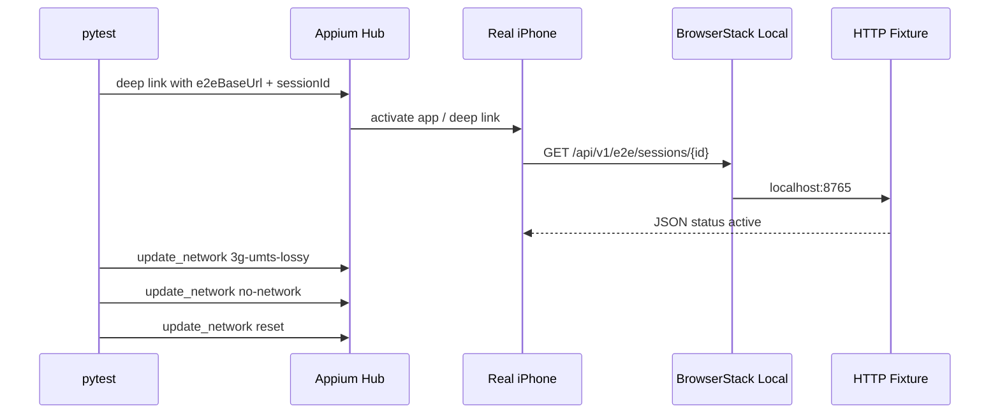
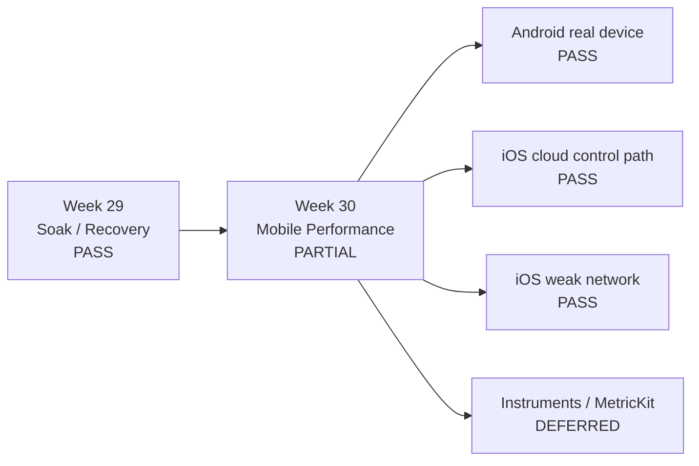

# WEEK-30 - iOS 设备云性能与弱网 / iOS Cloud Performance and Weak Network

- 计划 / Plan: Week 30，移动启动、恢复、性能与弱网
- 实际开启日期 / Opened: 2026-11-17
- 当前工作区 / Current Worktree:
  `C:\Users\quan\.codex\worktrees\week30-ios-cloud-performance\Appium 2 study`
- 当前分支 / Current Branch: `study/week-30-ios-cloud-performance`
- 状态 / Status:
  **部分完成 / PARTIAL - IOS CLOUD PERFORMANCE AND WEAK NETWORK PASS**
- iOS 依赖 / iOS Dependency: BrowserStack 真机 / real device

## 范围说明 / Scope

这是 Week 30 的设备云补充工作区。Android 真机启动、jank、内存和 CPU
核心证据保存在主工作区：

```text
D:\Codex projects\Appium 2 study
reports/weekly/WEEK-30.md
```

该主工作区 Android 结果此前已为 `PASS`。本分支新增：

```text
iOS cloud launch / resume
+ BrowserStack weak network
+ no-network error and reset recovery
-> iOS cloud evidence
```

两个工作区没有互相覆盖同一份周报。

## 已完成 / Completed

- 在 BrowserStack 真实 iPhone 15 / iOS 17 上重新执行既有 fixture 云验收。
- 既有 Week 19 云验收结果：`9 passed, 1 xfailed`。
- 建立独立 iOS Week 30 启动/恢复云性能测试。
- 建立真实 App 请求的弱网、断网和恢复测试。
- 使用 BrowserStack `networkProfile`：`3g-umts-lossy`、`no-network`、`reset`。
- 使用 BrowserStack Local 把 macOS/Ubuntu Runner 的受控 HTTP fixture 暴露给真机。
- 验证慢网请求仍成功、耗时显著增加、断网可观察、reset 后恢复。
- 增加 Ubuntu 快速证据 workflow，复用已上传的真实 iOS fixture。
- 更新 iOS 测试清单到 52 条，纳入两条 Week 30 测试。

## 云执行 / Cloud Runs

| Run | Workflow | Result | Evidence |
| --- | --- | --- | --- |
| `44108721696` | iOS Week 19 Fixture Cloud | PASS，`9 passed, 1 xfailed` | 真实 iPhone fixture |
| `44111355259` | First Week 30 performance attempt | FAILED，测量口径错误 | warm 包含固定 1 s 等待 |
| `44110400262` | First Week 30 weak network | PASS | 真实慢网链路 |
| `44114178963` | Week 30 Cloud Evidence | PASS | 最终启动/恢复 + 弱网 JSON |

第一次性能 run 的 warm p95 为 `3155.197 ms`，其中包含
`background_app(1)` 固定 1 秒等待。该失败保留为测量方法问题，不能直接当
App 回归。修正后先发送 HOME，确认 App 离开前台，再从 `activateApp` 开始计时。

## iOS 启动与恢复 / iOS Launch And Resume

最终 Run：`44114178963`

| Field | Result |
| --- | --- |
| Provider | BrowserStack |
| Device | iPhone 15 |
| Runtime | iOS 17.3 |
| Provider session status | done |
| Session ready | 18,860.57 ms |
| Cold samples | 2367.802 / 2311.359 / 2294.759 / 2293.179 / 2245.044 ms |
| Cold p50 / p95 | 2294.759 / 2356.514 ms |
| Warm samples | 983.816 / 990.103 / 990.388 / 974.664 / 954.079 ms |
| Warm p50 / p95 | 983.816 / 990.331 ms |

测量定义：

```text
Cold = terminateApp -> activateApp -> fixture title visible
Warm = pressButton(home) -> assert app not foreground
       -> activateApp -> fixture title visible
```

这些时间包含：

- GitHub Runner 到 BrowserStack Hub；
- Provider 到真实 iPhone；
- Appium / XCUITest 命令；
- App 启动与 UI 显式等待。

因此不能把它写成 XCUITest 原生首帧时间，也不能替代 Instruments、
`xctrace` 或 MetricKit。

## 弱网结果 / Weak-Network Result

同一个真实 iPhone session 中依次切换网络：

| Phase | Profile | App result | Elapsed |
| --- | --- | --- | ---: |
| Baseline | normal | `active` | 633.555 ms |
| Lossy | `3g-umts-lossy` | `active` | 1563.99 ms |
| Offline | `no-network` | `error: NSURLError` | 994.789 ms |
| Recovery | `reset` | `active` | 589.499 ms |

- 慢网耗时是 baseline 的 `2.469` 倍。
- 三个网络切换 API 均返回 HTTP `200` 和 `{"message":"Completed"}`。
- 断网时 App 显示可观察错误，而不是无限 loading。
- Reset 后同一 App 旅程恢复成功。
- BrowserStack Local 日志证明真机通过 `bs-local.com:8765` 访问了受控服务器。



## 术语解释 / Glossary

| 名词 / Term | 简单解释 | 在本项目中的作用 |
| --- | --- | --- |
| BrowserStack Local | 把本地测试服务安全地映射给云端设备 | 让真机访问受控 HTTP fixture |
| `networkProfile` | Provider 预定义的网络条件 | 模拟慢网和断网 |
| `update_network.json` | BrowserStack session 网络切换 API | 在同一 session 内切换故障和恢复 |
| Appium command latency | Runner 到 Appium、设备和 UI 的往返时间 | 云控制路径指标 |
| First frame | 应用第一张画面真正显示的时间 | 需要 XCUITest/Instruments 原生测量 |
| `NSURLError` | iOS URLSession 网络错误 | 断网在 App 状态中的可观察结果 |
| MetricKit / xctrace | Apple 原生运行指标和 Instruments 工具 | 当前仍未执行 |

## 通俗解读 / Plain-Language Guide

把设备云测试想成“远程遥控的真实手机”：遥控信号本身也要经过网络，所以
`activateApp` 的耗时包含遥控往返，不等于手指按下后屏幕第一帧出现的时间。

弱网测试像给遥控门店的送货通道临时限速：

1. 正常通道送一次，记录成功和时间。
2. 限速后送同一次，仍成功但更慢。
3. 完全断开，店里必须显示失败状态。
4. 恢复通道，同一操作再次成功。

**一句话理解：** 性能测的是云端控制路径和 UI 可见结果，弱网测的是真实 App
请求在慢、断、恢复过程中的行为。

## 计划位置 / Plan Position



Week 30 的设备云部分已闭合，但 native iOS 性能和 Android 电量仍为未完成项。

## 可复制验收 / Reproduction

### 既有 fixture 云验收

```powershell
gh workflow run ios-fixture-cloud.yml `
  --ref codex/week24-ios-cloud-acceptance-20261108 `
  -f acceptance_target=week19 `
  -f device_name="iPhone 15" `
  -f platform_version=17
```

### 完整来源构建

```text
.github/workflows/ios-week30-mobile-performance.yml
.github/workflows/ios-week30-weak-network.yml
```

这两个 workflow 使用 macOS Runner 构建并上传 IPA，适用于后续正式回归。

### 快速已有 App 证据

```text
.github/workflows/ios-week30-cloud-evidence.yml
```

该 workflow 在 Ubuntu Runner 上复用真实 BrowserStack App ID，执行：

```powershell
uv run pytest tests/ios/test_week30_cloud_weak_network.py -q
uv run pytest tests/ios/test_week30_cloud_performance.py -q
```

### 本地静态和契约验证

```powershell
uv run pytest tests/unit -q -p no:cacheprovider `
  --basetemp=artifacts\pytest-temp\week30-ios-full-2
uv run ruff check packages scripts tests
uv run mypy packages tests
uv run python scripts/build_doc_index.py --check
```

实际本分支验证：

- `340 passed in 6.54s`
- Ruff：通过
- Mypy：已检查的修改文件通过
- `build_doc_index.py --check`：通过

## 证据 / Evidence

- 最终云 Run：
  https://github.com/htb123-maker/quality-engineering-lab/actions/runs/44114178963
- 启动/恢复 JSON：
  `artifacts/performance/week30/ios-cloud/mobile-performance.json`
- 弱网 JSON：
  `artifacts/performance/week30/ios-cloud/weak-network.json`
- 云性能测试：
  `tests/ios/test_week30_cloud_performance.py`
- 弱网测试：
  `tests/ios/test_week30_cloud_weak_network.py`
- 受控 HTTP fixture：
  `scripts/run_mobile_network_fixture.py`
- Runbook：
  `docs/runbooks/ios-cloud-performance-and-weak-network.md`
- 测试清单：
  `configs/ios-test-inventory.yaml`

## 未验证项 / Unverified Items

- Instruments、`xctrace`、MetricKit 原生启动、卡顿、CPU 和内存。
- 多 iPhone 型号、iOS 版本、真机网络运营商和地域。
- BrowserStack 之外的其他设备云弱网能力。
- 受控 fixture 与项目真实 SUT 的端到端弱网关联。
- Android 弱网 Toxiproxy 的实际运行。
- Android 非充电电量测量。
- WebView context；BrowserStack 仍只暴露 `NATIVE_APP`，严格 xfail 保持不变。

## 已知限制 / Limitations

- Appium 启动时间不是 first-frame。
- 云 Runner 排队、取消和 provider 调度不属于 App 性能。
- `networkProfile` 是 provider session 级能力，不是生产网络控制。
- 受控 HTTP fixture 不能替代项目 SUT 的业务链路。
- 快速 Ubuntu workflow 使用之前真实构建并上传的 fixture App ID；正式回归仍以
  macOS 来源构建 workflow 为准。
- 当前工作区仍是隔离分支，尚未合并到主工作区周报。

## 下一步 / Next Steps

1. 在 macOS 上执行 `xctrace` / Instruments 启动、CPU、内存和卡顿基线。
2. 将弱网受控目标从 fixture 扩展到项目 SUT，并保留 BrowserStack Local/Toxiproxy
   两种故障入口。
3. 在本机 Android 使用 `adb reverse + Toxiproxy` 运行同等的慢网、断网和恢复。
4. 增加第二个 iPhone/iOS 版本，形成设备矩阵。
5. 将云性能和弱网结果接入 Week 31 流水线与趋势。
