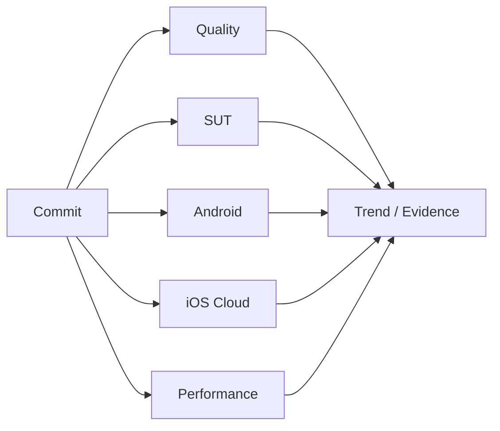
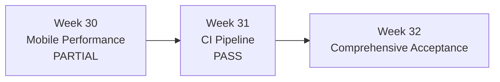

# WEEK-31 - CI 质量流水线、门禁与趋势 / CI Quality Pipeline, Gates, and Trends

- 计划 / Plan: Week 31，PR/Main/Nightly/Weekly、多平台执行、质量门禁和趋势
- 计划日期范围 / Planned Date Range: 2026-12-10 to 2026-12-16
- 实际开启日期 / Opened: 2026-11-18
- 实际完成日期 / Completed: 2026-11-20
- 当前工作区 / Current Worktree:
  `C:\Users\quan\.codex\worktrees\week30-ios-cloud-performance\Appium 2 study`
- 当前分支 / Current Branch: `study/week-31-ci-pipeline`
- 基线提交 / Base Commit: `732456e`（Week 30 integrated）
- 状态 / Status:
  **通过 / PASS - FULL PIPELINE GREEN**

## 计划目标 / Plan Goal

Week 31 把已有的 API、SUT、Android、iOS 和性能测试组织成一条可重复质量流水线：

```text
quality gates
+ Compose SUT
+ Android Linux emulator
+ iOS real-device cloud
+ performance smoke
+ owner / quarantine / trend
-> one-commit quality evidence
```

目标是让一个 commit 触发统一入口，并在失败时直接定位 job、测试、设备、报告和
缺陷草稿。配置存在或静态检查通过不能替代真实 CI 运行。

## 本轮已完成 / Implemented

- 新增统一 workflow：
  `.github/workflows/week31-quality-pipeline.yml`。
- PR 触发 Quality、SUT、Android 和可用 iOS 云任务。
- Main、Week31 分支、Nightly、Weekly 和手动触发运行完整任务。
- 新增 Linux Android fixture 构建脚本：
  `scripts/build_android_fixture.sh`。
- 新增质量趋势聚合器：
  `qa_core.reporting.quality_trends` 和 `scripts/build_quality_trends.py`。
- 新增 owner/quarantine 配置：
  `configs/quality-governance.yaml`。
- 新增治理校验器：
  `scripts/check_quality_governance.py`。
- 趋势任务使用 JUnit 和状态 JSON，不解析不可信控制台文本。
- 趋势历史通过有界 GitHub Actions cache 恢复并追加。
- 缺陷草稿继续由 pytest 插件生成，不自动创建或关闭正式缺陷。

## 本地验证 / Local Verification

| Check | Result | Evidence |
| --- | --- | --- |
| Week31 trend unit tests | PASS | trend/governance + GitHub adapter |
| Quality trend smoke | PASS | 4 checks，overall `PASS` |
| Governance validation | PASS | 0 quarantined tests |
| Workflow YAML parse | PASS | PyYAML `safe_load` |
| Bash syntax | PASS | `bash -n scripts/build_android_fixture.sh` |
| Ruff | PASS | `All checks passed!` |
| Mypy | PASS | `224 source files` |
| Full unit regression | PASS | `387 passed in 11.04s` |
| CI cross-platform fix | PASS | `15 passed` targeted after run 44324791844 |

趋势 smoke 从 Week30 云 artifact 中发现：

- iOS performance JUnit：PASS，67.531 s。
- iOS weak-network JUnit：PASS，37.563 s。
- iOS mobile performance JSON：PASS。
- iOS weak-network JSON：PASS。

## GitHub Actions 实跑 / GitHub Runs

### 第一轮 / First Run

Run `44323603085`：

| Job | Result | Finding |
| --- | --- | --- |
| Quality | FAILED | Linux path 单测硬编码 `;` |
| SUT | FAILED | OTEL 关闭时没有 recording tracer，`X-Trace-Id` 缺失 |
| Performance | PASS | 独立性能 SUT + smoke |
| iOS cloud | PASS | 真实 iPhone 云 smoke/launch evidence |
| Android | NOT RUN | emulator 长步骤未完成，旧 run 被取消 |

两处失败均在仓库内修复：

- Locust path 断言改用 `os.pathsep`。
- 本地始终创建 recording TracerProvider，只有 OTEL 启用时才添加 OTLP exporter。

### 第二轮 / Second Run

Run `44324791844`：

| Job | Result | Evidence |
| --- | --- | --- |
| Quality | PASS | Ruff、Mypy、Unit、Governance |
| SUT | PASS | readiness、integration、API |
| Performance | PASS | `configs/performance-smoke.yaml` |
| iOS cloud | BLOCKED | `App Automate testing time has expired` |
| Android | NOT RUN | Linux emulator 步骤超过十余分钟无进展 |
| Trends | NOT RUN | run 在 Android 未结束后取消 |

第二轮证明统一入口和三条核心 job 可用，但 Android runner 仍需缩短/修正
emulator 启动路径；iOS 需要恢复 provider 配额。`BLOCKED` 和 `NOT RUN` 不写成
`PASS`。

### 最终轮 / Final Run

Run `44560844554`：

| Job | Result | Evidence |
| --- | --- | --- |
| Quality | PASS | 385 unit tests + Ruff/Mypy/Governance |
| Compose SUT | PASS | 45 integration + 238 API |
| Android Linux emulator | PASS | 6 smoke |
| iOS macOS Simulator | PASS | 4 smoke，407.712 s |
| iOS device cloud | BLOCKED (optional) | Free Trial 到期，保留证据但不替代 Simulator |
| Performance | PASS | isolated smoke |
| Trend | PASS | required checks all green |

最终趋势 artifact 同时保留前几轮 FAILED/BLOCKED 历史，证明趋势不是只保存成功
数据。设备云可选 job 的阻断没有替代或掩盖必需的 Simulator PASS。

## 术语解释 / Glossary

| 名词 / Term | 简单解释 | 在项目中的作用 |
| --- | --- | --- |
| Quality Gate | 不满足条件就阻止继续合并的检查 | Ruff、Mypy、Unit、SUT、设备和性能 |
| JUnit XML | 标准测试结果文件 | 稳定统计 tests/failures/errors/skipped |
| Allure | 测试证据与附件报告 | 截图、日志、page source 和失败定位 |
| Owner | 某类质量信号明确负责人 | API、Android、iOS、性能和基础设施 |
| Quarantine | 有负责人、原因和到期时间的临时隔离 | 防止“重跑变绿”掩盖 flaky |
| Trend | 多次运行的机器可读历史 | 判断质量是否持续退化 |

## 通俗解读 / Plain-Language Guide

CI 像机场安检：每个岗位只检查自己的一段，结果写在标准表格里；最后的总台
汇总所有表格，而不是听每个人口头说“没问题”。



**一句话理解：** 一个入口触发各平台真实执行，每个平台交机器可读证据，最后统一
形成可追溯的质量结论。

## 计划位置 / Plan Position



Week 31 接收 Week 25–30 的性能、设备和报告资产，为 Week 32 的完整演示提供
持续执行入口。

## 验收方式 / Acceptance Method

### Workflow

```powershell
gh workflow run week31-quality-pipeline.yml `
  --ref study/week-31-ci-pipeline
```

### 本地基础检查

```powershell
uv run pytest tests/unit/test_quality_trends.py -q
uv run python scripts/check_quality_governance.py
uv run ruff check .
uv run mypy packages tests performance
uv run pytest tests/unit -q
```

### 证据路径

- `.github/workflows/week31-quality-pipeline.yml`
- `docs/adr/0013-ci-pipeline-required-evidence-and-trends.md`
- `packages/qa_core/reporting/quality_trends.py`
- `packages/qa_core/reporting/governance.py`
- `packages/qa_core/integrations/defect_tracking/github_issues.py`
- `configs/quality-governance.yaml`
- `scripts/build_quality_trends.py`
- `scripts/check_quality_governance.py`
- `scripts/build_android_fixture.sh`
- `docs/runbooks/week31-quality-pipeline.md`
- `docs/architecture/quality-pipeline-and-trends.md`

## 未验证项 / Unverified Items

- BrowserStack 设备云当前仍被 Free Trial 到期阻断；macOS Simulator 已作为本周
  必需 iOS 路径通过。
- Android 只在一个 API 35 AOSP ATD emulator 上执行，尚未覆盖 OEM/API 矩阵。
- GitHub Issues adapter 已通过 mock contract 验证，但没有在真实仓库创建正式
  Issue，避免无人工审批的自动缺陷。
- 历史趋势是有界 CI cache，不是永久分析数据库。

## 下一步 / Next Steps

1. Week 32 使用该 pipeline 做综合验收。
2. 可选恢复 BrowserStack 额度，重新运行设备云证据。
3. 增加 GitHub Pages 或永久趋势存储。
4. 扩展 Android OEM/API 设备矩阵。
5. 由人工审批后验证一次真实 GitHub Issue 创建和回归闭环。
